# 📊 Polars 与 Python 数据分析（第二部分）：178：GroupBy 方法

在本节课中我们将要学习 Polars 中的 GroupBy 方法。我们会先认识 groupby 对象这个“分组容器”，再学习如何从每个组里取出第一行、最后一行、前几行和后几行，同时解释反复执行代码时结果行顺序为什么会变化，最后看看 `maintain_order` 参数如何让分组顺序保持一致。学完本节后，你会知道这些方法在大白话层面到底在做什么，以及它们和并行计算、结果顺序之间的关系。

## 🧭 Polars 与 Python 数据分析（第二部分）：178.1：认识 GroupBy 对象

上一节内容为后面的分组操作打下了基础，本节中我们来看看 groupby 对象到底是什么。一旦我们有了一个 groupby 对象，就等于有了一个容器，这个容器会把某一列中的所有不同值分割开、分到不同的“桶”里，同时把和这些值相关联的所有行也一起放进对应的桶里。用更直白的话说，groupby 对象像一张按类别整理好的清单，每个类别下面挂着原始数据框中属于这个类别的那些行。

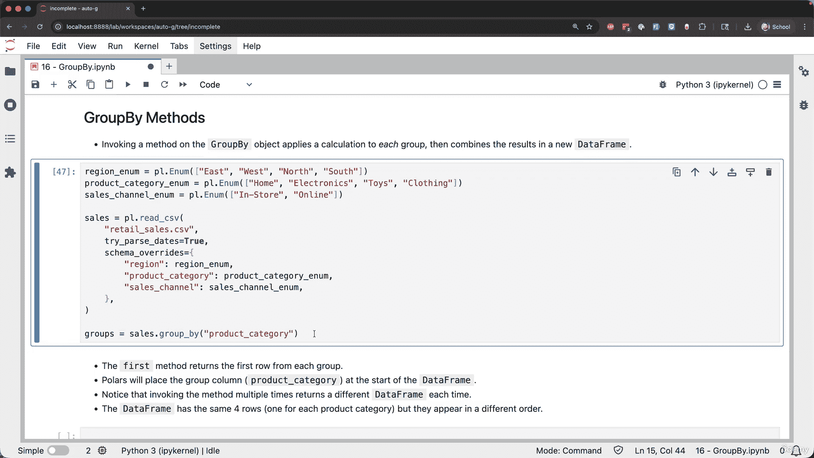

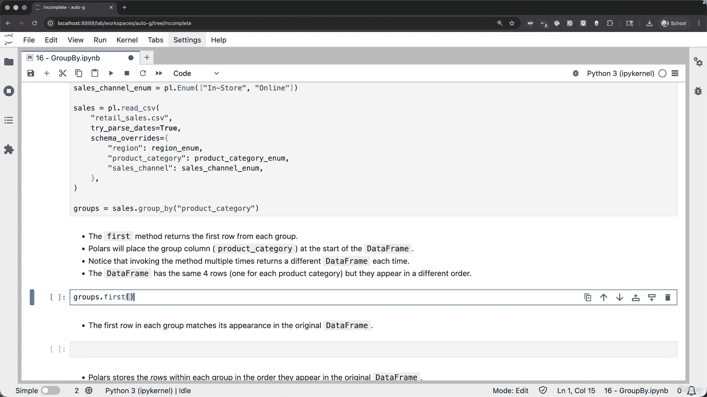

这个容器本身还不是最终结果，我们可以在它上面调用很多方法。核心概念可以用下面的公式和代码来描述：

```python
分组对象 = 数据框.groupby("分组列")
结果数据框 = 分组对象.方法()
```

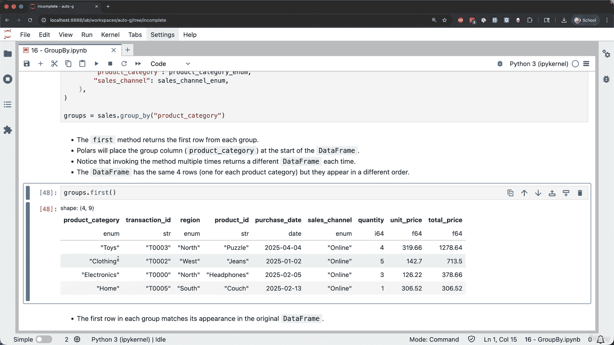

这些方法会对每一个组、每一个分段应用某种计算或转换，然后把结果合并成一个新的数据框。下面用一个列表把本节会反复遇到的核心概念先列出来，方便后面回看。

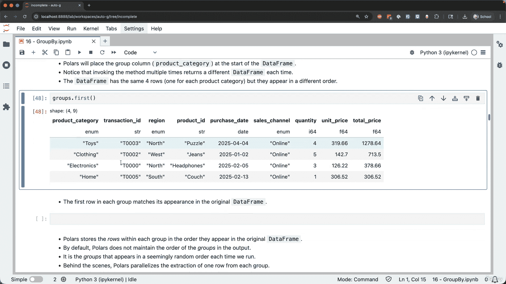

- `groupby` 对象：按某一列的不同值分组的容器，每个组里包含对应的行。
- 分组方法：在 groupby 对象上调用，对每个组分别执行计算或转换。
- 最终结果：把每个组的计算结果合并成一个新的数据框。

理解了这个容器之后，下一步就是看具体方法如何从每个组里取数据。

## 🧪 Polars 与 Python 数据分析（第二部分）：178.2：first 方法

上一节我们认识了 groupby 对象这个分组容器，本节中我们来看看第一个常用方法 `first`。先执行之前课程中的代码，我已经有 CSV 导入代码和 `groups` 分组对象，这里直接执行它们。关键点是：`first` 要调用在 groupby 对象上，而不是调用在原始数据框上，因为 groupby 对象本身才是那个已经分好组的容器。

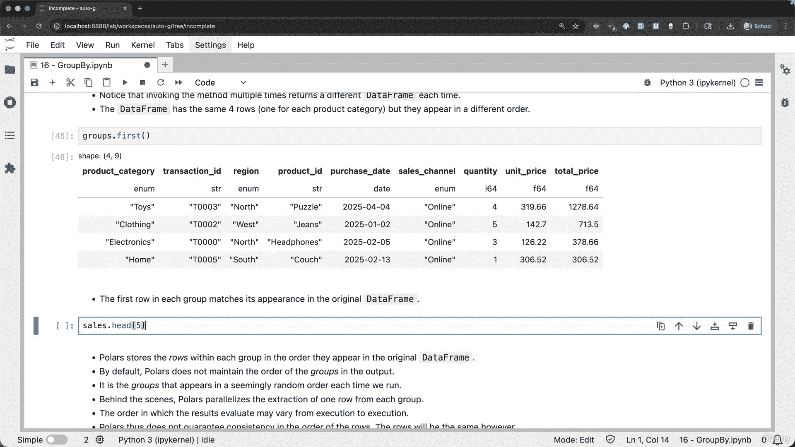

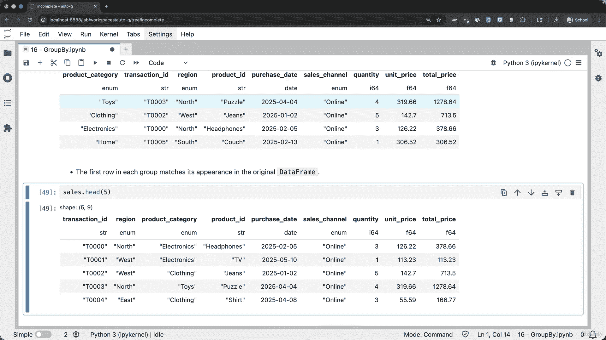

示例代码如下：

```python
groups = sales.groupby("product_category")
groups.first()
```

在 groupby 对象上调用 `first` 方法，会从每个组中提取第一行。因为一共有四个组，对应四个产品类别，所以会得到一个包含四行的数据框。注意，每个产品类别只出现一次，我们实际得到的是每个组的第一行，而这个“第一行”对应的是该类别在原始数据框中第一次出现的顺序。例如，这里得到的是 sales 数据框中产品类别为 toys 的第一行，那里得到的是产品类别为 clothing 的第一行，其他类别同理。

为了证明这一点，可以向下滚动一点，预览数据框的前五行。预览时可能不会得到所有产品类别，但应该能看到几个类别。例如，产品类别为 electronics 的第一行，对应 `transaction ID 0` 的那一行，这一行会出现在结果集中；第二个遇到的产品类别原文以 C 表示，对应 `transaction ID 2` 的那一行，也会出现在结果中；然后是 toys，第一次遇到该产品类别时对应 `transaction ID T3`，这一行同样会出现在结果中，其他类别以此类推。理解 `first` 之后，本节末尾需要过渡到一个更关键的问题：为什么反复执行时，结果行的顺序会变。

## 🔁 Polars 与 Python 数据分析（第二部分）：178.3：为什么反复执行时行顺序会变化

上一节我们用 `first` 从每个组取出了第一行，本节中我们来看看一个很有意思的区别：如果反复执行这段代码，会注意到结果中行的顺序每次可能不同。执行一次可以看到行顺序在跳动，再执行一次也可能换一个顺序。这里发生的事情是：即使我们一直稳定地按照每个组在数据框中出现的顺序去取第一行，组本身并不一定以一致的顺序存储。

Polars 实际看到的是四个不同的产品类别，然后执行某种计算或计算过程。这一次它只是简单地从每个组中取一行，但这四个组本身不保证以一致顺序排列。Polars 可以并行化工作、拆分任务以提高效率，这意味着它在完成时从每个组取出的行，不一定在每次执行单元格、每次执行代码时都以相同顺序到达。

总结一下：我们总是会得到完全相同的四行，每个组一行；但行的顺序可能不同，因为“从每个组取一行”这项工作被并行化了，在很多场景下这完全合适。例如，你想对四个类别的所有商品销售总价做某种业务分析，并且希望计算尽可能快，你可能并不关心最终数据框中行的展示顺序；如果你确实关心顺序，也可以对最终数据框应用排序，让结果以更可预测的方式呈现。

换句话说，这种展示顺序不一致的代价，被 Polars 通过把工作拆成四路再聚合结果所带来的更快速度补偿了。如果你希望每次都有固定顺序，Polars 也能做到，但它不能并行执行，只能顺序执行。例如，先去 electronics 组取第一行，再去 clothing 组取第一行，线性地一步一步遍历每个产品类别，而不是把工作拆开。理解顺序问题后，下一节我们看看如何通过参数主动要求保持顺序。

## ⚙️ Polars 与 Python 数据分析（第二部分）：178.4：maintain_order 参数

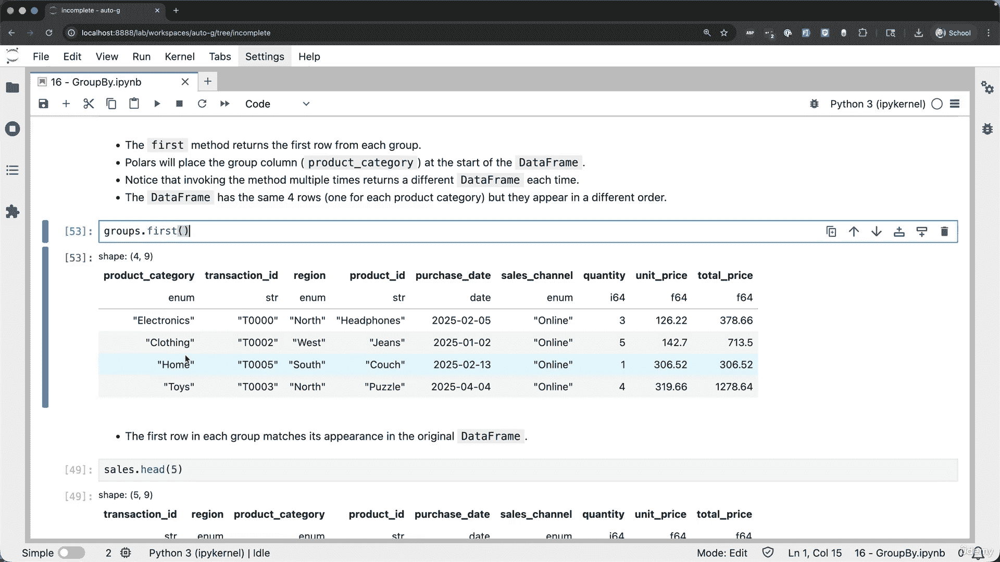

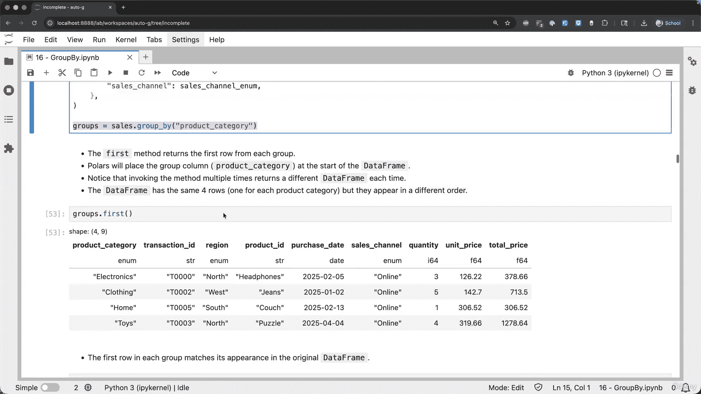

上一节我们解释了并行计算为什么会导致结果行顺序变化，本节中我们来看看如何让分组顺序保持一致。如果你确实想要固定顺序，只是因为你更喜欢这样，并且愿意牺牲一点潜在效率，那么可以在 groupby 方法中加一个特殊参数 `maintain_order`。

示例代码如下：

```python
groups = sales.groupby("product_category", maintain_order=True)
groups.first()
```

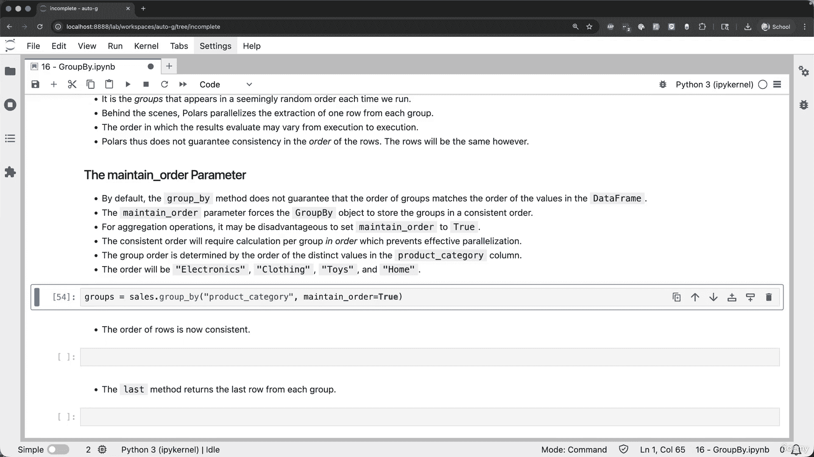

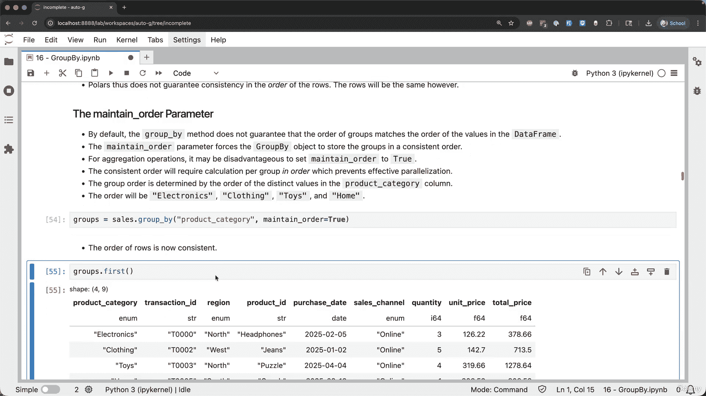

把上面的 groupby 代码粘贴到下面，并添加 `maintain_order` 参数。如果给这个参数传入 `True`，就是在要求为各个组维持一致顺序。现在执行代码，再同样调用 `first` 方法，我们仍然会得到 sales 数据框中每个产品类别对应的第一行，这些行和上面看到的四行完全相同。不同的是，现在各个组也处于一致顺序中，这个顺序基于组在原始 sales 数据框中出现的顺序。

这次执行会保持一致，但可能更慢。数据集很小时看不出这种差异。如果数据量越来越大，达到数百万行甚至数十亿行，而你并不关心最终聚合数据框中组的顺序，可能就不想这样做，因为这会让代码效率降低：结果更一致，但效率更低。明白这个取舍之后，下一节我们继续看其他从组里取行的方法。

## 🧮 Polars 与 Python 数据分析（第二部分）：178.5：last、head 与 tail 方法

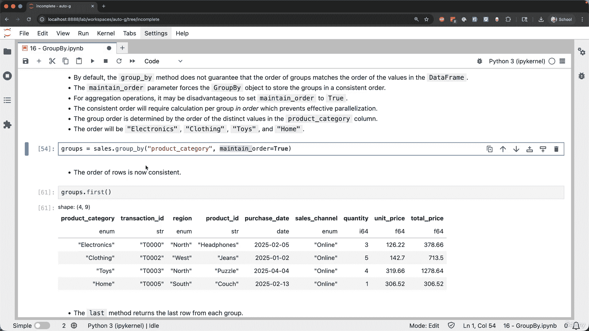

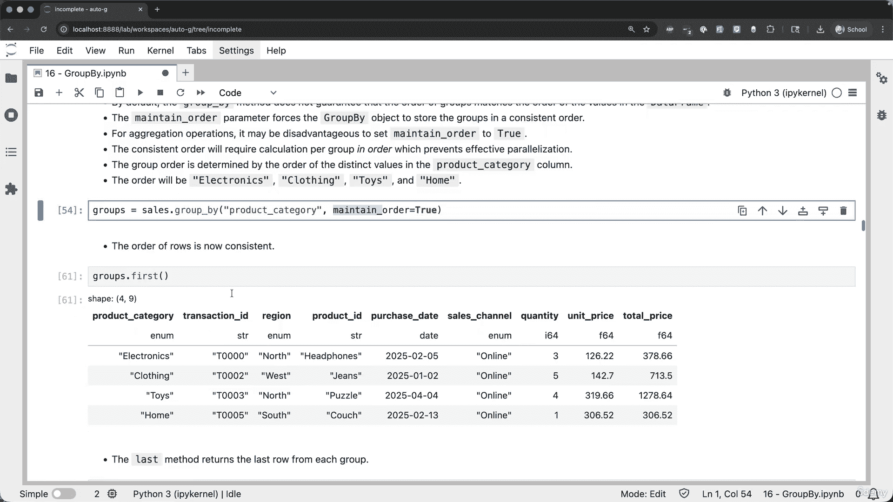

上一节我们通过 `maintain_order` 控制了分组顺序，本节中我们来看看 `last`、`head` 和 `tail` 这些方法。`first` 的互补方法是 `last`，它会根据某个产品类别在 sales 数据框中最后一次出现的位置，从每个组中取出最后一行。可以看到，这些最后出现的 `transaction ID` 都靠近 sales 数据框的末尾。结果仍然是四个组，仍然是每个产品类别组一行，但现在是基于最后一次出现的位置，也就是在 sales 中最后出现的顺序。

如果你想从每个组中取出多行，就可以使用 `head` 和 `tail` 方法。`head` 可以应用在 groupby 对象上；普通数据框上的 `head` 只是从顶部取前几行，而 groupby 对象上的 `head` 会从每个组中取前几行。例如传入 `2`，就是要求每个组的前两行。因为一共有四个组，所以会产生一个包含八行的数据框：electronics 两行、clothing 两行、toys 两行、home 两行，其他类别以此类推；这些行同样基于它们在原始 sales 数据框中出现的顺序。并且因为前面使用了 `maintain_order`，每次执行时产品类别的顺序也会保持一致。

下面用一个列表把 `last`、`head`、`tail` 的用途说明白，便于区分。

- `.last()`：从每个组中取出最后一行，基于该组在原始数据框中最后一次出现的位置。

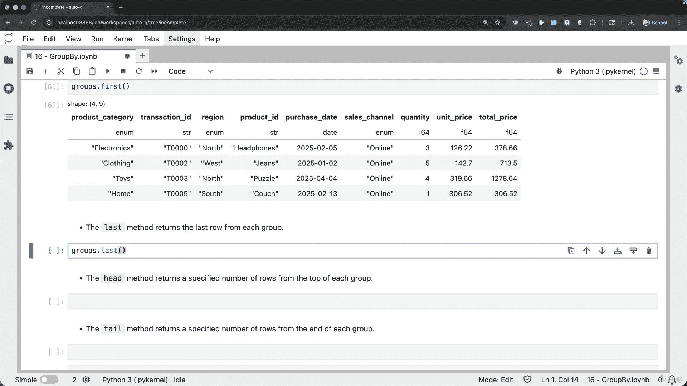

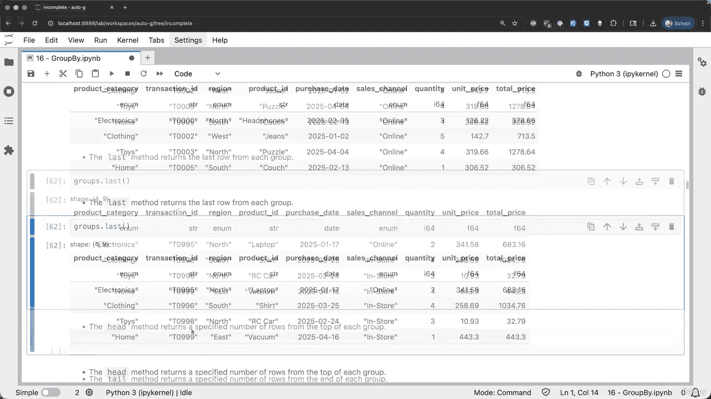

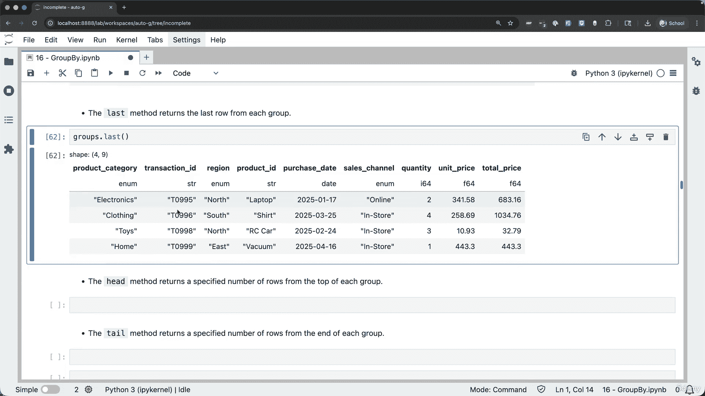

- `.head(2)`：从每个组中取出前两行，普通数据框的 `head` 取顶部几行，groupby 对象的 `head` 取每组前几行。

- `.tail(2)`：从每个组中取出末尾指定行数，基于该组在原始数据框中最后出现的位置。

与 `head` 互补的方法是 `tail`，它返回每个组末尾指定数量的行，或者基于在 sales 数据框中最后出现的位置。这里我们从 sales 中每个唯一产品类别里取出最后两行，可以看到 electronics 的最后两行、clothing 的最后两行，其他类别以此类推。到目前为止，这些操作都比较简单，我们只是从每个组中取出条目；更强大的做法是对每个组分别执行复杂的聚合操作，然后在最终数据框中合并结果，这部分会在后续课程中看到。

## ✅ Polars 与 Python 数据分析（第二部分）：178.6：本节总结

本节课中我们一起学习了 Polars 的 GroupBy 方法。我们知道了 groupby 对象是一个按列中不同值分组的容器，每个组包含关联行；可以在 groupby 对象上调用 `first`、`last`、`head`、`tail` 等方法，对每个组分别取行或做计算，再合并成新的数据框；也理解了并行计算可能导致结果行顺序变化，以及 `maintain_order=True` 可以让分组顺序保持一致，但可能牺牲一些效率。最后用一段代码把本节核心方法串起来，方便复习。

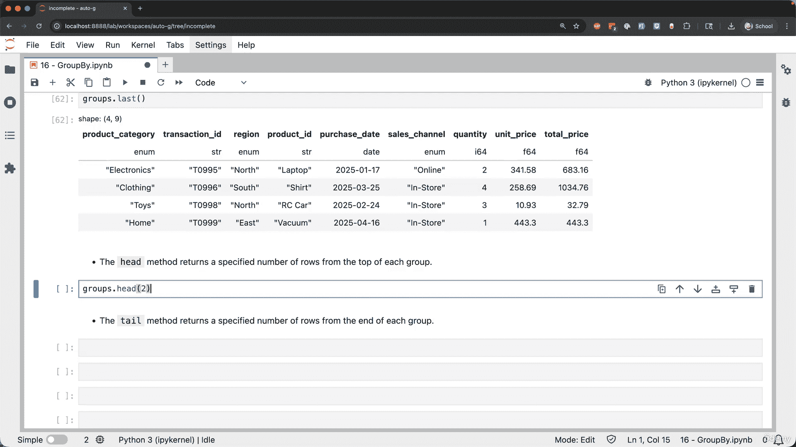

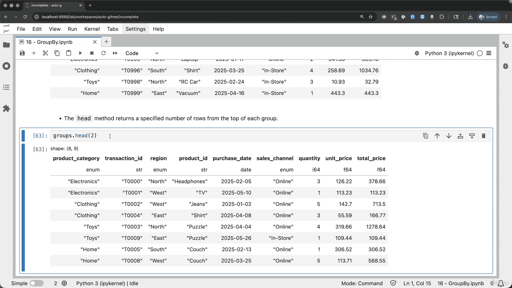

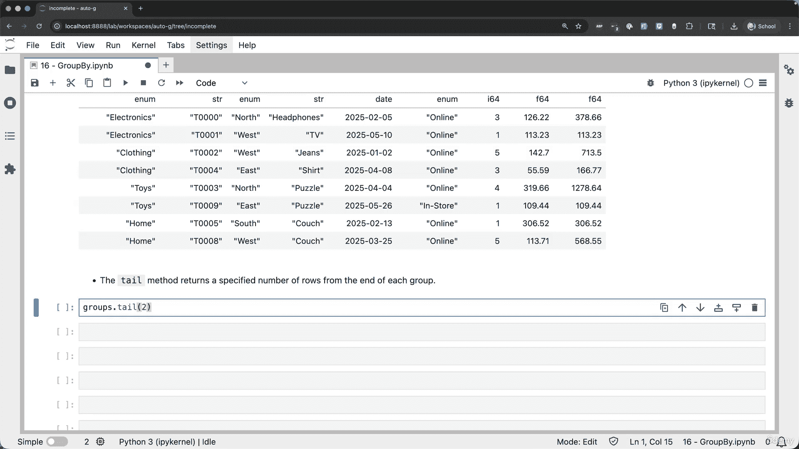

```python
groups.first()
groups.last()
groups.head(2)
groups.tail(2)
groups = sales.groupby("product_category", maintain_order=True)
```

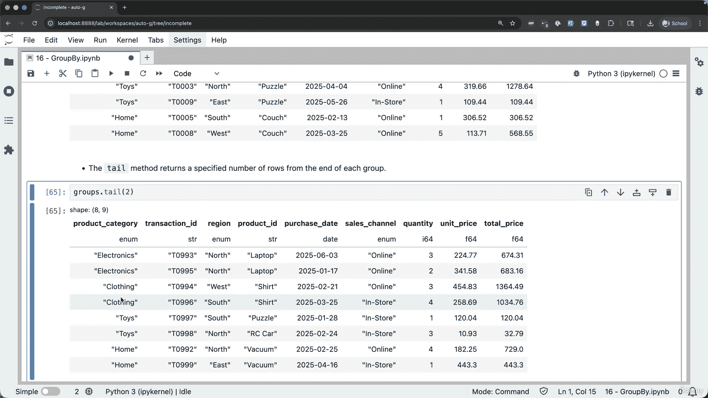

这些方法看起来只是从每个组里取数据，但它们是后续复杂聚合操作的基础。本节先建立了“分组容器”和“对每组执行方法再合并结果”的基本思路，后续课程会在这个思路上继续深入。

