# 📊 Polars 与 Python 数据分析：179：按组查找最大值和最小值

在本节课中，我们将学习 `max` 和 `min` 这两个方法。它们可以用在 `group_by` 对象上，用来找出每个分组中每一列的最大值和最小值。听起来很简单，但这里有一个非常重要的细节：返回结果不是数据集中某一行的原始记录，而是按组、按列分别汇总出来的最大或最小值。为了把这个细节讲清楚，我们还会看字符串列和枚举列的特殊排序规则，并用 `min` 方法做对称验证。下面先从准备分组对象开始。


## 🧭 准备分组对象

上一段我们明确了本节课的目标，本节中我们来看看如何准备分组对象。首先重新执行导入代码，这样我们就有了 `sales` 数据框，以及右侧的 `groups` 分组对象。这里的 `groups` 是按 `product_category` 列中的值进行分组的，数据中一共有四个产品类别。下面我们拿 `groups` 这个分组对象调用 `max` 方法，会得到每个产品类别一行，也就是一个四行的数据框。核心概念可以写成下面这样。

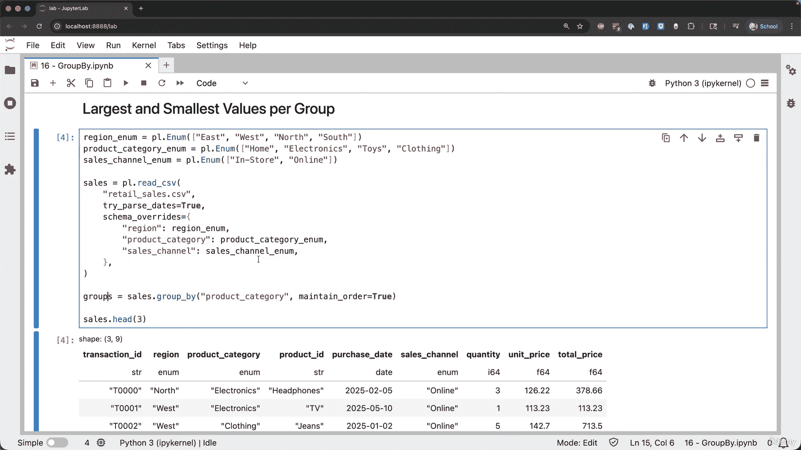

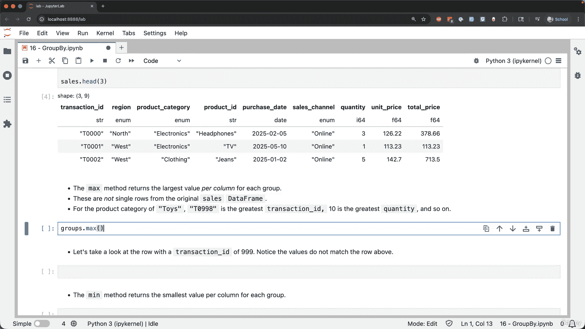

```python
groups = sales.group_by("product_category")
result_max = groups.max()
```

这里的 `groups.max()` 就是按每个组、每一列求最大值。为了理解输出，需要先暂停一下，强调一个非常重要的细节：对于每一个产品类别，我们看到的是该类别下某一列所遇到的最大值。换句话说，不是随便挑一行出来，而是把该类别下的所有行都拿来，对每一列分别找最大值。


## 🔍 max 方法的输出含义

上一节我们准备好了分组对象，本节中我们来看看 `max` 方法返回的值到底代表什么。以下是理解 `max` 输出时需要抓住的几个关键点。

- 对 `transaction_id` 列来说，`T0995` 是 `electronics` 类别中 `transaction_id` 列遇到的最大值。
- 对 `quantity` 列来说，`6` 是 `electronics` 类别所有行中遇到的最大数量。
- 这些值不是数据集中某一行完整记录的复制，而是来自许多不同的行。
- 每个值都表示“该列在该类别下”的最大值。
- 对整数和浮点数来说，最大值就是数值上最大的那个值。
- 对字符串来说，最大值是按字母顺序比较后最接近字母表末尾的值。
- 对枚举来说，排序逻辑基于变体声明的顺序，这一点需要特别注意。

具体看枚举类型时，`region` 枚举的声明顺序是 `east` 在 `west` 之前，`west` 在 `north` 之前，`north` 在 `south` 之前，这个顺序也被当作逻辑排序顺序。因此 `south` 被认为是最大、最靠后的枚举值。在 `max` 方法的返回结果中，`region` 列显示为 `south`，这意味着对于这四个产品类别中的任意一个，`south` 都是遇到的枚举变体最大值。

> 注意：`groups.max()` 返回的是按组、按列汇总后的最大值，不是数据集中某一行的原始记录。


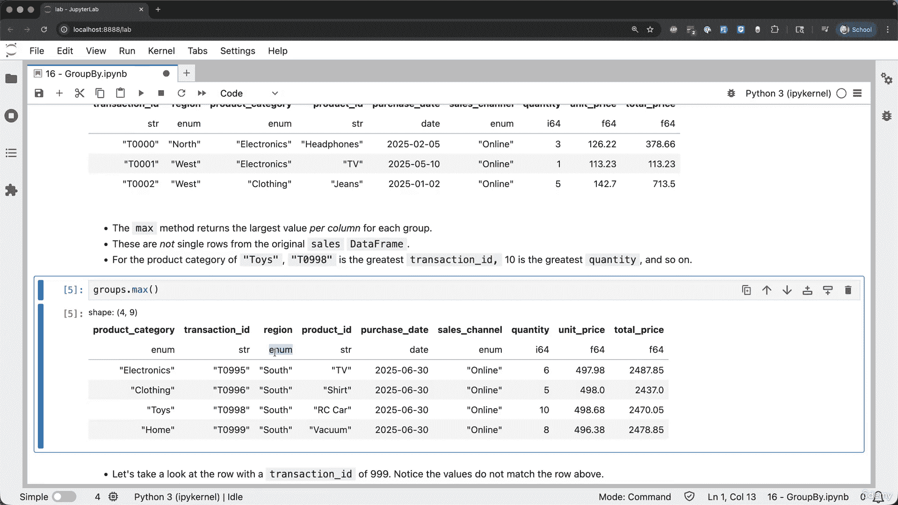

## 🧪 验证返回值不是单行记录

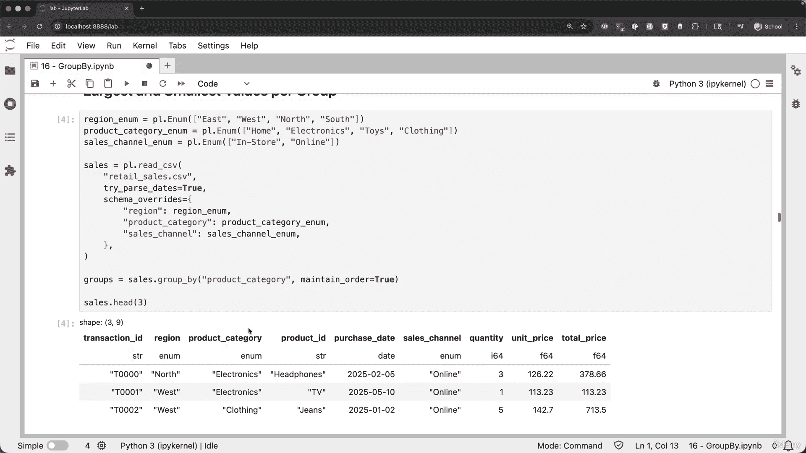

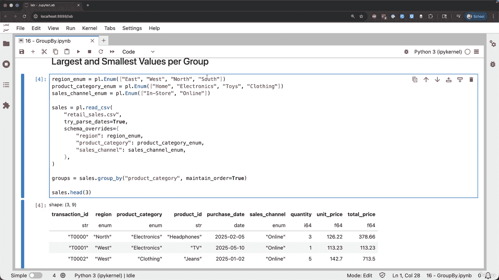

上一节我们解释了 `max` 返回的是按列汇总值，本节中我们用实际过滤来验证这一点。原文中举了一个例子：`home` 类别中有一行的 `transaction_id` 是 `T0999`。我们取出 `sales` 数据框，调用 `filter` 方法，定位 `transaction_id` 等于上面这个值的行。代码示意如下。

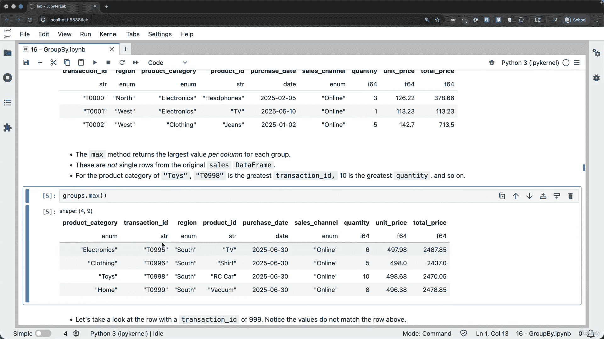

```python
sales.filter(pl.col("transaction_id") == "T0999")
```

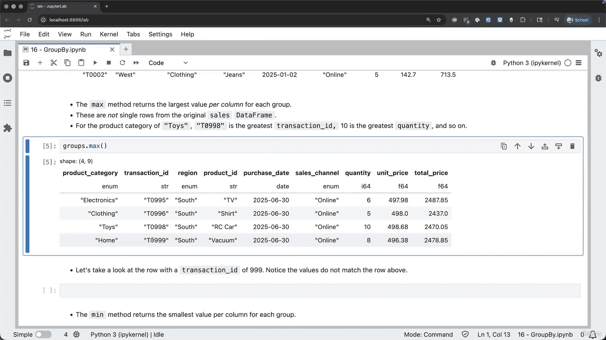

可以看到这一行确实存在，但这一行的值和我们前面 `max` 输出中的值并不匹配。日期不一样，销售渠道不一样，其他列也不一样。原因还是那句话：`max` 输出不是 `home` 类别中某一行的原始记录，而是对每个单独列分别取最大值，再按四个产品类别分组汇总出来的结果。也就是说，这些最大值来自许多不同的行，只是每一列都取了该列自己的最大值。


## 📉 min 方法与对称结果

上一节我们验证了 `max` 的汇总性质，本节中我们来看看与它互补的 `min` 方法。`min` 可以调用在同一个 `group_by` 对象上，它会给出每个组中每一列的最小值。核心概念如下。

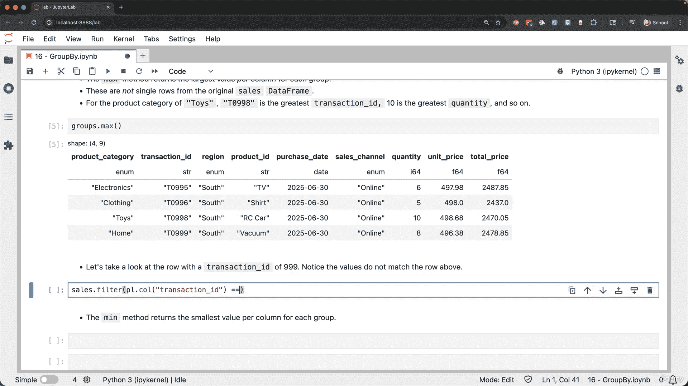

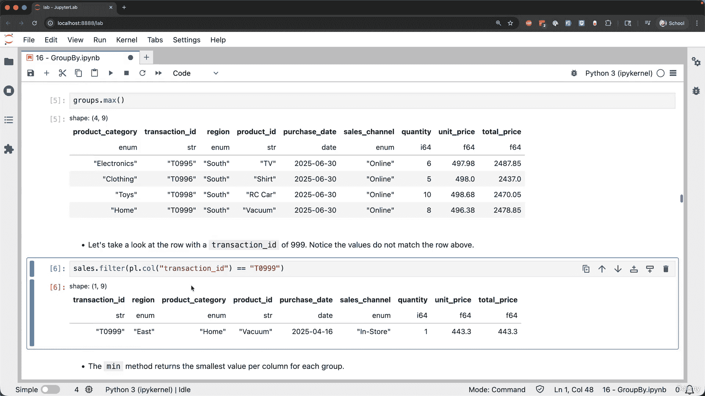

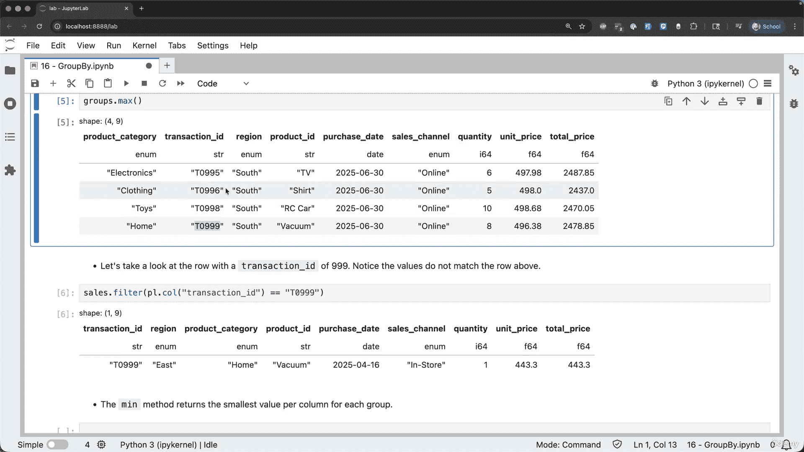

```python
result_min = groups.min()
```

以下是 `min` 输出中需要理解的几个要点。

- 对数值列来说，`min` 会找到这些列在所有对应产品类别行中的最小数值。
- 对字符串列来说，最小值是字母顺序上最接近字母表开头的值。
- 对枚举列来说，最小值同样基于变体声明顺序。
- 例如 `6.61` 是在产品类别为 `toys` 的任意行中遇到的最小单价。
- 在 `region` 列中，`east` 确实是最小值，因为它正好是枚举声明中的第一个变体。

到这里，`max` 和 `min` 两个方法就讲完了。它们非常适合查看实际分组的摘要，本例中就是四个产品类别，并查看这些类别对应所有行中遇到的最大值和最小值。


## ✅ 总结

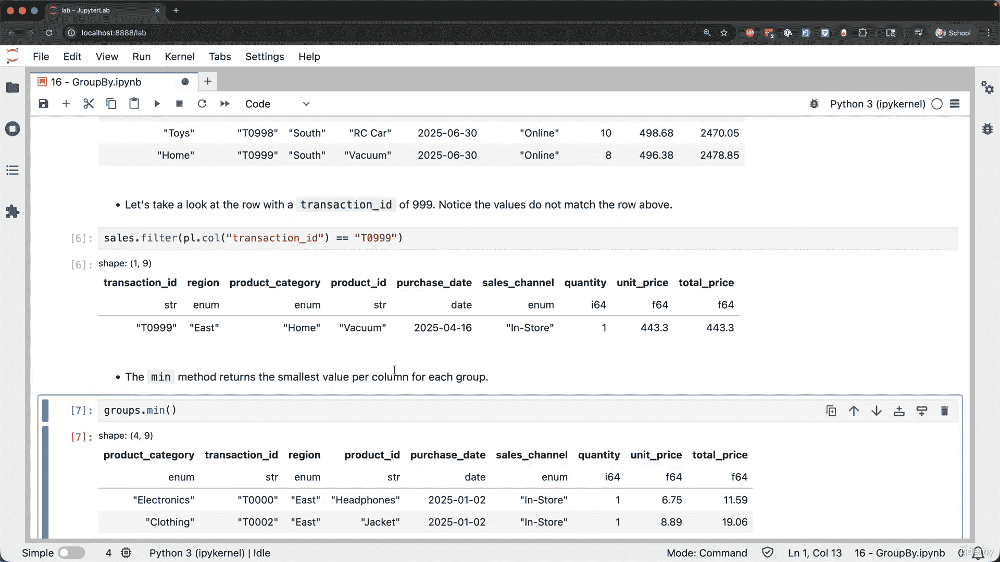

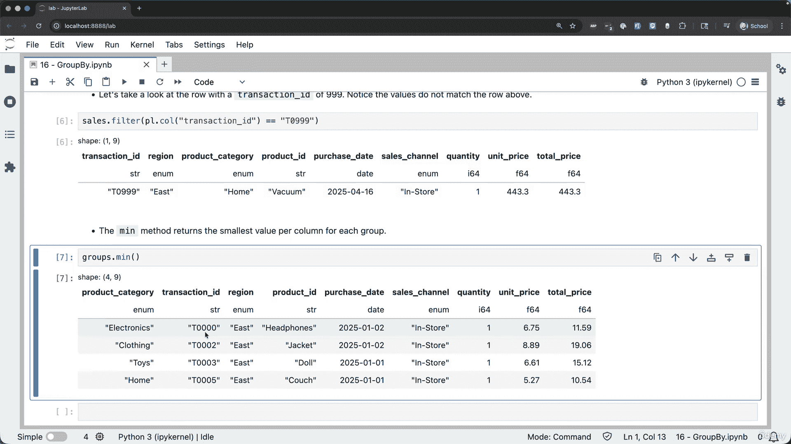

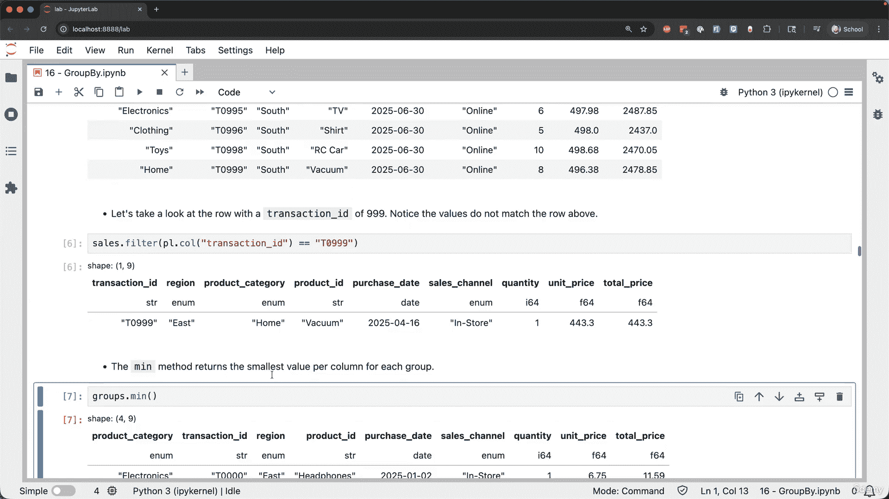

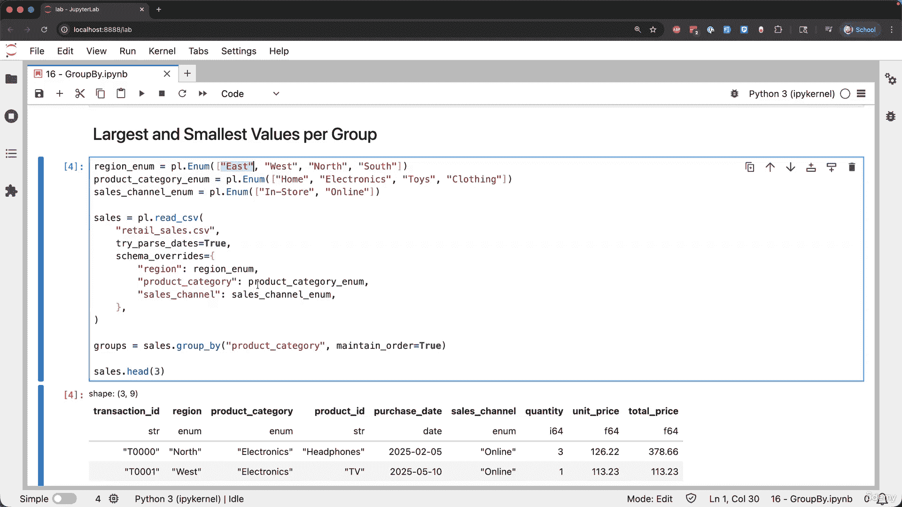

本节课中我们一起学习了如何在 Polars 的 `group_by` 对象上使用 `max` 和 `min`。我们重新执行了导入代码，准备了 `sales` 数据框和按 `product_category` 分组的 `groups` 对象，知道一共有四个产品类别。调用 `groups.max()` 会得到四行结果，每个类别一行，每一列显示该类别下遇到的最大值；这些值来自许多不同的行，不是某一行的完整记录。字符串最大值按字母顺序取最接近末尾的值，枚举最大值按声明顺序取最靠后的变体，例如 `south`。随后我们用 `T0999` 这一行做过验证，发现过滤出来的原始行与 `max` 输出并不匹配。最后我们看了互补的 `groups.min()`，它按组、按列返回最小值，字符串取最接近字母表开头的值，枚举取声明顺序中最靠前的变体，例如 `east`。现在可以使用 `max` 和 `min` 来快速查看分组数据的最大和最小摘要。
