# 📊 Polars与Python数据分析：第180节：使用agg方法进行聚合

本节课中，我们将要学习一个非常实用的方法：`agg` 方法。`agg` 是 *aggregate*（聚合）的缩写，所谓聚合，简单说就是一个涉及某个组里所有值的计算。在上一节课中，我们已经学习了 `max` 和 `min` 方法，它们正是聚合操作的典型例子。不过，`max` 和 `min` 只是最简单的例子，因为它们只是从每个分组里找出一个最大值或最小值。除了这两个，还有很多其他聚合操作，比如 `sum`、`mean`、`median`，它们的工作原理都差不多，都是对 `group_by` 对象中的每一个分组执行同一种计算。有一点不同之处在于，上一节课的 `max` 和 `min` 方法是直接作用于原始数据帧中的所有列；而使用 `agg` 方法时，我们可以自己指定要聚合哪一列或哪几列。下面我们就来一起看几个实际例子。

在正式讲解例子之前，我们先把“聚合”这个概念再拆开揉碎说一下。聚合操作可以理解为：给定一组数值，用一个函数把这组数值“浓缩”成一个结果。用公式表示就是这样：

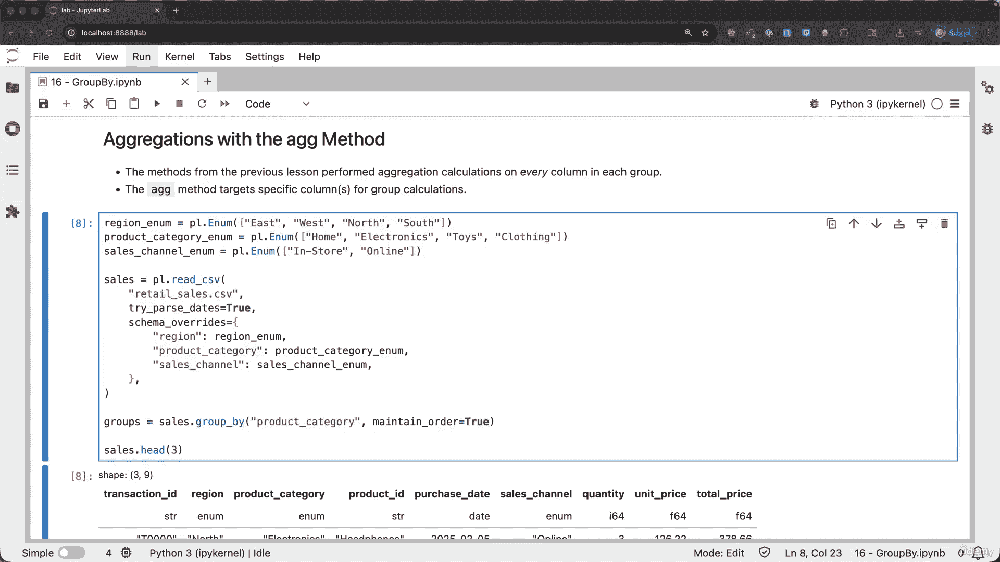

$$
\text{聚合结果} = f(\text{组内所有值})
$$

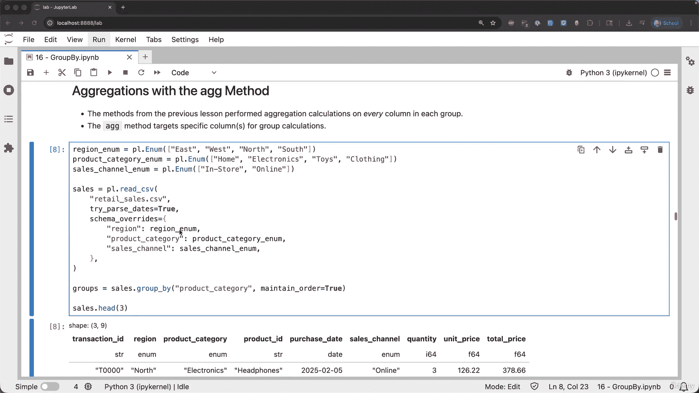

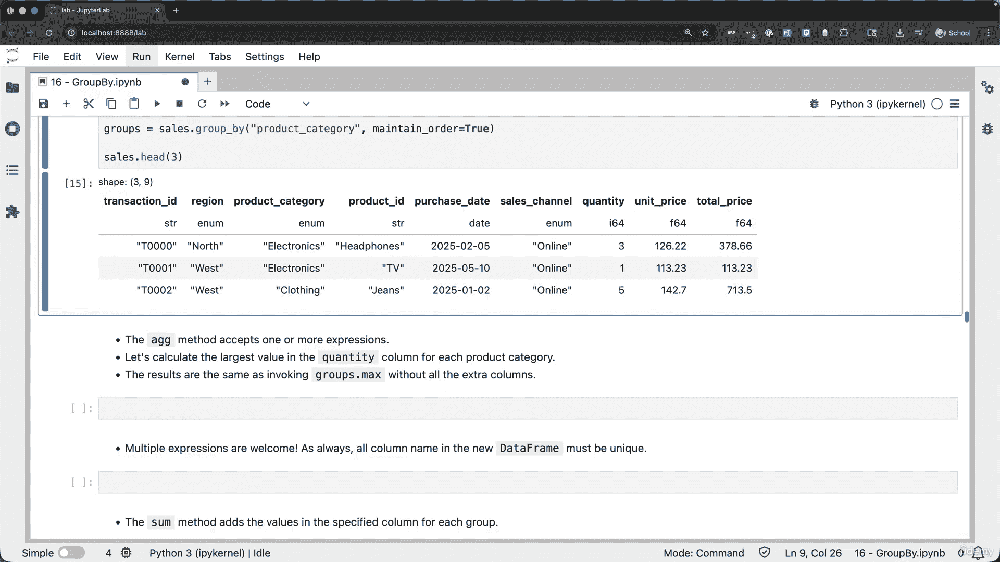

这里的 `f` 可以有很多种选择。常见的聚合操作包括以下几种：

- `max`：求最大值
- `min`：求最小值
- `sum`：求和
- `mean`：求平均值
- `median`：求中位数

有了这个基础，我们在后面的例子里就会反复看到这些操作。

接下来，我们先准备好分组对象。假设我们已经执行了导入代码，并且 `sales` 这个 DataFrame 已经存在。现在要创建一个分组对象，代码可以这样写：

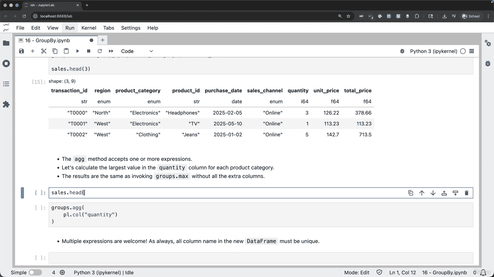

```python
groups = sales.group_by("product category")
```

这样我们就得到了一个名为 `groups` 的 `group_by` 对象。之后我们会在这个对象上调用 `agg` 方法。和 `select`、`with_columns`、`filter` 一样，Polars 的 API 风格非常一致，所以 `agg` 方法接收的参数也是一个或多个表达式（expression）。什么意思呢？就是说，你需要用表达式告诉 Polars：到底要对哪些列、执行怎样的聚合计算。

在动手写代码之前，我们先提醒一下自己 `sales` 长什么样。我在笔记本里新建了一个单元格，预览了前几行数据，这里就是 `sales` 的样子。每一行代表一条交易记录，里面包含了产品类别、数量、单价这些信息。现在，我们打算先针对 `quantity` 这一列构建一个表达式。不过请记住，这个表达式是放在 `group_by` 对象里面的，所以它会对每一个分组分别执行一次。目前 `sales` 里一共有四个产品类别，也就是说，这个表达式会对这四个类别分别计算一次。

我们先来看一个求最大值的例子。其实，上一节课我们已经做过类似的事情了：找出每个类别的最大数量。这就是一种聚合操作，实现它的方法叫做 `max`。现在我们在 `agg` 方法里调用 `max` 方法，并给这个新列命名为 `largest quantity`，也就是“最大数量”的意思。代码如下：

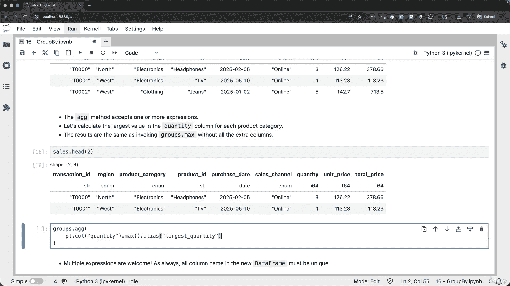

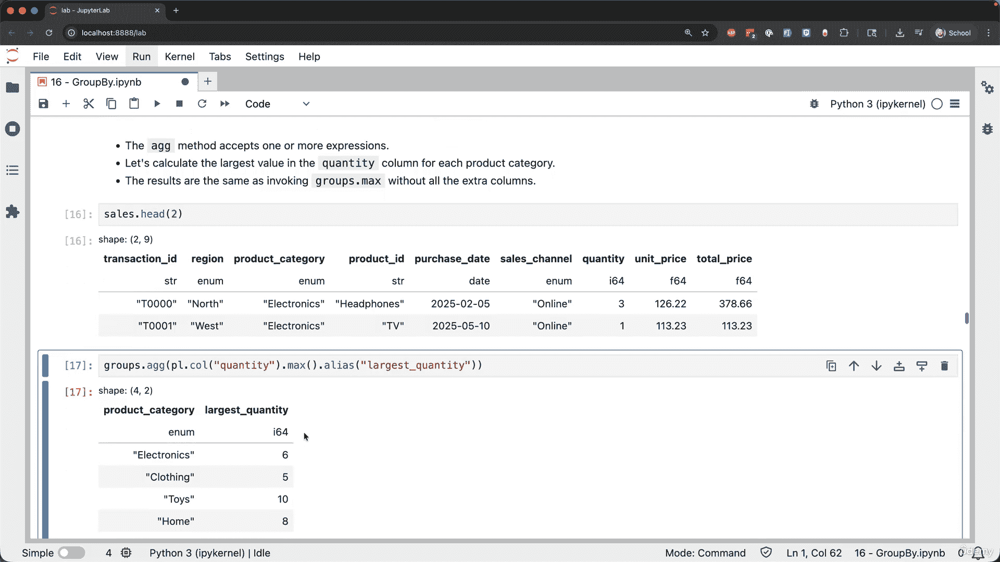

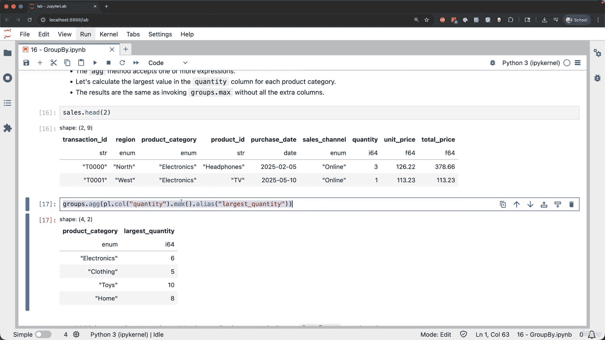

```python
groups.agg(
    pl.col("quantity").max().alias("largest quantity")
)
```

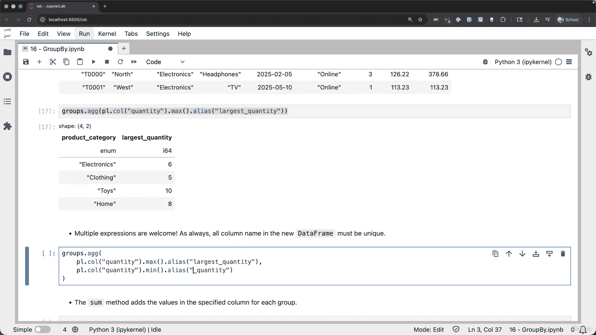

我们来看一下结果是什么样子。最终我们会得到一个 DataFrame，它一共有四行，每行对应一个产品类别；同时还有两列。第一列是 `product category`，也就是分组对象中的四个分组；第二列就是我们的聚合结果。这个结果正是由我们声明的表达式计算出来的：它分别在这四个产品类别中，查找 `quantity` 列的最大值。其实，这里得到的数据和上一节课完全一样。比如，对于 `electronics`（电子产品）这个类别，`quantity` 列里出现的最大值就是 6。

接下来，我们来看看 `agg` 方法最漂亮的地方。它支持传入多个表达式，也就是说，我们可以只调用一次 `agg`，就同时完成多种聚合计算。举个例子，我把上面的表达式复制到下面，同样针对 `quantity` 列，但这一次调用的是 `min` 方法，也就是求最小值。我把这个新列命名为 `smallest quantity`，表示“最小数量”。代码是这样的：

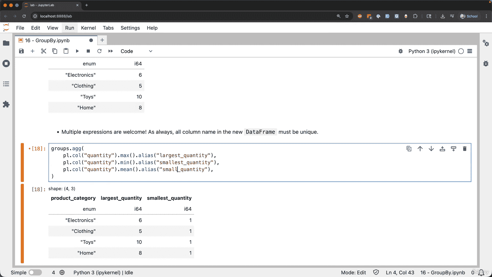

```python
groups.agg(
    pl.col("quantity").max().alias("largest quantity"),
    pl.col("quantity").min().alias("smallest quantity")
)
```

执行之后，我们可以看到，结果中有两列分别对应这两个表达式，同时仍然保留着那四个产品类别。所以，这些例子和上一节课用 `max`、`min` 直接得到的结果是等价的。

除了 `max` 和 `min`，还有几种常见的聚合操作，你可能也会经常用到。比如 `mean` 方法，它用来计算所有值的平均值。我们还是针对 `quantity` 列，把结果命名为 `average quantity`，也就是“平均数量”。使用 `mean` 方法之后，你能看到 `electronics` 这个类别所有行的 `quantity` 平均值，也能看到 `clothing`（服装）这个类别的 `quantity` 平均值，依此类推。代码可以这样写：

```python
groups.agg(
    pl.col("quantity").mean().alias("average quantity")
)
```

再比如 `median` 方法，它求的是中位数，也就是一组有序数据里处在中间位置的那个数。我们可以再一次按产品类别这个分组，去查看 `quantity` 列的中位数。这样，每个产品类别的中位数就一目了然了。

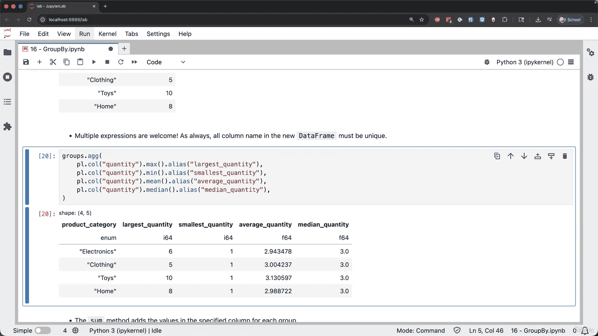

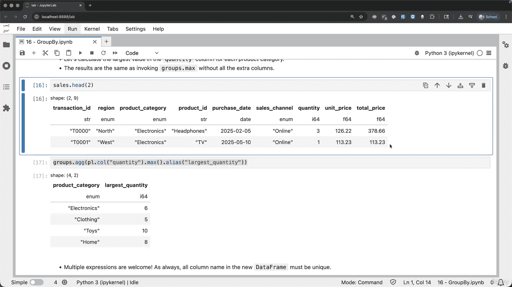

到这里，我们已经看了 `max`、`min`、`mean`、`median` 四个聚合操作。不过，我还想再展示一个更实际的例子：从 `sales` 数据帧中计算每个产品类别的总收益。对于任何一笔交易，我们都有 `quantity`（数量）和 `unit price`（单价）这两个字段，把它们相乘，就得到了 `total price`（总价）这一列。用公式表示就是：

$$
\text{total price} = \text{quantity} \times \text{unit price}
$$

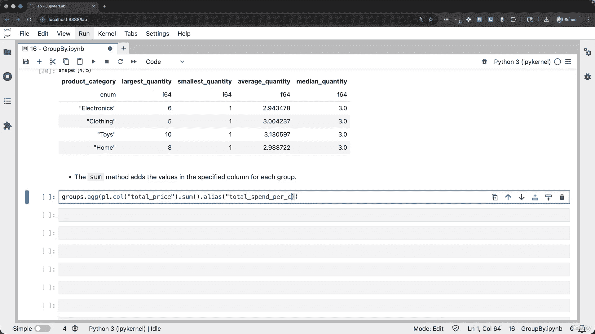

因此，`total price` 列就可以看成每笔交易的收益。现在我们要做的，就是把 `total price` 列里的所有值加起来，并且依然按照产品类别进行分组。这件事用 `group_by` 来做就超级简单了。我们再次拿出 `groups` 这个分组对象，调用 `agg` 方法。`agg` 接受一个或多个表达式，所以我们先创建一个针对 `total price` 列的表达式，然后调用 `sum` 方法，也就是把所有值累加起来。最后，我们用 `alias` 方法给这个新列起个名字，叫做 `total spend per category`，意思是“每个类别的总消费额”。代码如下：

```python
groups.agg(
    pl.col("total price").sum().alias("total spend per category")
)
```

运行之后，我们就能很清楚地看到每个产品类别的总收益了。写成公式就是这样：

$$
\text{total spend per category} = \sum_{\text{每个类别}} \text{total price}
$$

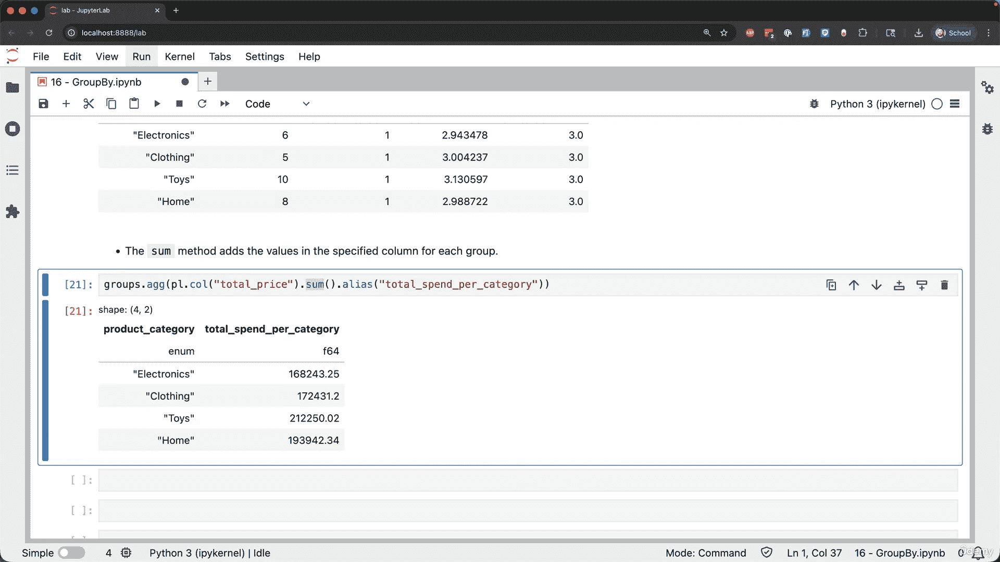

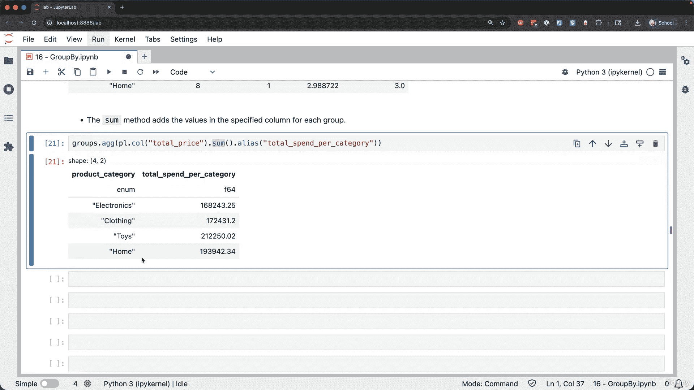

这个写法非常优雅，因为仔细想一想，导入数据之后，我们其实只需要两行代码：第一行是 `group_by` 方法，用来对数据进行分组；第二行就是 `agg` 方法，用来完成整个聚合操作。Polars 会自动识别出所有唯一的产品类别，然后对每一组执行一致的计算，也就是每个分组计算一次总和。

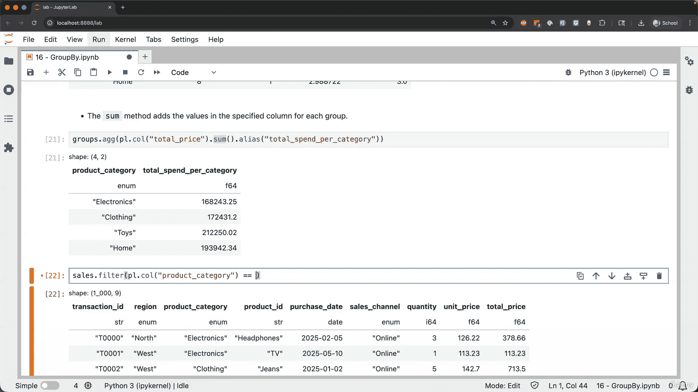

说到这里，你可能会想：这种分组求和的逻辑，不用 `agg` 能不能做？当然可以。像我前面提到的，这种逻辑完全可以用手写 Polars 代码来实现。举个例子，假设我想计算所有 `toys`（玩具）类别的 `total price` 总和，我可以先取 `sales`，然后调用 `filter` 方法，在 `product category` 列中筛选出所有值为 `toys` 的行。这样一来，我就得到了所有产品类别为 `toys` 的行。接着，我再在这个结果上调用 `select`，创建一个针对 `total price` 列的表达式，并调用 `sum` 方法对值求和。代码大概长这样：

```python
toys_total = (
    sales.filter(pl.col("product category") == "toys")
    .select(pl.col("total price").sum())
)
```

运行之后，你会看到 `toys` 的求和结果，这个结果和前面用 `agg` 得到的结果完全一致。但是问题来了：如果我想算 `electronics`、`clothing`、`toys`、`food` 等等所有类别，我就必须把这段逻辑重复写好几次。目前数据里只有四个产品类别，这还不算太夸张；但假如有 100 个类别呢？那就要写非常多的重复代码了。而使用 `group_by` 对象，我们就能获得一个很大的好处：可以基于某一列中的不同值，对不同的组、子集或者说“桶”执行逻辑聚合，完全不需要写这些手动代码。我们只需要创建分组对象，然后执行一次聚合，它就会对容器里的每一组做一次一致的计算。这真的是非常强大的功能。

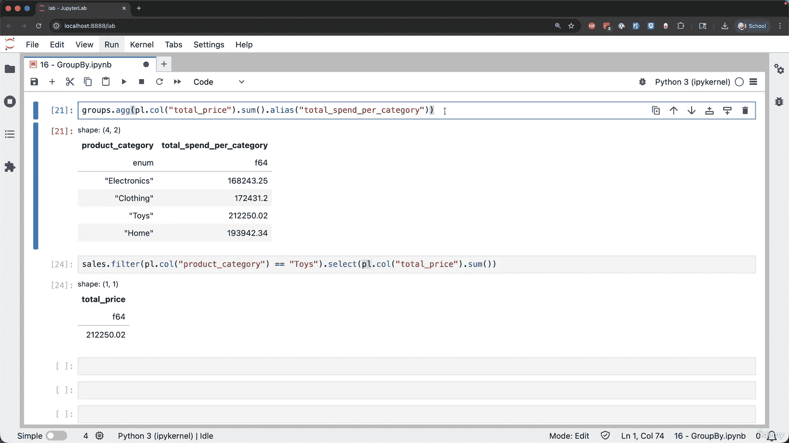

到这里，我们就把 `agg` 方法的主要用法都过了一遍。本节课中，我们一起学习了 `agg` 方法的核心概念和实际应用。首先，我们明白了聚合就是一个对组内所有值进行统一计算的过程；接着，我们通过 `agg` 方法实现了 `max`、`min`、`mean`、`median` 和 `sum` 等常见聚合操作。我们还看到，`agg` 方法支持一次传入多个表达式，并且能够精确指定要聚合的列。最后，我们对比了手动 `filter` + `select` 的写法和 `group_by` + `agg` 的写法，发现后者在代码简洁性和可扩展性上都更有优势。以后你在处理分组聚合任务的时候，可以优先考虑使用 `agg` 方法。

