# 📊 Data Analysis with Polars and Python（Part 2）：p81：在聚合中使用选择器


在本节课中，我们将学习如何在Polars的`groupby`聚合中使用`selectors`模块。此时我们已经见过几种给`groupby`对象应用聚合操作的方法，本节会先回顾这些方法，再重点说明选择器如何在聚合中一次性定位多列，从而避免逐列书写。课程还会演示用`cs.numeric()`对所有数值列求和、用`name.suffix()`给结果列加后缀，以及混合多个表达式与多个选择器完成批量计算。下面从三种聚合方式的回顾开始。


## 📘 Data Analysis with Polars and Python（Part 2）：p81.1：回顾三种聚合方式


在进入选择器之前，先回顾原文提到的三种聚合方式。第一种方式是直接调用`groupby`对象上的顶层方法，例如`max`或`min`，这类方法会把操作应用到每一个列；如果你并不关心所有列，这种做法有时会带来问题。反过来，第二种方式是使用`agg`方法，它允许更精确地指定要操作的目标列，但问题在于必须把想操作的每一列单独写出来，代码可能相当冗长。第三种补充方案是在聚合中使用选择器，它可以利用Polars库内部的一些工具。下面用列表对三种方式做一个简短对比，方便初学者理解。


- 第一种方式：在`groupby`对象上调用`max`、`min`等顶层方法，操作会应用到每个列，可能处理不关心的列。  

- 第二种方式：使用`agg`方法精确指定目标列，但需要逐列写出列名，写法冗长。  

- 第三种方式：在聚合中使用`selectors`选择器，作为前两种方式的补充方案。  


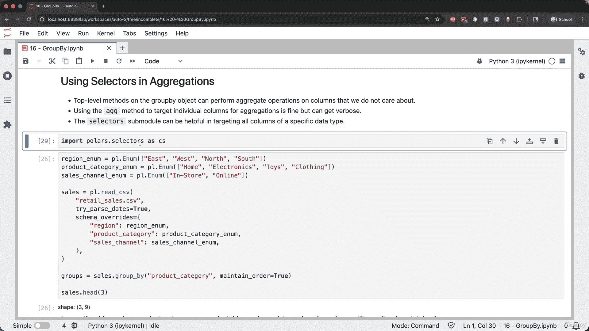

通过这个列表可以看出，三种方式各有取舍。理解这些取舍后，本节中我们来看看`selectors`模块本身是什么，以及它在Polars中如何组织。


## 🧩 Data Analysis with Polars and Python（Part 2）：p81.2：认识selectors模块


上一节回顾了三种聚合方式，本节中我们来看看`selectors`模块。提醒一下，在Polars库中有一个模块，可以把它想成一个嵌套目录，名字叫`selectors`。我们在课程前面的章节已经讲过这个模块，它常见的别名是`cs`。这些选择器允许我们定位特定类型的列，例如所有数值列，不管这些列存储的是整数、不同类型的整数，还是浮点数。如果要对所有数值列做某种操作，又不 worrying 这些列的具体数据类型，选择器就会派上用场。为了在代码中使用选择器，常见的导入写法如下。


```python
import polars.selectors as cs
```


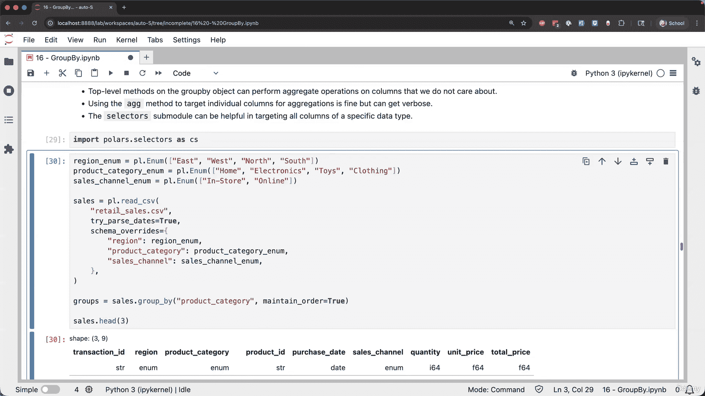

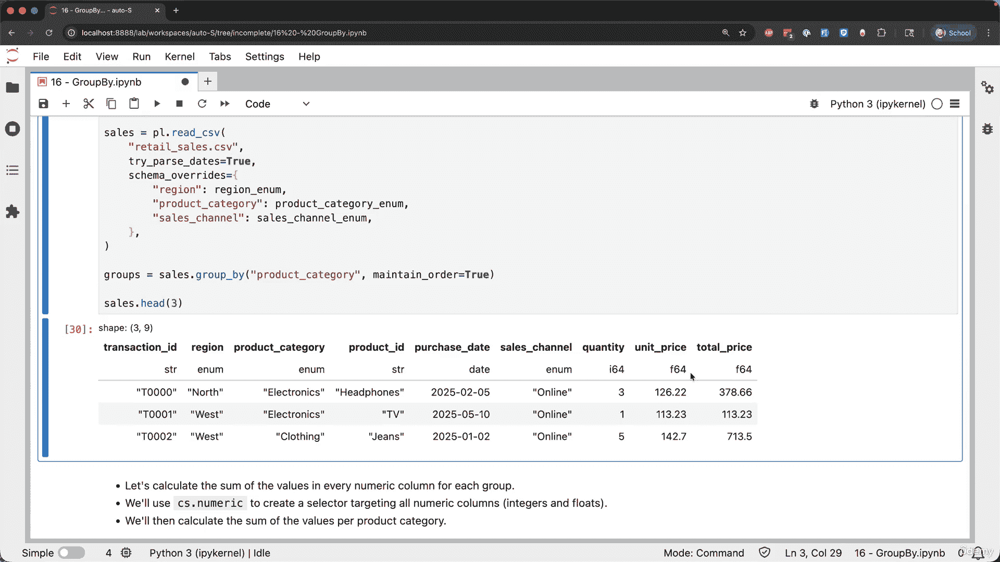

理解选择器的定位能力后，下面进入具体示例。原文在这里开始执行已有代码，并演示如何计算所有数值列的总和。本节中我们来看看这个求和例子。


## ➕ Data Analysis with Polars and Python（Part 2）：p81.3：用选择器计算数值列总和


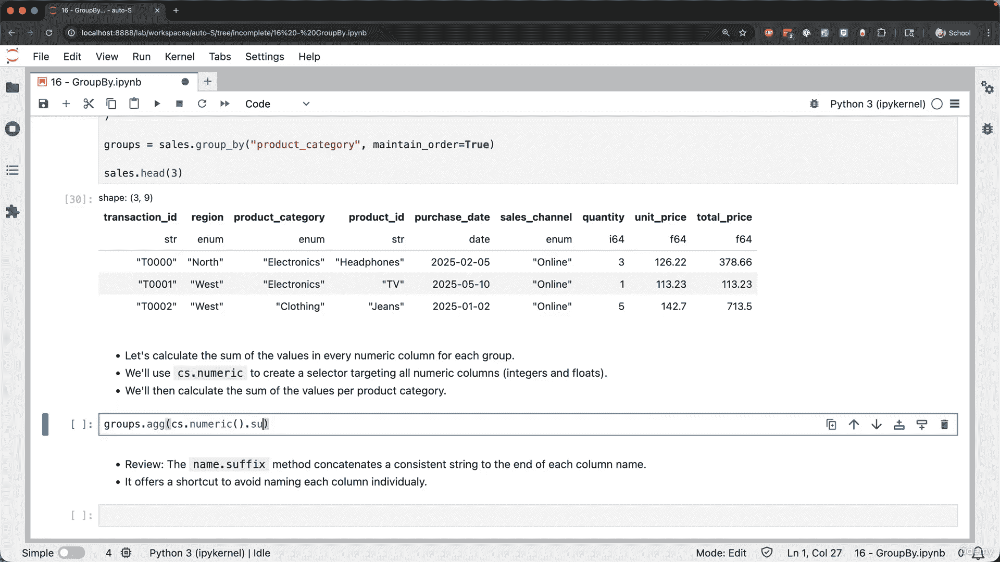

上一节认识了`selectors`模块，本节中我们来看看如何在聚合中用它求和。假设要计算所有数值列的总和，这些列是`quantity`、`unit_price`和`total_price`。这里涉及两种数据类型：整数和浮点。仍然可以使用`agg`方法，但那样就必须把三个列名逐一写出来，再把它们交给`sum`方法；而使用选择器后，可以在一次方法调用中更优雅地定位所有这些列。下面先执行已有代码，再取出由`groupss`变量表示的`groupby`对象并调用`agg`方法。原文中的变量名读作`groupss`，示例中按常见写法使用`groups`，核心是那个`groupby`对象。


```python
result = groups.agg(
    cs.numeric().sum()
)
```


在`cs`别名下，有之前探索过的`numeric`函数。它会创建一个表达式，目标是所有数值列，不管这些列是整数还是浮点。然后在这个表达式上调用`sum`。这样会得到原始数据框中所有数值列的总和，同时仍然保留四个产品类别值。这里的核心概念可以用下面的公式概括。


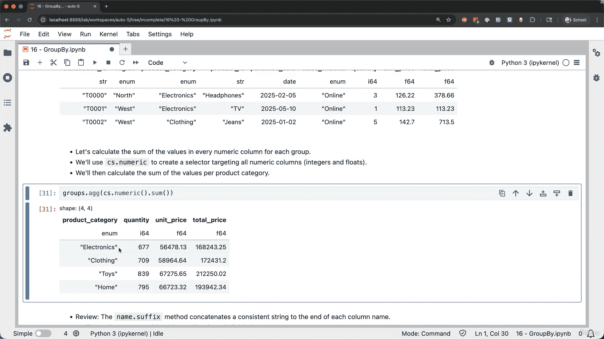

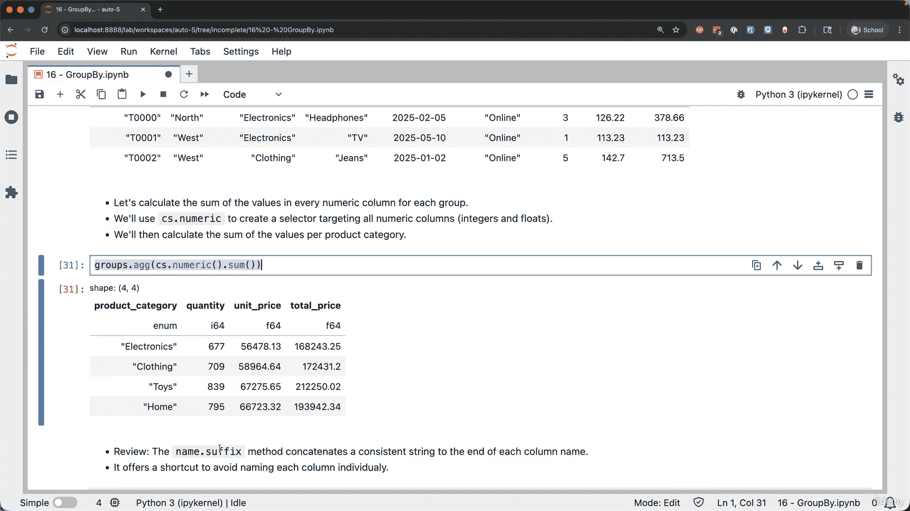

\[
\text{聚合结果}=\text{groupby对象}.\mathrm{agg}(\text{选择器表达式})
\]


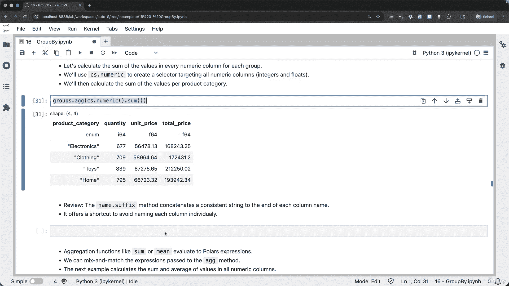

总和计算完成后，接下来考虑结果列的命名。提醒一下，课程前面稍微讲过，表达式构建器上还有一个好用的`name`属性，它允许指定表达式实际产生的列名。例如，可以使用`suffix`方法给每个列名拼接一致的后缀，也就是在字符串末尾追加内容。本节中我们来看看如何用这个属性给聚合结果加后缀。


## 🏷️ Data Analysis with Polars and Python（Part 2）：p81.4：为聚合结果列命名


上一节用选择器计算了数值列总和，本节中我们来看看如何给结果列命名。下面复制上面的代码，并在这个表达式上访问`name`属性、调用`suffix`方法，然后传入后缀`_sum`。这个字符串会被拼接到产生的列名末尾。于是不再只是保留来自销售数据的原始列名`quantity`，而是得到`quantity_sum`、`unit_price_sum`、`total_price_sum`等列名。代码如下。


```python
result = groups.agg(
    cs.numeric().sum().name.suffix("_sum")
)
```


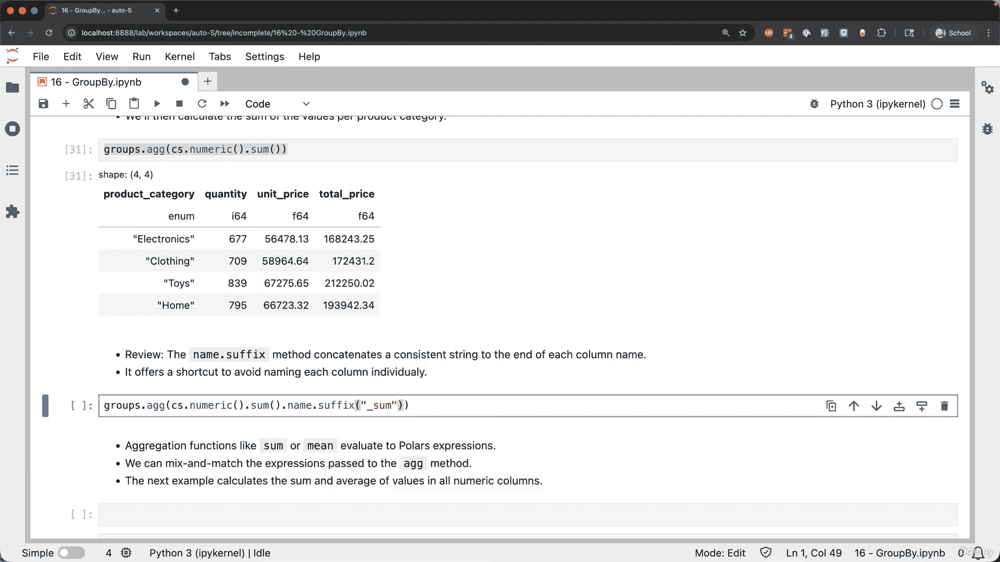

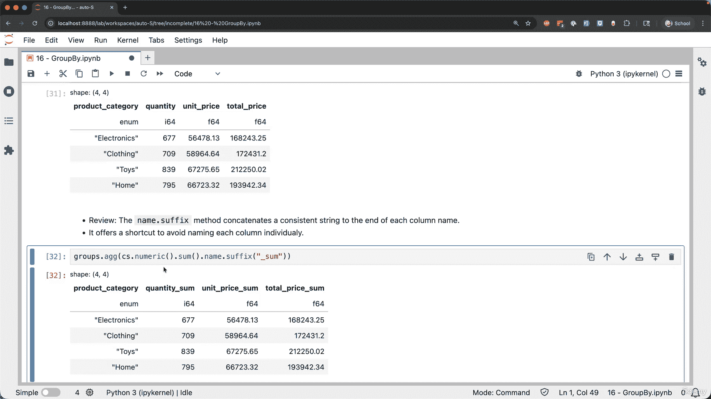

当然，可以混合搭配多个表达式，也可以混合搭配多个选择器。命名完成后，下面再给一个例子，展示如何用许多不同选择器快速执行大量计算。本节中我们来看看混合求和与平均值的写法。


## 🔀 Data Analysis with Polars and Python（Part 2）：p81.5：混合多个表达式和选择器


上一节给聚合结果加了后缀，本节中我们来看看混合多个表达式与选择器。下面保留第一个选择器表达式，也就是前面求和并加后缀的写法；然后同样定位所有数值列，不管它们是整数还是浮点。接着可能想求平均值，于是可以用`mean`方法求平均，这会对三个数值列都应用平均操作。这样会按每个产品类别进行计算，但现在同时覆盖所有三个数值列。同样可以访问`name`属性、调用`suffix`方法，并拼接结尾`_average`。示例代码如下。


```python
result = groups.agg(
    cs.numeric().sum().name.suffix("_sum"),
    cs.numeric().mean().name.suffix("_average")
)
```


现在非常优雅地计算了两个结果：每个产品类别下所有数值列的总和，以及每个产品类别下所有数值列的平均值。基本上三行代码，就能得到原始销售数据集中所有产品类别的一份漂亮分析或汇总。以上就是对之前讨论过的`selectors`模块的快速介绍，目的是用它构建查询，定位你希望应用这些聚合操作的特定列。下面进入课程总结。


## ✅ Data Analysis with Polars and Python（Part 2）：p81.6：课程总结


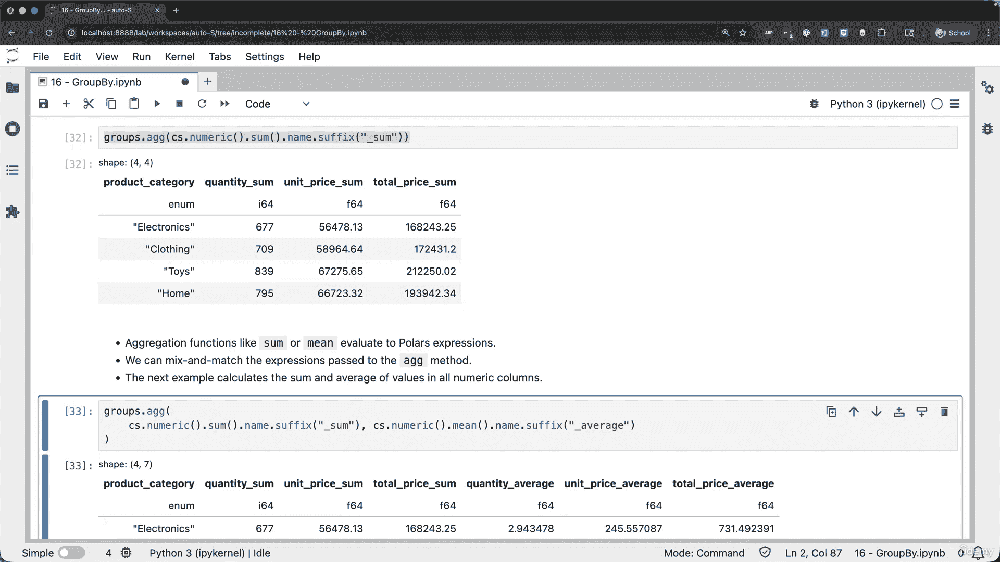

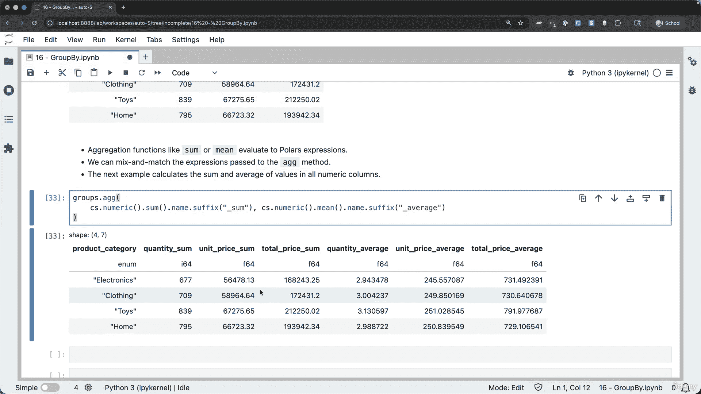

本节课中我们一起学习了Polars聚合中`selectors`的用法。我们回顾了`groupby`对象顶层方法、`agg`精确指定列，以及使用选择器作为第三种补充方案；学习了`cs.numeric()`可以定位所有数值列，不关心里面是整数还是浮点；学习了`name.suffix()`可以给聚合产生的列名加统一后缀；还混合了`sum`和`mean`两个表达式，按产品类别同时生成总和与平均值。核心思路是：用选择器构建针对特定列的表达式，再交给`agg`完成聚合，从而减少逐列书写的重复工作。原文最后也强调，这就是利用之前讨论过的`selectors`模块来构建查询、定位目标列并应用聚合操作的一次快速介绍。
