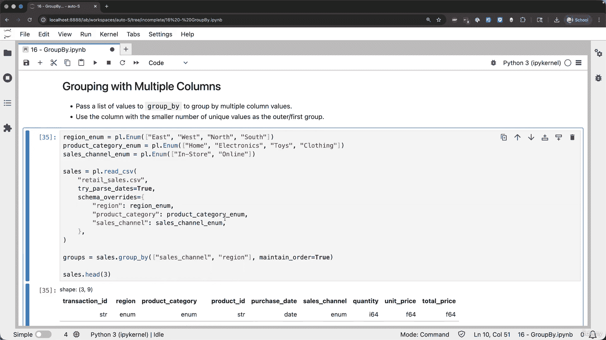
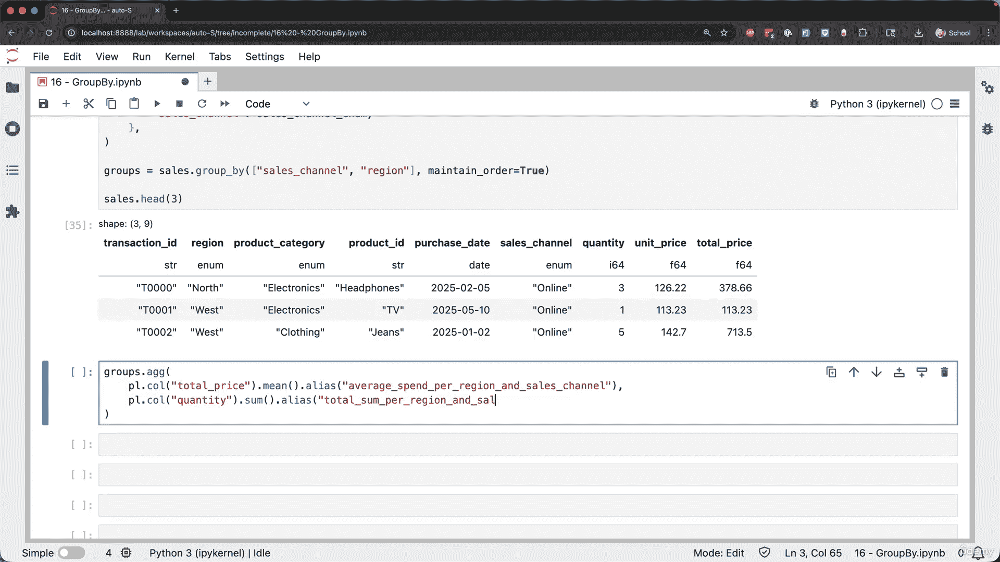
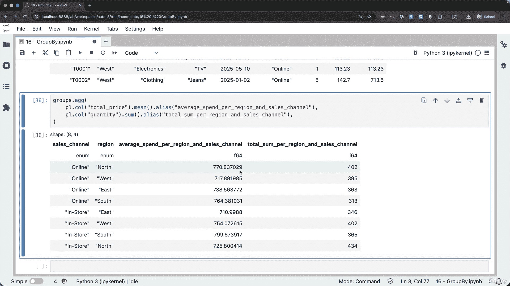

# Polars 与 Python 数据分析：p82：多列分组 📊

在本节课中我们将要学习如何在 Polars 中按多个列进行分组，并且在这些分组的基础上完成聚合计算。上一节我们介绍了单列分组的基本用法，本节中我们来看看当分组依据从一列变成两列时，Polars 会怎样生成组，以及聚合代码应该怎样写。为了照顾初学者，我们会先回顾单列分组的思路，再解释多列分组的组合逻辑，最后把代码和结果联系起来。整个过程中，重点不是记住复杂语法，而是理解“组”是怎样被定义出来的，以及 `agg` 方法为什么仍然可以照常使用。只要把“组”的含义想清楚，后面的代码就会顺很多。

## Polars 与 Python 数据分析：p82：从单列分组回顾开始 🧭

在之前所有课程中，我们创建了一个 `group_by` 对象，并使用单列 `product_category` 中不同的唯一值来形成 `group_by` 对象内部的各个组。这个思路比较直接：某一列里有几个不同的值，就可能形成几个组。回顾这一点很重要，因为多列分组并没有推翻原来的逻辑，它只是把“按一个值分组”扩展成了“按多个值的组合分组”。理解了这个基础之后，后面的代码就不会显得突然，也更容易看出多列分组到底改变了什么。

理解了单列分组的做法之后，本节中我们来看看多列分组到底是怎么回事。实际上，可以按多个列中的值进行分组，Polars 会把这些列所有可能值的组合作为组。也就是说，分组依据不再是一个单独的值，而是一组值同时确定一个组。下面的公式可以直白地表示组合数量：

\[
\text{组数} = \text{第一列不同值的数量} \times \text{第二列不同值的数量}
\]

## Polars 与 Python 数据分析：p82：多列分组的组合逻辑 🧩

例如在这里，我们尝试一种不同的做法：传入一个列表，而不是传入单个字符串。由于目前对 `product_category` 已经讨论得足够多，所以先把它换掉。我们首先使用 `sales_channel` 列创建一个 `group_by` 对象，该列存储两个不同的值，也就是 `online` 和 `in person`；随后还要把 `region` 列加入分组条件。这样，四个 `region` 值和两个 `sales_channel` 值会形成所有可能的组合，也就是四个选项乘以两个选项。

以下是多列分组时组数形成的具体逻辑，可以按步骤理解：

- `sales_channel` 有两个不同值：`online` 和 `in person`。
- `region` 有四个不同值。
- 每个 `sales_channel` 值都能与每个 `region` 值组合一次。
- 因此可能出现 \(2 \times 4 = 8\) 种组合。
- 这 8 个组合就是 8 个组，会被存储在创建出来的 `group_by` 对象中。

完成组合逻辑的梳理后，我们来看看创建分组对象的代码。执行这段代码之后，后续聚合的逻辑仍然和单列分组时完全一样，只是组的来源变成了多列组合。下面的代码用列表同时指定 `sales_channel` 和 `region` 两列，其中 `df` 代表你的数据表：

```python
groups = df.group_by(["sales_channel", "region"])
```

## Polars 与 Python 数据分析：p82：在多列分组上聚合 📈



创建好 `group_by` 对象之后，我们来看看怎样调用聚合方法。例如可以取出这个分组对象，调用 `agg` 方法，并在其中创建针对 `total_price` 列的表达式。然后应用类似 `mean` 的聚合操作，并把结果列命名为类似 `average_spend` 的名称。这里的列名是为了说明计算含义，也就是按 `region` 和 `sales_channel` 计算出来的平均花费，这样读者看到结果时就能明白每一行代表什么。列名不是随便起的，它可以帮助我们把计算结果和业务含义对应起来。

以下是聚合计算中涉及的两个核心操作，它们都建立在同一套多列分组之上：

- 对 `total_price` 列求平均值，并将结果列命名为 `average_spend`，用来表示按区域和销售渠道计算的平均花费。
- 对 `quantity` 列求和，得到每个区域和销售渠道下所有售出数量的总和。

同样的聚合逻辑可以应用到另一列。我们还可以针对 `quantity` 这类列，取所有已售出数量的总和；再次强调，这个总和是每个 `region` 和 `sales_channel` 组合下的总和。下面的代码把这两个聚合操作写在同一个 `agg` 调用中，代码结构与单列分组时保持一致：

```python
result = groups.agg(
    pl.col("total_price").mean().alias("average_spend"),
    pl.col("quantity").sum()
)
```

现在执行这段代码。聚合逻辑相同，但结果中会看到 `sales_channel` 和 `region` 的所有 8 种组合。到这里，我们已经完成了这次分析，这些计算仍然按组执行，只不过现在使用的是多个列中的值作为创建组的基础。为了更清楚地理解结果的含义，可以这样理解：

> 计算依然按每个组执行，但组的定义已经变成多列值的组合。

## Polars 与 Python 数据分析：p82：总结 ✅





到这里，多列分组的核心步骤已经介绍完毕，下面进行总结。本节课中我们一起学习了如何在 Polars 中使用多列进行分组，如何把多个列名放进列表中创建 `group_by` 对象，以及如何在多列分组基础上调用 `agg` 完成平均值和求和等聚合计算。关键点在于：多列分组会把各列不同值的所有组合当作组，组数可以用 \(2 \times 4 = 8\) 这样的乘法来理解；创建分组对象后，聚合写法和单列分组保持一致，只是分组依据从一列变成了多列。

