# 🕒 Polars与Python数据分析：183：按时间分组数据

在本节课中我们将要学习如何在 Polars 和 Python 中按时间窗口对时间数据进行分组。前面几课里，我们一直用普通的分组方法把数据框中的行放进不同的桶或组里。本节的重点是时间数据，因为日期和时间不能简单地用“字符串完全相等”来判断是否应该分到同一组。我们会介绍专门处理时间数据的 `group_by_dynamic` 方法，理解时间窗口、排序、每周起点、自定义起始星期、按月与按季度分桶、组合时间间隔以及重叠窗口等用法。教程会尽量用大白话解释，让初学者也能看懂每一步在做什么。

## 📌 Polars与Python数据分析：183.1：为什么普通分组不适合时间数据

在前面的课程中，我们使用 `group_by` 方法，根据某一列中的不同值把数据框的行分到不同的桶或组中。到目前为止，这些组都是基于匹配字符串值创建的。字符串之间的相等比较容易定义，它是一种字面匹配，按字符顺序和大小写来判断。例如，两个字符串只有在每个字符的顺序和大小写都完全一样时，才会被视为相等。

但是，有时我们会遇到更复杂的数据类型，例如时间数据类型，也就是日期或时间。对于时间数据，Polars 提供了一个补充方法 `group_by_dynamic`，它专门用于按时间窗口对值进行分组。所谓时间窗口，也可以叫时间区间，就是一个时间跨度或间隔。例如，“每五分钟”是一个时间窗口，“每一年”或“每一个月”也是时间窗口。时间数据更难完美分组，因为时间的变化和波动很多，严格相等往往不是分析时想要的结果。

从 Python 或 Polars 的角度看，两个 `datetime` 值只有年、月、日、时、分、秒等属性全部匹配时，才会被认为相等。可以用下面的公式表示这种严格相等：

\[
t_1=t_2 \iff \text{年、月、日、时、分、秒等全部相等}
\]

但在分析时间序列数据时，我们通常不是要找完全相同的时刻。更常见的需求是把相似或相关的时间归到同一组，判断依据是它们是否落入同一个区间。例如，按小时分组时，下午 1:10、1:15 和 1:48 在严格相等标准下并不相同，但为了分析，我们可能希望把它们放进同一个桶。用公式表达这种“按小时归桶”的思路，就是：

\[
b(t)=\left\lfloor \frac{t}{1\text{小时}}\right\rfloor
\]

`group_by_dynamic` 就是帮助我们完成这种时间分组的工具，它专门用于对日期和时间数据分组。上一节我们说明了普通字符串分组与时间分组的区别，本节中我们来看看在真实数据框里如何准备时间列。

## 🧱 Polars与Python数据分析：183.2：准备数据并理解时间窗口

在我们的数据框中，有一列非常适合演示时间分组，这就是 `purchase_date` 列。例如，如果你想做业务分析，想知道每周或每月赚了多少钱，就可以把这一列中的值按指定的时间窗口分桶。这样得到的每个桶代表一段时间，而不是一个精确的日期值。

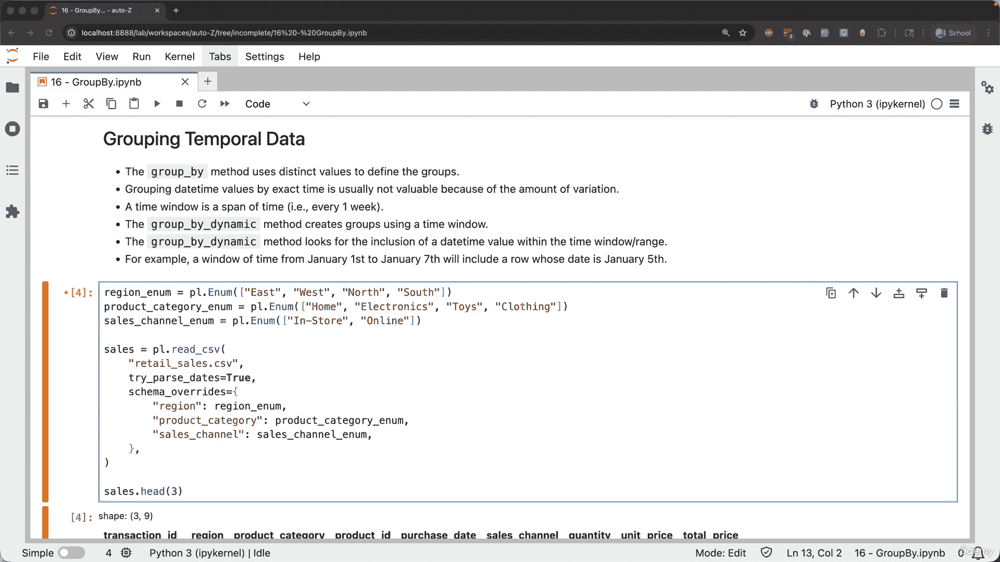

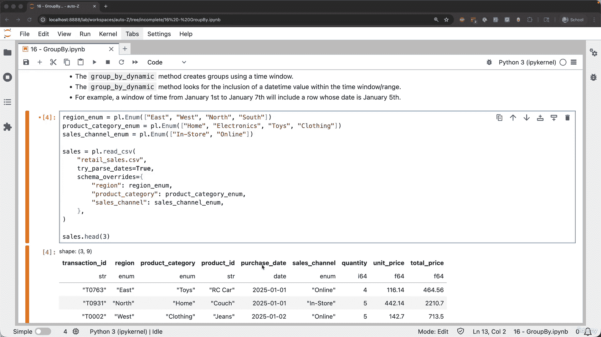

在进行动态分组之前，有一个重要细节需要注意：在创建分组对象之前，要先按将用于形成分组值的那一列排序。这里我们在导入数据后，马上给数据框加上 `sort` 方法，并指定按 `purchase_date` 列的值排序。排序后，日期会按升序排列，也就是从最旧的日期到最新的日期。示例代码如下：

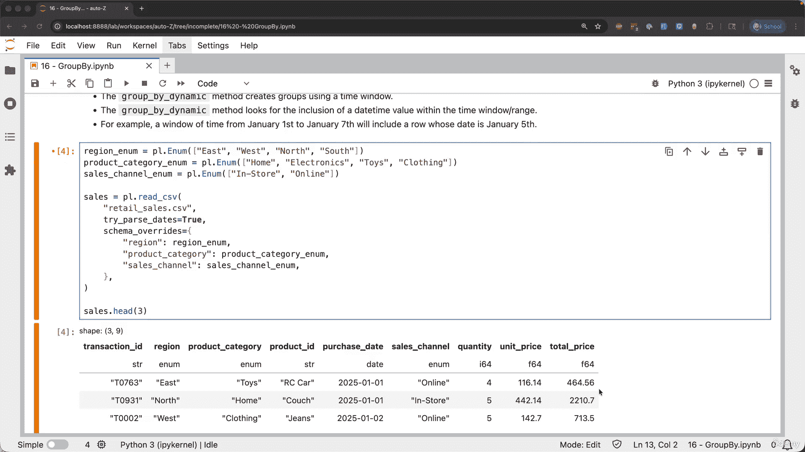

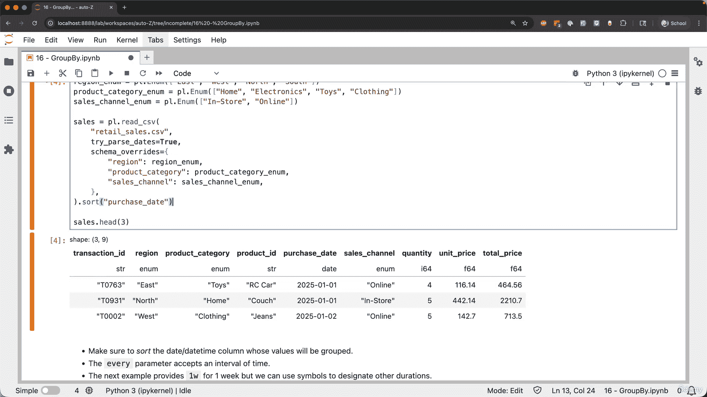

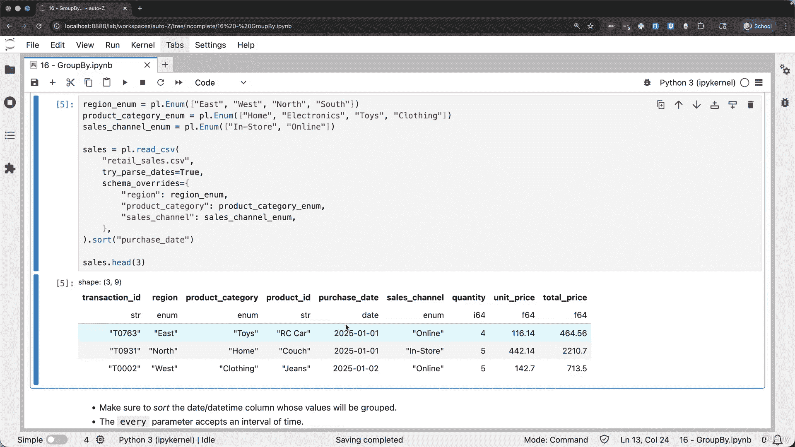

```python
sales = sales.sort("purchase_date")
```

排序后的数据会按时间顺序排列，这一点对动态分组很重要，因为时间桶通常会沿着时间顺序向前推进。以下是使用 `group_by_dynamic` 前需要记住的准备步骤：

- 先选好用于分组的时间列，例如 `purchase_date`。

- 按这个时间列排序，保证数据从旧到新排列。

- 再创建动态分组对象，并传入时间窗口参数。

完成这些准备后，我们就有了一个按时间排好序的数据框，接下来可以看看普通 `group_by` 为什么不适合按周汇总，以及 `group_by_dynamic` 是如何按周分桶的。

## 🪣 Polars与Python数据分析：183.3：用group_by_dynamic按周分桶

上一节我们完成了按时间列排序，本节中我们来看看如何按周对销售数据进行分组。普通 `group_by` 在这里不太好用，因为它会寻找完全匹配的日期值。假设我们要计算 `total_price` 列的总和，但不是按每个精确日期求和，而是按每一周求和。例如，从 1 月 1 日到 1 月 8 日算作一个桶，然后继续按周划分。这里的桶是一个时间跨度，等于一周，我们想计算这一周内的销售总和。

如果使用普通 `group_by`，它会按日期字面匹配，这不符合我们的目标。因此要改用 `group_by_dynamic`，它专门用于时间数据。我们需要指定用于分桶的列，也就是 `purchase_date` 列。然后使用参数 `every` 指定时间窗口或间隔。`every` 使用一种特殊字符串语法，用符号或字符表示时间跨度。例如，要按一周分桶，可以写 `"1w"`，其中 `1` 表示数量，`w` 表示周。代码如下：

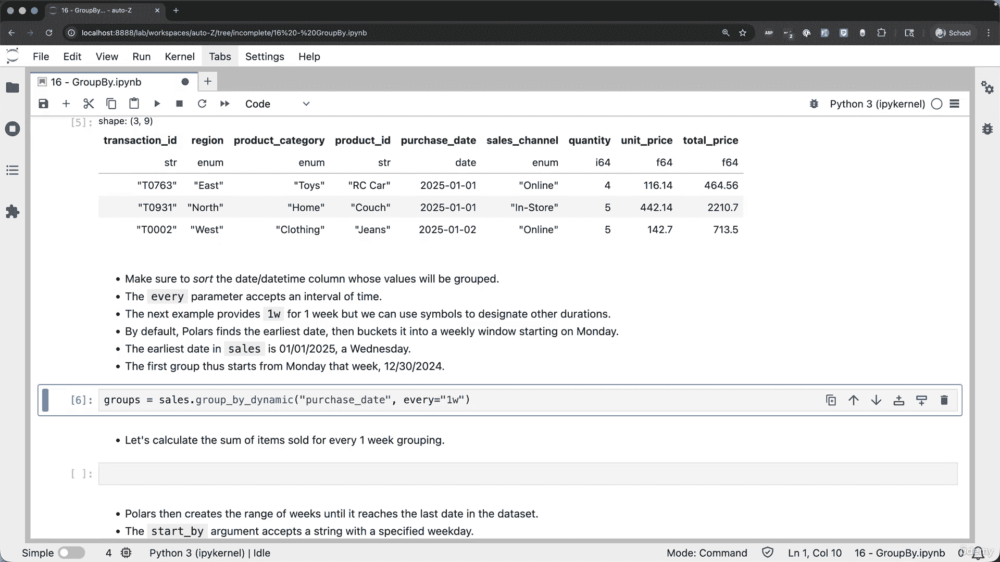

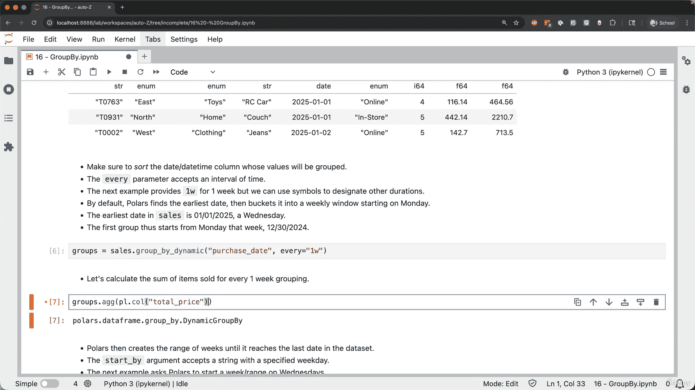

```python
groups = sales.group_by_dynamic(
    "purchase_date",
    every="1w"
)
```

这段代码要求每个桶基于一周的数据创建。这里有一个细节：Polars 从哪里开始每一周会影响结果。我们可以把结果传给 Python 的 `type` 函数查看，它会显示这是一个动态分组对象。它本质上仍然是组的集合，但这些组是按照“是否属于同一个一周时间窗口”来划分的。接着可以对 `groups` 调用熟悉的 `agg` 方法，创建针对 `total_price` 列的表达式并求和：

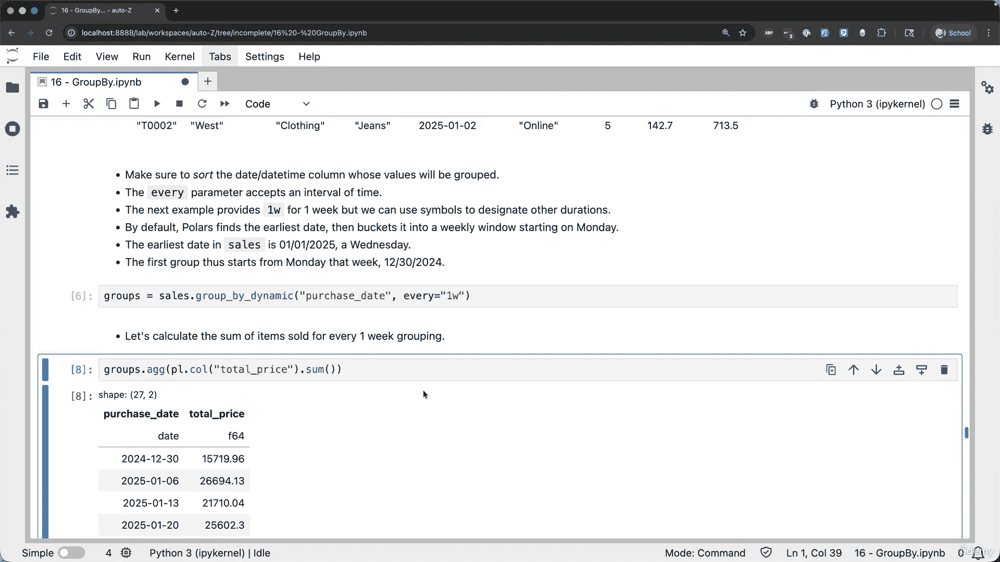

```python
groups.agg(
    pl.col("total_price").sum()
)
```

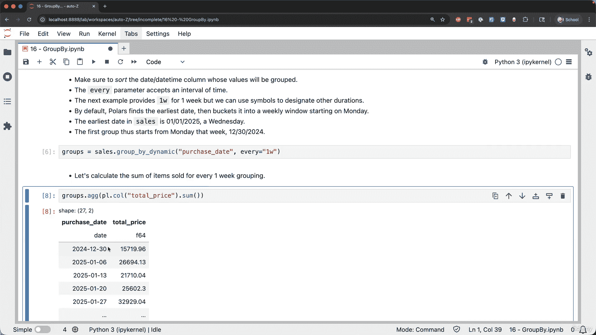

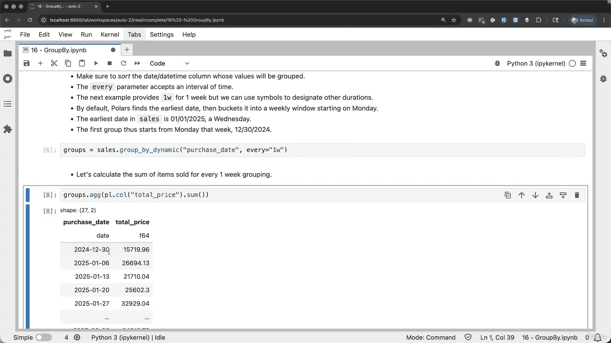

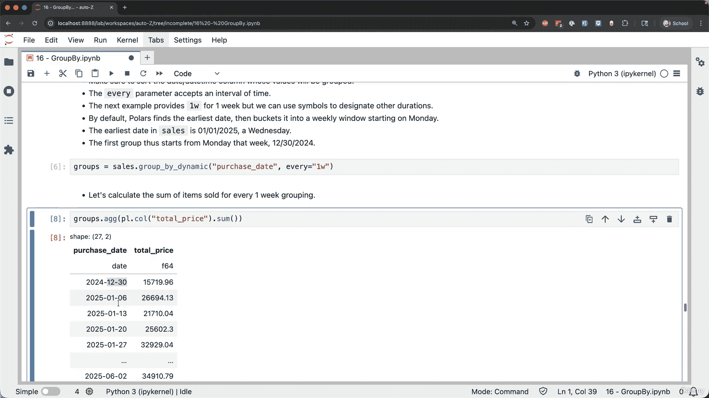

结果会符合预期。注意，分组值不是 `purchase_date` 列中的每一个不同日期，而是时间桶。例如，桶可能从 2024 年 12 月 30 日开始，然后按一周的增量推进到下一个日期，再下一个日期。也就是说，12 月 30 日之后一周是一个桶，1 月 6 日之后一周是下一个桶，以此类推。

这里还有一个默认行为需要理解：数据框中最早的日期实际是 2025 年 1 月 1 日。Polars 默认会选择那一周的星期一作为分组起点。2025 年 1 月 1 日是星期三，但默认分组不会从星期三开始，而是从星期一开始。因此，那一周最早的星期一是 2024 年 12 月 30 日。向下滚动结果可以看到，这个起点确实是星期一，下一个桶从下一个星期一开始，组就是这样收集起来的。上一节我们看到了默认按周分桶，本节中我们来看看如何自定义每周的起始星期。

## 📅 Polars与Python数据分析：183.4：自定义每周起点start_by

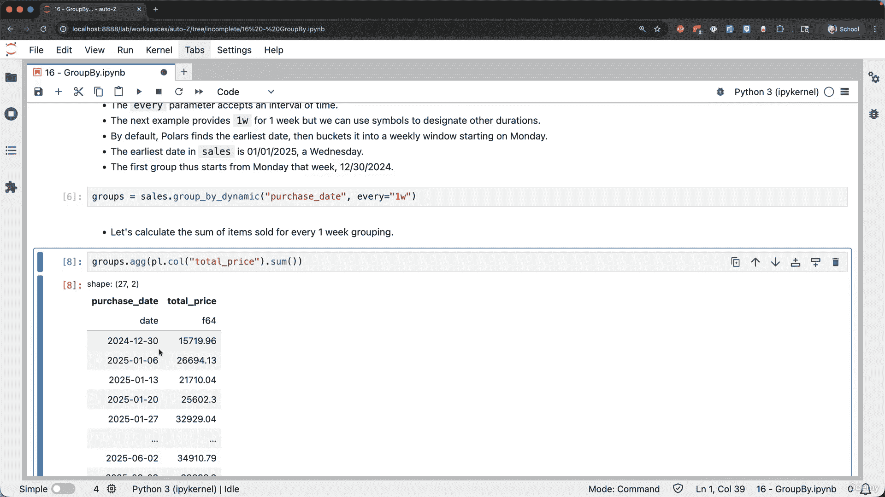

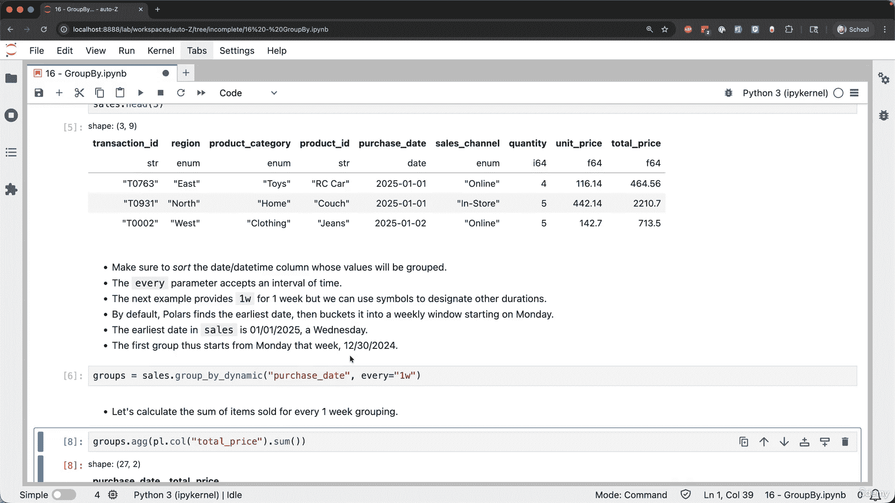

如果默认从星期一开始不符合需求，可以调整传给 `group_by_dynamic` 的参数。我们可以在代码中加入参数 `start_by`，它用于指定从星期几开始创建时间桶。例如，如果你希望第一个桶从星期三开始，并且数据中的第一个日期恰好是星期三，就可以传入 `start_by="wednesday"`。一周七天都支持，使用小写英文字符串即可。代码如下：

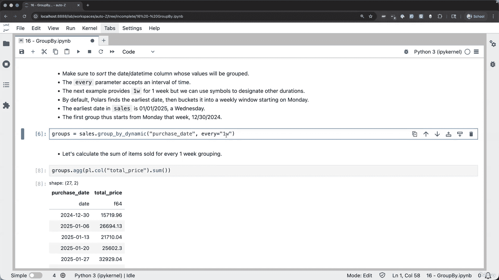

```python
sales.group_by_dynamic(
    "purchase_date",
    every="1w",
    start_by="wednesday"
).agg(
    pl.col("total_price").sum()
)
```

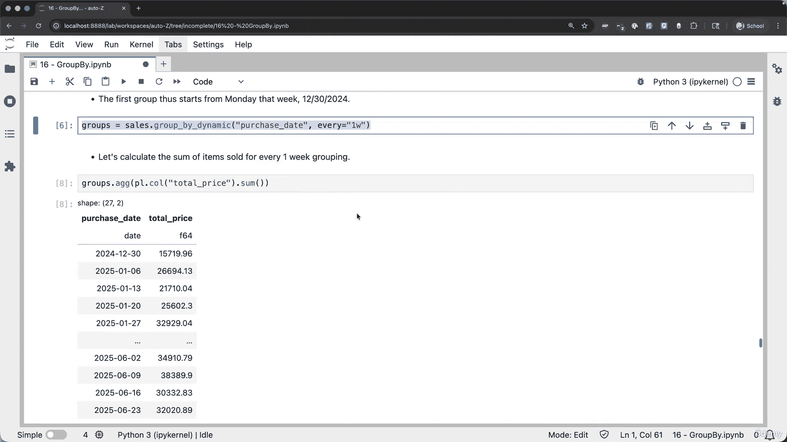

这样仍然会创建时间桶，但日期会基于第一个遇到的星期三开始。2025 年 1 月 1 日是数据中的第一个实际数据点，它恰好是星期三，所以分组会从星期三开始，并按每周的增量继续推进。

在这个场景中，我们是手动发现 1 月 1 日是星期三的。如果你不想手动判断，可以告诉 Polars 自己找出数据中第一个时间值所属的星期，并从那个点开始按一周分桶。这时可以把 `"wednesday"` 替换为 `"data_point"`。`data_point` 的含义是：找到数据中的第一个数据点或第一个时间值，从那天开始按一周的窗口向前推进。代码如下：

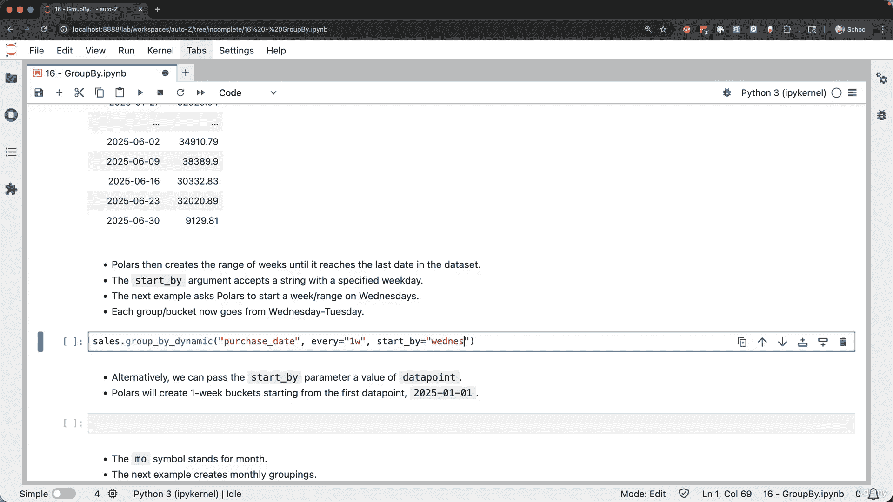

```python
sales.group_by_dynamic(
    "purchase_date",
    every="1w",
    start_by="data_point"
).agg(
    pl.col("total_price").sum()
)
```

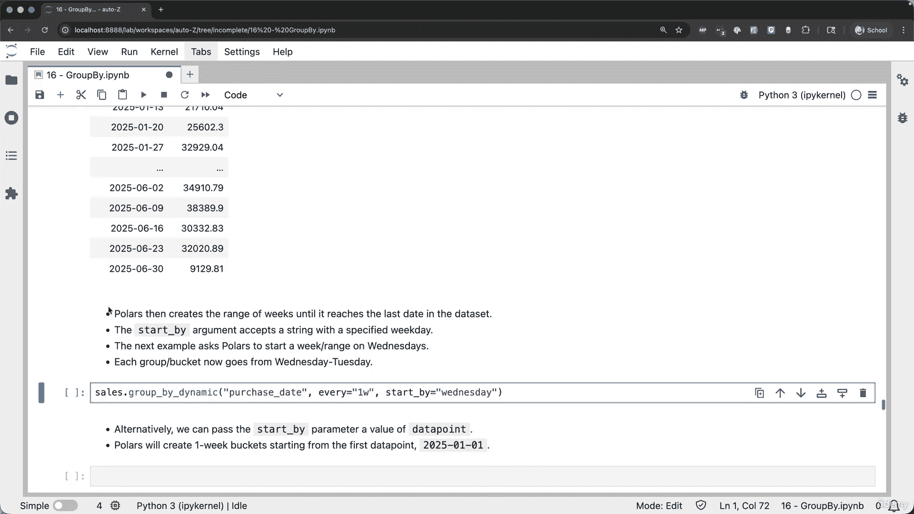

因为数据集中的第一个值是 2025 年 1 月 1 日，而它恰好是星期三，所以一周的时间桶会从星期三开始，并一直推进到最后一个能够完整覆盖数据集中所有行的星期三。这样就能看到业务按周统计的总销售额。以下是 `start_by` 的常见取值思路：

- `"monday"`：从星期一开始创建时间桶。

- `"wednesday"`：从星期三开始创建时间桶。

- `"data_point"`：让 Polars 找到第一个数据点，并从那个时间点开始推进时间桶。

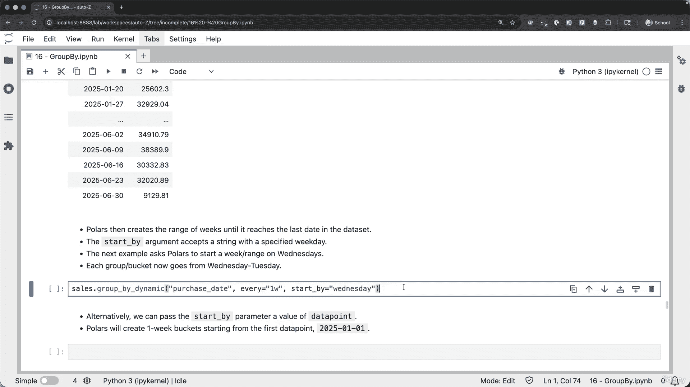

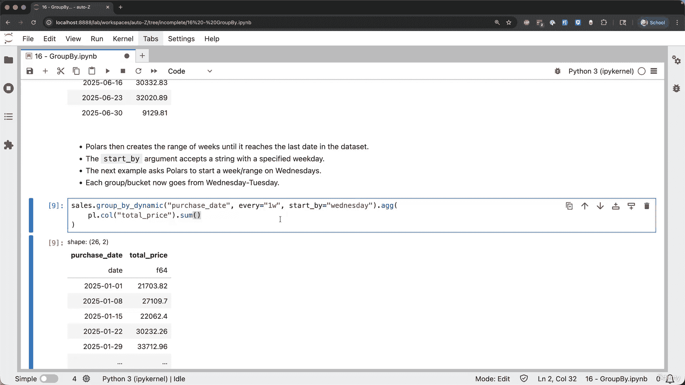

上一节我们自定义了每周起点，本节中我们来看看如何把时间窗口改成按月、按季度以及组合间隔。

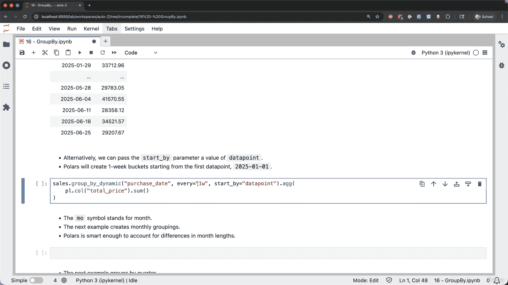

## 📆 Polars与Python数据分析：183.5：按月、按季度和组合间隔

`every` 参数不限于一周，我们可以自定义时间窗口。例如，如果想按月查看销售数据，可以使用月份的符号 `mo`。代码如下：

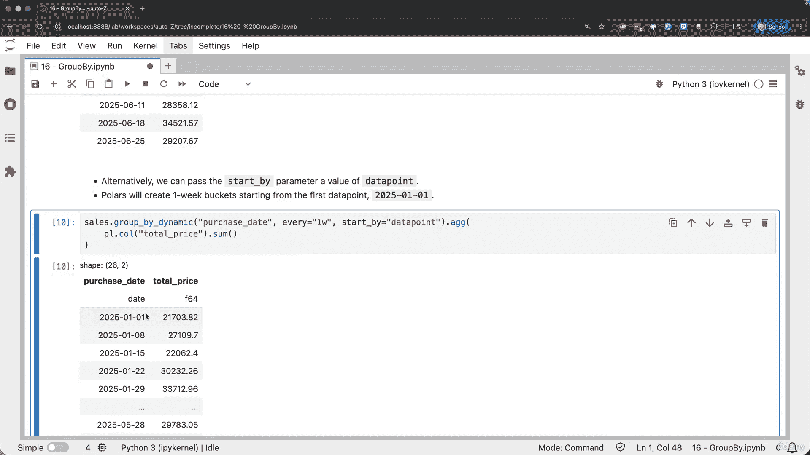

```python
sales.group_by_dynamic(
    "purchase_date",
    every="1mo",
    start_by="data_point"
).agg(
    pl.col("total_price").sum()
)
```

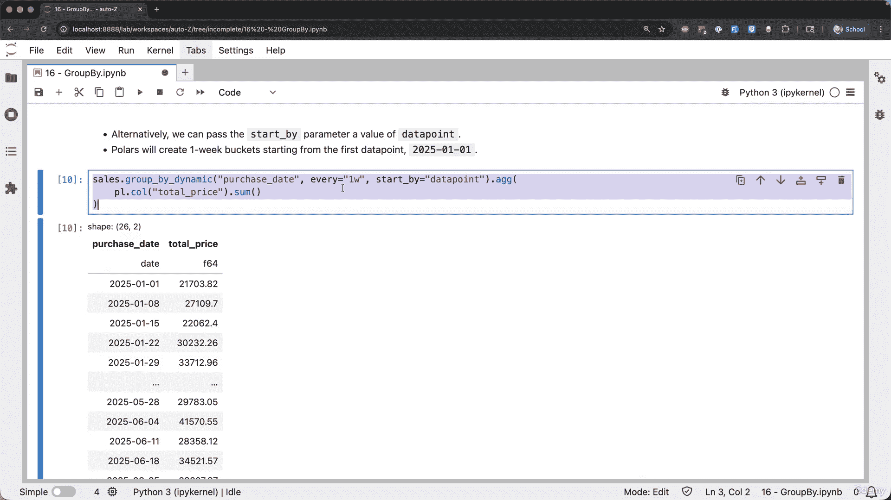

Polars 会看到第一个数据点是 2025 年 1 月 1 日，并把它作为一月的开始。向前推进时，桶不再是每一周，而是每一个月。当然也可以自定义为每两个月，使用 `"2mo"` 即可。如果想模拟季度销售，可以每三个月分桶，只要写成 `"3mo"`，其中 `3` 表示三个，`mo` 表示月：

```python
sales.group_by_dynamic(
    "purchase_date",
    every="3mo",
    start_by="data_point"
).agg(
    pl.col("total_price").sum()
)
```

这样就会从数据集中的第一个数据点 2025 年 1 月 1 日开始，创建每三个月一个的时间桶，并得到按季度统计的总销售额。

此外，时间窗口不要求只包含一个时间单位。可以组合多个单位，例如创建一个窗口间距为一个月、两周、三天的时间桶，写成 `"1mo2w3d"`。Polars 会把这些符号合并在一起，形成桶的边界：

```python
sales.group_by_dynamic(
    "purchase_date",
    every="1mo2w3d",
    start_by="data_point"
).agg(
    pl.col("total_price").sum()
)
```

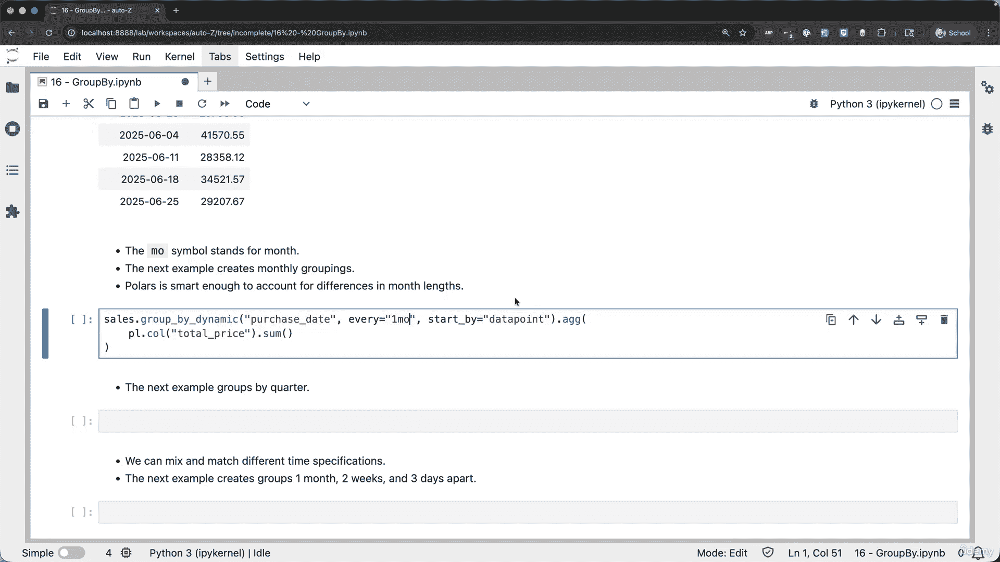

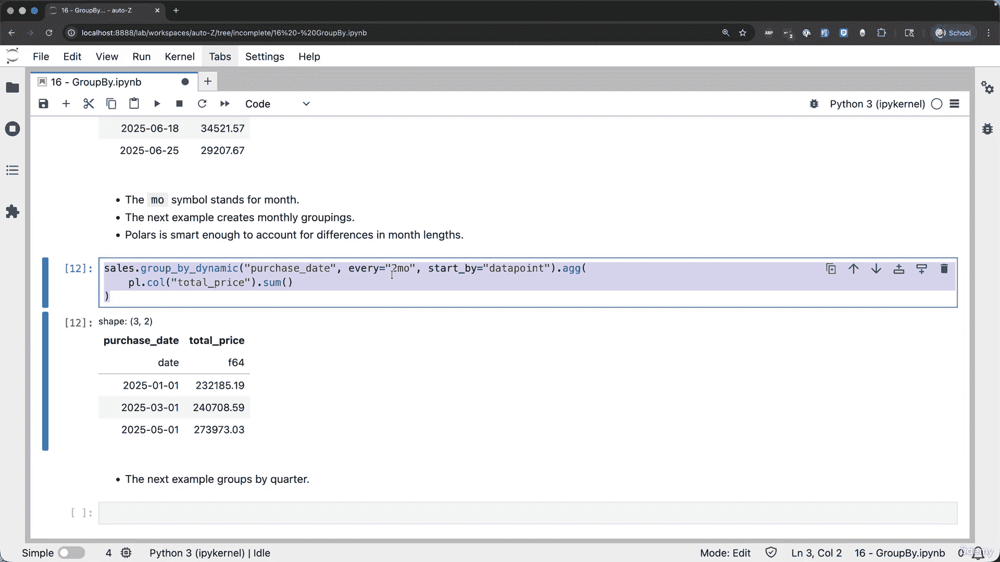

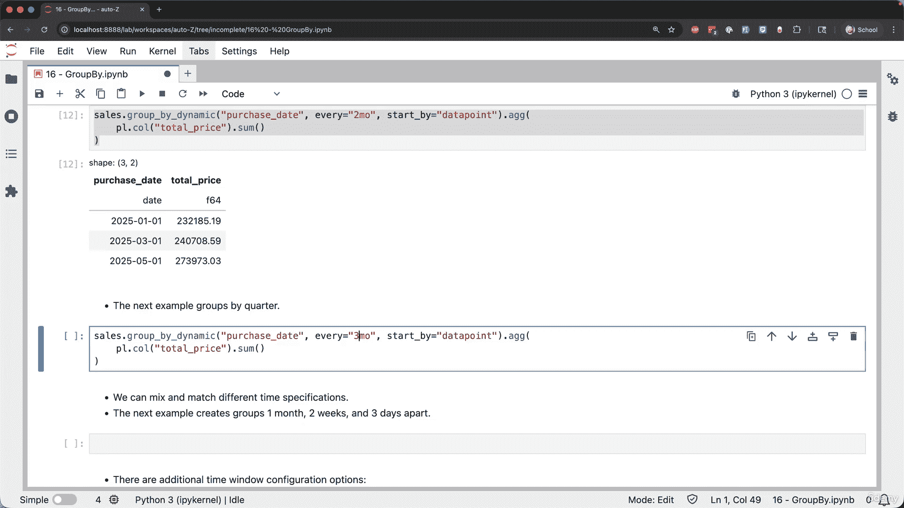

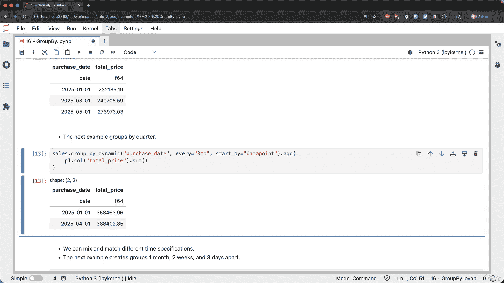

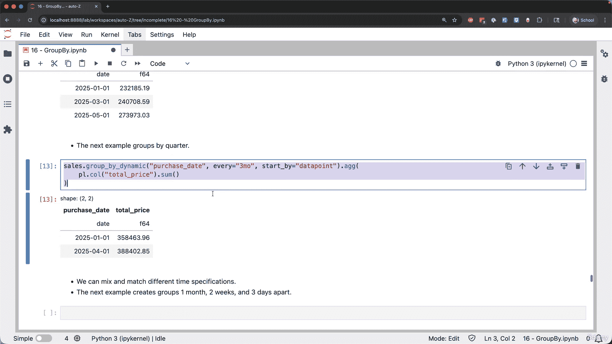

这时桶确实会相隔一个月、两周、三天。以下是本节会用到的时间单位符号：

- `d`：天。

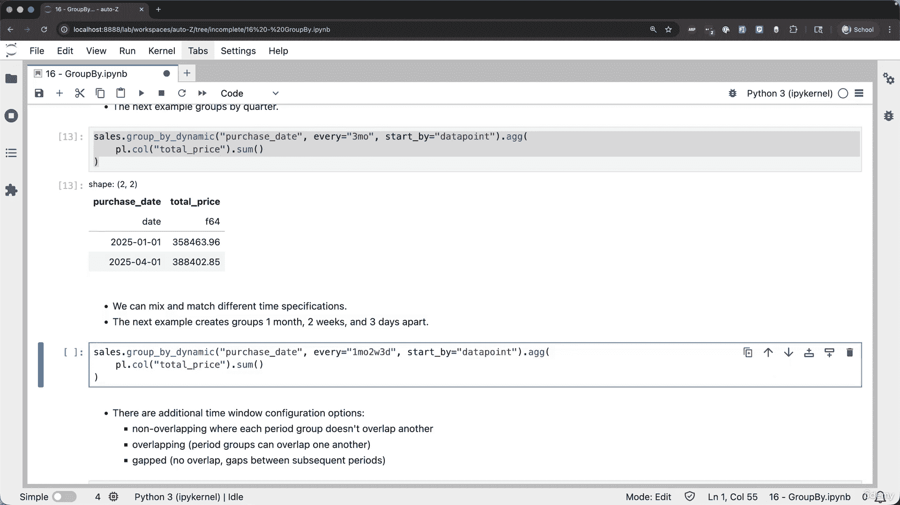

- `w`：周。

- `mo`：月。

这些符号可以组合使用，形成 Polars 用来组织日期数据的时间桶、约束、限制或边界。Polars 仍然会创建这些组，然后执行完全相同的聚合分析，例如对 `total_price` 列求和，只不过现在行是按照时间跨度或时间间隔来分桶的。上一节我们介绍了按月、按季度和组合间隔，本节中我们来看看重叠时间窗口以及后续聚合方法的一致性。

## 🔁 Polars与Python数据分析：183.6：重叠时间窗口与聚合方法一致

如果深入查看文档，`group_by_dynamic` 还有很多配置选项。例如，你可能需要滚动总计，也就是时间窗口之间可能重叠。假设你想看每三天的销售数据，但让窗口重叠：第一个窗口包含星期一、星期二、星期三，第二个窗口包含星期二、星期三、星期四，第三个窗口包含星期三、星期四、星期五。在这个例子中，时间窗口不是彼此分离的，而是可能重叠。这种效果可以通过给 `group_by_dynamic` 提供正确参数来实现，从而按你希望的方式切分时间数据。重叠窗口可以用下面的关系表示：

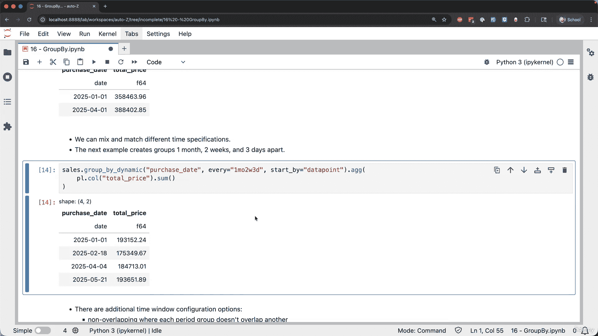

\[
W_i=[s_i,s_i+\Delta),\quad W_i\cap W_{i+1}\neq\emptyset
\]

一旦创建了 `group_by_dynamic` 对象，后续方法和普通 `group_by` 完全一样。你可以调用 `agg`，创建针对某一列的表达式，然后执行分析，例如求和。唯一区别是，现在的组是按照时间跨度或时间窗口创建的，而不是按照字符串或普通值精确匹配创建的。换句话说，前面的准备和分组方式变了，后面的聚合分析方式仍然保持一致。

## ✅ Polars与Python数据分析：183.7：总结

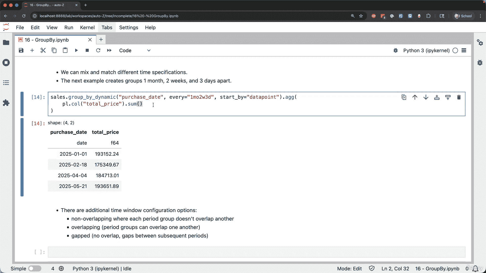

本节课中我们一起学习了如何用 Polars 的 `group_by_dynamic` 按时间窗口分组。普通 `group_by` 适合字符串等容易定义字面相等的值，而时间数据如果按精确相等分组，往往会把同一分析区间内的记录拆得太碎。`group_by_dynamic` 专门用于时间数据，它通过 `every` 参数定义时间窗口，例如 `"1w"` 表示一周，`"1mo"` 表示一个月，`"3mo"` 表示三个月，`"1mo2w3d"` 表示一个月、两周、三天组合间隔。创建动态分组前要先按时间列排序，默认按周分组时 Polars 会从该周的星期一开始，也可以用 `start_by` 指定从星期三等星期几开始，或者用 `start_by="data_point"` 让 Polars 从第一个数据点开始推进时间桶。最后，动态分组对象仍然可以调用 `agg` 等方法做聚合，和普通分组后的分析方式一致，只是组现在由时间窗口来定义。至此，我们已经掌握了按周、按月、按季度以及按组合间隔分析时间数据的基本方法。 
