## 📊 Polars 数据分析：第84节：窗口函数与 over 方法

在本节课中，我们将要学习窗口函数和 `over` 方法。严格来说，`over` 方法并不涉及 `group by` 对象，但它和分组操作有相似之处，因为 `over` 方法会把某个操作应用到属于同一组的所有值上。换句话说，它在思路上与分组操作很接近。下面我们用一个例子来说明它能在哪些场景中发挥作用。首先执行导入代码，数据表名为 `sales`。

### 🔁 回顾 rank 方法

上一节我们介绍过一些基础方法，本节中我们先把 `rank` 方法重新过一遍，为后面的 `over` 示例做准备。`rank` 方法会按照从小到大或从大到小的顺序，给某一列中的值排名。例如，我们想查看所有交易，并按照 `total_price` 列中的值为每笔交易分配一个排名：总价最高的交易排名为 1，总价第二高的交易排名为 2，依此类推。要实现这个目标，可以使用 `rank` 方法。下面是基本写法。

```python
sales.with_columns(
    pl.col("total_price").rank(descending=True).alias("rank")
)
```

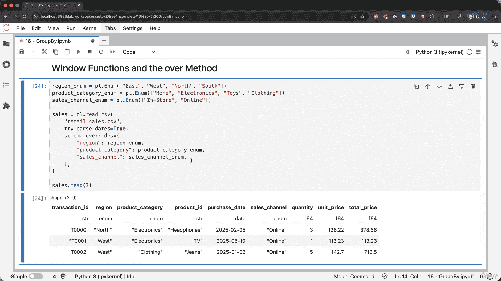

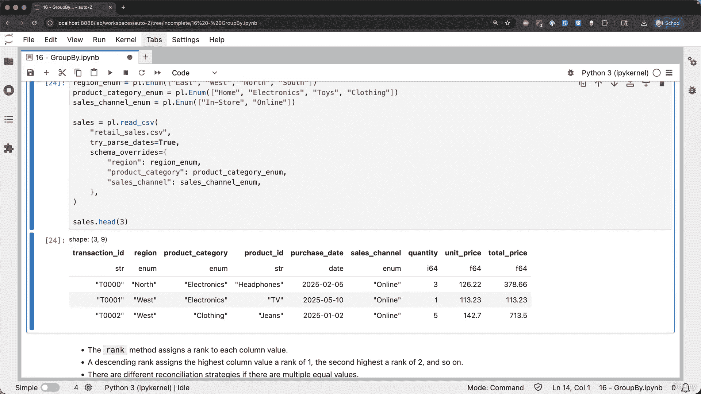

需要说明的是，`rank` 方法默认会把总价最高的值排到最后一名，这并不是我们想要的结果。我们希望排名第 1 的交易是最贵或最赚钱的交易，因此要给 `descending` 参数传入 `True`。同时，我们使用 `alias` 方法把新列命名为 `rank`。执行后，我们会得到一个 `rank` 列，其中所有行都按照 `total_price` 列的值进行了排名。

为了让结果更容易查看，我们可以把 `rank` 方法的结果从 64 位浮点数转换为整数。这里使用 `cast` 方法转换数据类型，并在 Polars 顶层命名空间中访问无符号整数类型 `pl.UInt32`。使用无符号整数的原因很简单：这些排名不可能是负数，它们都会从 1 开始，一直排到最高名次。转换完成后，我们还可以按 `rank` 列排序，验证结果是否正确。以下代码展示了完整写法。

```python
sales.with_columns(
    pl.col("total_price")
      .rank(descending=True)
      .cast(pl.UInt32)
      .alias("rank")
).sort("rank")
```

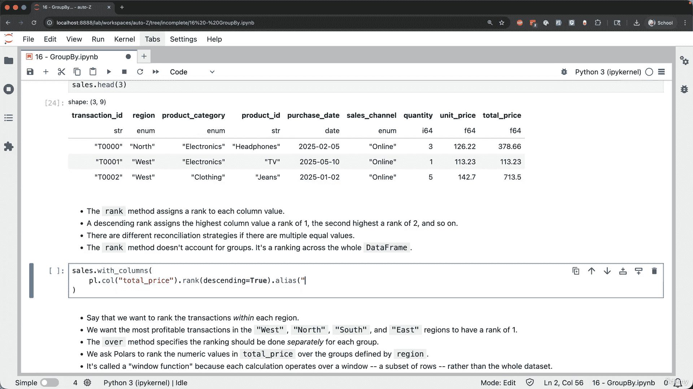

排序后可以看到，排名为 1 的行表示该行 `total_price` 最高，排名为 2 的行表示总价第二高，后面的行依此类推。到这里，我们快速回顾了 `rank` 方法。接下来提出一个新的需求：如果不想对完整数据框的所有行排名，而是想在每个区域内分别排名，应该怎么做。

### 🧮 需求：按 region 分组排名

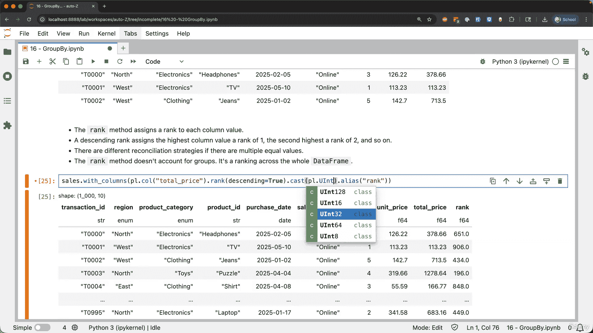

上一节我们回顾了整体排名，本节中我们来看看如何在每个 `region` 内部排名。假设 `region` 列中一共有四个区域：`west`、`north`、`south` 和 `east`。我们希望每个区域中最赚钱的交易排名为 1，每个区域中第二赚钱的交易排名为 2。也就是说，我们不是基于所有行排名，而是基于 `region` 列中的值分组后，在每个组内部排名。这类似于先按 `region` 列创建分组，再在每个分组内部执行排名。使用 `over` 方法就可以完成这个任务。

窗口函数的核心思路可以用下面的公式表示。

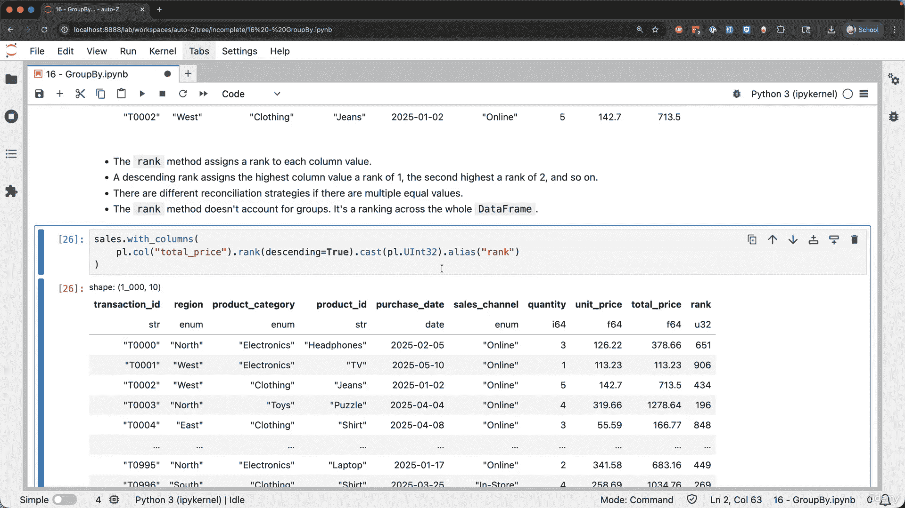

\[
\text{组内排名}(x,g)=\operatorname{rank}(x)\ \text{over each distinct value of }g
\]

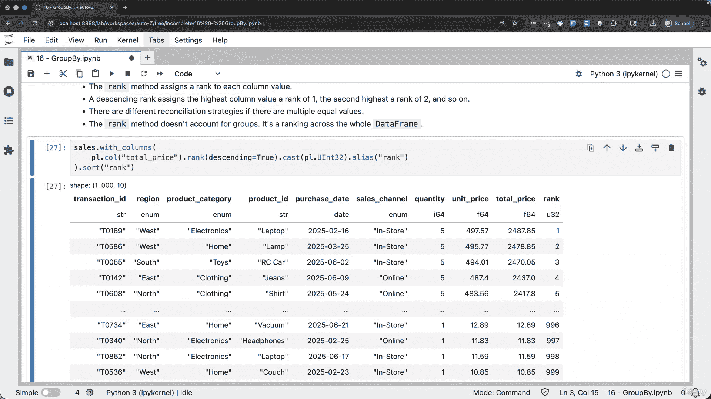

具体做法是复制上一节的代码，在 `rank` 后面加上 `over` 方法。`over` 方法允许我们指定在什么分组上执行操作，也就是指定按哪些组来排名。我们通过传入列名来指定分组依据，该列中的不同值会作为形成分组的基础。这个原理和给 `group by` 方法传入列名完全相同：`group by` 中的列名决定哪些值形成不同的桶或分组，`over` 这里也是同样的原理。下面的代码按 `region` 列排名。

```python
sales.with_columns(
    pl.col("total_price")
      .rank(descending=True)
      .over("region")
      .cast(pl.UInt32)
      .alias("rank")
).sort("rank")
```

执行后会得到一个完全不同的结果。由于一共有四个不同的区域，排名 1 会重复出现四次：一次是 `south` 区域中总价最高的交易，一次是 `east` 区域中总价最高的交易，`west` 和 `north` 也遵循同样的逻辑。继续往后看，排名 2 同样会出现四次，因为一共有四个区域。以下列出观察结果时可以关注的要点。

- 排名 1 会重复四次，因为每个区域各有一个最高总价交易。

- 排名 2 也会重复四次，因为每个区域各有一个第二高总价交易。

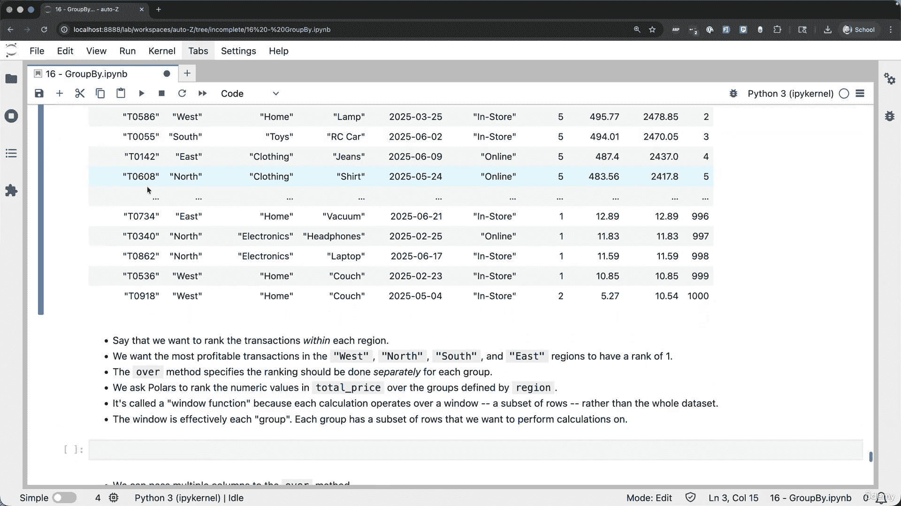

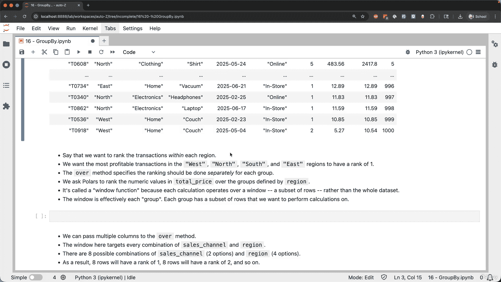

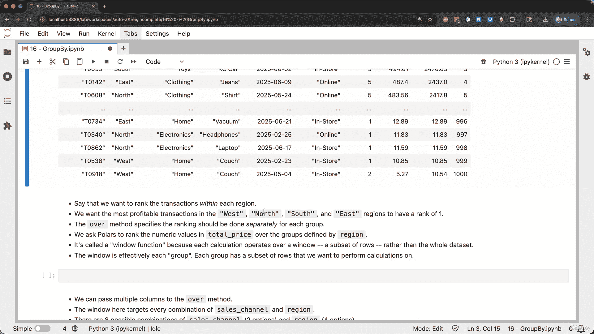

- 每个区域内部独立排名，而不是所有区域混在一起排名。

`over` 方法并不只能指定一列。我们可以继续扩展这个例子，看看多列组合时的效果。

### 🧩 多列组合：按 sales channel 与 region 排名

上一节我们按单个 `region` 列进行了组内排名，本节中我们来看看按多个列组合排名。我们可以让需求更复杂一些，例如按照 `sales_channel` 和 `region` 的每一种组合来排名。这里可以在 `over` 中传入第二个参数，也就是另一个列名 `sales_channel`。这等价于在 `group by` 方法中传入两个列名。

组合数量可以用下面的公式表示。

\[
\text{组合数}=4\times2=8
\]

数据中一共有四个不同的区域，以及两个不同的销售渠道：`online` 和 `in store`。因此两者组合的总数是 4 乘 2，也就是 8。下面的代码展示了按两列组合排名，并按 `rank` 和 `sales_channel` 排序。

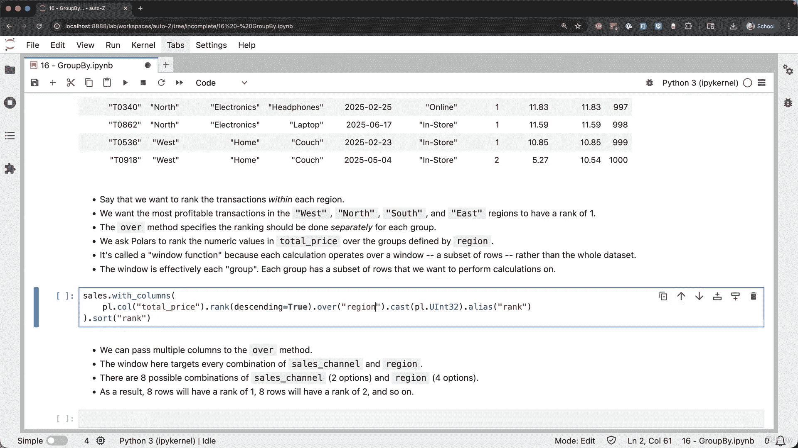

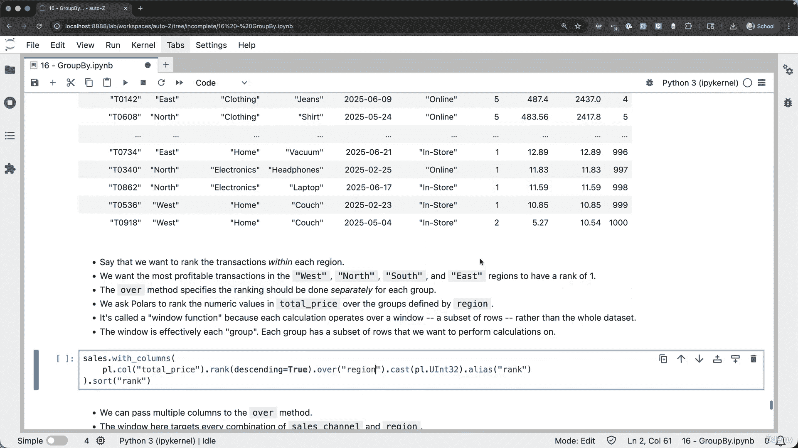

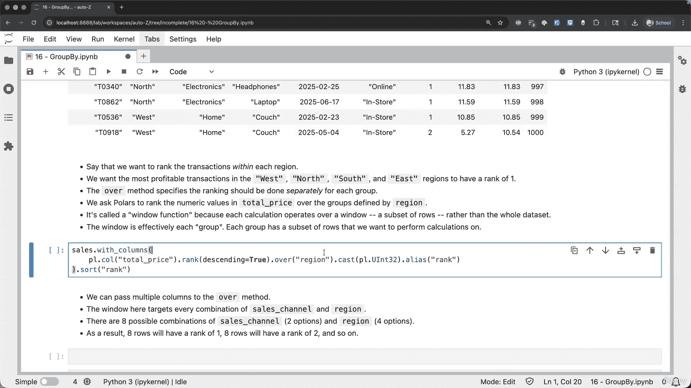

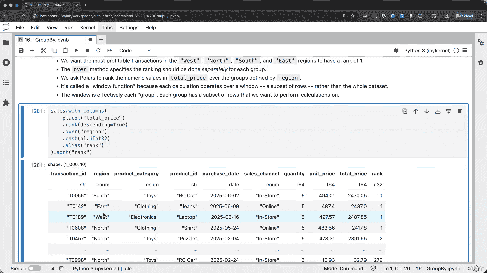

```python
sales.with_columns(
    pl.col("total_price")
      .rank(descending=True)
      .over("region", "sales_channel")
      .cast(pl.UInt32)
      .alias("rank")
).sort(["rank", "sales_channel"])
```

执行后会出现八行排名为 1 的记录，因为每一个不同的 `region` 和 `sales_channel` 组合都会产生一个排名 1。为了看得更清楚，我们可以先按 `rank` 排序，再按 `sales_channel` 排序。以下列出验证结果时的要点。

- 排名 1 一共有八行，对应八个不同的区域与渠道组合。

- `in store` 会重复四次，因为它与四个区域形成一对一组合。

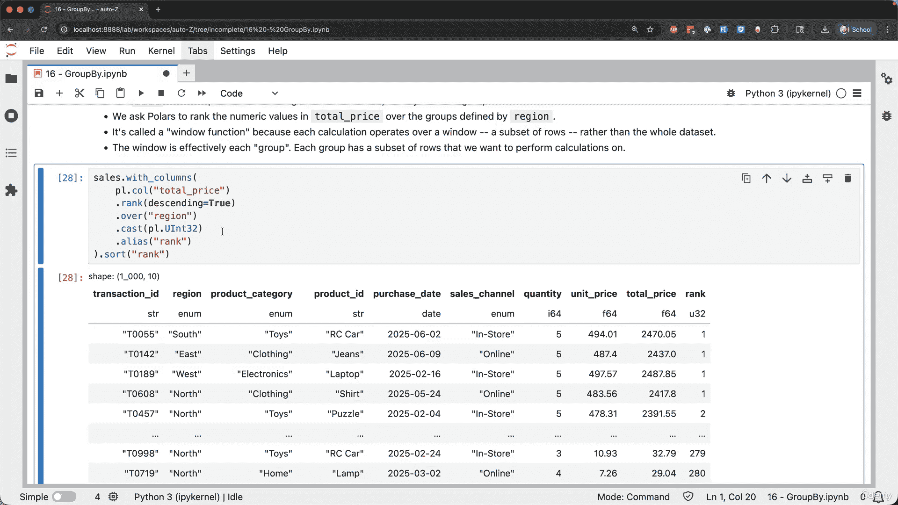

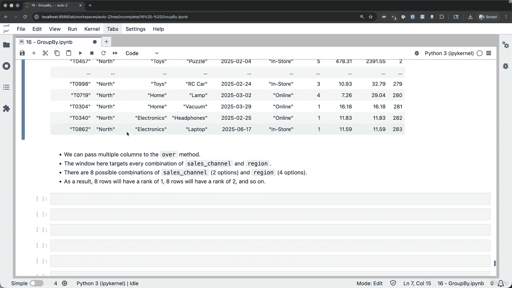

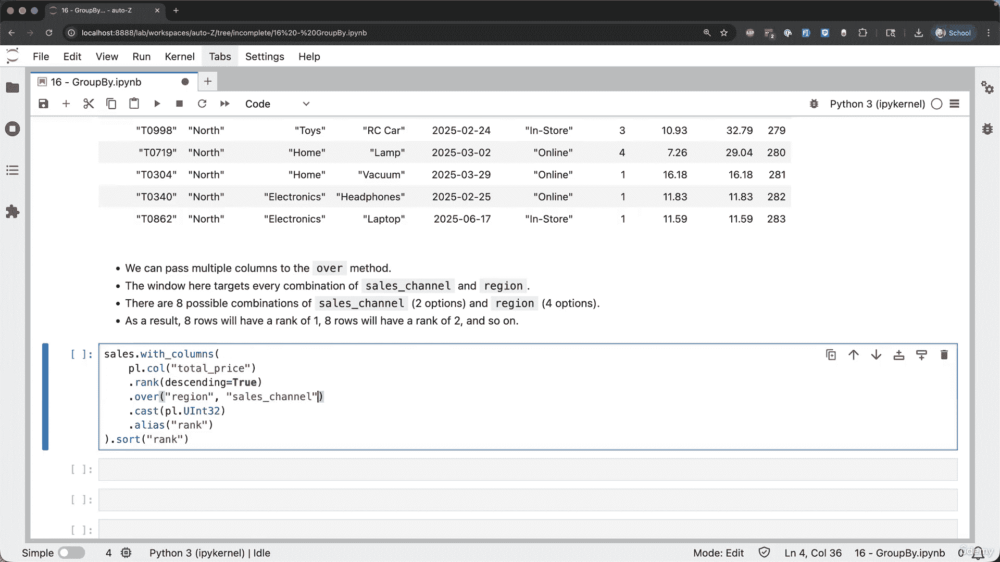

- `east` 与 `in store` 的组合中，总价最高的交易排名为 1。

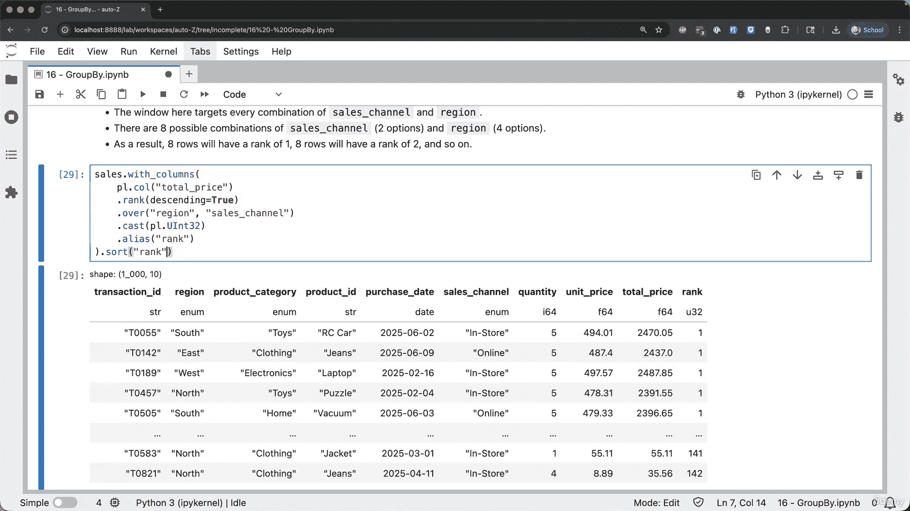

- `south` 与 `in store` 的组合中，总价最高的交易排名为 1。

- 四个区域加 `in store` 会产生四行排名 1，四个区域加 `online` 也会产生四行排名 1，合计八行排名 1。

- 排名 1 处理完后，结果会继续进入排名 2，后面的排名依此类推。

这个例子说明，我们正在执行一种聚合性质的操作，本例中是排名操作，但现在是按照一列或多列中的不同值来执行。它和 `group by` 的思路相近，但仍然是略有不同的操作，因为它实际上并不涉及 `group by` 对象。

### ✅ 总结

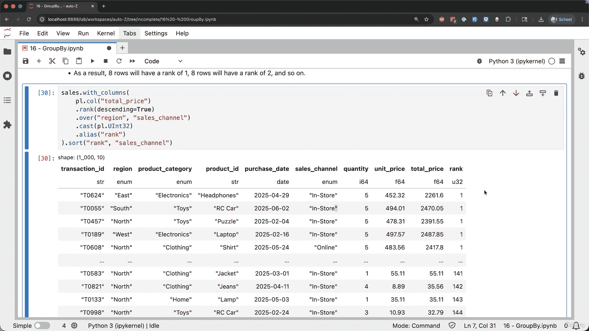

本节课中我们一起学习了窗口函数和 `over` 方法。我们先回顾了 `rank` 方法，了解了如何按 `total_price` 列从高到低排名，以及如何用 `descending=True`、`cast(pl.UInt32)` 和 `alias` 得到更清晰的排名结果。接着我们把排名范围从整个数据框缩小到每个 `region` 内部，使用 `over("region")` 实现了组内排名。随后我们又扩展到多列组合，使用 `over("region", "sales_channel")` 在每个区域与销售渠道的组合内部排名。核心结论是：`over` 方法和 `group by` 在思路上相似，但它不涉及 `group by` 对象；它可以把排名等操作应用到一列或多列的不同值分组上。下一节课再见。
