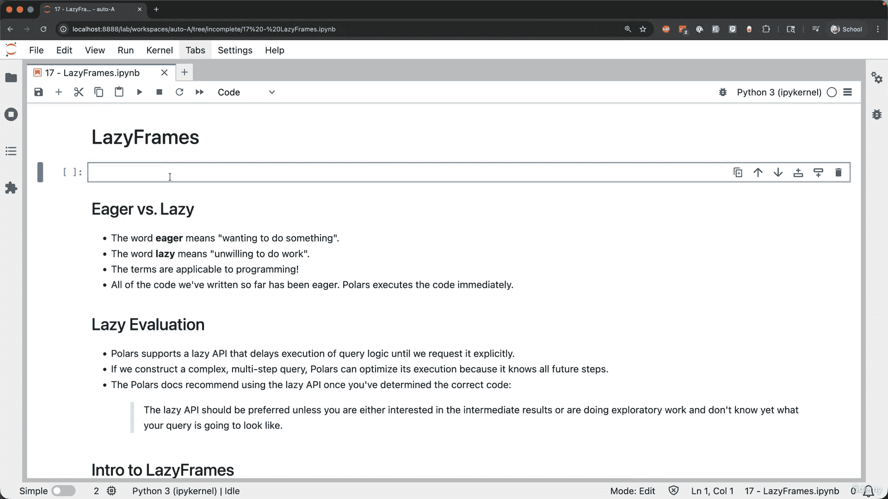
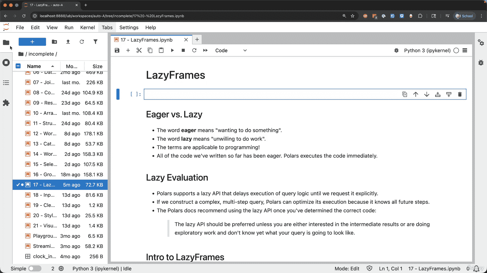
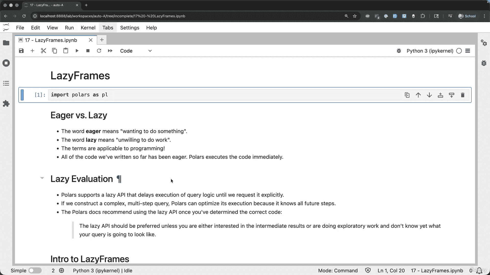
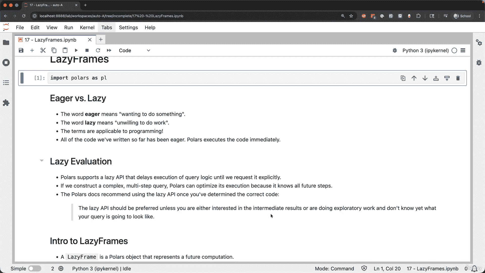
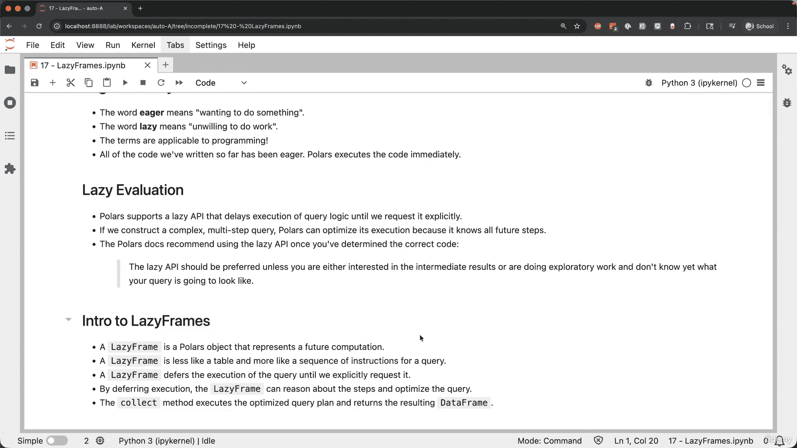
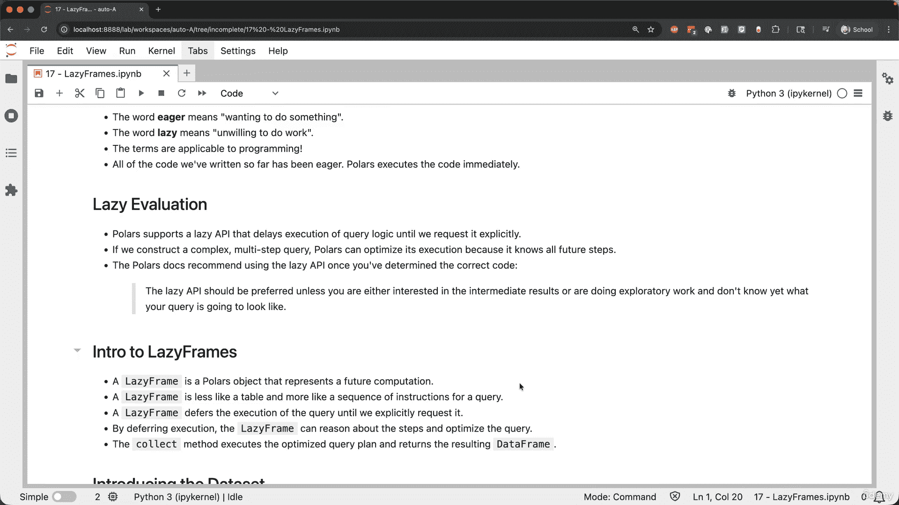
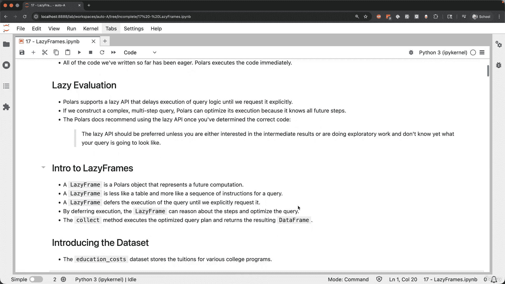
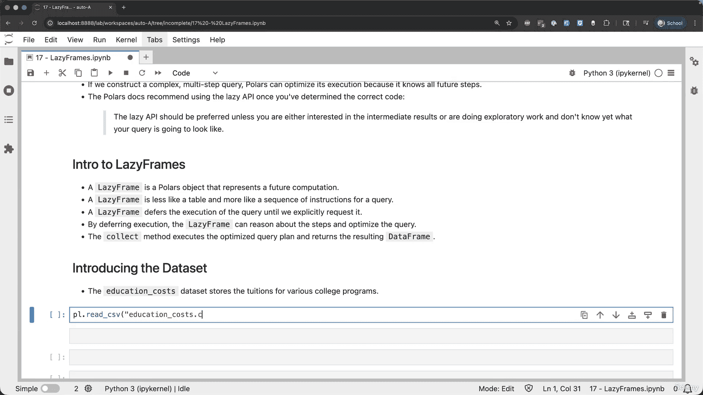
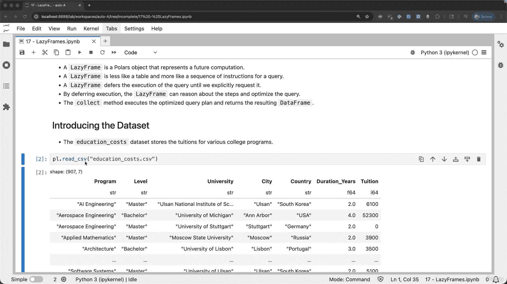
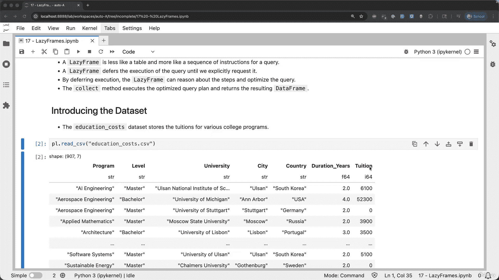

📊 Polars与Python数据分析：第85讲（185）：惰性帧（LazyFrame）与 Eager vs Lazy 求值

本节课我们将一起来认识 Polars 里的惰性帧（LazyFrame），并理清即时求值（Eager Evaluation）与惰性求值（Lazy Evaluation）的区别。我们会先回顾 eager 和 lazy 这两个词在日常语言与编程中的意义，然后再解释惰性帧是什么，以及它如何通过推迟执行来优化查询。最后我们会把本课程后续要用的教育费用数据集导入进来，为下一节课的实际对比做好准备。

### 导入 Polars 与准备 Notebook





欢迎来到课程的新章节，这一整章都会围绕惰性帧展开。惰性帧是 Polars 中一个非常受欢迎且非常有特色的功能，它能让一条查询在真正执行之前，先知道全部步骤，然后对整个执行过程进行优化。简单来说，我们先把查询的执行推迟，用推迟来换取效率。在正式解释惰性帧之前，我们按照惯例先导入 Polars。

我们会使用一个全新的 Jupyter Notebook 文件，名字叫 “17 lazy frames”。在笔记本的第一个单元格中，我们用 `import` 关键字导入 Polars，并给 Polars 起一个别名 `pl`，这样后续操作会简洁很多。

```python
import polars as pl
```

导入完成之后，`pl` 就代表着 Polars 库。接下来我们开始讨论 eager 和 lazy 这两个关键词，理解了它们，惰性帧的一系列行为就会变得非常自然。



### 即时求值（Eager）与惰性求值（Lazy）

在深入技术细节之前，我们先复习一下 eager 和 lazy 这两个英文单词的含义。eager 的意思是“很想做某事”，比如一个人迫不及待地想开始任务；lazy 的意思是“不愿意干活”，比如一个人能拖就拖，不想付出努力。这两个词用到编程里也同样贴切。我们到目前为止写过的所有代码，都可以被形容为 eager 模式：只要运行一个单元格，任务就会立即执行。Polars 会分析这些代码，并以一个单一步骤完成运行。这种模式带给我们的是“写代码、看结果”的即时反馈。

那么与之相对的惰性求值（lazy evaluation）又是什么？实际上，Polars 也提供了一套惰性 API。这里所说的 API，你可以理解为一组方法的集合。这套集合的作用是把你给定的查询执行动作延迟到我们显式请求的时候。如果你想要完成多个步骤，或者构造一个复杂的多步骤流程，例如第 1 步过滤（filter）、第 2 步选择列（select）、第 3 步排序（sort）等等，就可以利用这种延迟机制。

通过把执行一直延迟到最后一刻，Polars 就有机会优化这一整条查询。因为在延迟状态下，Polars 已经知道所有需要按顺序执行的步骤，它可以分析出哪些步骤其实没必要，哪些步骤可以进一步优化。下面是一个简单的对比，帮助你理解两种模式的不同：

- Eager 模式：每写一步就执行一步，可以立刻看到中间结果。适合探索性分析，也方便调试。
- Lazy 模式：先把所有步骤记录成一个查询计划，等最后真正执行时再统一优化并运行。适合已经确定流程的高效处理。

Polars 官方文档其实也给出了建议：等你写好了初始代码，并且弄清楚了真正需要哪些步骤之后，再使用惰性 API。因为一旦你明确步骤，惰性帧就可以进一步优化代码的整体执行效率。文档中的态度是，除非你确实需要中间结果，否则应该优先使用惰性 API。本课程前面的大部分内容之所以一直是 eager 模式，是因为我们想看到每一小段代码的即时影响或结果，也就是说，我们一直在享受“写代码、看结果”的反馈循环。

但是，假如你现在打算写一段代码，导入一个 CSV 文件，然后依次对它做 10 步处理，并且你已经完成了探索性工作，知道了这 10 步具体要做什么，那么此时创建惰性帧往往会高效得多。惰性帧本质上就是一个查询计划，你把它的执行推迟到最后一刻，就能获得 Polars 提供的那些额外优化。

### 什么是惰性帧（LazyFrame）

前面其实已经剧透了不少，这里我们再正式说明一下。本节中我们要接触的核心数据结构，也就是核心对象，叫做惰性帧（LazyFrame）。惰性帧是 Polars 中的一个对象，它表示一个还未发生的未来计算，你可以把它想成“未来的计划”。从这个角度来说，它不太像一张表，也不太像普通的数据帧，反而更像是一串为未来查询准备的指令序列。惰性帧会把真实查询的执行动作一直延迟，不管这个查询有多少步，都要等我们明确请求运行之后才真正开始。

正是因为能延迟执行，惰性帧才可以对已经积攒的步骤进行推理和分析。它会观察这些步骤之间的逻辑关系，找出可以提前裁剪的数据、可以合并的操作，最终产出一个尽可能高效的查询计划。当我们需要真正运行这个查询时，会对惰性帧调用一个方法，叫做 `collect` 方法。`collect` 会把优化后的查询计划真正执行起来，并从惰性帧中创建一个实实在在的数据帧。所以再说一遍：惰性帧并不是一张表，而是一个计划，是你针对数据制定的一套执行策略。





用代码来表示，一个典型的惰性查询流程大概是这样的：

```python
# 构建惰性查询计划的示意代码
lazy_plan = (
    pl.read_csv("数据.csv")
    .lazy()                          # 转成惰性帧
    .filter(pl.col("类别") == "A")     # 第1步：过滤出类别为A的行
    .select(["类别", "数值"])          # 第2步：选择需要保留的列
    .sort("数值")                      # 第3步：按数值排序
)

# 直到调用 collect()，查询才真正执行
result = lazy_plan.collect()
```

上面的代码里，我们先用 `read_csv` 读取文件，再调用 `lazy()` 转成惰性帧，然后连续给出多个步骤，最后用 `collect()` 触发执行。可以看出，惰性帧的核心思想是“先规划，后执行”。接下来我们要做的是把本课程中一直要用到的数据集导入进来。

### 导入本节数据集

在下一节课中，我们会正式对比惰性帧和普通数据帧之间的异同。不过在做对比之前，先从导入数据集开始。这里我们使用 `read_csv` 函数，导入名为 `education_costs` 的 CSV 文件。







```python
df = pl.read_csv("education_costs.csv")
```

执行完上面的代码，`df` 就是一个普通的即时求值模式下的数据帧。我们来看一看这份数据里到底有什么内容。这个数据集存储了不同大学项目的学费信息，其中包含了多个字段列。下面是对这些字段的简要说明：

- program：描述大学项目本身，也就是学生实际学习的专业方向。
- level：教育水平，例如硕士（master）或学士（bachelor）。
- university：提供该项目的大学。
- city：大学所在城市。
- country：大学所在国家。
- length：项目时长，即需要学习多久才能获得相应学位。
- tuition：学费。

这份数据集是一个很基础的例子，它内部包含了多种不同的数据类型，同时也很适合我们在上面执行各种不同的逻辑步骤。在接下来的课程中，我们会继续围绕这份数据展开探索。下一节课我们就会通过对惰性帧执行一系列指令，来观察它如何通过延迟执行优化查询。

### 总结





本节课我们一起学习了惰性帧（LazyFrame）与即时求值、惰性求值的概念。我们知道了 eager 模式会立即执行代码，而 lazy 模式会先把所有步骤构建成查询计划，再通过 `collect()` 统一执行。我们也明白了 Polars 官方文档为什么建议优先使用惰性 API，除非你真的需要中间结果。最后，我们还成功导入了教育费用数据集 `education_costs.csv`，为后续对比惰性帧与普通数据帧做好了准备。在下节课中，我们就会正式开始探索惰性帧的执行过程，看看延迟执行到底能带来哪些优化。

