📊 使用Polars和Python进行数据分析：第186节：scan_csv函数与collect方法

在本节课中，我们将学习如何创建一个惰性帧（lazy frame），如何查看它的优化查询计划，以及如何执行这个查询计划并将惰性帧转换为普通的数据帧（DataFrame）。同时，我还会一步一步地展示惰性帧相对于数据帧的优势在哪里。为了让你更容易理解，我们会从一个实际例子出发，先用我们已经熟悉的eager写法实现，然后再转换成lazy写法，看看Polars是如何帮我们做自动优化的。

💡 从一个现实问题开始

让我们先从一个非常实际的问题入手。假设我们想找出所有学费大于50,000美元的美国大学，并按照level（等级）分组，计算每个分组的平均学费。这个需求我们可以直接用已经学过的eager API来实现。

所谓eager API，就是“立即执行”的API。简单来说，Polars在接到代码后，会老老实实地按照写好的顺序逐条执行，不会额外考虑哪些步骤可以合并、哪些数据可以不加载。这种做法在数据量小的时候没有问题，但数据量一大，就会有很多不必要的开销。在接下来的实现过程中，我会把那些不够优化的地方逐一指出来。

首先，我们要读取education_cost.csv文件。注意，使用read_csv时，Polars会把整个CSV文件完整地读入内存。也就是说，全部7列、907行数据都被加载进来了。接下来，因为我们只需要7列中的5列，所以调用select方法，创建一个针对program level、university、tuition和country这5列的表达式。从逻辑上说，我们这是先把完整的7列数据帧导入内存，然后再基于它生成一个只有5列的新副本。这其实是一个可以优化的点：既然最终只需要5列，为什么在读取CSV时不能只读这5列呢？

我们先用eager API把前两步写出来，代码如下：

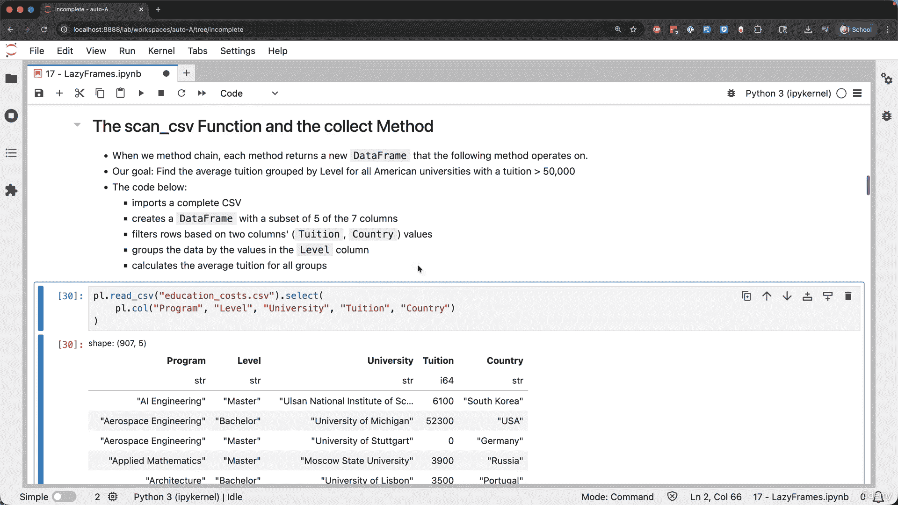

```python
import polars as pl

# 读取完整 CSV（7列、907行）
education = pl.read_csv("education_cost.csv")

# 只保留其中的5列
education = education.select(["program level", "university", "tuition", "country"])
```

接下来，我们需要对数据进行过滤。这里有两个条件：第一，学费要大于50,000美元；第二，国家必须等于"USA"。我们可以使用逻辑与（&）运算符把两个条件组合起来，也可以把两个表达式分别作为两个参数传给filter方法，两者效果相同。先定位tuition列，筛选出大于50,000的行；再定位country列，筛选出值为"USA"的行。过滤后的代码如下：

```python
# 过滤学费大于50000且国家为USA的行
education = education.filter(
    (pl.col("tuition") > 50000) & (pl.col("country") == "USA")
)
```

过滤完成后，最后一步是分组聚合。我们要按照level列的值分组，这会创建一个分组对象。然后调用agg方法，对tuition列中的数值求平均，这样就能得到每个level下的平均学费。代码如下：

```python
# 按level分组，计算每组tuition的平均值
result = education.group_by("level").agg(
    pl.col("tuition").mean()
)
```

上面这段代码整体上是完全没问题的。对于当前这个规模的数据集，你不会感觉它慢，因为数据量并不大。但是，如果数据集有上百万行，情况就完全不同了。在继续之前，我们先来仔细分析一下这段eager代码有哪些可以优化的地方。

⚡ eager API 的局限性

具体来说，上面的eager代码存在以下几个可以优化的点：

- 读取CSV时加载了全部7列，但最终可能只需要其中的5列；
- 所有数据被完整加载到内存之后，才开始进行选择和过滤，而不是在导入时边读边筛；
- 两次过滤操作被分开执行，这意味着Polars要扫描两遍数据，而不是用一次遍历同时判断两个条件。

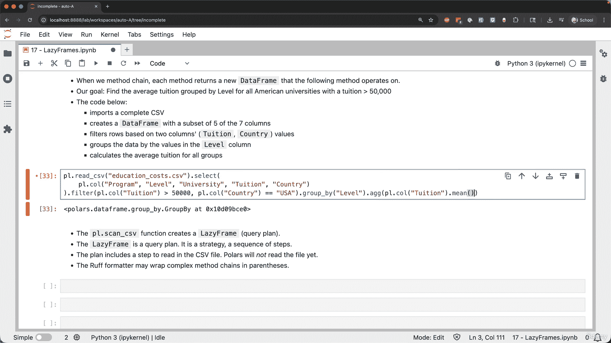

我们先看第一点。如果Polars在导入CSV的时候就知道“只需要这几列”，那它就不必解析并保存用不到的列。但eager API不会做这种前瞻性的思考，它只会先把所有列读进来，再在内存里做减法。

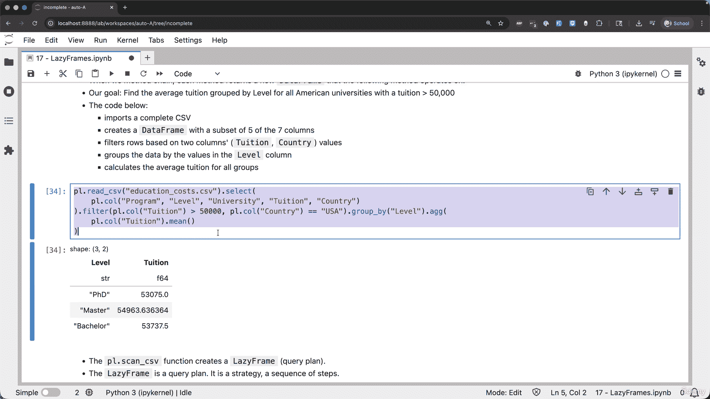

再看第二点。如果Polars在导入阶段就能逐行检查过滤条件，遇到满足条件的行就保留，不满足条件的行直接丢掉，那内存压力会小很多。特别是在大数据集上，如果只需要30,000行，我们完全没必要把1,000,000行都先加载进来。但eager API做不到这一点，它必须先把数据全部加载完，再执行后续的过滤。

第三点也很关键。两个过滤条件完全可以放在一次遍历里同时判断。但eager API会先做第一个过滤，得到一个新的子集，然后再对这个子集做第二个过滤。这相当于把数据翻来覆去地扫描了两遍，效率自然低。

正如上一课提到的，推荐的做法是先用eager API把代码写通，明确整个操作流程，然后再把它转换成等价的lazy frame表示，让Polars帮我们把这些优化自动做出来。下面我们就来实际演示一下这个转换过程，看看它到底有多简单。

🔄 用 scan_csv 创建 lazy frame

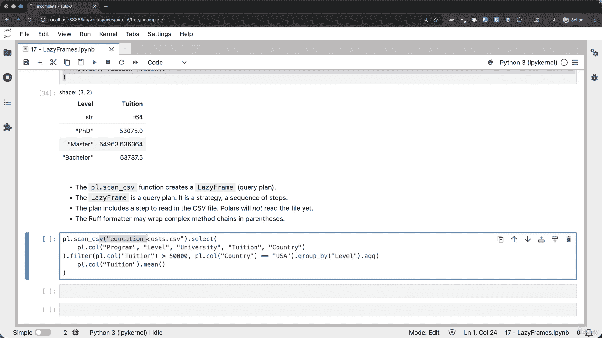

现在，我们只需要把上面代码中的read_csv替换成一个新函数——scan_csv，就可以把整个eager链条变成lazy frame。可能有人会问：read_csv和scan_csv到底有什么区别呢？区别就在于：read_csv会立刻读取文件并返回一个DataFrame；而scan_csv并不会立刻读取文件，它返回的是一个lazy frame。

把lazy frame想象成一份查询计划，而不是一张数据表。它记录了所有待执行的步骤：第1步是读取CSV文件，第2步是选择5列，第3步是进行过滤，后面还有分组和聚合。但在这个阶段，Polars还没有碰文件，也没有把任何数据放进内存。它只是拿到了一份“作战计划”。

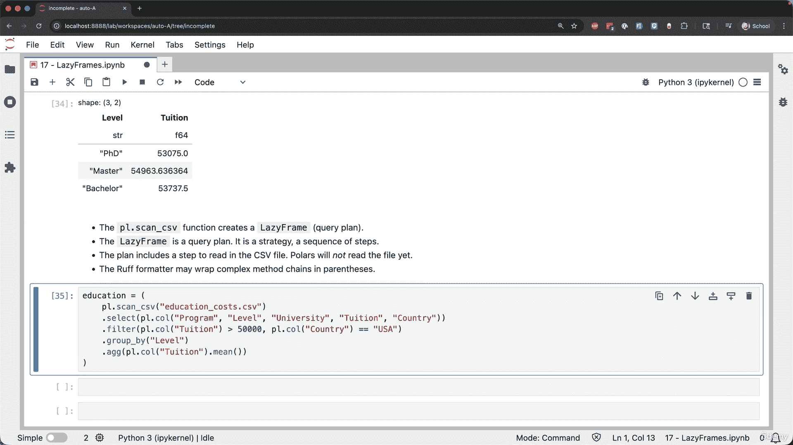

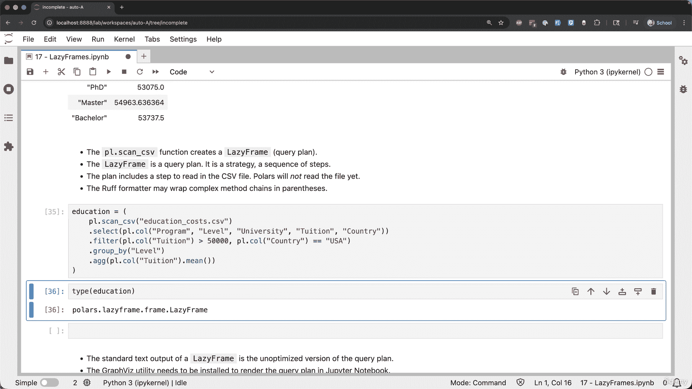

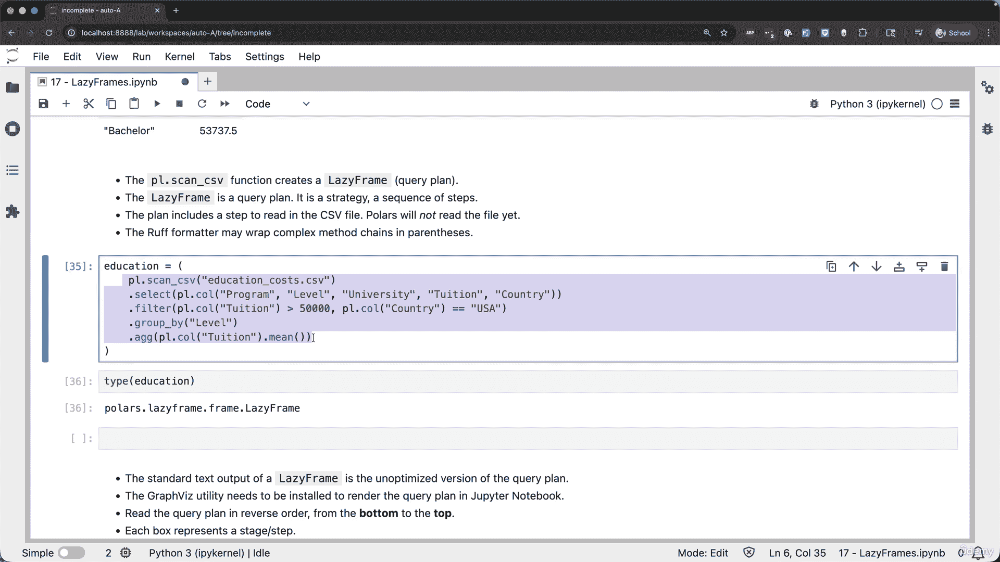

如果你觉得文字不够直观，可以用下面的流程对比两者：

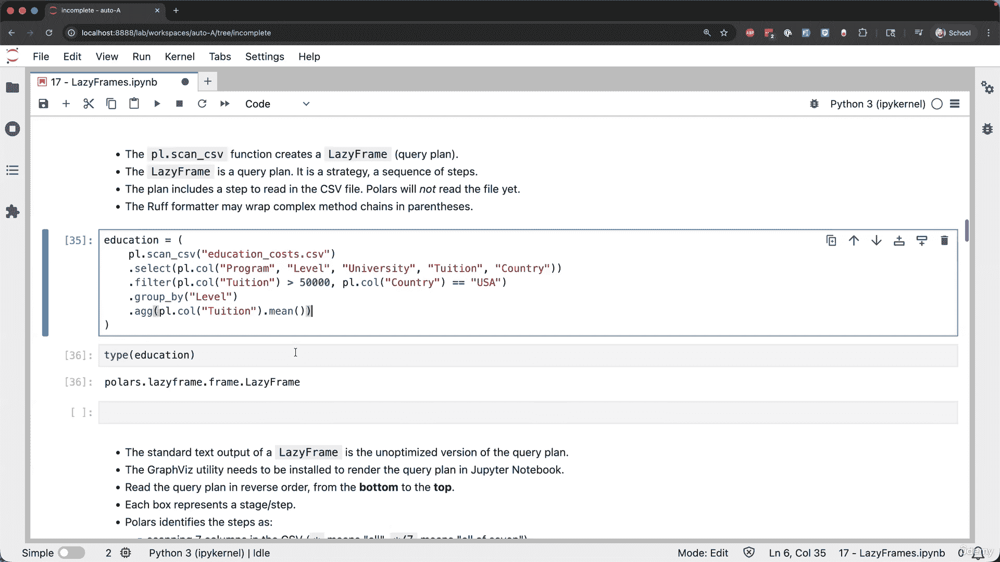

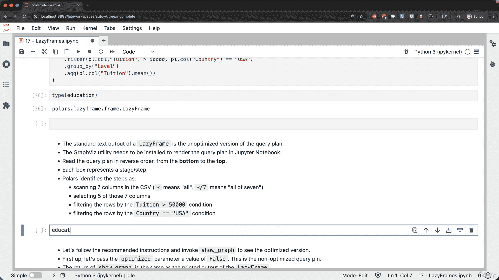

```text
read_csv:   CSV → 读取全部数据 → DataFrame → select → filter → filter → group_by → agg
scan_csv:   CSV → 记录查询计划 → LazyFrame → 自动优化 → collect → DataFrame
```

这份计划写好后，Polars会站在全局视角审视所有步骤，把前面提到的那些优化自动找出来。比如，它知道自己最终只需要5列，所以不需要把全部7列都读进内存；又比如，它可以在导入CSV时直接过滤行，而不需要先把所有数据加载完再进行过滤。下面是转换后的完整lazy版本代码：

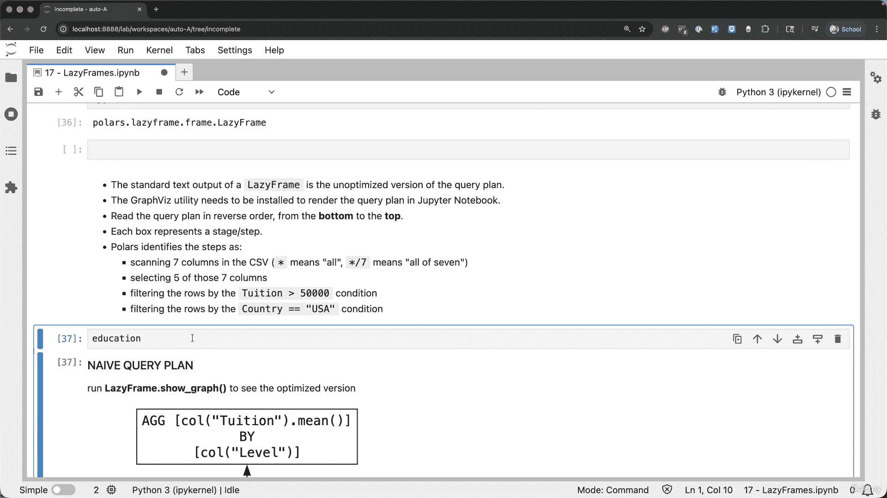

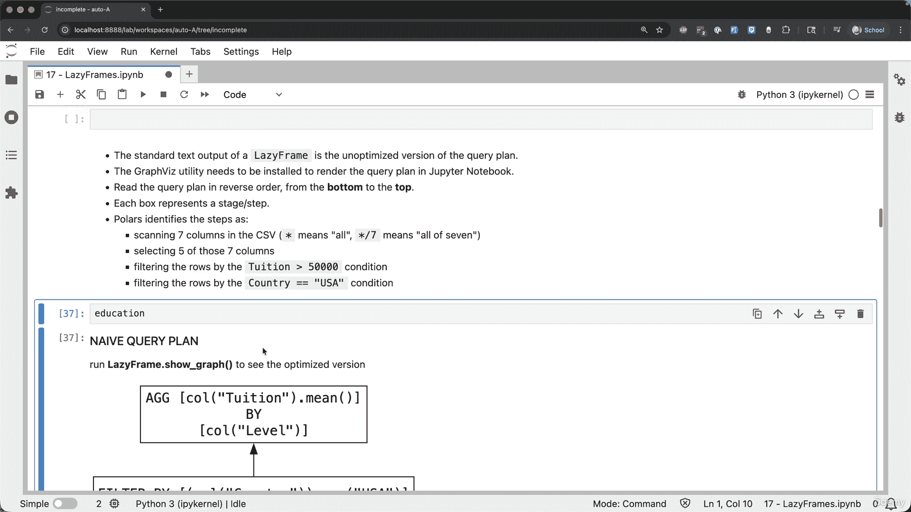

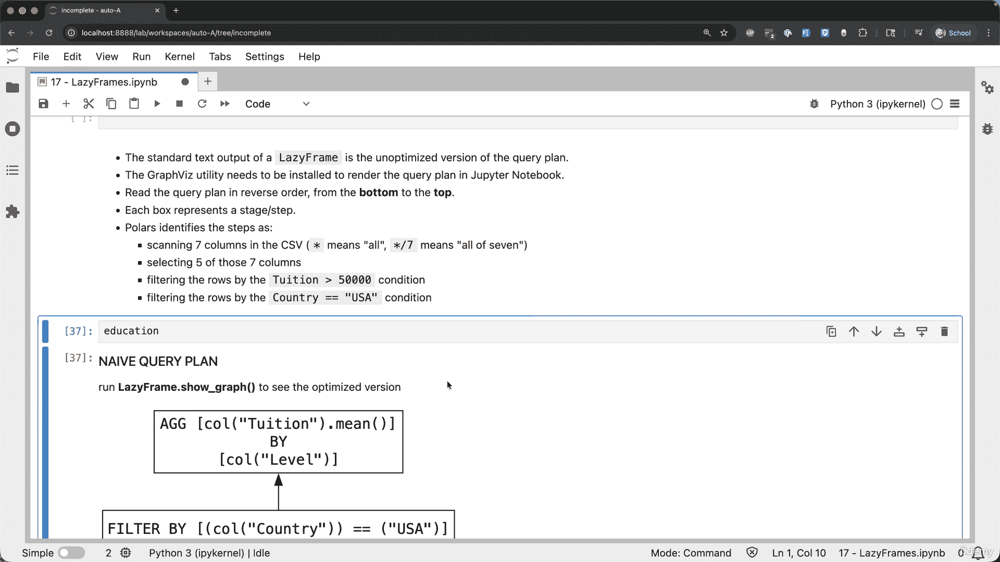

```python
# 用 scan_csv 创建 lazy frame，后续操作与 eager 版本写法相同
education_lazy = (
    pl.scan_csv("education_cost.csv")
    .select(["program level", "university", "tuition", "country"])
    .filter((pl.col("tuition") > 50000) & (pl.col("country") == "USA"))
    .group_by("level")
    .agg(pl.col("tuition").mean())
)
```

这里我们把结果赋值给了一个名为education_lazy的变量。顺便说一句，如果你想用括号把它包起来调整格式，那也完全没问题。我们可以用Python的type函数来看看这个变量的类型。type函数会告诉我们这个对象到底是哪个类创建出来的。运行之后，你会看到它并不是DataFrame，而是LazyFrame，这完全是两个不同的概念。这也提醒我们：到目前为止，这些逻辑实际上一条都没有执行，我们只是写好了一份查询计划，仅此而已。

🧠 查看查询计划

现在，如果我们直接输出这个lazy frame，我们不会看到数据，而是会看到一张可视化的查询计划图。想要看到这张图，你的电脑上需要安装一个名叫Graphviz的特殊程序。如果图显示不出来，可以回到上一课，按照教程在电脑上配置好Graphviz。这个图是什么呢？它就是前面那些操作步骤的可视化表示。图中的每一个方框，都可以理解为一条指令，多条指令合在一起就是完整的执行流程。

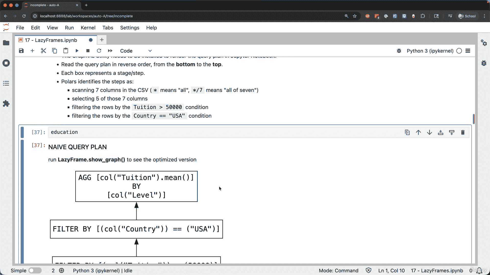

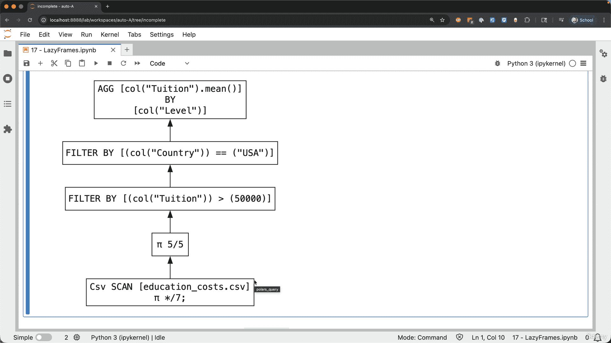

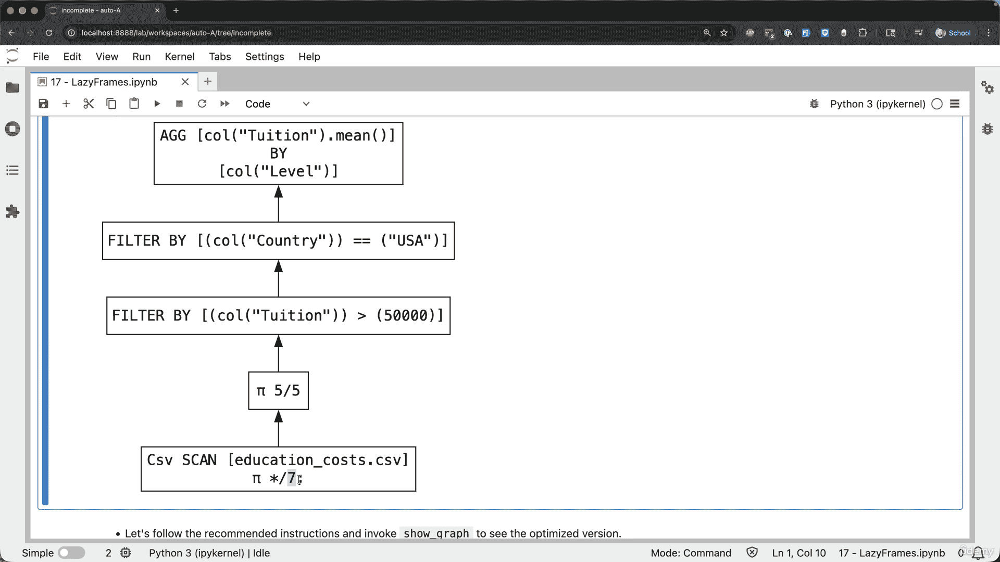

这里有个有趣的地方：这张图需要从下往上读。所以，我们要把滚动条拖到最底部再看。另外，还需要注意，我们现在看到的这个图被称为“未优化的查询计划”。它等价于我们前面用read_csv写的那段eager代码，只是把原始步骤以图形的方式按顺序列了出来。

从图中可以看到，最初的未优化计划包含以下几个关键步骤：

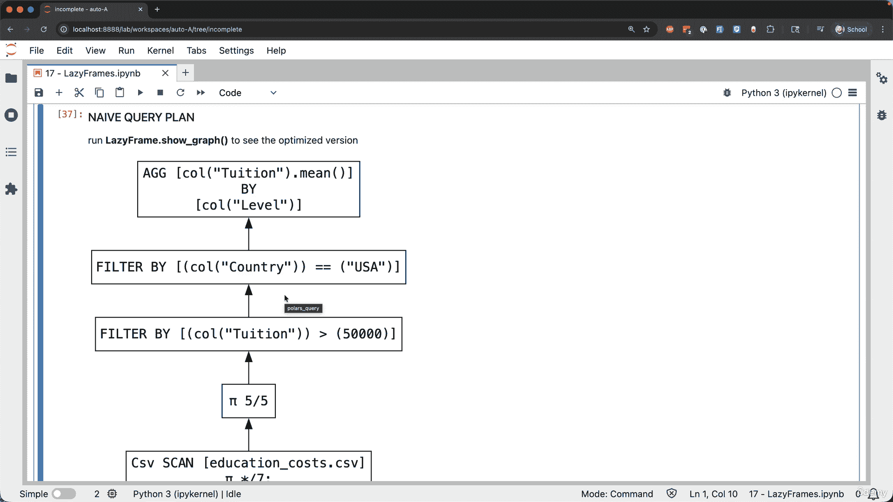

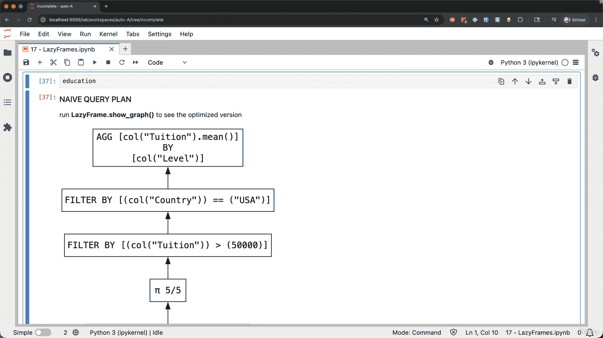

1. 读取education_cost.csv文件，并加载文件中的所有7列；
2. 从7列中选择5列；
3. 第一次过滤操作：筛选出学费大于50,000的行；
4. 第二次过滤操作：筛选出国家为"USA"的行；
5. 按level列分组；
6. 对tuition列进行平均聚合。

看到这里，你可能已经发现了：第3步和第4步其实是两个分开的过滤操作。这又给了lazy frame一个优化机会。我们完全可以只遍历一次全部数据，在这一次遍历中同时检查两个条件，只有两个条件都满足时才保留这一行。这样，就不需要先扫描一遍数据得到子集，再对子集扫描一遍进行第二次过滤。用大白话说，就是“能一次干完的活，绝不分成两次”。

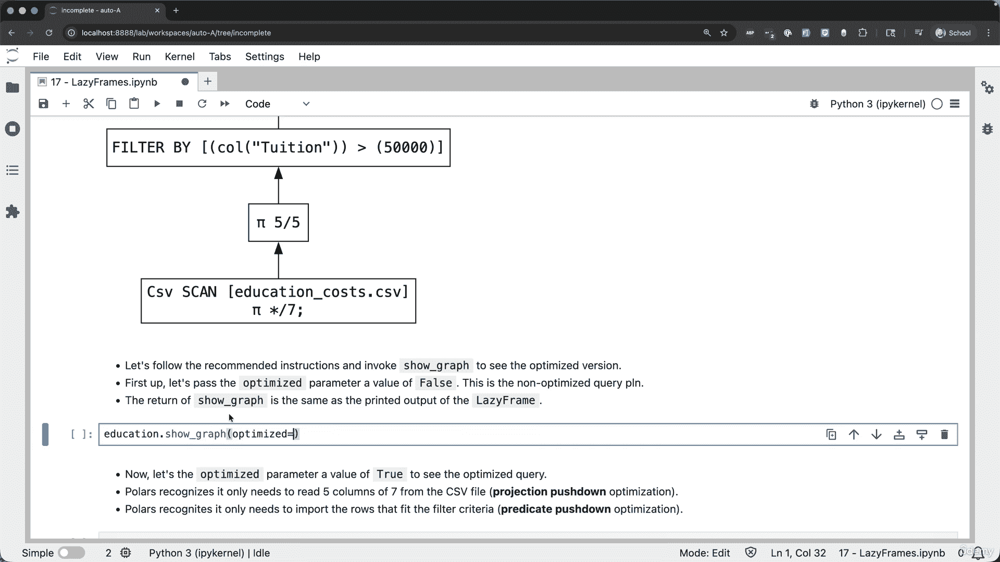

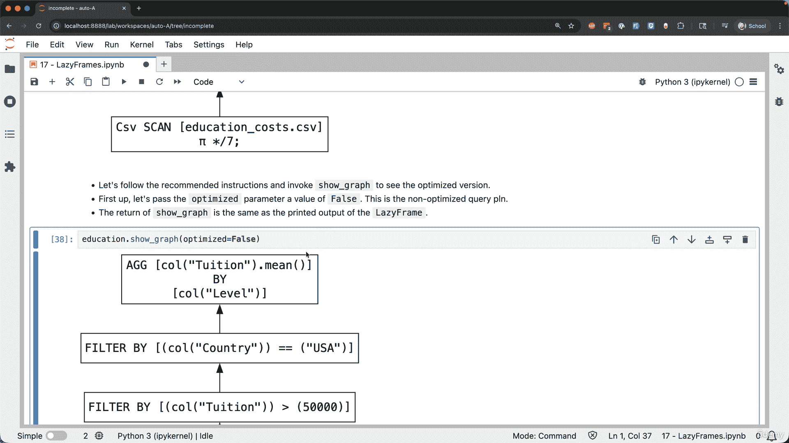

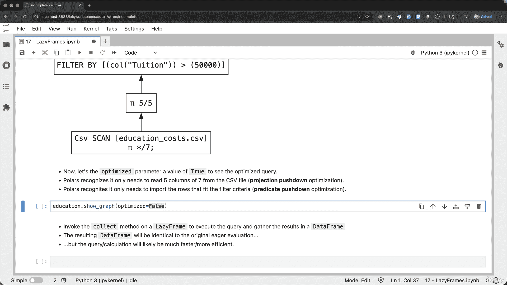

未优化的查询计划虽然步骤多，但它最后也一定会以tuition列的平均值聚合作为结束。那么，我们要怎么查看优化后的查询计划呢？Polars提供了一个专门的方法，叫做show_graph。

🚀 优化后的查询计划

我来演示一下如何使用show_graph。这个方法接收一个名为optimized的参数。如果将optimized设置为False，那么展示出来的就是上面那种未优化的查询计划；如果将optimized设置为True，展示出来的就是Polars经过优化后的执行计划。

```python
# 查看未优化的查询计划
education_lazy.show_graph(optimized=False)

# 查看优化后的查询计划
education_lazy.show_graph(optimized=True)
```

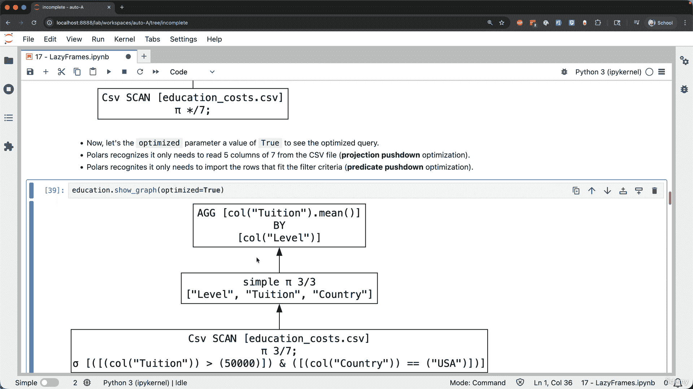

我们把optimized设为True之后，可以清楚地看到步骤数量大幅减少，从原先的很多步变成了3步。我们仔细看一下这3步：

- 第一步仍然是读取education_cost.csv文件，但Polars已经判断出最终只需要原7列中的3列，所以它只读取必要的列；
- 同时，它会在导入文件时就执行过滤操作，不会先把所有数据加载到内存里再筛选；
- 更有意思的是，Polars还发现country == "USA"这个条件只是用来提取子集的，它对于最终聚合结果并不需要保留。因为我们最终得到的是按level分组的数据，并不需要按国家查看任何结果。所以，Polars会用这个条件筛选出更少的行，但在过滤完成之后，不会真的把country这一列的数据保存在内存中。

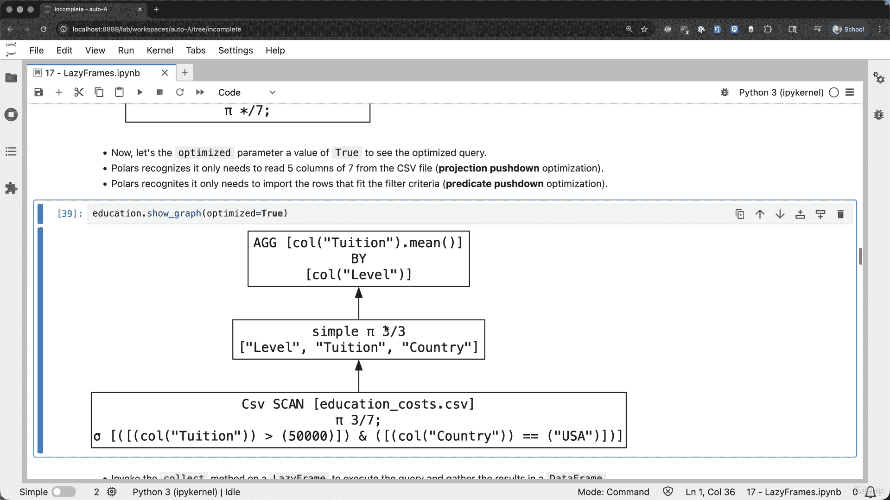

这些优化之所以能够实现，根本原因在于Polars看到了我们提供的完整步骤链，知道每一步需要什么、不需要什么，从而可以提前做出取舍。这也是lazy frame最核心的价值。

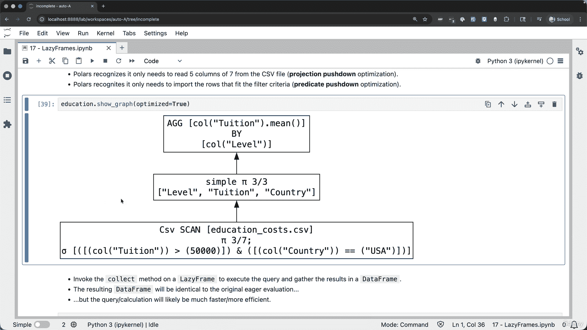

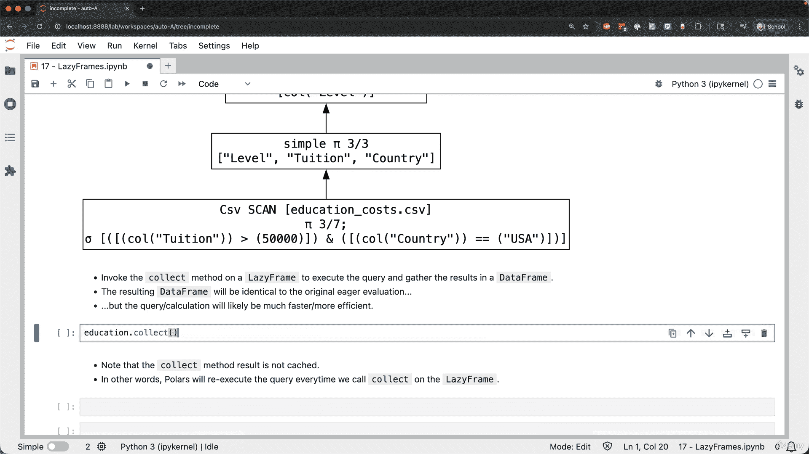

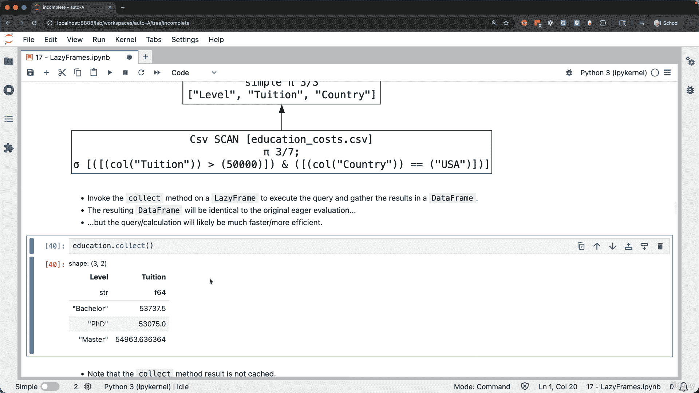

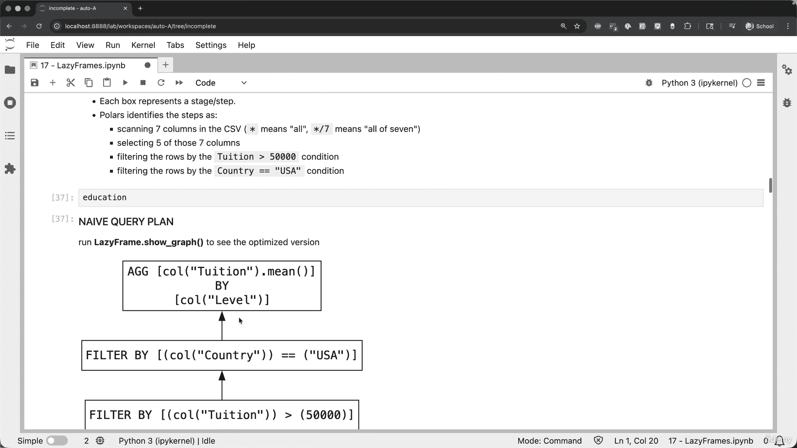

现在，education_lazy这个变量依然只是一份攻击策略、一个作战计划、一串指令序列。它还没有真正执行。那我们要怎么把它变成一个DataFrame，并让Polars实际执行这套优化后的指令呢？答案就是调用collect方法。

🏃 用 collect 执行查询

collect方法是专门定义在lazy frame上的。它的作用就是执行优化后的查询。当我们调用collect时，Polars才会真正读取CSV文件，按照优化后的计划完成所有计算，并把结果返回为一个DataFrame。代码如下：

```python
# 执行优化后的查询，得到最终 DataFrame
result_lazy = education_lazy.collect()
```

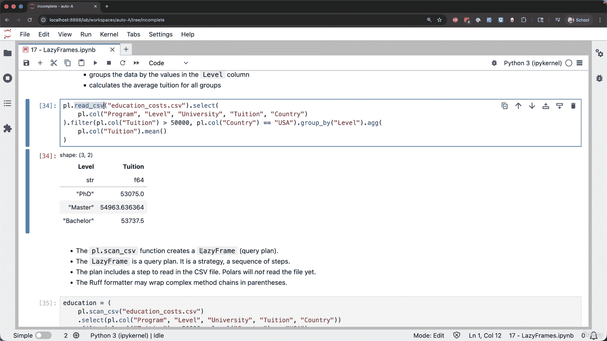

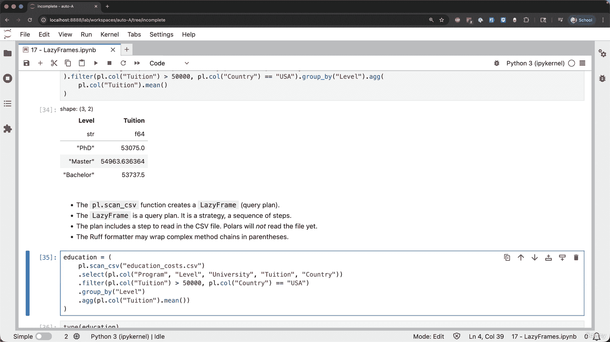

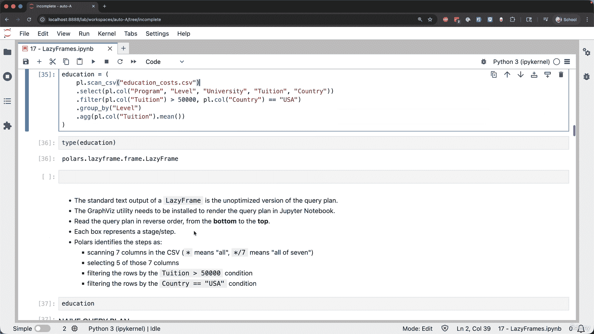

执行完之后，你会看到，这个结果和我们前面用eager代码得到的结果一模一样。但它的计算量更少、效率更高、占用内存也更少。唯一的变化就是我们把read_csv换成了scan_csv，而这个函数从一开始创建的就是lazy frame。你可能会想，为什么代码几乎完全没变呢？因为所有在lazy frame上调用的方法，都会继续返回另一个lazy frame。也就是说，每次调用方法，都只是给原查询计划追加一条新指令。

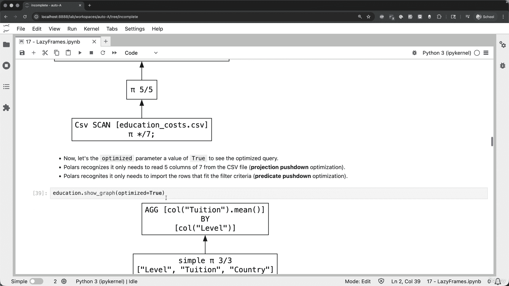

这个逻辑其实和我们构建表达式非常相似。比如，我们对一个表达式调用select或filter时，每调用一次方法，都会生成一个新的表达式，指令序列也随之延长。lazy frame也是同样的道理：我们从lazy frame出发，每一步方法调用都只是在查询计划上多加一层指令。最后，Polars可以通览所有指令并进行优化，等到真正运行查询时，再通过collect一次性执行。

这里还有一个重要的细节需要强调：collect方法的结果并不会被缓存。也就是说，每次调用collect，Polars都会重新执行一遍整个查询，仍然需要消耗相应的时间和资源。但好消息是，它每次都会使用优化后的计算路径。举个例子，即使你再次调用collect，也只是再次强制执行一遍计算，而不是在内存中直接取出一个已经缓存好的DataFrame。由于优化后的查询计划一直保存在lazy frame中，你每次执行这个计划时，都能稳定地获得那些优化收益。

📝 总结

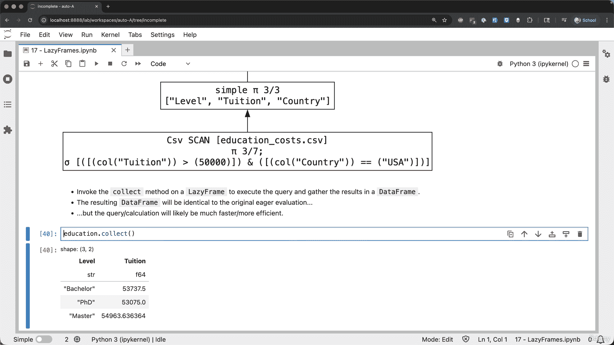

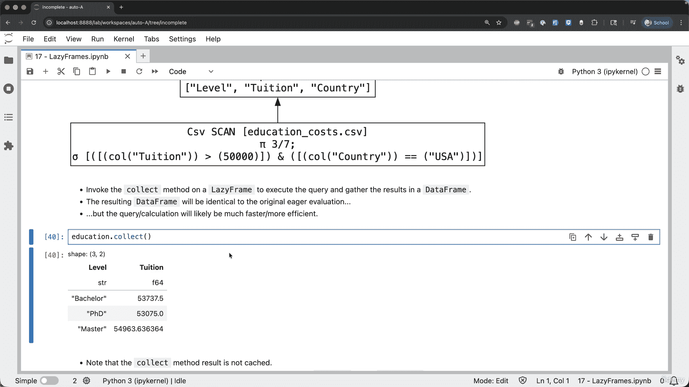

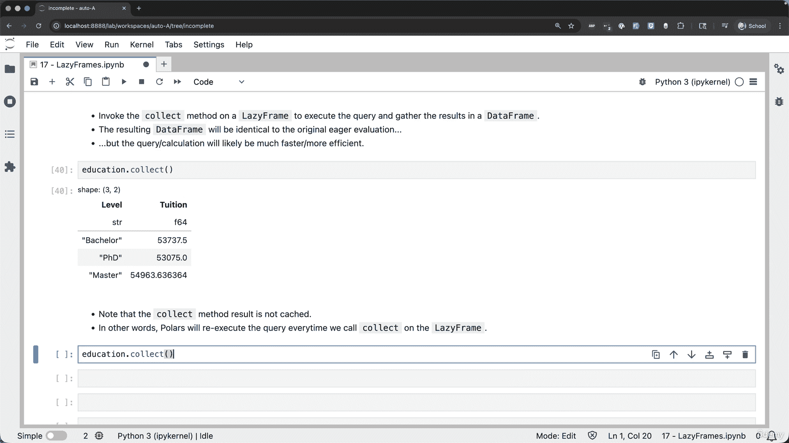

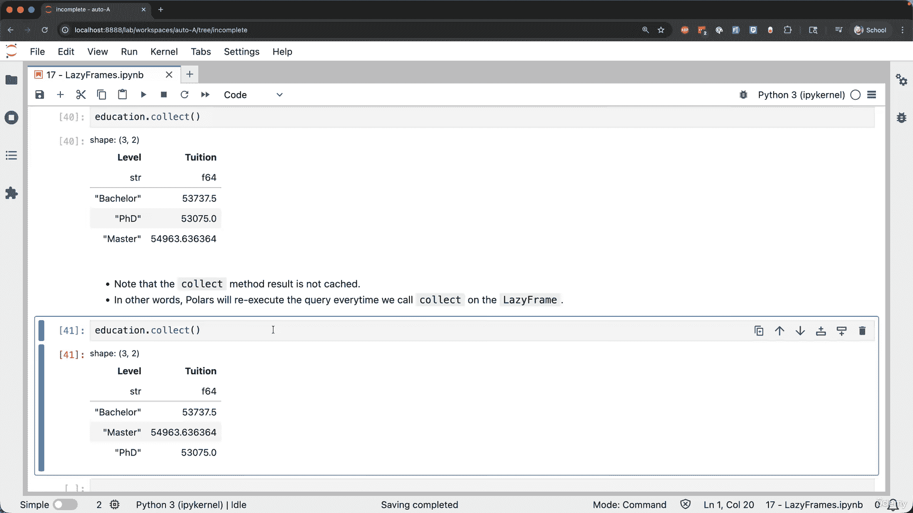

本节课中，我们一起学习了lazy frame的核心用法。我们先从eager API入手，解决了一个按level统计美国高学费大学平均学费的问题；然后我们分析了eager写法中几个可以优化的地方，包括多读列、导入后再过滤、重复过滤等；接着我们引入了scan_csv函数，用它创建lazy frame，并通过show_graph查看了未优化和优化后的查询计划；最后，我们使用collect方法执行了优化查询，得到了与eager写法完全相同的结果。希望你现在已经理解了lazy frame的核心价值：它让Polars在真正执行计算之前，先看到完整的步骤，再做全局优化。在下一节课中，我们会直接对比lazy frame和普通DataFrame的执行速度，看看它到底能快多少。

