## ⏱️ Polars 与 Python 数据分析（第二部分）：第87课：时间效率与惰性帧优势

在本节课中我们将要学习如何通过 LazyFrame 和 DataFrame 的对比，观察 Polars 在时间效率上的提升。课程会先回顾上一课的两种代码写法，再用 Jupyter Notebook 的 `%%timeit` 魔法测量平均执行时间，最后比较两种写法的时间与内存优势。下面先给出本课的总体目标，方便你建立整体印象。

下面先列出本课要完成的事情：

- 回顾 `read_csv` 创建 DataFrame 的写法，以及 `scan_csv` 创建 LazyFrame 的写法。
- 使用 `%%timeit` 测量单元格的平均执行时间。
- 对比两种写法的时间数字，理解 LazyFrame 为什么更高效。
- 说明 LazyFrame 在内存占用上的优势，以及这种优势在大数据集上的意义。

完成这些观察后，你会更容易理解 LazyFrame 的价值。接下来先回到上一课的代码。

## 🧱 Polars 与 Python 数据分析（第二部分）：第87课：回顾 DataFrame 与 LazyFrame 写法

上一节我们已经有了两种读取与处理数据的代码。本节中我们来看看这两种写法分别做了什么，以及它们的结果为什么完全相同。原文中的前两个单元格就是上一课的代码，一个使用 DataFrame，一个使用 LazyFrame。下面先梳理两种写法各自的核心步骤。

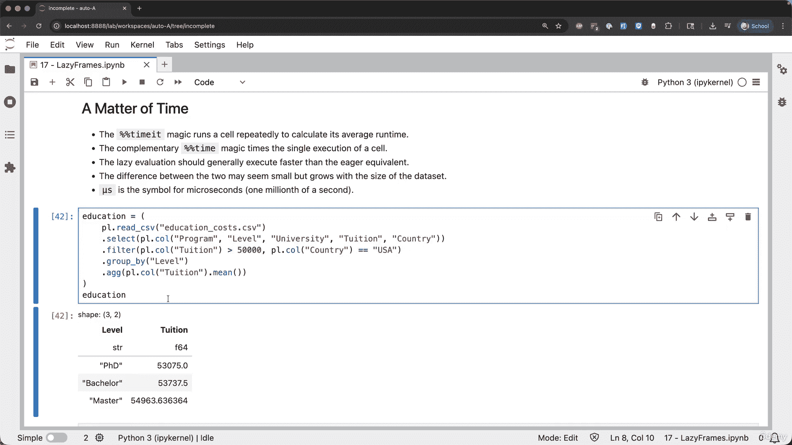

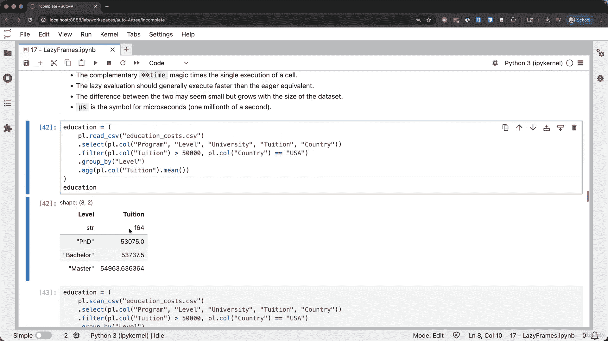

下面先梳理两种写法各自做了什么：

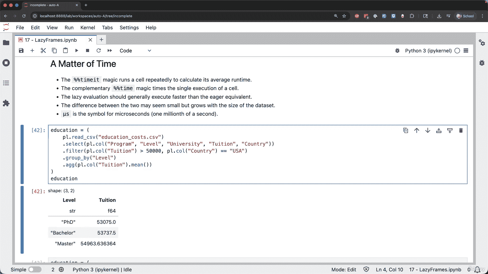

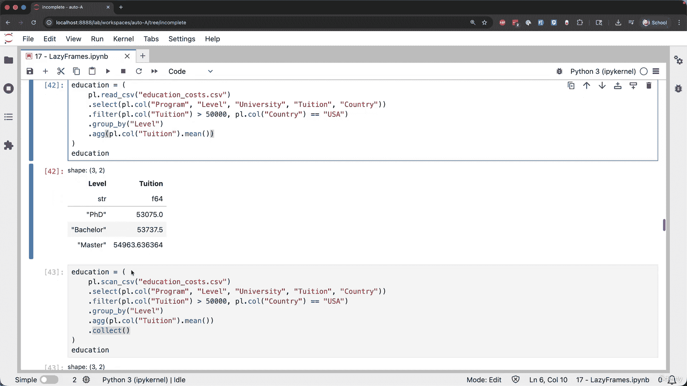

- 第一个单元格使用 `read_csv` 读取 CSV 并创建 DataFrame。后面的连续方法调用属于方法链，每一步都会创建新的 DataFrame，最终得到结果。
- 第二个单元格使用 `scan_csv` 创建 LazyFrame。代码中列出的是查询计划的各个步骤。最后调用 `collect()` 方法，把 LazyFrame 转换成 DataFrame，这等价于运行查询计划并产生最终数据集。
- 两种写法得到的结果完全一样。这一部分只是上一课的代码，接下来要添加计时工具，用来比较效率。

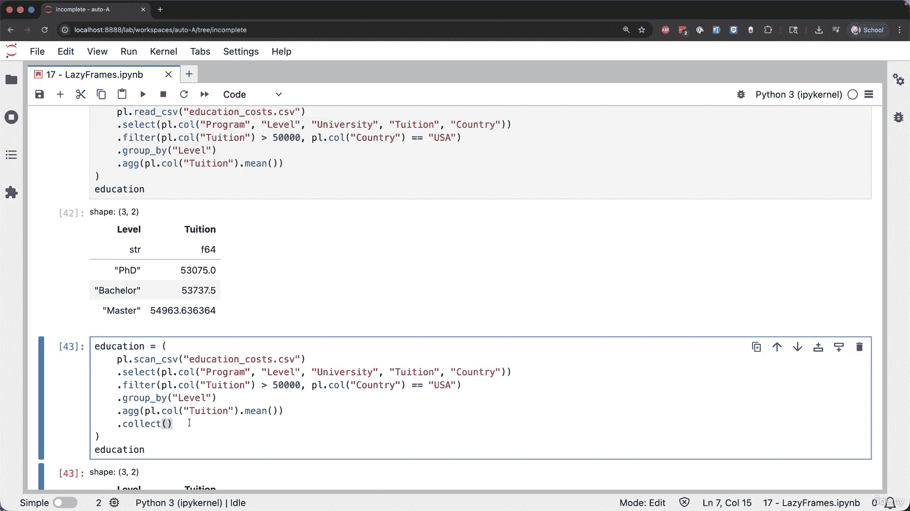

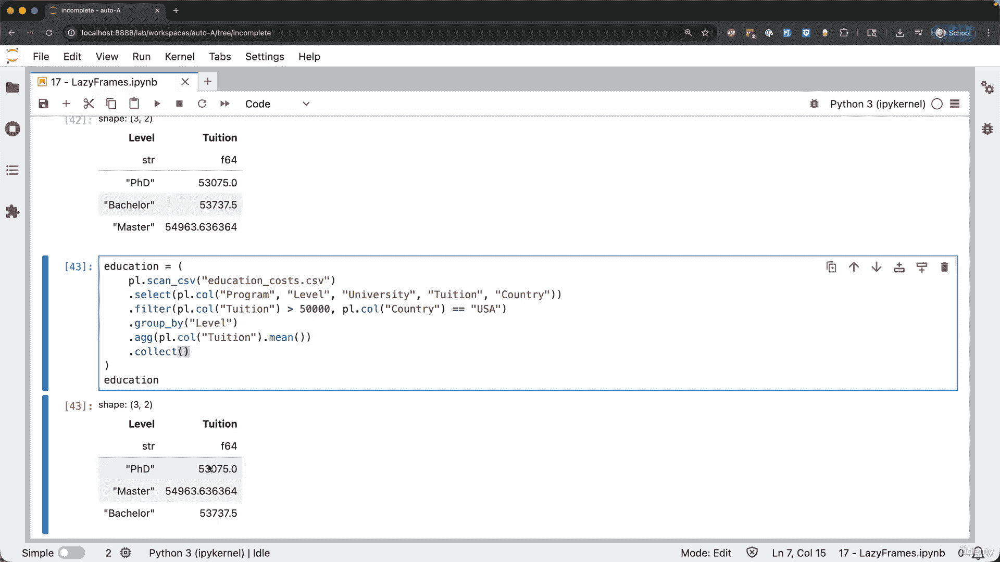

从写法上看，DataFrame 路线会较早读取数据并逐步生成新对象，而 LazyFrame 路线会先记录查询计划，最后再执行。可以把核心区别写成下面这种示意代码。

```python
# DataFrame 写法示意
df = pl.read_csv("data.csv").后续方法链()  # 每一步可能创建新 DataFrame

# LazyFrame 写法示意
lf = pl.scan_csv("data.csv").查询计划步骤()
df = lf.collect()  # 执行查询计划，得到最终 DataFrame
```

这里的重点不是写复杂代码，而是比较同一种读取与处理流程在不同写法下的执行成本。`collect()` 可以理解成“现在真正开始干活”，而 `scan_csv` 加查询计划可以理解成“先把要做的事情记下来”。理解了这一点后，下面看看如何测量执行时间。

## ⏱️ Polars 与 Python 数据分析（第二部分）：第87课：使用 `%%timeit` 测量执行时间

上一节我们回顾了 DataFrame 与 LazyFrame 的代码差异。本节中我们来看看如何使用 Jupyter Notebook 的单元格魔法来测量执行时间。每个 Jupyter 单元格都可以使用一种特殊魔法，魔法就是一段特殊代码，用来请求 Notebook 执行某种动作。写单元格魔法时，可以在单元格最上方加两个百分号，再加 `timeit`，也就是 `%%timeit`。下面列出这个魔法在本课中的用法与观察结果。

下面列出 `%%timeit` 魔法在本课中的用法与观察结果：

- `%%timeit` 会多次运行当前单元格，然后报告平均执行时间，也就是告诉这段代码大概花了多久。
- 执行时可能要多等一会儿，因为 Notebook 不会只运行一次，而可能运行 100 次或 1000 次。
- 本次运行结果显示它执行了 1000 次循环，也就是把单元格运行了 1000 次，并给出最终平均运行时间。
- 结果中的微秒符号表示微秒，微秒是 1 百万分之一秒，满足 `1 微秒 = 10^{-6} 秒`。
- 第一个单元格的平均执行时间是 838 微秒。

`%%timeit` 的基本写法如下，注意它要放在单元格最上方。

```python
%%timeit
# 这里放要计时的单元格代码
```

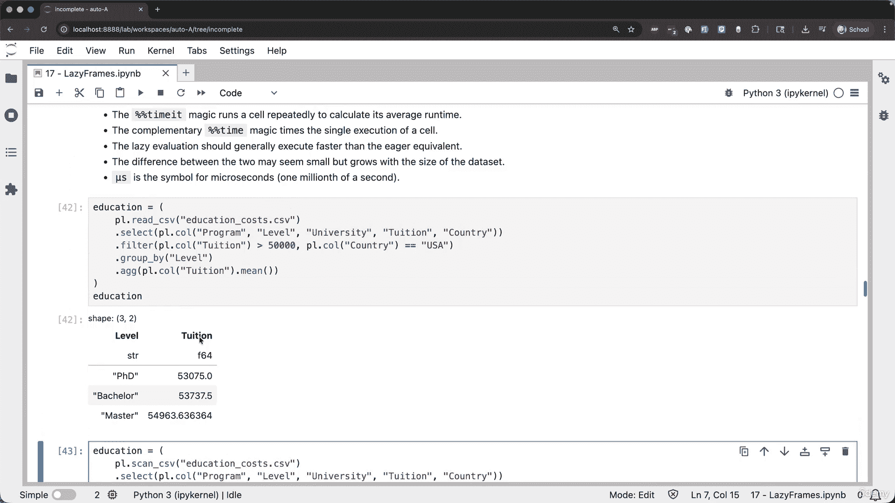

得到第一个平均时间后，还需要对第二段 LazyFrame 代码做同样的计时。下面继续比较第二个单元格的结果。

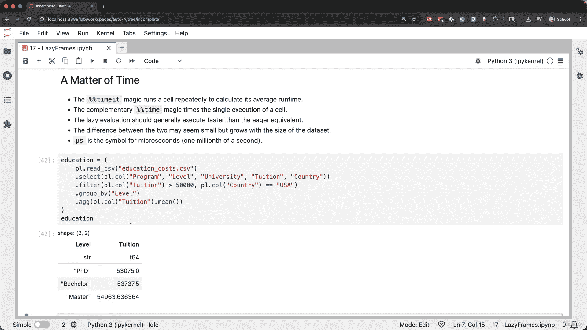

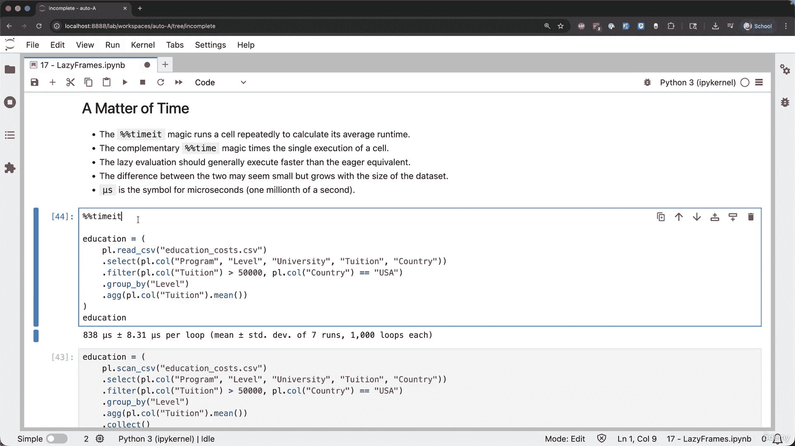

## 📊 Polars 与 Python 数据分析（第二部分）：第87课：对比效率与内存优势

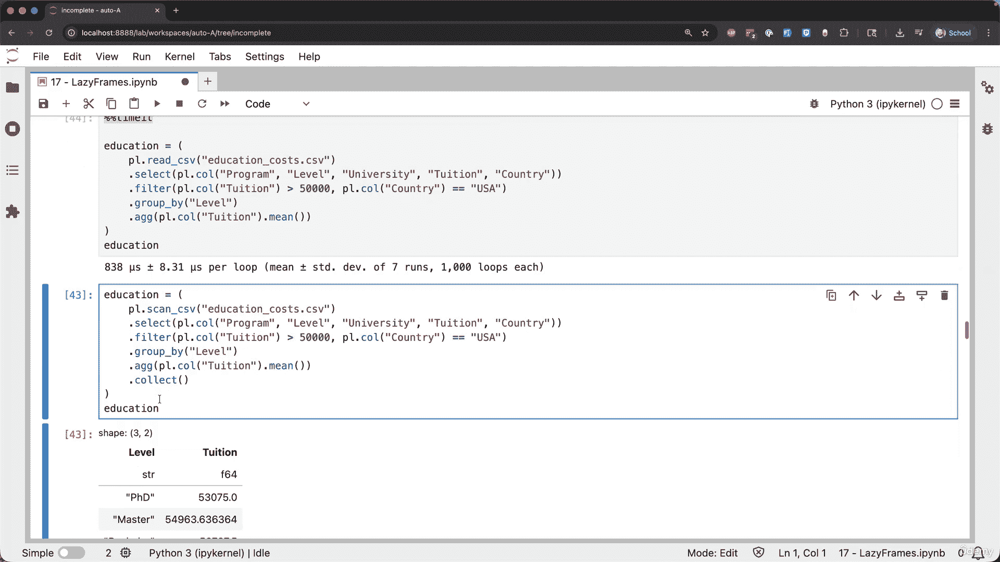

上一节我们测出了 DataFrame 写法的平均耗时。本节中我们来看看 LazyFrame 写法的平均耗时，并比较两者的效率与内存差异。对下方代码重复同样的计时逻辑后，可以看到它产生完全相同的数据框，随后执行同样的单元格计时逻辑。`%%timeit` 魔法同样运行了 1000 次，而平均时间只有 699 微秒，对比第一个单元格的 838 微秒。下面列出可以直接看出的结论和数字。

下面列出可以直接看出的结论和数字：

- LazyFrame 写法同样运行 1000 次，平均耗时为 699 微秒，DataFrame 写法为 838 微秒。
- 本课使用的数据集很小，行数少于 1000 行，因此数字差异看起来不算巨大。
- 直接用 `699 / 838` 计算，耗时比例约为 83%，也就是只花了约 83% 的时间。
- 加速比例约为 17%，也就是速度提升了约 17%。这次提升只是因为把 `read_csv` 换成了 `scan_csv`，并在最后调用 `collect()`。
- LazyFrame 还占用了更少的内存，因为它需要从 CSV 读取的数据更少。
- 即使数据集很小，约 17% 的速度提升或内存减少也有意义；当数据集越来越大时，这种优势会进一步加速 Polars 执行代码。

把关键数字写成公式会更清楚。

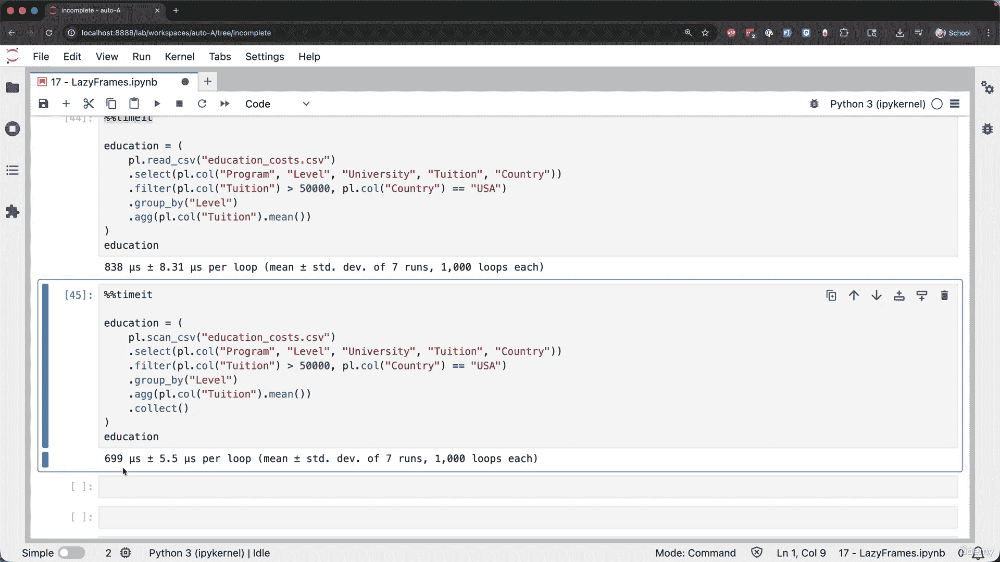

```text
耗时比例 = 699 / 838 ≈ 83%
加速比例 = (838 - 699) / 838 ≈ 17%
```

> 结论：在本例中，LazyFrame 写法平均耗时约 699 微秒，DataFrame 写法平均耗时约 838 微秒；前者只用了约 83% 的时间，速度提升约 17%。

这些数字说明，LazyFrame 的优势不只是写法不同，而是会实际影响执行效率。到这里，本课的主要内容已经完成，下面做一个总结。

## ✅ Polars 与 Python 数据分析（第二部分）：第87课：本课总结

上面我们对比了 DataFrame 与 LazyFrame 的代码写法，并用 `%%timeit` 测量了平均执行时间。本节中我们对整节课做最后总结。 DataFame 写法使用 `read_csv`，通过方法链逐步创建新 DataFrame；LazyFrame 写法使用 `scan_csv` 建立查询计划，最后用 `collect()` 执行计划并得到 DataFrame。两者结果完全相同，但 LazyFrame 写法在本例中平均耗时 699 微秒，DataFrame 写法平均耗时 838 微秒，耗时只占约 83%，速度提升约 17%，同时内存占用也更少。

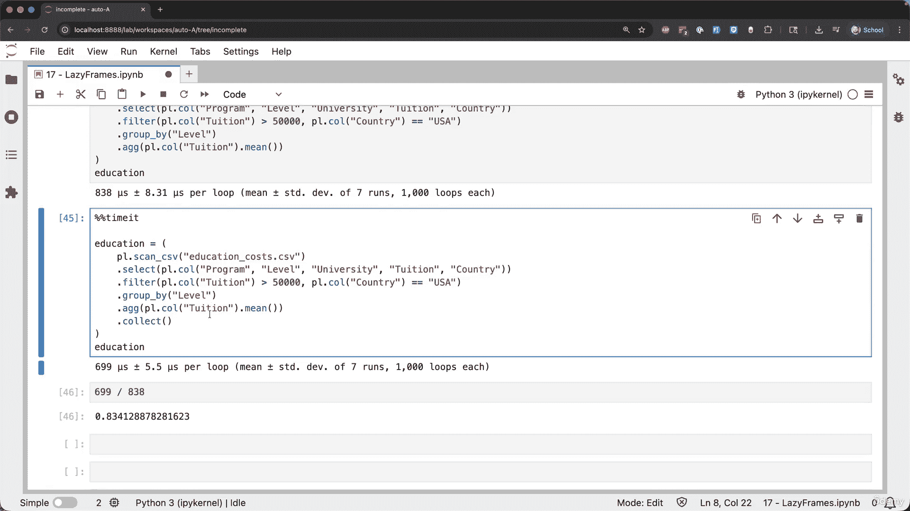

本节课中我们一起学习了如何用 `%%timeit` 测量 Polars 代码的执行时间，如何比较 DataFrame 与 LazyFrame 的效率差异，以及为什么 LazyFrame 在读取更少数据时能减少内存占用并加速执行。即使当前数据集很小，这种约 17% 的提升在大数据集上也会带来明显收益。下节课见。

