# Polars 与 Python 数据分析：188：将 DataFrame 转换为 LazyFrame 🚀


在本节课中，我们将要学习如何把已有的 DataFrame 转换成 LazyFrame，并理解这种转换能带来什么、不能带来什么。上一节课程介绍了使用 `scan_csv` 创建 LazyFrame 的一种方式；本节我们来看看另一种方式：从已有的 DataFrame 出发，通过 `lazy` 方法创建 LazyFrame。为了让初学者更容易跟上，下面会先讲基本思路，再写代码演示，然后观察查询计划，最后用 `collect` 真正执行计算。


## Polars 与 Python 数据分析：188：从 DataFrame 创建 LazyFrame 的基本思路 🧭


上一节我们介绍了 `scan_csv` 这种创建 LazyFrame 的方式，本节中我们来看看如何从已有 DataFrame 转换。基本做法是：以现有 DataFrame，也就是实际的数据表为基础，调用 `lazy` 方法，得到一个 LazyFrame。这个 LazyFrame 可以理解为一个查询计划，它先记录要做什么，而不是立刻把所有计算都执行完。核心语法可以写成下面这样：


```python
lazy_df = df.lazy()
```


需要特别注意的是，当你把 DataFrame 转换成 LazyFrame 时，转换之前本来可能发生的优化已经无法获得。原因是 DataFrame 已经被提前加载和计算过，转换发生在它之后。转换之后，你获得的是 LazyFrame 在后续操作上的优化能力，也就是说，未来操作、后续操作仍然可以被优化。这个区别很重要，因为它决定了你什么时候用 `scan_csv`、什么时候用 `df.lazy()`。


以下是转换时需要记住的几个要点：


- 转换发生在 DataFrame 已经加载之后，所以转换前的优化机会无法追回。
- 转换后得到的是 LazyFrame，后续操作仍然可以被优化。
- 转换有时是必要的，因为 DataFrame 并不支持所有方法；不只是 DataFrame 转 LazyFrame，反过来也可能需要。
- 下一节课会用一个例子展示 DataFrame 不支持某些方法的情况，现在先掌握基本语法和转换流程。


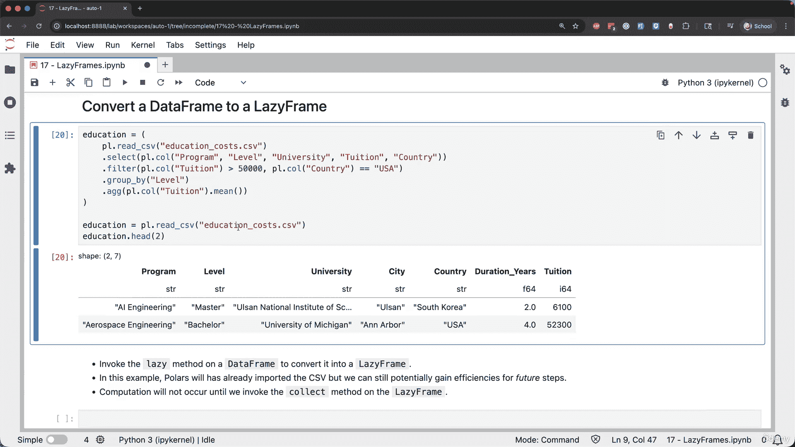

这种转换可以用一句大白话来概括：


> 有比没有好。我们可能拿不到全部好处，但至少可以拿到一部分好处。


这些要点理解后，下面我们进入具体代码，看看读取 CSV、调用 `lazy` 以及后续操作是怎样连接起来的。


## Polars 与 Python 数据分析：188：代码演示与 lazy 方法 💻


上一节说明了转换的基本概念，本节我们来看看具体代码。这里先放上一节课程留下的最终代码：它读取一个 CSV 文件，然后执行一系列计算和转换。同时，这里还有一个最简版本代码，它只做一件事：读取 CSV 文件。执行这个单元格后，末尾会得到我们的 DataFrame。接下来，我们拿这个 `education` DataFrame 调用 `lazy` 方法，从而得到 LazyFrame。为了看清过程，可以把核心操作记成下面的形式：


```python
education = pl.read_csv("education.csv")
education_lazy = education.lazy()
```


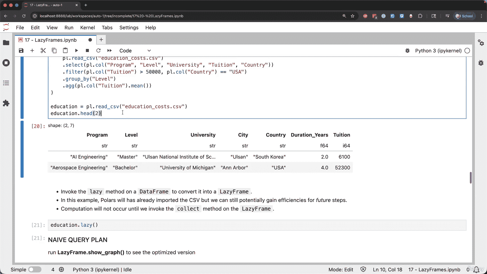

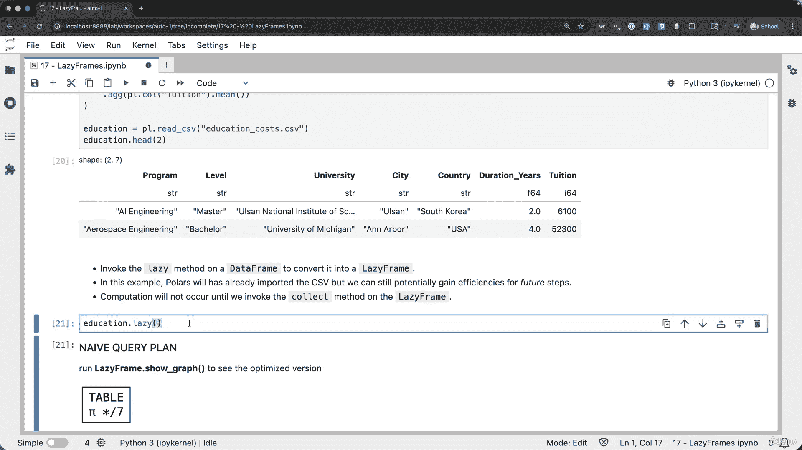

再次强调：因为起点是一个 DataFrame，所以此时必须用 Polars 读取 CSV 文件。这样一来，如果 `scan_csv` 本来可以带来某些优化，现在这些优化已经不再可能，因为 CSV 必须被立即、急切地加载进来。不过，如果把 `education` DataFrame 转换成 LazyFrame，那么从转换之后开始，在真正用 `collect` 强制计算之前，后续执行的操作仍然可以获得优化收益。也就是说，前面的损失已经发生，后面的操作仍然有优化空间。


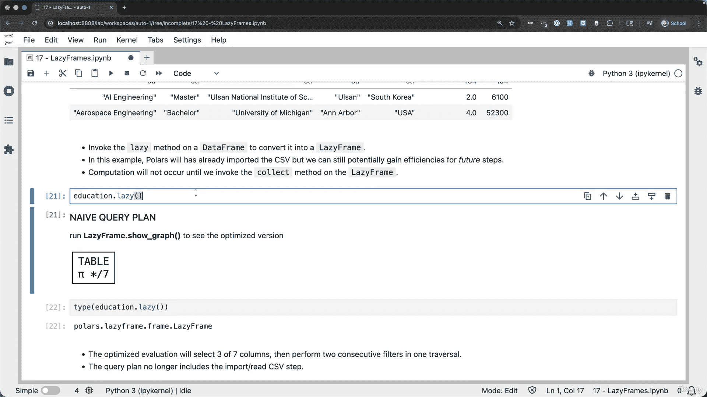

我们还可以把 `lazy` 方法的返回值传给 Python 的 `type` 函数，结果如预期一样是 LazyFrame。此时还没有任何东西需要运行，因为还没有进一步命令。Polars 会查看我们想要执行的所有计算，并想办法优化它们。下面用代码表示这个检查过程：


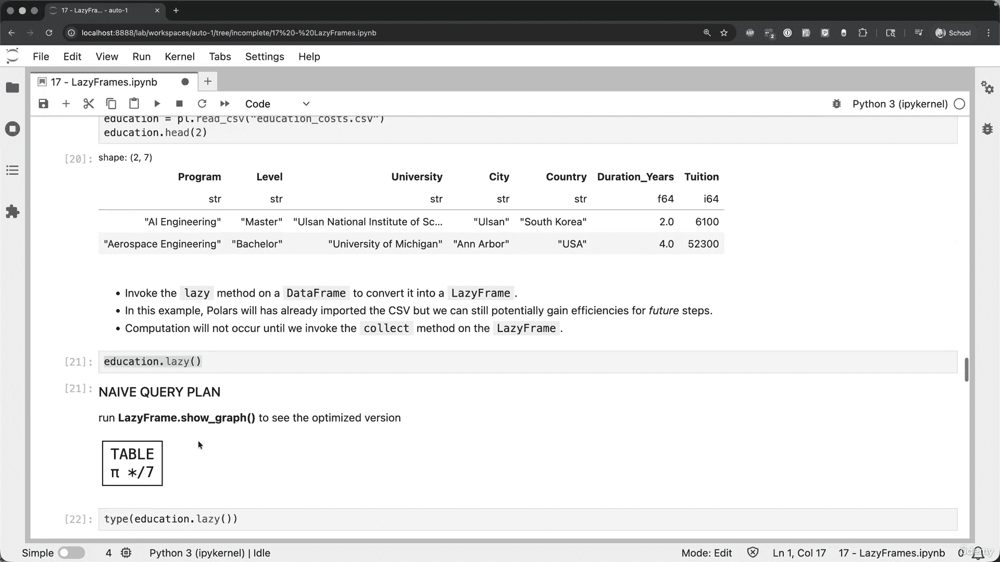

```python
print(type(education_lazy))
# <class 'polars.lazyframe.frame.LazyFrame'>
```


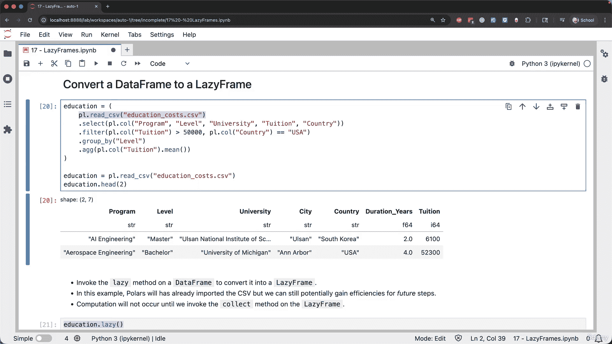

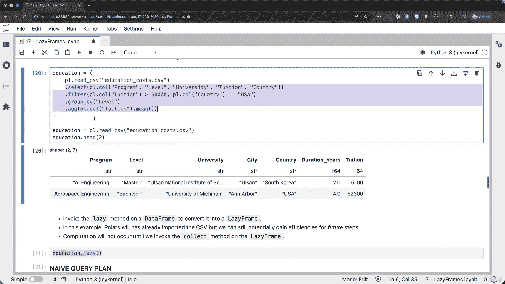

完成转换后，下一步就是把原本要作用在 DataFrame 上的计算搬到 LazyFrame 上，并保持方法链正确连接，下面我们继续看具体写法。


## Polars 与 Python 数据分析：188：在 LazyFrame 上继续写方法链 🔗


上一节我们完成了 DataFrame 到 LazyFrame 的转换，本节我们来看看如何在 LazyFrame 上继续执行原来的计算。做法是：先创建 LazyFrame，把它粘贴到下面，然后把原本要作用在原始 DataFrame 上的代码复制下来。这里会损失一部分效率，因为前面是立即加载；但在后面的 LazyFrame 操作中，仍然有可能获得效率收益。下面复制原来的四行代码，并把它们作用到 LazyFrame 上。为了让方法链正确工作，必须确保每一行末尾的点与上一个方法调用对齐。为了更容易看清，可以把代码拆开一点，然后在末尾加上 `filter`。注意：点的前面不要有换行，点的位置要接在上一个方法调用的末尾。写完后可以用 `ruff format` 格式化。核心形式如下：


```python
result_lazy = (
    education_lazy
    .filter(...)
    .with_columns(...)
    .group_by(...)
    .agg(...)
)
```


这段代码仍然只是执行计划，仍然处于 LazyFrame 状态。它还没有真正计算出结果。只要还没有调用 `collect`，Polars 就仍然可以把它当成一份计划来分析和优化。也正因为如此，即使我们是从 DataFrame 转换而来，后半段仍然可以受益于 LazyFrame 的优化机制。方法链写好后，下一节我们就来看看 Polars 如何优化这份查询计划。


## Polars 与 Python 数据分析：188：查看未优化与优化后的查询计划 🔍


上一节我们写好了 LazyFrame 上的方法链，本节我们来看看 Polars 如何优化查询计划。我们可以拿这个尚未优化的 LazyFrame，调用 `show_graph` 方法，并观察下面展示的前后对比。未优化的查询计划中可以看到一个个单独的 `filter`：一步一步创建过滤后的子集，然后再遍历这个子集，创建另一个过滤行子集，最后执行聚合。优化后的版本则可以通过 `show_graph` 看到：Polars 仍然可以把这些步骤合并成一个 `filter` 调用，这样只需要对所有行迭代一次，而不是多次迭代。下面用代码示意查看查询计划：


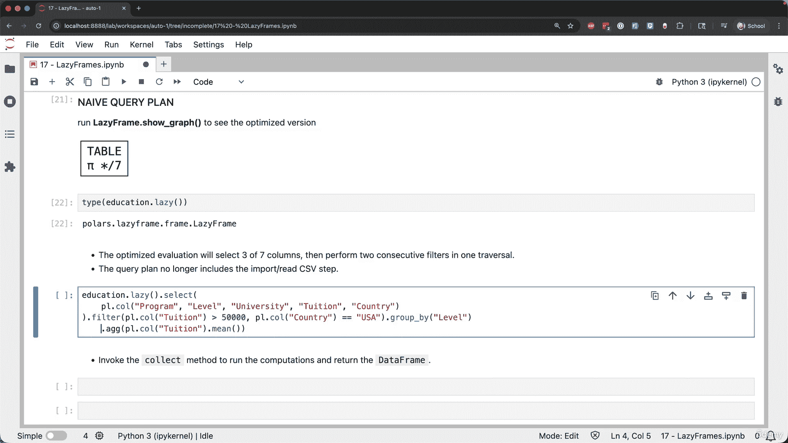

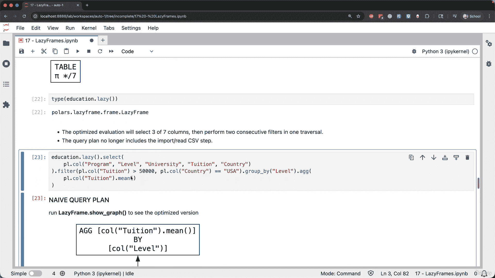

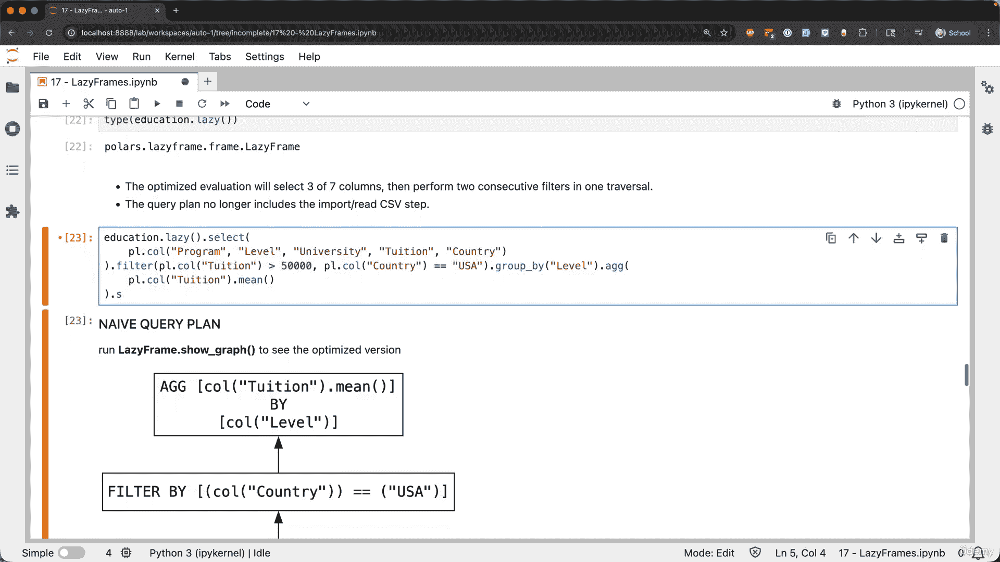

```python
lazy_df.show_graph()  # 查看查询计划
```


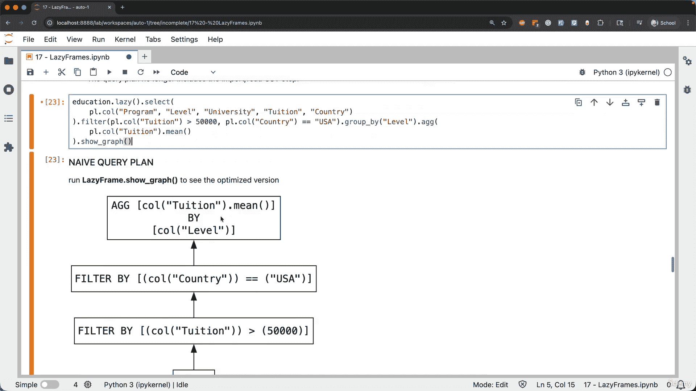

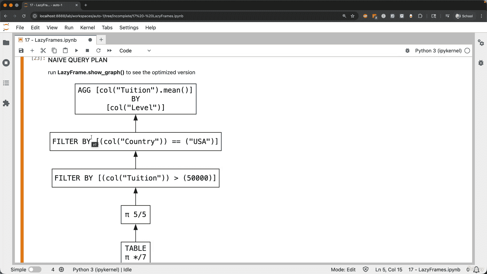

这个对比说明：即使你从 DataFrame 开始，然后再转换成 LazyFrame，仍然有好处可以获得。转换之后，代码仍然是一份“作战计划”，仍然保持 LazyFrame 状态。如果你真的想创建结果 DataFrame，仍然需要像往常一样调用 `collect` 方法。`collect` 会以尽可能最优的方式执行计算，并返回你想要的结果。可以用下面的代码表示最后一步：


```python
result_df = result_lazy.collect()
```


以上就是把已有 DataFrame 转换成 LazyFrame 的方法：使用 `lazy` 方法。需要记住，转换前的优化机会可能已经失去，但转换后的后续操作仍然可以被优化；真正执行计算时，再用 `collect` 得到结果。下面我们做最后总结。


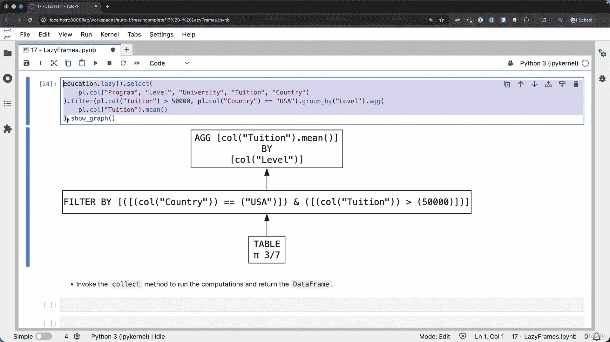

## Polars 与 Python 数据分析：188：总结 🎯


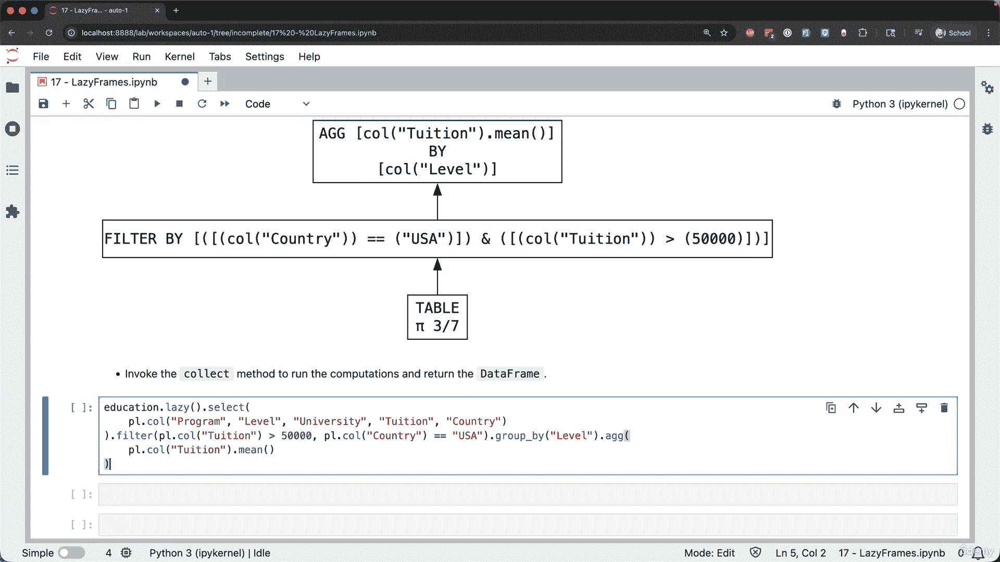

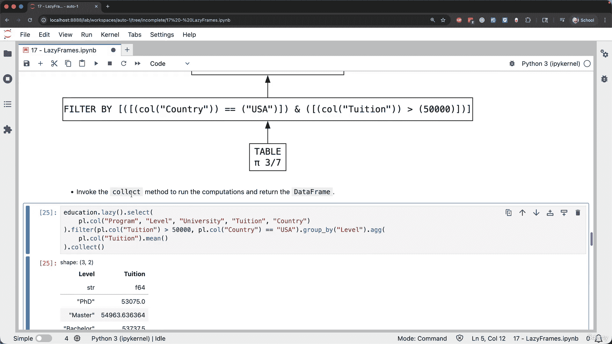

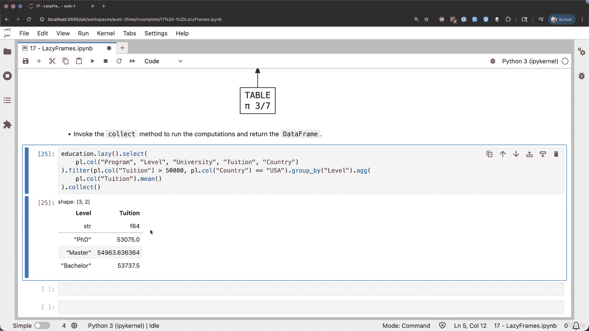

本节课中我们一起学习了如何将 DataFrame 转换为 LazyFrame。我们回顾了 `scan_csv` 创建 LazyFrame 的方式，然后重点讲解了 `df.lazy()` 这种从已有 DataFrame 转换的方法。我们理解了转换前优化与转换后优化的区别，也通过代码演示了读取 CSV、调用 `lazy`、继续写方法链、查看查询计划以及最后调用 `collect` 的完整流程。核心结论是：转换不会让前面的立即加载变成惰性加载，但后续操作仍然可以享受 LazyFrame 的优化收益；需要结果时，用 `collect` 真正执行计算即可。

