# 📗 使用 Polars 与 Python 进行数据分析：第89节：LazyFrame 的限制 🚧

在本节课中，我们将会学习 LazyFrame 的局限性。上一节课我们介绍了 `lazy` 方法，它可以把一个普通的 DataFrame 转换为 LazyFrame。这节课我们要展示一种必须做这种转换的场景，同时也会说明为什么在某些情况下这种转换会失败。我们会从 LazyFrame 的基本限制讲起，然后用一个透视表的例子来演示问题，最后给出解决方案，并看看 Polars 的优化器到底做了哪些优化。

## 🎯 回顾：DataFrame 与 LazyFrame 的转换

在正式开始之前，先简单复习一下上一节课的内容。上一节课我们引入了 `lazy` 方法，调用它之后，DataFrame 就会变成 LazyFrame。LazyFrame 本身并不立刻执行任何计算，它只是记录你接下来想要执行的步骤，形成一个查询计划。等到你调用 `collect()` 的时候，这个查询计划才会真正运行。

本节课要介绍的情况，正是需要用到这种转换的场景。为什么需要转换？因为 LazyFrame 有一些天生的限制，它不能像 DataFrame 那样支持所有的方法。换句话说，有某些操作是只有 DataFrame 才支持的，LazyFrame 并不支持。

## ⚠️ LazyFrame 的局限性

先来说说 LazyFrame 到底有什么限制。简单地说，LazyFrame 中的某些方法是不存在的，只有 DataFrame 才能调用这些方法。造成这个现象的原因，是 LazyFrame 必须满足一个条件，才能成为一个可用的查询计划。这个条件是：查询优化器必须在每一个执行步骤中，都能推断出潜在结果表的 schema。

所谓 schema，指的是结果表包含哪些列，以及这些列要存放什么数据类型。可以把这个概念用公式写出来：

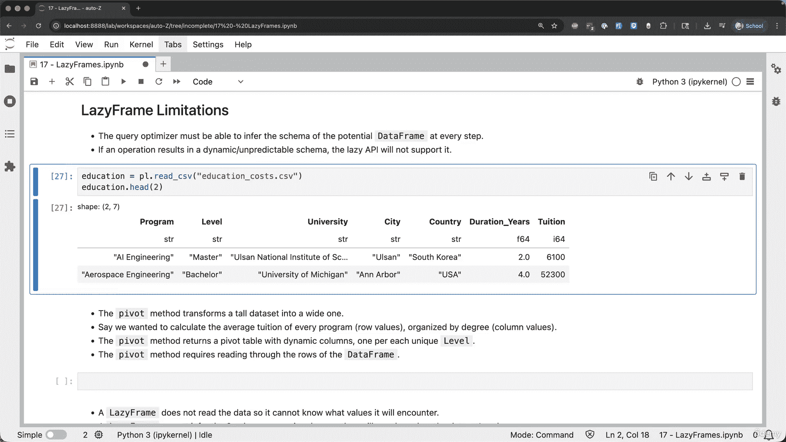

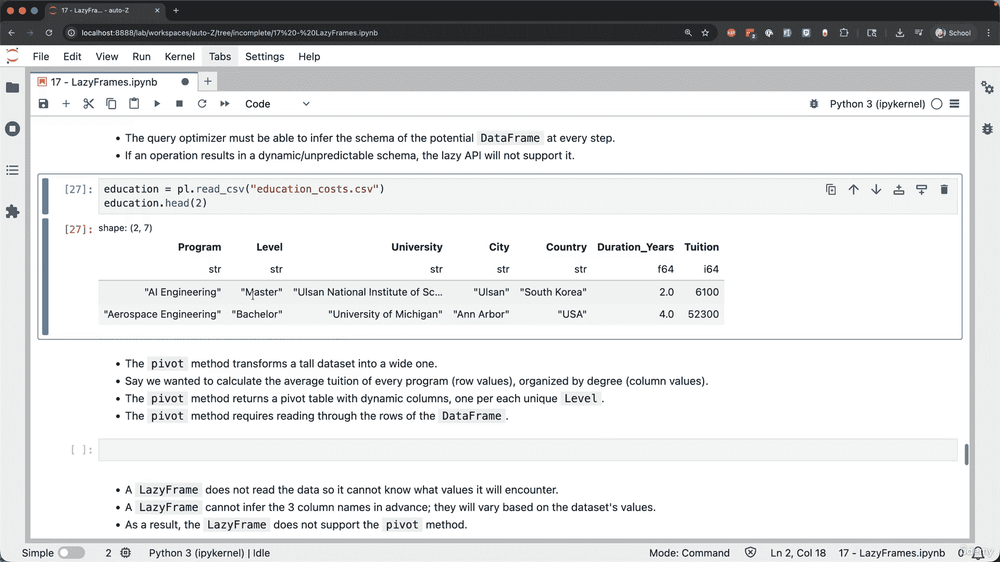

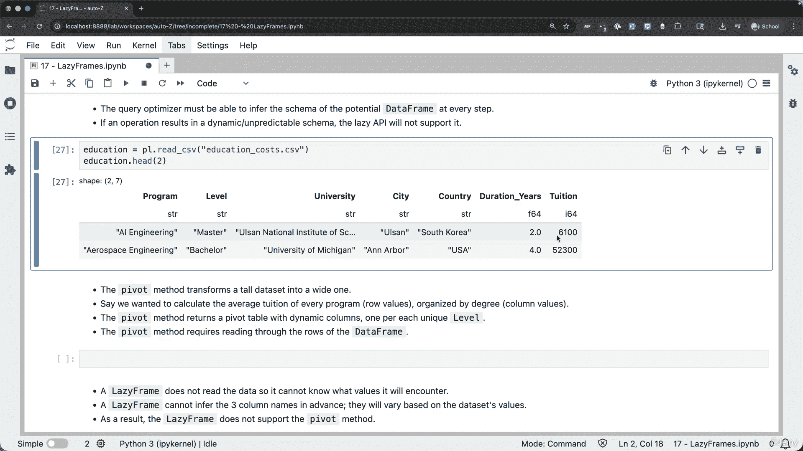

`Schema = { 列名: 数据类型, ... }`

如果某一批数据中的列名和数据类型是动态变化的，无法提前预测，那么 LazyFrame 就无法支持对应的操作。因为 LazyFrame 不知道未来的数据到底是什么形状，它也就无法确定后续的步骤能不能继续执行。这种不可预测性，正是导致一些方法不能在 LazyFrame 上使用的根本原因。

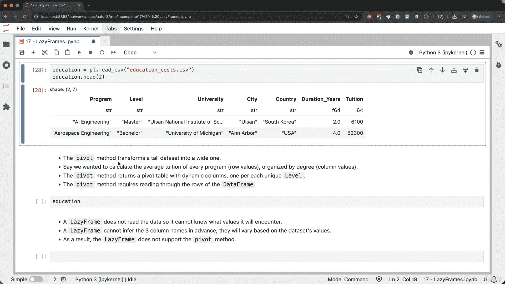

接下来，我们用一个具体的例子来说明这个问题，并看看应该怎么解决。

## 🧮 示例：用透视表计算不同学位的平均学费

为了说明问题，我们使用一个关于教育数据的 DataFrame，这个数据帧里保存着不同课程、不同学位水平以及对应的学费信息。在本课程的前面部分，我们介绍过 `pivot` 方法，它可以用来创建透视表。现在，我们希望做这样一件事：计算每一个课程在不同学位水平下的平均学费。

也就是说，我们想把课程名称作为行，比如 AI 工程、航空航天工程等；把学位水平作为列，比如硕士、学士、博士等。在行与列的交叉位置，我们放入对应课程和学位水平下的学费平均值。例如，AI 工程这个课程在硕士这一列中的值，就是 AI 工程硕士学费的平均值。

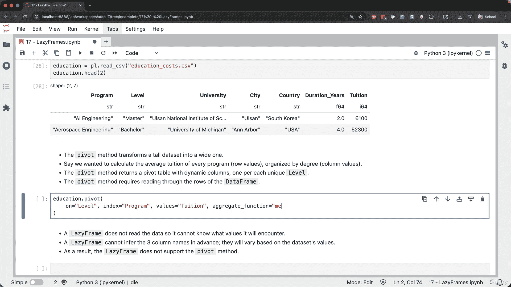

这个需求用 `pivot` 方法很容易实现。当前 `education` 是一个 DataFrame，因为它是通过 `read_csv` 读取出来的。我们可以直接在这个 DataFrame 上调用 `pivot` 方法，代码如下：

```python
import polars as pl

education = pl.read_csv("education.csv")

pivot_df = education.pivot(
    index="program",
    columns="level",
    values="tuition",
    aggregate_function="mean"
)
```

在这段代码中，`index` 参数指定了透视表的行索引，我们使用 `program` 列中的值作为行。`columns` 参数指定了透视表的列，我们希望根据 `level` 列中的不同值来生成新列。`values` 参数指定了需要被聚合的列，这里就是 `tuition`。最后一个参数 `aggregate_function` 指定了聚合操作，我们传入的是 `"mean"`，也就是求平均值。

执行之后，我们会得到一个透视表。这个表中的行是各个课程，列是学位水平，包括 `master`、`bachelor`、`PhD` 等等。表中的每一个值，都是对应课程和对应学位水平下的平均学费。可以看到，这个结果非常清晰，每一行每一个学位都有对应的平均值。

## 🔍 筛选出三个学位都有值的行

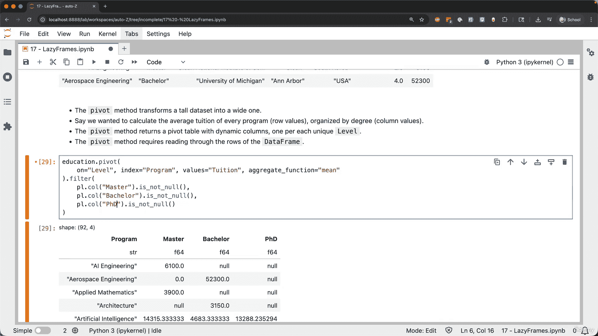

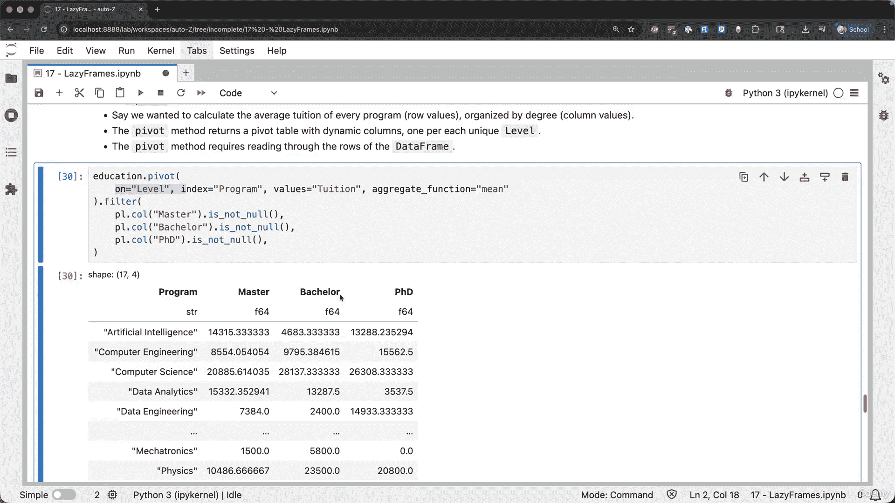

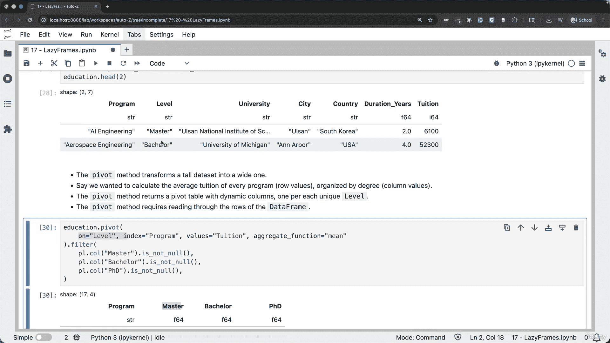

拿到透视表之后，我们可能还想继续处理。假设我们只关心三个学位水平下都有具体学费数据的课程，也就是在这三个列中都没有空值的行。为了实现这个需求，我们可以调用 `filter` 方法来筛选这些行。

具体的做法是：分别检查 `master` 列、`bachelor` 列和 `PhD` 列是否不为空。这些条件需要同时成立，所以我们可以把三个表达式作为参数依次传入 `filter` 方法。虽然可能还有更优化的写法，但是目前这样写已经可以工作了。代码如下：

```python
filtered_df = pivot_df.filter(
    pl.col("master").is_not_null(),
    pl.col("bachelor").is_not_null(),
    pl.col("PhD").is_not_null()
)
```

执行之后，我们得到的透视表中，每一行在三个学位列上都有实实在在的值。到目前为止，我们做的都是普通的 DataFrame 操作，没有什么特别之处。

## 🚨 问题：LazyFrame 不支持 pivot 方法

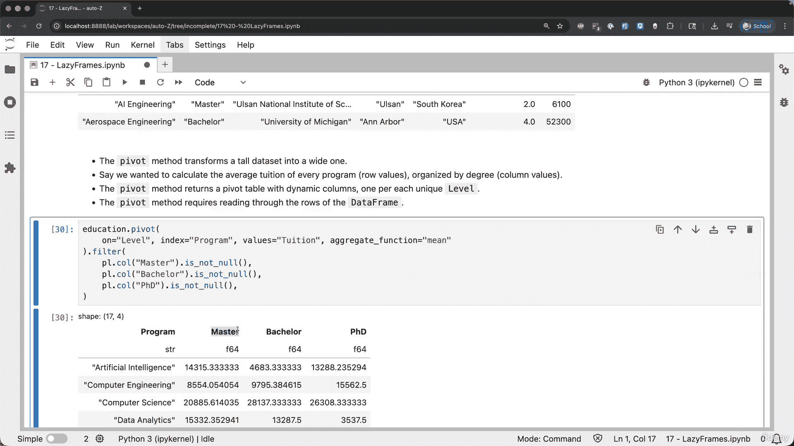

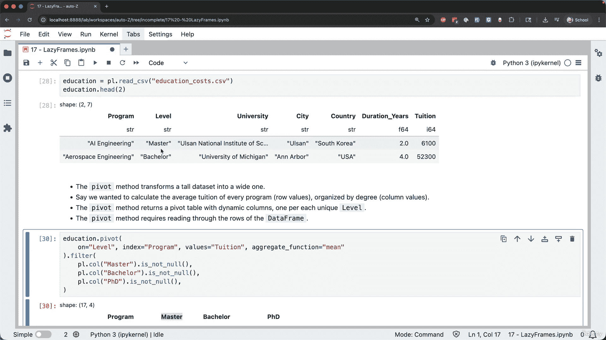

现在让我们仔细看看刚才的第一步操作，也就是透视表那一步。注意，透视表生成的新列名 `master`、`bachelor`、`PhD` 是动态的，它们是根据 `level` 列中的不同取值生成的。当 DataFrame 需要确定列名时，它必须扫描 `level` 列中的每一个值，找出所有不同的值，然后把它们作为新列的名称。

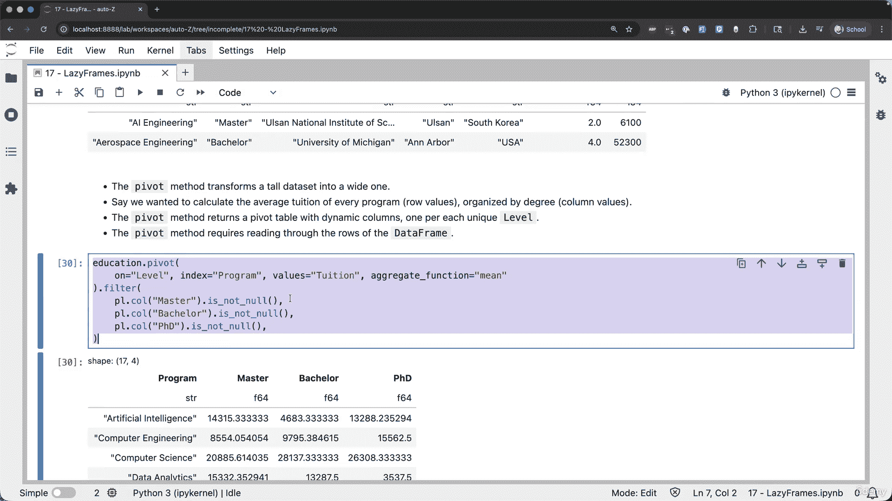

这个操作之后，DataFrame 的 schema 就是由 `master`、`bachelor`、`PhD` 这些列组成的。但是，LazyFrame 并不会提前读取数据。问题就在这里：LazyFrame 无法支持 `pivot` 方法，因为它无法预知最终结果表的 schema。在调用 `collect()` 之前，LazyFrame 不会真正读取数据行，所以它不可能知道 `master` 是不是一个可能的列名。

因为 LazyFrame 不知道这个假设出来的表长什么样子，所以它也无法保证后续的操作是否可行。比如说，后续如果我们要对 `master` 列执行筛选操作，或者对 `master` 列做除法、求平均值这类进一步的计算，LazyFrame 都无从判断这个列是否存在。这正是我们不能直接在 LazyFrame 上调用 `pivot` 的原因。

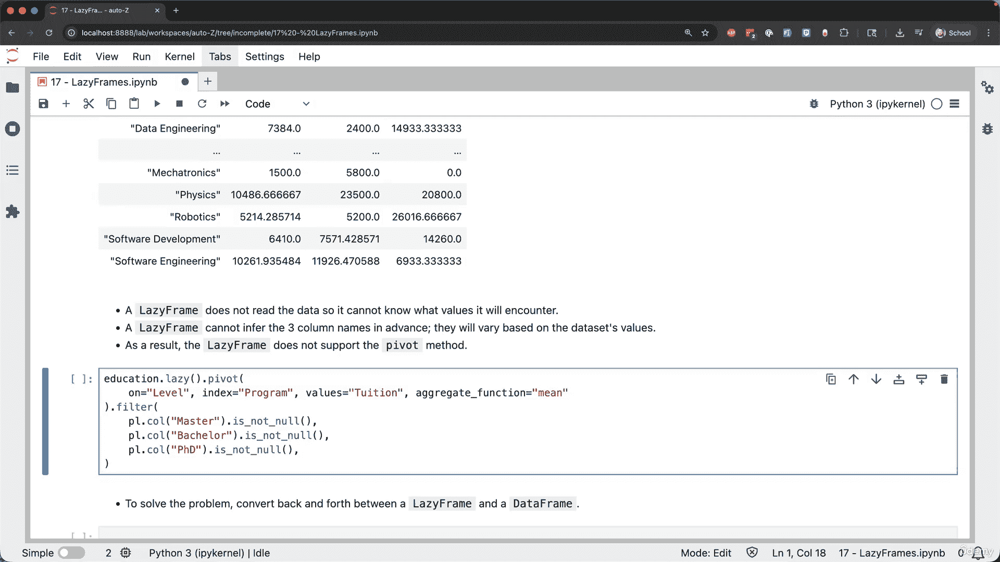

我们来实际演示一下这个错误。假设我们把刚才所有代码复制一份，然后在执行 `pivot` 之前先调用 `lazy` 方法，把 DataFrame 转换成 LazyFrame。那么代码会变成这样：

```python
lazy_attempt = education.lazy().pivot(
    index="program",
    columns="level",
    values="tuition",
    aggregate_function="mean"
)
```

运行之后，Polars 会直接报错。错误信息大概是：`LazyFrame object has no attribute pivot`。这段信息告诉我们，LazyFrame 对象没有 `pivot` 这个属性，也就是说它不支持这个方法。这并不奇怪，因为 `pivot` 的功能依赖于扫描原始数据列中的各个不同取值，而 LazyFrame 是惰性的，它不会提前做这种扫描。LazyFrame 本质上是一份查询计划，是一串将来才会执行的指令。既然现在不能读取数据，自然也就无法完成透视表操作，所以我们的代码在这里就失败了。

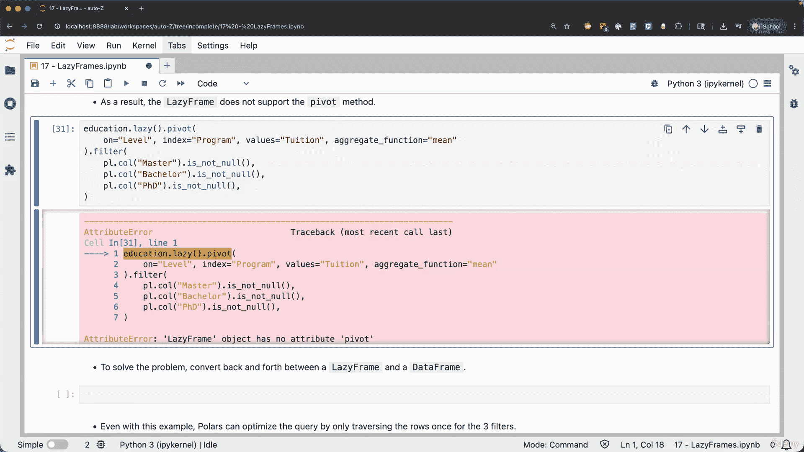

## 🛠️ 解决方案：先在 DataFrame 上执行，再转换到 LazyFrame

遇到这种情况应该怎么处理呢？我们的思路其实在上一节课已经介绍过了：如果 LazyFrame 不支持某个操作，那就先在支持这个操作的 DataFrame 上执行，再把执行得到的 DataFrame 转换成 LazyFrame，然后继续完成剩余的操作。

具体来说，我们不会试图在 LazyFrame 上调用 `pivot`，而是先保留原来的 DataFrame，直接对 DataFrame 调用 `pivot` 方法。这样可以得到一个带有完整 schema 的结果表。然后，我们调用 `lazy` 方法，把这个已经确定好列名和数据类型的 DataFrame 转换成 LazyFrame。最后，我们再在这个 LazyFrame 上执行 `filter` 等后续操作，并用 `collect()` 来真正运行整个查询计划。

这种做法的代码形式如下：

```python
result = (
    education.pivot(
        index="program",
        columns="level",
        values="tuition",
        aggregate_function="mean"
    )
    .lazy()
    .filter(
        pl.col("master").is_not_null(),
        pl.col("bachelor").is_not_null(),
        pl.col("PhD").is_not_null()
    )
    .collect()
)
```

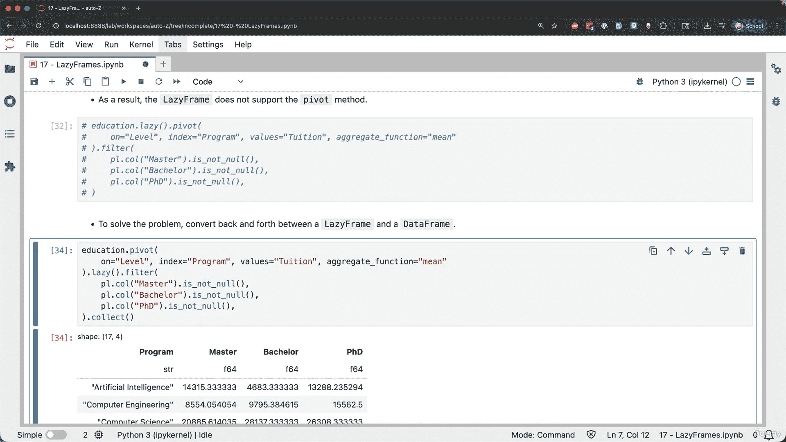

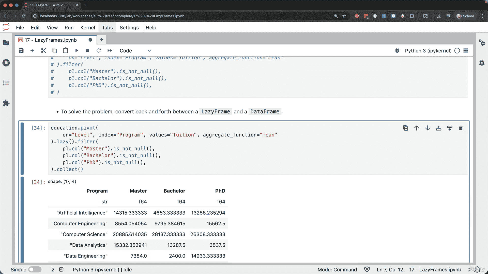

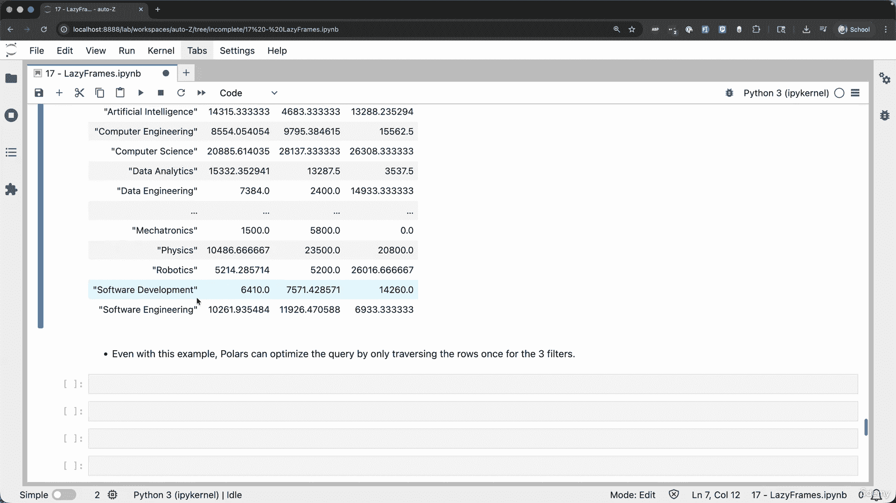

可以看到，我们在这里先支付一点代价：`pivot` 操作必须在一个已经存在的 DataFrame 上执行，没有办法跳过这一步。不过，一旦透视表生成完毕，所有列名和数据类型就都已经确定了，这时候可以放心地把它转换成 LazyFrame。转换之后，我们依然能够享受到 LazyFrame 在筛选操作上的优化好处。最终调用 `collect()`，把 LazyFrame 转换回 DataFrame，得到的结果和之前完全一样。

## ⚡ 优化效果：三个过滤器变成一次扫描

也许你以为上面的例子已经很好了，但实际上在这个过程中还有更多的优化空间。我们可以把这段代码再复制一份，然后不调用 `collect()`，此时可以看到原始的查询计划。因为我们还没有调用 `collect()`，所以 `filter` 操作只是不停地在 LazyFrame 上添加指令。Polars 提供了 `explain` 方法来展示查询计划，也提供了 `show_graph` 方法来画出查询计划图。我们可以这样使用：

```python
lazy_query = (
    education.pivot(
        index="program",
        columns="level",
        values="tuition",
        aggregate_function="mean"
    )
    .lazy()
    .filter(
        pl.col("master").is_not_null(),
        pl.col("bachelor").is_not_null(),
        pl.col("PhD").is_not_null()
    )
)

print(lazy_query.explain(optimized=False))  # 未优化的计划
print(lazy_query.explain())                  # 优化后的计划
lazy_query.show_graph()
```

先来看未优化的计划。如果直接在 DataFrame 上依次执行三个 `filter`，那么每一步都会重新扫描一次数据。过程是这样的：第一次读取所有行，筛选出满足第一个条件的行；然后对筛选后的子集做第二次扫描，应用第二个条件；接着再对剩余结果做第三次扫描，应用第三个条件。也就是说，我们会对数据集进行了三次顺序扫描，每次扫描针对的是上一次筛选后剩下的数据。

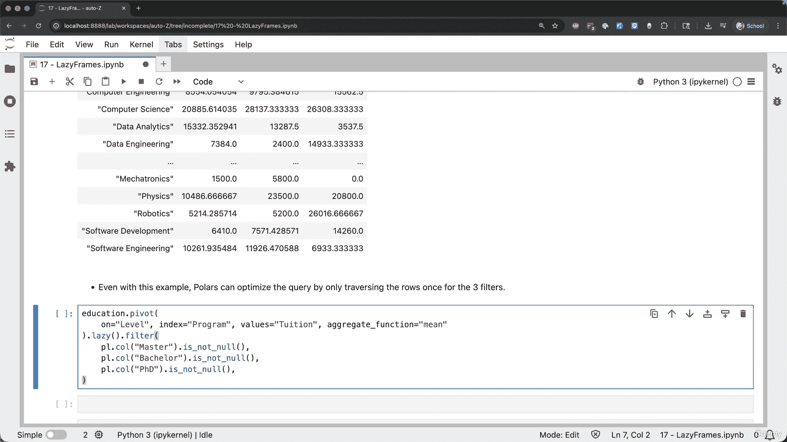

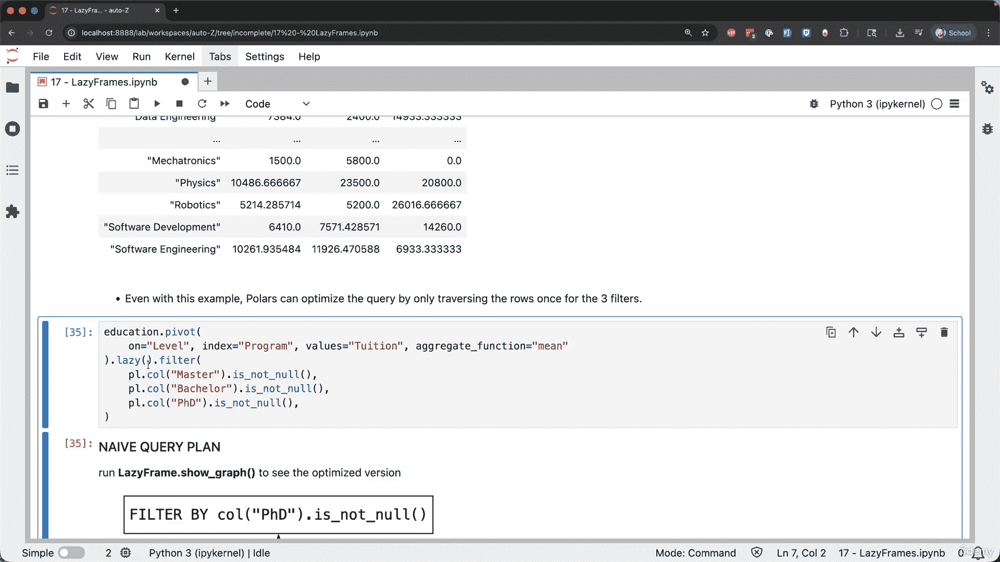

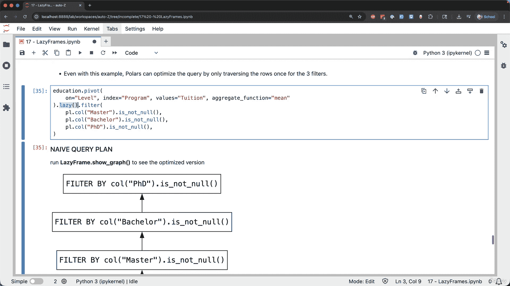

而经过 Polars 优化器处理之后，真正的查询计划会变得更加高效。LazyFrame 会把这三个独立的 `filter` 步骤合并到一次遍历中完成。也就是说，我们只需要扫描一遍所有行，就能同时完成三个条件的筛选。所有的优化都发生在调用 `collect()` 的时候，或者在我们调用 `explain()` 和 `show_graph()` 的时候被展示出来。

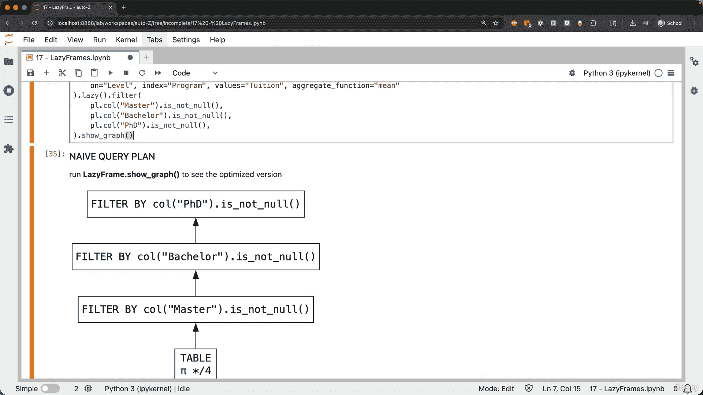

这带来一个重要的结论：`pivot` 本身必须运行在原始 DataFrame 上，没有办法被优化掉。但是，一旦 Polars 知道了结果表的列名，比如 `master`、`bachelor`、`PhD`，后续的筛选操作就可以进行优化了。所以我们的做法是：先转换成 LazyFrame，再执行筛选操作，从而为后续步骤节省时间和资源。

## ✅ 总结

本节课中，我们一起学习了 LazyFrame 的限制。我们首先回顾了 `lazy` 方法的基本作用，然后知道了 LazyFrame 并不是万能的，它只支持那些能够提前推断 schema 的操作。由于 `pivot` 需要读取动态列名才能确定结果表的 schema，所以它无法在 LazyFrame 上直接使用。我们也看到了具体的解决方法：先在 DataFrame 上执行 `pivot`，再用 `lazy` 转换成 LazyFrame，继续进行筛选，最后用 `collect` 得到结果。

我们还通过一个例子看到了 Polars 优化器的价值：未优化的计划会进行三次扫描，而优化后的计划只需要一次扫描。这是 LazyFrame 在数据处理中的一大优势。以后如果你知道后续操作可以被优化，就可以放心使用 `lazy` 来转换；但如果某些操作确实只能由 DataFrame 完成，那就先老老实实在 DataFrame 上计算，然后再回到 LazyFrame 上继续处理。这样既绕开了限制，也能获得性能优化。

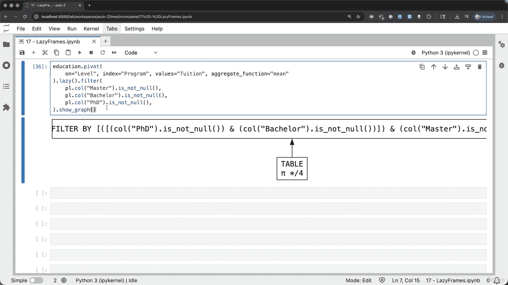

下一节课，我们会继续深入学习 Polars 中其他相关内容。

