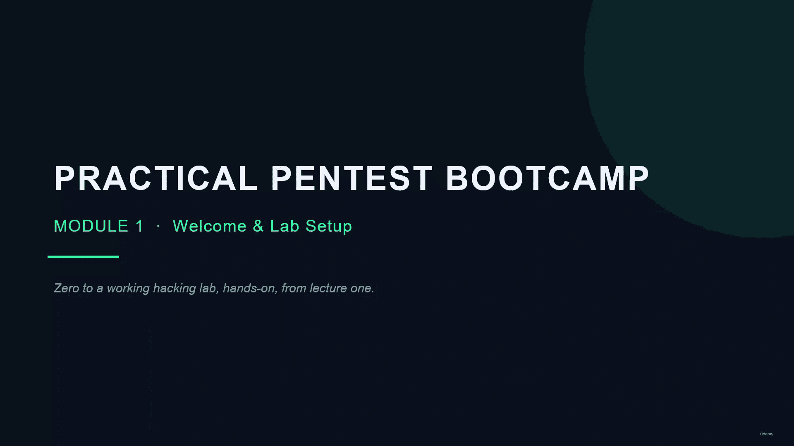
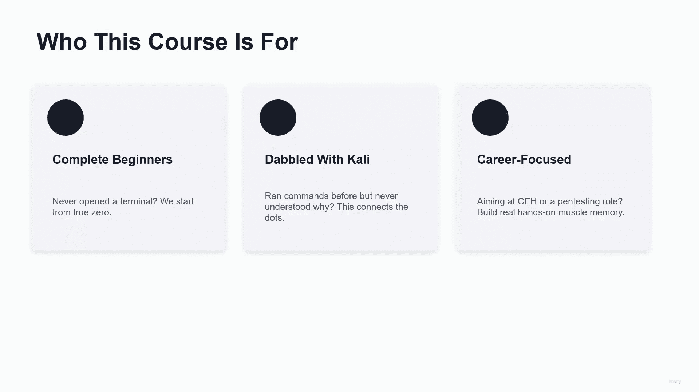
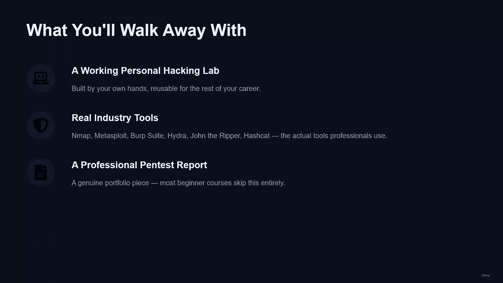

🛡️ 道德黑客与渗透测试：01：课程概述

在本节课中我们将要学习这门渗透测试课程的整体情况，包括谁适合学习、学完之后能掌握什么，以及怎样才能把知识真正记住。很多刚开始接触网络安全的朋友，最容易遇到的困难就是看着视频里快速闪过的命令，完全不知道每个参数代表什么意思，也不知道为什么能成功。这种感觉很常见，但并不是学习必须经历的痛苦。

欢迎来到实用渗透测试训练营。如果你以前看过黑客视频，可能会有这样的感觉：视频里直接跳到输入一些看起来很吓人的命令，却完全没有解释。终端屏幕上随机飘过绿色的文字，有人在飞快地打字，而你完全不知道刚才发生了什么，也不明白为什么命令能成功。

这门课程不一样。我们会放慢脚步，刚好让你在每一步都真正理解自己在做什么。同时，我们也不会讲得太慢，避免你在听我讲解你已经懂的内容时感到无聊。这就是我在这门完整课程中追求的平衡，我觉得你会喜欢这样的节奏。

```
渗透测试学习路径 = 从零开始搭建实验室 → 理解每个工具的原理 → 亲自输入命令进行练习 → 编写专业渗透测试报告
```



了解了课程的整体定位之后，我们来看看这门课程到底是为哪些人设计的。

先花一分钟聊聊这门课程到底是为谁设计的，因为我想让你在继续之前，清楚自己处于什么水平。如果你是完全的新手，一生都没打开过终端，从未碰过 Linux 命令，或者只用过 Windows 或手机，那么你来对地方了。

这门课程从零开始。我不会假设你甚至知道命令行是什么。我们会从地基开始，一块砖一块砖地搭建每一个概念。如果你以前摆弄过 Kali，可能看过随机的 YouTube 视频，运行了几个自己不完全明白的命令，然后因为知识点串不起来而失去了动力。这门课程专门用来填补这个空白。

以下是你学完之后会获得的核心能力：

- 你会真正理解每个工具为什么起作用，而不仅仅是按哪些按钮。
- 如果你将来想从事这个行业，或者考取 CEH 之类的认证，这门课程会给你很多考试导向备课会跳过的东西：真正的动手肌肉记忆。
- 当然，你可以为了考试背定义，但真正自己输入这些命令，并在自己屏幕上看到攻击成功，会建立一种完全不同、更持久的知识。这正是雇主和客户雇佣渗透测试人员时真正为之付费的东西。

知道了适合的人群和核心能力之后，我们来看看学完这门课你具体会得到什么。



现在，让我描绘一下你学完这门课时会处于什么位置，因为我认为清楚地看到那个目标很有激励作用。

学完课程，你会拥有一个完全由自己动手搭建的可用个人黑客实验室。你在整个职业生涯中都可以复用和扩展这个实验室，这不是一次性设置就完事的东西，它是一个你会反复回归的基础。

你将拥有与真实渗透测试人员在实际客户项目中每天使用的完全相同的工具的真实动手经验。常见的行业标准工具包括：

- Nmap，用于网络扫描。
- Metasploit，用于漏洞利用。
- Burp Suite，用于 Web 应用测试。
- John the Ripper 和 hashcat，用于密码攻击。

这些不是玩具版本或简化的替代品，而是真正的行业标准工具。

最重要的是，你会带着一份基于在实验室中亲自完成的真实工作撰写的专业风格渗透测试报告离开。我想强调这一点，因为这一点被严重低估，大多数入门课程根本不教报告编写。它们只教你怎么入侵系统，然后就结束了。但在现实世界中，那份报告往往就是客户为之付费的实际交付物。老实说，入侵部分才是有趣的部分，报告才是能让你被雇佣或获得报酬的部分。这门课程两者都会教。

了解了课程产出之后，我们再聊聊在学习过程中应该怎么做，才能让知识真正留在脑子里。

在继续之前，还有一件事。我希望你在观看时真正动手跟着做，不要像看电影一样被动观看。如果命令跑得太快你来不及看，随时暂停、倒带视频。

整门课程的结构就是，让你在到达最后一节课时，亲自手动输入过每一个有意义的命令，点击过每一个有意义的按钮。这真的是唯一能让知识记住的方法。

好了，这就是课程概述。下一节课，在碰任何工具之前，我需要带你过一遍三条基本规则，其中有一条是非常严肃的法律要点。我需要你认真听，不要跳过。我们开始吧。



本节课中我们一起学习了渗透测试课程的概述：这门课程适合零基础学习者，也适合曾经接触过 Kali 但缺乏系统理解的人；学完后你会搭建个人实验室，掌握 Nmap、Metasploit、Burp Suite、John the Ripper、hashcat 等行业标准工具，并编写专业渗透测试报告；同时强调必须动手跟练，才能把知识真正记住。
