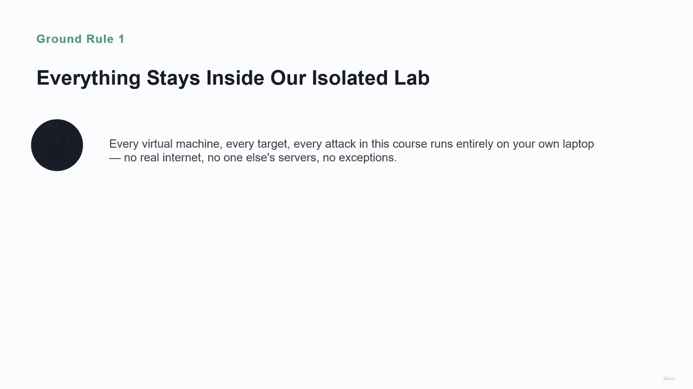
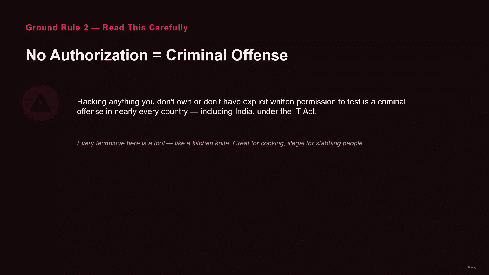
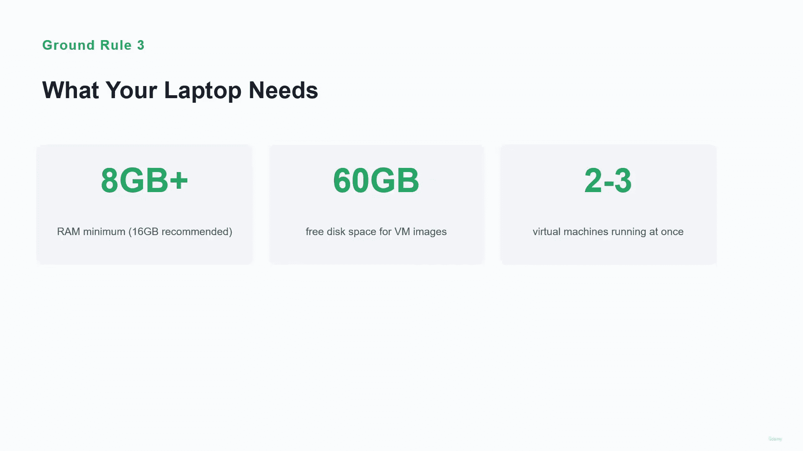

# 🔒道德黑客与渗透测试：2：基础规则——法律与道德边界

在本节课中，我们将要学习在碰到任何工具之前必须遵守的三条基本规则。这些规则涵盖了实验环境的安全边界、未经授权测试的法律后果，以及运行课程所需的硬件配置。我们会先说明为什么要把所有攻击目标放在虚拟机里，接着讨论在没有书面许可的情况下测试他人系统会面临什么刑事风险，最后看看你的笔记本电脑需要多少内存和磁盘空间才能顺利跟进课程。


在我们开始使用任何渗透测试工具之前，必须先搞清楚课程的底线。请在这里认真听讲，不要跳过，也不要快进，因为其中有一条规则涉及非常严肃的法律要点，我需要你真正记住，而不是听一遍就忘记。下面是这三条规则的整体介绍，帮助你建立正确的学习心态。


## 规则一：所有操作都在虚拟机里完成

上一节我们介绍了课程的三条基本规则，本节我们先来看看第一条，也就是关于实验环境安全边界的内容。简单来说，这条规则要求你把所有的攻击练习都限制在自己的笔记本电脑里，绝对不要碰触外面的真实网络。

本课程中所有的操作都完全发生在虚拟机里面，这些虚拟机完全运行在你自己的笔记本电脑上。我们不会使用这些技术去碰触真实的互联网。我们不会去碰任何其他人的服务器。我们绝对不会去碰你邻居的WiFi、你的学校网络或者办公室的基础设施。

本课程从第一讲一直到最终的毕业项目，所有我们要攻击的目标，都是你自己在VirtualBox里创建的虚拟机。这些虚拟机位于一个根本无法访问外网的私有网络中。这就是让我们一起做的一切完全安全且完全合法的原因。



你可以把这个安全模型用下面的公式来理解：

```
实验安全性 = 虚拟机隔离 + 宿主机环境 + 私有网络 + 无法访问外网
目标机器 = 你在VirtualBox中自己创建的虚拟机
结果 = 完全安全且合法的渗透测试练习
```


## 规则二：未经明确书面授权，禁止测试任何系统

我们已经了解了如何在虚拟机里安全地操作，本节我们来看看更严肃的一条规则，也就是关于法律红线的内容。这一点非常重要，我希望你能停下来认真思考一下。

测试你不拥有或者没有明确书面授权的任何东西，在世界上几乎每个国家都是刑事犯罪。在印度，这属于2000年信息技术法的管辖范围。在其他国家，也有类似的法律，例如美国的计算机欺诈和滥用法案。

以下是不同国家中与此相关的典型法律依据：
- 印度：2000年信息技术法
- 美国：计算机欺诈和滥用法案
- 其他国家：各自对应的计算机犯罪相关法律

这些法律通常不在乎你的意图。它们不在乎你只是出于好奇，或者只是想看看是否可行。它们也不在乎你是不是打算做坏事。未经授权的访问就是未经授权的访问，绝对不行。这种行为可能会带来真实的刑事处罚，包括坐牢，具体取决于司法管辖区和案件的具体细节。

这是这条规则的实际操作版本。我不在乎这有多诱人，我向你保证，在这门课期间或者之后，你迟早会产生想要尝试的冲动。不要扫描你邻居的WiFi网络。不要只为了看看而对你学校的服务器运行nmap。不要对你工作单位的系统尝试这些技术，即使你认为自己通过发现漏洞是在帮他们。

你在本课程中学到的每一种技术，本质上都是一种工具。和任何工具一样，它既有合法用途也有非法用途。你可以把它想象成一把厨房刀，做晚饭时非常好用，但如果用来威胁别人，就显然是非法且有害的。刀子本身没有好坏之分，关键在于你如何选择使用它。而你如何使用这个工具，最终要由你自己负责。

你可以用下面的伪代码来记住这个授权检查逻辑：

```
如果（你拥有该目标）或（你拥有明确的书面授权）：
    可以进行测试
否则：
    禁止测试，违者可能面临刑事处罚，包括坐牢
```

每次都要相应地使用本课程中的所有内容，不要有任何例外。




## 规则三：硬件要求，确保内存和磁盘空间足够

我们讨论完法律边界之后，本节来看看实践层面的准备工作，也就是你的电脑需要满足什么条件才能流畅跟上课程。这一点更加实际，也没那么严肃，但对你的学习体验非常重要。

你需要一台内存至少为8GB的笔记本电脑，才能舒适地跟上本课程。老实说，16GB确实更好。原因如下。在本课程中，我们大多数时间会同时运行两台虚拟机，在后续的高级模块中，有时甚至会同时运行三台。

每台虚拟机都需要自己的一块内存才能流畅运行。如果内存太紧张，你会发现一切运行都很卡顿，这会让跟进课程和真正学习内容变得比实际需要的更加令人沮丧。

你还需要大约60GB的可用磁盘空间。因为在Kali Linux、目标机器以及一路上下载的各种工具和字典之间，这些虚拟机镜像在整个学习过程中体积会不断累加。

你可以用下面的公式来估算所需的硬件资源：

```
建议内存 = 宿主机系统占用 + 虚拟机1内存 + 虚拟机2内存 + 余量（推荐16GB）
所需磁盘空间 ≈ 60GB（用于Kali Linux、目标机器、工具与字典）
```


## 快速回顾与下一节预告

在进入更激动人心的内容之前，我们先快速回顾一下刚才讲的三条规则，确保你已经记住了最重要的底线。

请记住以下三点：第一，待在我们隔离的实验环境中，所有攻击目标都在你自己创建的虚拟机里；第二，在没有明确书面授权的情况下，永远不要测试任何不属于你的系统；第三，确保你的硬件能够舒适地同时运行多台虚拟机。在本课程剩下的全部时间里，请时刻铭记这三条规则。我向你保证，在第14讲它们和在第1讲这里一样重要。

好了，把这些严肃的事情放在一边，我们即将进入更激动人心的内容：正式定义什么是渗透测试，以及为什么这是一份真正合法、薪资优厚的职业，而本整门课程将为你做好准备。




本节课中我们一起学习了渗透测试课程的三条基础规则。第一条规则是，所有攻击目标都在你自己用VirtualBox创建的虚拟机里，运行在无法访问外网的私有网络上，因此完全安全且合法。第二条规则是，未经明确书面授权不得测试任何你不拥有的系统，否则在几乎每个国家都可能构成刑事犯罪，甚至会面临坐牢的风险。第三条规则是，你的笔记本电脑需要至少8GB内存，建议16GB，以及大约60GB的可用磁盘空间，才能同时运行多台虚拟机。下节课我们将进入更激动人心的内容，详细定义渗透测试是什么，并介绍为什么这是一个合法且薪资优厚的职业。
