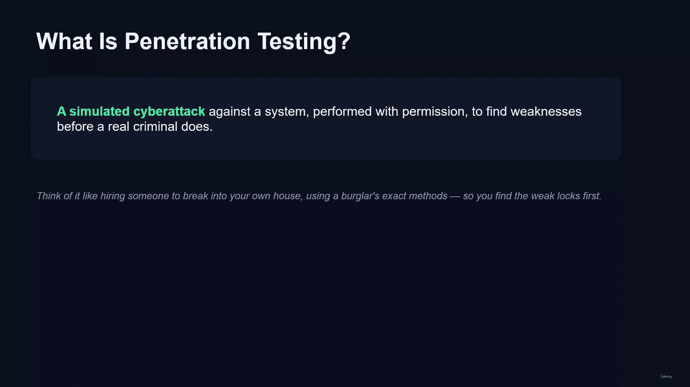
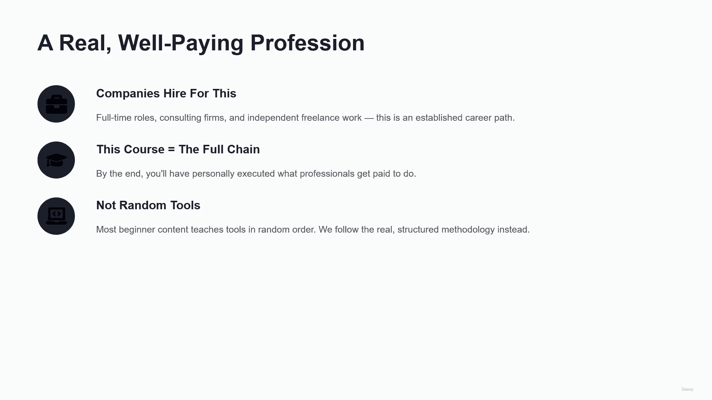

# Ethical Hacking & Penetration Testing with Kali Linux：3：什么是渗透测试🔍

在本节课中我们将要学习渗透测试到底是什么，它在真实工作中的定位，以及为什么本课程会按照专业渗透测试人员的实际流程来安排教学内容，而不是随意地堆砌工具。

## 渗透测试的核心定义📋

渗透测试这个词听起来很高大上，但实际上我们可以用非常大白话把它讲明白。很多初学者一听到黑客或者网络安全，脑子里可能会浮现出电影里那种在昏暗房间里对着几个显示器快速敲键盘的人，但实际上渗透测试是一件非常正经、有明确边界的事情，它不是随意破坏，而是有目的的模拟攻击。

以下是对渗透测试的几个关键要点：

- 渗透测试（Penetration Test，简称 Pen Test）是对计算机系统进行的模拟网络攻击。
- 被攻击的目标可以是一台计算机系统、一个网络，也可以是一个应用程序。
- 整个测试过程必须在系统所有者的明确授权下进行。
- 测试的具体目标，是在真正的恶意攻击者发现安全问题之前，先找出系统中存在的安全弱点。

我们可以用下面这个简单的公式来描述渗透测试的核心要素：

```text
渗透测试 = 模拟攻击 + 明确授权 + 寻找弱点
```

这里的“模拟攻击”意味着我们并不是真的在破坏系统，而是采用攻击者可能会使用的手段去尝试入侵。“明确授权”则是合法性的底线，没有授权而进行的攻击就是非法入侵，和渗透测试完全不同。



为了让你更容易理解，可以用一个生活中的例子来类比。想象一下，你雇佣一个人来试图闯入你自己的房子，这个人使用的手段和小偷完全一样。他可能会试着撬门锁，或者找找有没有没锁好的窗户。这么做的目的不是为了偷你的东西，而是为了让你发现门锁是否太差，窗户是否没关好，从而在真正的小偷出现之前把问题修复掉。

渗透测试在计算机世界里做的事情也是类似的，只不过我们面对的不是物理的门锁和窗户，而是服务器、网络协议、Web应用程序等等数字化的资产。

## 渗透测试作为一份真实职业💼

说完了渗透测试的定义，我们再聊聊它在现实工作中到底是什么样子。很多人可能认为渗透测试只是业余爱好者玩玩的东西，但实际上它是一份非常正经、合法，而且报酬不错的全职职业，而且市场需求很大。

以下是关于渗透测试职业现状的几个事实：

- 从小型初创公司到大型跨国银行，各种规模的公司都会雇佣人来做渗透测试。
- 这些人可以是公司的全职员工，也可以是受聘的外部顾问。
- 有些咨询公司完全围绕渗透测试业务而建立，不做其他事情。
- 也有自由职业的渗透测试人员，按合同独立接单工作。

也就是说，当你学会渗透测试之后，你所掌握的技能不是只有在课堂上才能用到的理论知识，而是真实公司会花钱购买的专业服务。你在课程中亲手完成的每一个攻击步骤，都是真实渗透测试人员为客户执行并获得真金白银报酬的工作内容。等到你完成这门包含十四节课的课程之后，你就已经亲手执行过完整的攻击链，而这正是专业人士在现实项目中会做的事情。

## 本课程与其他课程的不同📚

到这里你可能会问，市面上已经有很多黑客和渗透测试的课程了，为什么还要上这一门？其实最大的区别就在于教学的顺序和逻辑安排。

很多入门课程在教学时比较随意，可能第一节课讲Nmap扫描，第二节课突然跳到Metasploit利用，第三节课又开始讲Wireshark抓包，然后再跳到其他工具，最后你得到的是一堆散乱的工具名称和命令语法，但完全没有感觉到这些东西如何真正连接成一个连贯的过程。

你可以把这种学习方式比作只记住了各种工具的名字，却不知道盖房子的时候应该先打地基还是先刷墙漆，最后只会背命令，却不知道在什么时候该用哪个工具。

本课程采取完全不同的方法。我们按照真实渗透测试人员在实际项目中遵循的结构化方法论来组织内容，从第一节课到最后一节课，都严格按照阶段和正确顺序来安排。

以下是本课程教学逻辑的特点：

- 每个工具都会在方法论中真正属于它的位置被引入。
- 你不会只学到一堆彼此脱节的命令。
- 到课程结束时，你会理解专业人士在真实付费项目中，从开始到结束完整走过的整个流程。

这也就是为什么本课程与网上大量免费可用的内容有显著区别，也是为什么紧接着的下一节课会专门用来带你走完完整的五个阶段方法论。

## 为接下来的学习做好准备🗺️

在我们碰触任何具体工具之前，最重要的事情是先在脑子里建立一张完整的地图。只有当你清楚整个渗透测试过程是怎么运作的之后，后面学到的每一个工具、每一个命令才能找到自己的位置，否则你学到的东西就会变成孤立的碎片，久而久之很容易忘记。

可以把这张地图想象成导航软件里的路线规划，后面的每一节课都只是在路线沿途填充具体的细节。有了地图，你就不会在学习过程中迷失方向，也不会觉得所学内容支离破碎。

让我们现在就开始建立这张地图，为后面的实战课程打下坚实的基础。



本节课中我们一起学习了渗透测试的基本定义，它作为合法职业的现实背景，以及本课程与传统入门课程在教学顺序上的核心区别。我们还明确了在学习具体工具之前，先建立整体方法论地图的重要性。

