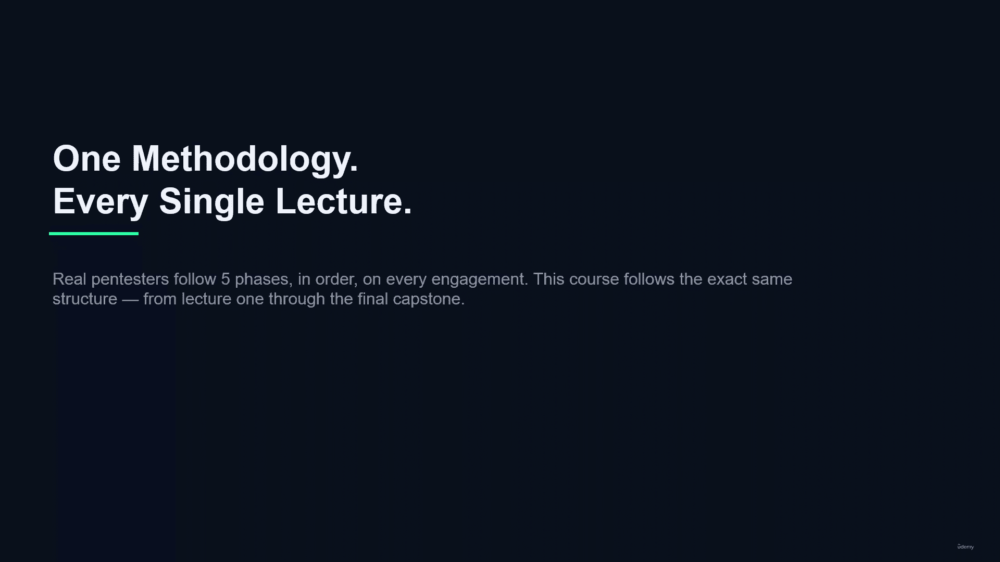
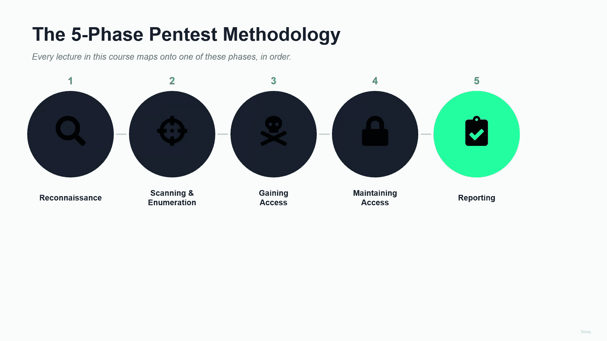

# 🛡️ Ethical Hacking & Penetration Testing with Kali Linux：第4课：5阶段渗透测试方法论


在本节课中，我们将学习渗透测试的完整五阶段方法论。这个框架是整个课程的骨架，每一个后续的实验课都会严格对应其中某一个阶段，直到最后的毕业项目。无论你是完全没有经验的新手，还是想要系统复习的学习者，都需要先把这五个环节搞清楚，才能在后面的实操中不迷路。下面我们先来看看这五个阶段分别是什么，以及它们在实际工作中的逻辑顺序。




## 渗透测试五阶段核心流程

每一次真实的渗透测试都会按照固定顺序执行五个阶段，从开始到结束依次如下：

- 信息收集
- 扫描与枚举
- 利用
- 利用后
- 报告

这个流程可以用一个简单的公式来描述：

```
渗透测试 = 信息收集 → 扫描与枚举 → 利用 → 利用后 → 报告
```

上面的每一个箭头都代表一次阶段转换，你不能跳过前面的步骤直接去做后面的，否则很可能因为目标信息不足而失败。


### 第一阶段：信息收集

在上一节我们简单介绍了渗透测试的基本概念，本节我们来看看第一阶段。信息收集是指在你真正触碰目标系统之前，先收集关于目标的所有公开信息。

你可以把它想象成一个小偷在动手之前，先在街对面观察一栋房子好几天，看看窗户亮不亮灯，车道上有没有车，墙边有没有明显的破损之类。在网络安全领域，这相当于研究目标公司的公开网站，查询域名注册记录，在 LinkedIn 上搜索员工姓名，大致摸清目标的整体情况，然后再向他们的系统发送第一个数据包。

第四章我们会专门讲解这个阶段，现在你只需要记住，信息收集的目标是建立一份关于目标的初步画像。


### 第二阶段：扫描与枚举

刚才我们说完了信息收集，接下来进入第二阶段。扫描与枚举的意思是，从被动观察转变为主动探测，看看目标到底哪些设备存活，哪些端口开放。

如果把信息收集比作在街对面看房子，那扫描就是走到门口，把每一扇门和每一扇窗都试一遍，看哪些没有锁。在实际操作中，这通常意味着使用 Nmap 之类的工具，找出目标机器上哪些端口是开放的，以及每个开放端口背后运行着什么具体服务。

我们会用一整节课来深入讲解 Nmap 这个业界标准工具，把它的常用用法和高级技巧都讲清楚。


### 第三阶段：利用

讲完了扫描与枚举，我们进入第三阶段。利用，也就是通常所说的获得访问权限，这一步就是你发现弱点之后，真正利用它进入系统的时刻。

这往往是初学者最兴奋的阶段，而且我们会花相当多的时间在这里讲解，包括专门一节关于 Metasploit 框架的内容。Metasploit 是专业人士用来把已发现的漏洞转化为实际访问权限的标准工具，学会它之后，你才能真正完成从发现问题到突破系统的整个过程。


### 第四阶段：利用后

说完了如何进入系统，接下来看看进去之后该做什么。利用后，也叫权限维持，是指在你已经进入目标系统之后，接下来要采取哪些行动。

真正的攻击者和模拟他们的专业渗透测试人员，往往需要证明攻击者进入系统以后能做些什么，能横向移动多远，还能访问哪些资源，是否能长期保持访问权限。我们会在课程后期的高级 Active Directory 模块中，以入门级的方式接触这部分内容。


### 第五阶段：报告

所有技术工作完成之后，就要进入第五阶段。报告阶段是指把所有发现写进一份专业文档，交给客户，说明发现了什么问题，每个问题的严重程度如何，以及具体怎么修复。

我在前面提到过这一点，现在要再强调一次，因为这真的非常重要。这往往才是客户付费真正要交付的成果，也是初级课程里最容易被跳过的一个话题。我们会在课程接近尾声的毕业项目课中，认真地花大量时间来讲解报告编写。


## 本阶段总结

好了，这个模块的理论部分就讲到这里。我们一起学习了这门课适合哪些人，需要遵守哪些基本规则，渗透测试到底是什么，以及贯穿整个课程的完整五阶段方法论。

到了课程结束的时候，你会亲自在这个实验环境中，用和真实专业项目完全相同的工具和流程，从头到尾完整走一遍这五个阶段。



下一课我们将开始动手搭建你自己的黑客实验室，从安装 VirtualBox 虚拟机软件开始。

