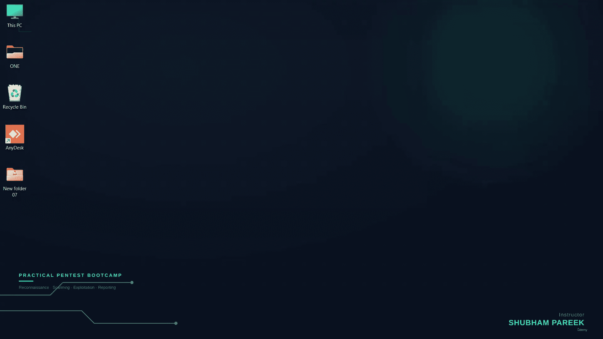
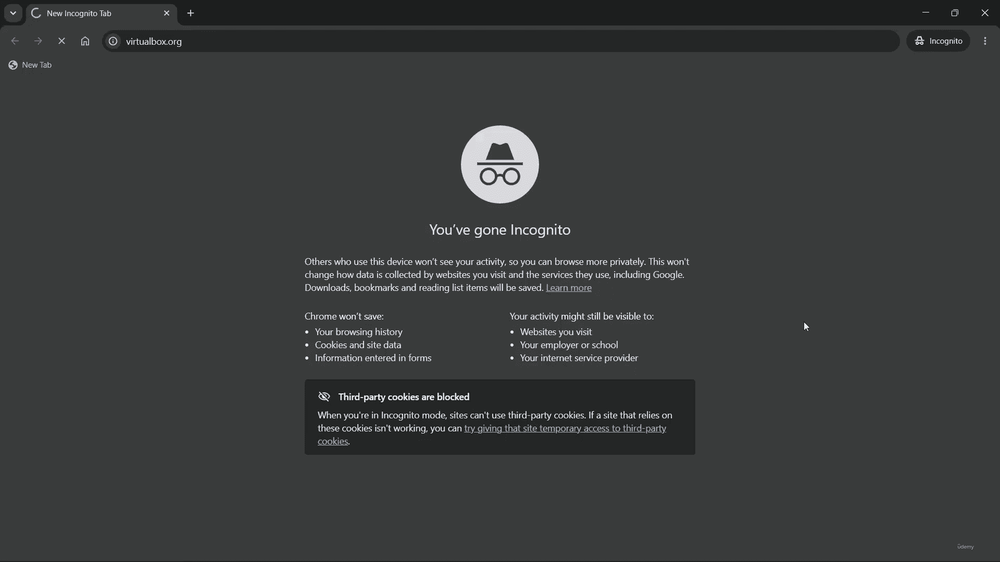
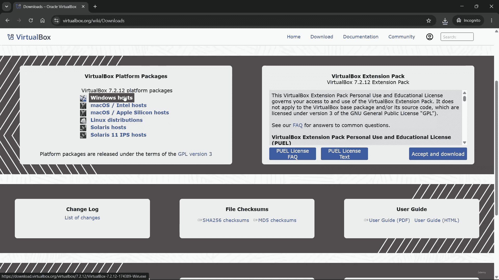
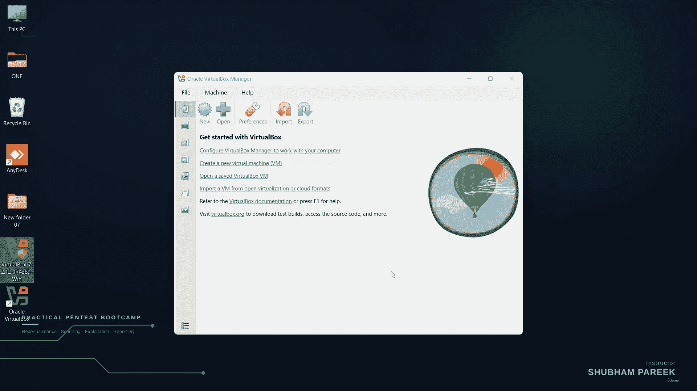
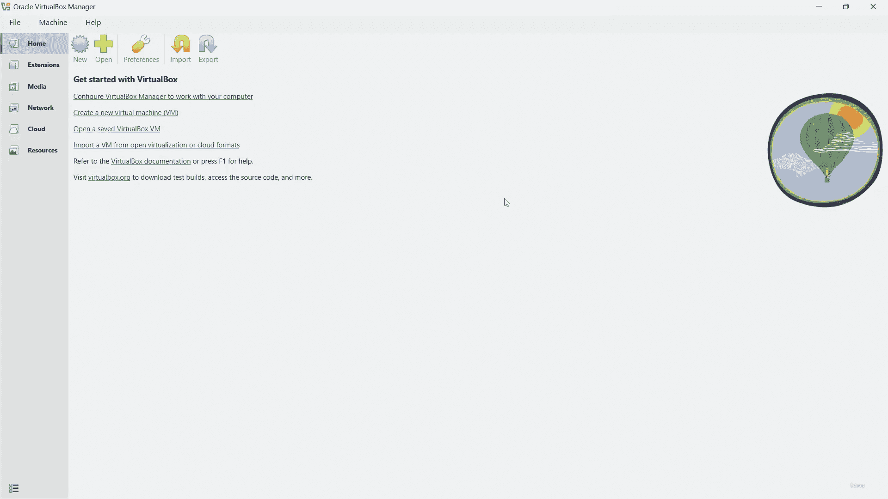

# 道德黑客与Kali Linux渗透测试：第05节：安装VirtualBox 🖥️



在本节课中我们将要学习如何在自己的电脑上安装VirtualBox虚拟机软件。这是整个课程的第一个实际操作步骤，后面所有的渗透测试实验都将在这个软件里面进行。如果你还没有安装好这个环境，后面的内容就没法继续，所以这一节非常关键，我们需要花一点时间把它装对。




从这一点开始，课程里面所有的操作都将运行在VirtualBox之中。也就是说，不管你之后要攻击什么目标，或者要搭建什么实验环境，都必须先有这个虚拟化软件作为基础。安装正确与否，直接决定后面每一个实验能不能顺利进行，所以不要急着跳过，我们慢慢来，把每一步都做对。


我现在要去virtualbox.org这个官方网站。打开网站之后，直接找到Downloads下载页面，这就是获取安装程序的地方。


下面简单说明一下VirtualBox到底是什么，对于从来没有用过虚拟化软件的同学来说，这个概念很重要。VirtualBox能让你在现在的电脑里面，运行一整套完全独立的操作系统。你可以把它理解为在你现有电脑的一个窗口里面，跑着一台完整的虚拟计算机。

```
虚拟机 = 一台完整的操作系统 + 虚拟硬件 + 与宿主机隔离的运行环境
```

比如说，你现在的电脑运行的是Windows系统，那么通过VirtualBox，你依然可以在一个窗口里面运行一台完整的Linux机器，而且这台Linux机器和你实际安装的Windows系统完全隔离。这个软件是免费的，也是开源的，也就是说它背后的代码是公开的，由一个庞大的社区来维护。在整个课程期间，我们会用它来运行每一台虚拟机，包括我们的Kali攻击机器、目标机器，一直到最后的毕业项目课程，都是用这个软件。


接下来，我要下载适合我自己操作系统的安装程序。在等待下载完成的过程中，有一个真正重要的注意事项需要告诉大家。

以下是关于苹果M系列芯片电脑的特别说明：
- 如果你使用的是Mac电脑，而且芯片是M1、M2或者M3，也就是苹果近年来出货的Apple Silicon处理器。
- VirtualBox在苹果Silicon芯片上的支持目前比较有限。
- 这是因为这些芯片使用的处理器架构，和VirtualBox最初设计时所基于的Intel芯片架构有本质区别。
- 如果你正好使用这类电脑，可以查看视频下方的简介，找到目前最推荐的替代方案。到目前为止，一个叫UTM的工具可以实现基本相同的目标。

虽然我在后面的课程中会一直演示VirtualBox，但希望你知道，虚拟机之间的网络、快照等底层概念，无论你最终使用什么具体软件，都是可以直接迁移的。




下载完成之后，我们来实际运行这个安装程序。

现在安装程序已经准备好了，我会一路使用默认选项点击完成，不需要针对我们的目的做任何自定义设置。

在安装过程中，你会看到一个弹出窗口，要求授权安装网络驱动程序。不管你的系统具体怎么显示，都请点击允许、同意或者安装。



以下是为什么这个网络驱动程序非常重要：
- 这个驱动程序是VirtualBox在你的电脑上创建虚拟网卡的前提。
- 稍后我们会用到它，来搭建独立的宿主机专用实验网络。
- 如果现在没有正确安装这个驱动程序，后面那个步骤根本无法完成，所以请不要跳过这个提示。


安装完成之后，出现在眼前的是VirtualBox Manager，也就是VirtualBox的主窗口，在接下来的课程中你会对它非常熟悉。

因为这是一个较新版本的VirtualBox，界面和你可能在旧教程里看到的有些不同，我快速带你熟悉一下现在看到的内容。

在左侧边栏，你可以看到分类，包括主页、扩展程序、媒体、网络、云和资源。在整个课程期间，我们基本都会停留在主页页面。在顶部工具栏，你可以看到新建、打开、导入、导出等按钮。现在，新建和打开是我们会用到的两个按钮。

我特别希望你注意工具栏里的导入按钮，那个像弯曲箭头的图标。在旧版本的VirtualBox里，需要通过文件菜单才能找到导入功能，但是在这个版本里，它直接就是一个点一下就能用的按钮，就放在工具栏里面。几节课之后，当我们导入Kali Linux的时候，就会用到这个按钮。


现在VirtualBox本身已经全部安装完毕，准备就绪。下一节课，我们将要下载整个课程要用的第一台虚拟机，也就是Kali Linux，我们的攻击机器，并直接导入到你现在看到的这个空白列表里面。




本节课中我们一起学习了如何下载并安装VirtualBox，了解了虚拟机的基本概念，也了解了苹果M系列芯片电脑的注意事项，并且初步认识了VirtualBox Manager的主界面。下一节课见。
