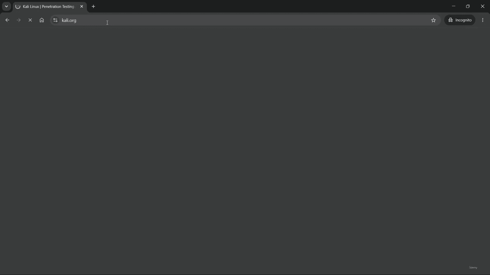
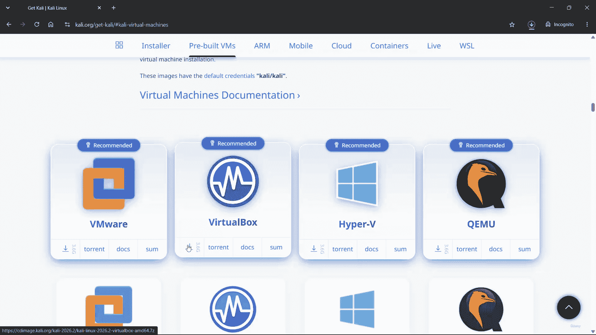
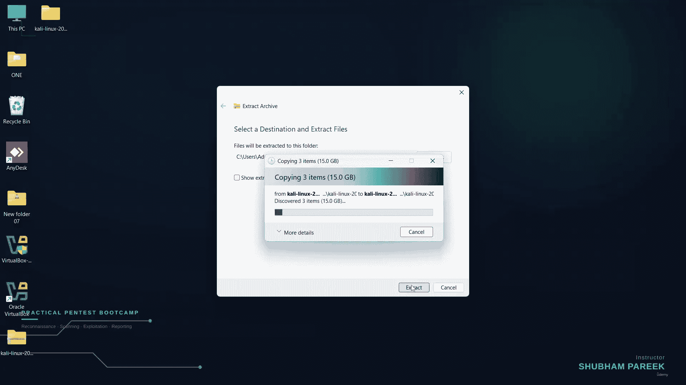
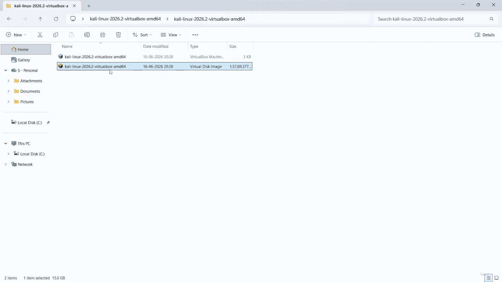
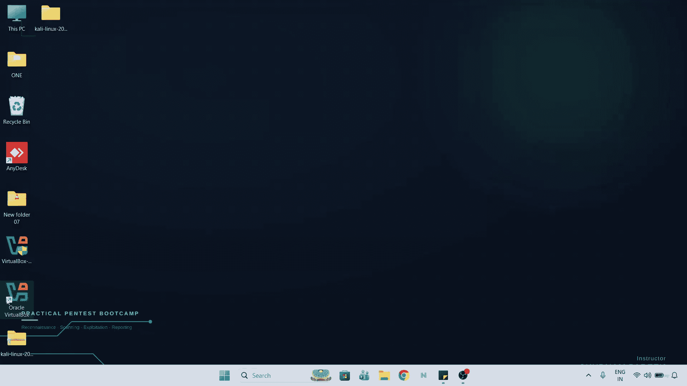
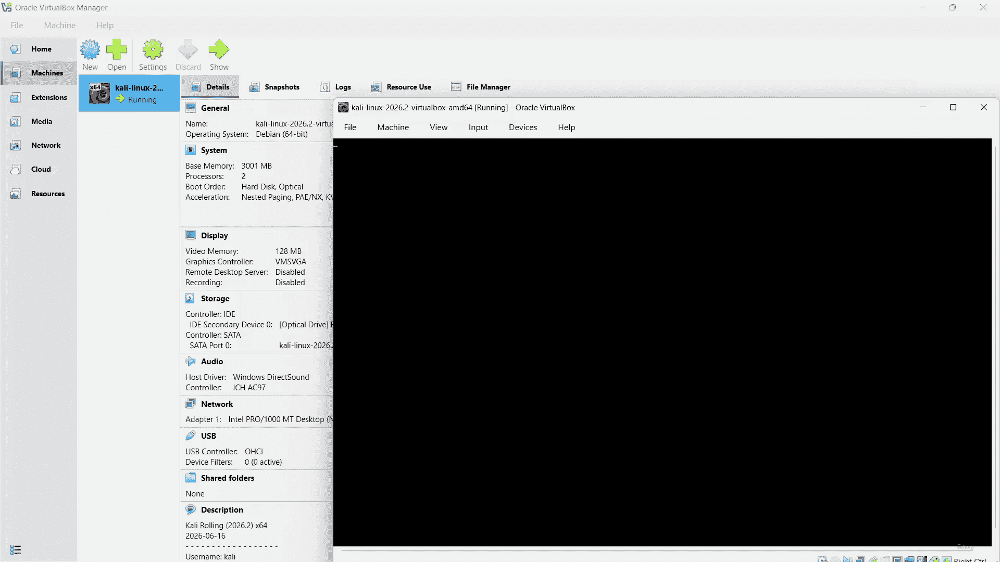

# Udemy - Ethical Hacking & Penetration Testing with Kali Linux 🐧：6：下载并导入 Kali Linux

在本节课中，我们将学习如何从 Kali 官网下载虚拟机镜像，把它导入 VirtualBox，调整合适的内存和处理器设置，最后启动系统并登录。这是整个渗透测试课程的第一个实践环节，因为后面所有的攻击演练都将在这个虚拟机里面完成。




## 确认 VirtualBox 已经安装好

在开始下载之前，我们先确认你的计算机上已经安装了 VirtualBox 虚拟机软件。如果你还没有安装，请先回到之前的课程完成安装，因为接下来的所有步骤都需要这个软件来运行 Kali Linux。


## 访问 Kali 官网并下载虚拟机镜像

首先，打开浏览器，访问 kali.org 网站。页面加载完成以后，找到页面上的 "Download" 按钮并点击。在出现的下载选项里，选择 "Virtual Machines" 类别。


以下是 Kali Linux 的核心定义：

```text
Kali Linux = 专门为渗透测试与安全研究而构建的 Linux 发行版
```

Kali Linux 不是普通的桌面操作系统，而是一种特殊的 Linux 版本。它的设计目标非常明确，就是从零开始专门为渗透测试和安全研究服务。如果你没有 Kali，就需要一个一个地去搜索、下载、安装几十个不同的黑客工具，非常浪费时间。而 Kali 的优势在于，它已经把课程中几乎所有要用的工具全部预装好了。

这些预装工具包括：

- Nmap
- Metasploit
- Burp Suite
- Hydra
- John the Ripper
- Wireshark

也就是说，一旦这台虚拟机第一次启动，所有工具就都已经准备就绪，可以直接使用。这也是为什么 Kali 已经成为整个网络安全行业的事实上标准操作系统，也是我们整门课程围绕它构建的原因。

回到下载页面，请务必选择 VirtualBox 镜像版本，因为这与我们之前安装的软件版本相匹配。在此基础上，选择 64 位版本进行下载。这个文件体积相当大，通常有好几个 GB，具体下载时间取决于你的网络速度，可能需要几分钟，也可能更久。

下面是下载时的建议操作：



- 点击下载按钮后，保持网络畅通
- 如果觉得等待时间较长，可以暂停视频
- 利用这段时间喝杯咖啡，放松一下
- 下载完成后再回来继续后续步骤

我会在这里等你，直到你准备好为止。




## 解压缩下载好的文件

下载完成以后，你得到的是一个压缩包。在使用之前，必须先把它解压出来。请等待解压过程完全结束。



解压完成后，打开这个文件夹，你会看到里面有一个 `.vbox` 文件，以及一个虚拟磁盘镜像文件。



以下是这两个文件的含义：

- `.vbox` 文件：本质上是一个配置文件，用来描述虚拟机的各项设置
- 虚拟磁盘镜像文件：包含实际的操作系统以及所有预装的工具

这两个文件在一起，才构成了一台完整的 Kali Linux 虚拟机。


## 在 VirtualBox 中导入虚拟机

解压好之后，我们需要回到 VirtualBox 界面，把这台机器导入进去。

在 VirtualBox 窗口顶部，点击 "Machine" 菜单，然后选择 "Open" 选项。如果这里看不到这些选项，可以直接点击 "Machine"，再选择 "Open"。接着，在弹出的窗口中，找到刚才解压的文件夹，选择那个 `.vbox` 文件，点击 "Open"。

导入完成后，你会立刻在 VirtualBox 左侧的机器列表中看到 Kali Linux。


## 调整虚拟机硬件设置

在第一次启动之前，我们需要先对虚拟机的设置进行一些调整。在列表中选中 Kali，点击 "Settings" 按钮。

进入 "System" 分类以后，建议把内存调大，比如设置为 3 GB 或 4 GB，具体取决于你的需求。另外，如果你的宿主机处理器核心数足够，也可以把 CPU 数量从默认值改为 1 个或 2 个。

以下是调整后的关键参数：

```text
Memory = 3 GB ~ 4 GB
CPU = 1 ~ 2 个核心
```

我来解释一下为什么这很重要，而不是盲目点击跳过。Kali 默认分配的内存比较保守，勉强能运行，但当我们在后面课程中叠加运行多个资源消耗较大的工具时，默认内存就不够用了。如果内存太小，像 Burp Suite 或后面的 OpenVAS 这样的工具会运行得非常缓慢，甚至让人感到沮丧。现在花一点时间提高配置，可以避免以后在学习新工具时还要去排查性能问题。


## 启动 Kali Linux 并登录

设置完成以后，Kali 已经在 VirtualBox 管理器中正式注册和配置好了。接下来，选中这台机器，点击 "Start" 启动它。

启动过程中会显示 "Powering VM Up"，需要等待一段时间。此时，我来告诉你默认的登录凭据，因为 Kali 出厂时已经配置好了一个标准账户。

以下是默认账户信息：

```text
Username = kali
Password = kali
```



注意，用户名和密码都是全小写的 "kali"。输入之后按回车，等待系统进入桌面。


登录成功以后，你看到的就是 Kali Linux 的完整桌面环境。它已经启动并准备就绪，将成为我们在这门课程中的家基地，也就是攻击机器。

课程中从第一次 Nmap 扫描，一直到最后的人工智能辅助结课项目，所有要运行的工具都将在这台虚拟机里面完成。


下一节课，我们将重复完全相同的流程，但这次是针对另一台完全不同的机器，即 Metasploitable2。它将作为我们在这门课剩余时间里的故意易受攻击的练习目标。我们下节课见。


## 本节课总结

在本节课中，我们一起学习了如何从 Kali 官网下载 VirtualBox 镜像，如何解压缩文件，如何在 VirtualBox 中导入 `.vbox` 配置，如何调整内存和 CPU 设置，以及如何启动 Kali 并使用默认凭据登录。至此，我们的攻击机器已经准备就绪，可以开始后续的渗透测试学习了。
