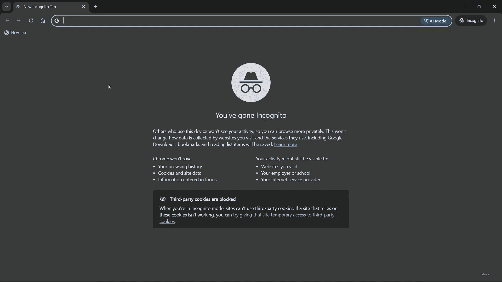
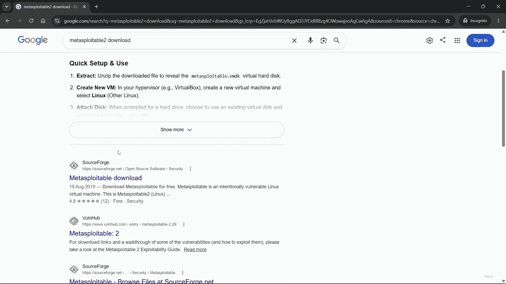
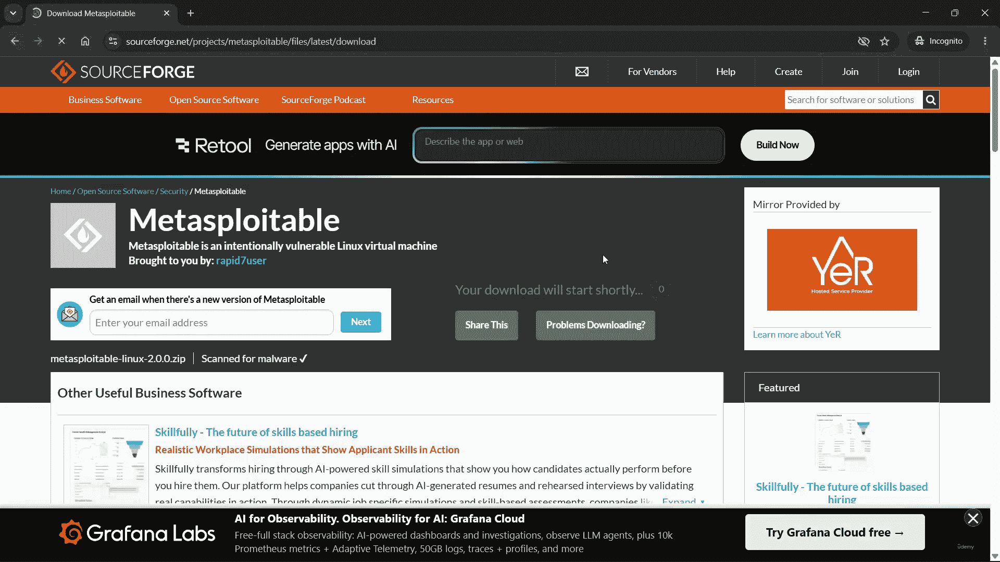
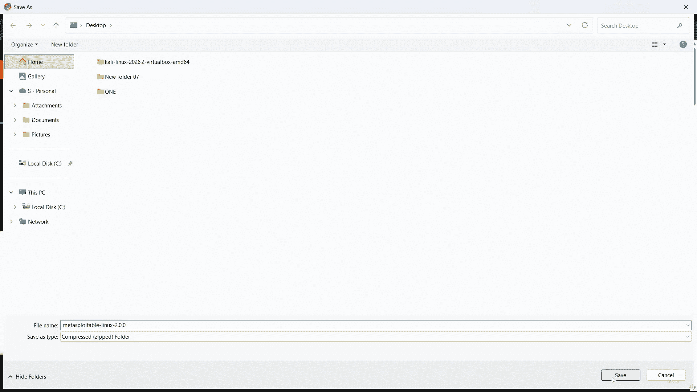
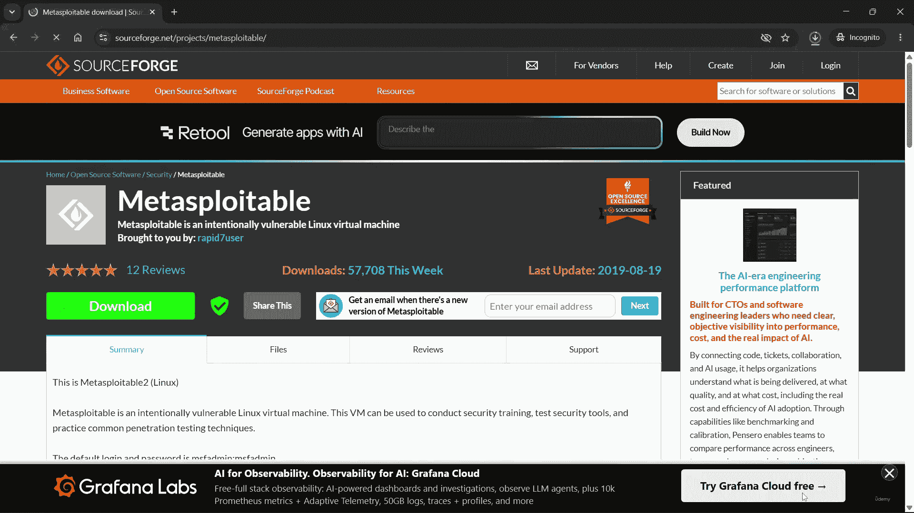
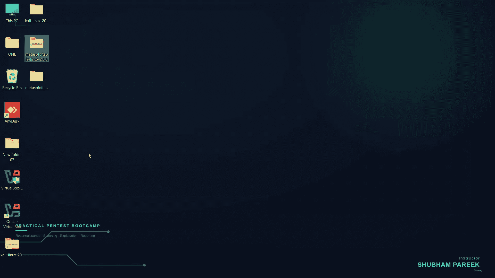
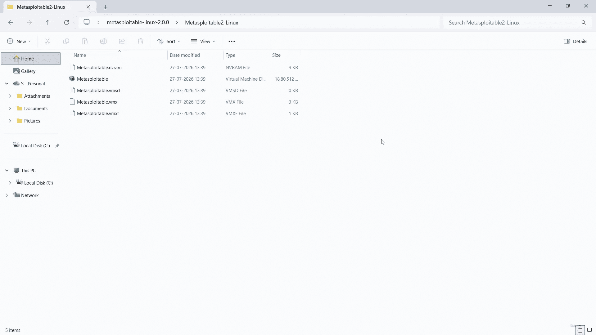
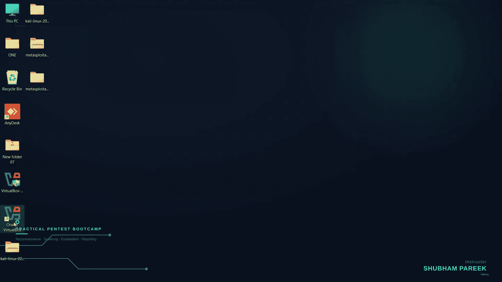
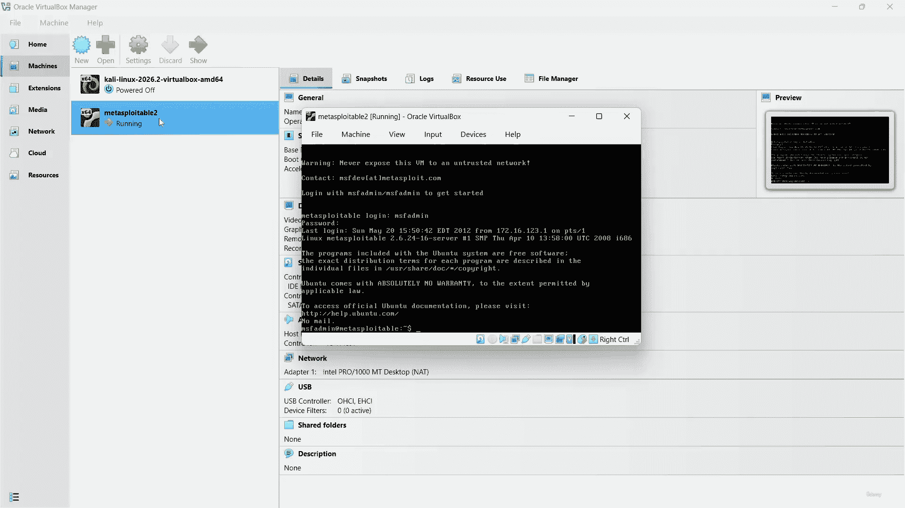

# 道德黑客与 Kali Linux 渗透测试：07：下载并导入 Metasploitable2 🛡️

在本节课中我们将要学习如何从官方渠道下载 Metasploitable2，并把它导入 VirtualBox 中作为我们的练习目标机。上一节课我们已经把攻击机 Kali Linux 准备好了，但光有攻击机还不够，我们还需要一台可以安全攻击的靶机才能开始练习。Metasploitable2 正是为此而设计的专用靶机，里面包含大量已知漏洞，非常适合初学者练习渗透测试的工具和技巧。



本节我们先来看看为什么要专门使用这台靶机，而不是随便安装一台普通的 Linux 系统。



## 什么是 Metasploitable2

Metasploitable2 是一台专门构建的 Linux 虚拟机。它不是普通的操作系统，也不是因为配置错误而出现问题的机器。安全社区故意在这台机器中放入了大量已知且有详细文档记录的漏洞。这种设计的目的非常明确，就是让正在学习渗透测试的人拥有一个安全、合法且完全真实的目标来进行练习。在整个渗透测试行业中，Metasploitable2 已经成为标准的练习靶机，如果你在安全论坛或其他在线教程中浏览，会经常看到它被提及。

核心概念可以用下面的公式来理解：

```
Metasploitable2 = 故意植入已知漏洞的 Linux 虚拟机
练习目标 = 安全、合法、真实的渗透测试靶机
```

了解了靶机的作用之后，我们现在来看看如何从官方来源下载它。

## 下载 Metasploitable2

你需要访问官方 SourceForge 页面。这是获取该文件的可信官方来源，所以务必确认自己停留在官方网站上，不要误入第三方镜像站点。进入页面之后找到下载按钮并点击。与 Kali Linux 相比，这个文件体积更小，下载完成不需要太长时间。下载开始后请耐心等待进度条走完。

以下是下载时的注意事项列表：





- 只在官方 SourceForge 页面下载
- 确认页面地址正确，避免钓鱼网站
- 文件体积小于 Kali，等待时间较短



文件下载完成后，我们需要把它解压出来，才能拿到里面的虚拟磁盘。

## 解压缩下载的文件



下载结束后，你会得到一个压缩包。打开它，将里面的内容解压到文件夹中。解压之后，你会看到一个以 .vmdk 结尾的文件。这是 VirtualBox 等虚拟化平台可以直接读取的虚拟磁盘镜像格式。和 Kali Linux 提供的完整即用型设备不同，Metasploitable2 只分发这个原始磁盘文件，所以还需要手动在 VirtualBox 中创建虚拟机外壳，再把这个磁盘挂载进去。

以下是解压后的关键文件：

- 扩展名为 .vmdk 的虚拟磁盘文件



拿到磁盘文件之后，接下来我们需要在 VirtualBox 里新建一台虚拟机来承载它。



## 在 VirtualBox 中创建虚拟机

打开 VirtualBox，点击“新建”按钮。给虚拟机起一个清晰的名字，比如 Metasploitable2。命名很重要，因为随着课程推进，我们会拥有多台虚拟机，如果名字混乱就容易搞错哪台是哪台。操作系统类型选择 Linux，具体发行版选择 Ubuntu，版本选择 64 位。

这里需要解释为什么要选择这个特定版本。虽然我们并不是从零安装操作系统，但 Metasploitable2 的基础是多年前的旧版 Ubuntu。这正是它故意存在漏洞的原因之一，因为里面运行的是旧版、未打补丁的软件。选择正确的类型和版本，可以让 VirtualBox 应用与该虚拟机实际需求相匹配的合理默认设置。

其他所有选项都保持默认即可。内存方面，默认设置完全足够，因为这是一台旧的轻量级机器，不需要分配像 Kali 那样多的资源。

以下是虚拟机基础设置建议：

- 名称：Metasploitable2
- 类型：Linux
- 版本：Ubuntu 64 位
- 内存：使用默认值

虚拟机外壳创建好以后，最关键的一步是指定使用哪个硬盘文件。

## 配置虚拟硬盘

在硬盘设置页面，不要选择创建一个全新的空虚拟硬盘，而要选择“使用现有的虚拟硬盘文件”。然后点击添加，在文件浏览器中找到刚才下载并解压的 Metasploitable2 文件夹，选择里面的 .vmdk 文件。确认选择后点击完成。

完成之后，回到 VirtualBox 主界面，选中刚才创建的虚拟机，点击启动，然后等待系统启动。

以下是硬盘配置的关键操作：

- 选择“使用现有的虚拟硬盘文件”
- 浏览并指定下载好的 .vmdk 文件
- 点击完成并启动虚拟机

虚拟机启动后，我们就可以进入系统并确认它已经准备就绪。

## 启动并登录 Metasploitable2

启动过程中你会看到一个登录横幅，界面显得有些老旧且粗糙。这正是一种直观的视觉提示，说明这是一台旧的、故意未打补丁、充满漏洞的系统，正好是我们学习渗透测试所需要的目标。

默认登录信息如下：

- 用户名：msfadmin
- 密码：msfadmin
注意两者都使用小写字母。

使用 msfadmin 登录之后，你就会进入系统。此时 Metasploitable2 已经完全启动，可以作为这门课程中绝大部分实验的练习目标。

现在我们已经有两台虚拟机在 VirtualBox 中并排运行，一台是我们的攻击机 Kali，另一台就是 Metasploitable2 靶机。不过目前它们还不能互相通信，因为我们还没有在它们之间配置共享网络。

## 当前网络状态与下一节预告

解决这个问题正是下一节课的内容，我们将设置隔离的仅主机网络。这一步是整个模块中最重要的技术操作，敬请期待。



本节课中我们一起学习了从官方 SourceForge 下载 Metasploitable2、解压获取 .vmdk 虚拟磁盘文件、在 VirtualBox 中创建 Linux 虚拟机并挂载现有硬盘、启动系统并使用 msfadmin 登录。至此我们拥有了攻击机和目标机，但它们之间的网络连接仍需在下一节中配置。
