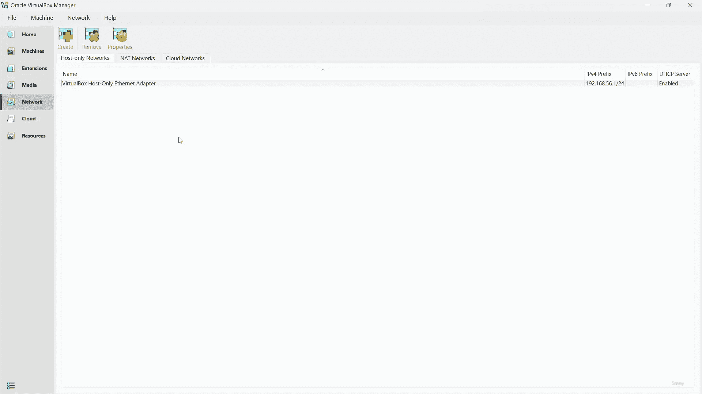
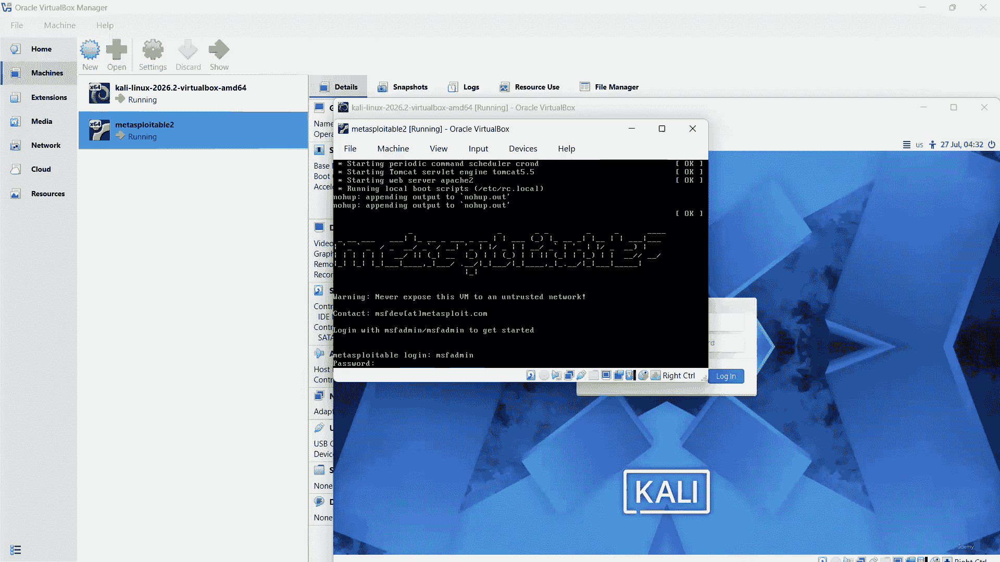

# Kali Linux 道德黑客与渗透测试：8：配置仅主机网络 🌐

## 本节概述

在本节课中，我们将一起学习如何在 VirtualBox 中配置仅主机网络（Host-Only Networking）。这是整个章节中最重要的一课，请务必仔细阅读，因为如果这一步配置错误，后续课程中几乎所有操作都将无法正常工作。我们将放慢速度，确保每一步都做正确，不要跳过任何细节。

## 什么是仅主机网络

在动手配置之前，我们先用大白话来理解什么是仅主机网络。不要只盲目点击按钮，而不明白背后的原因，否则后续出问题时你会很难排查。

仅主机网络是一种私有虚拟网络，它仅存在于你的虚拟机和宿主机之间。所谓宿主机，就是你实际使用的物理笔记本电脑。关键点在于，这个网络无法连接到真实的互联网，同时，真实互联网上的任何设备也无法进入这个网络。它完全与外界隔离，仅存在于你自己的机器内部。

这个事实正是我们实验室安全且合法的基础。在后续课程中，我们需要尽可能积极地进行攻击练习，但这一切都必须在隔离环境中完成。请回想几节课前提到的第一条规则：所有内容都必须留在我们的隔离环境内。

仅主机网络就是强制执行这条规则的实际技术机制。如果没有它，如果我们只是让两台虚拟机保持默认网络设置，它们可能会从你的家庭 Wi-Fi 网络，甚至更糟的是从更广泛的互联网中被访问到，这是我们绝对不希望看到的。

现在，让我们开始创建这个网络。

## 在 VirtualBox 中创建仅主机网络

根据你安装的 VirtualBox 版本不同，这个选项所在的位置会略有差异。在旧版本中，它位于文件菜单下；在新版本中，它可能位于工具菜单下。这里以新版本为例进行演示。

以下是具体的操作路径：

```text
File（文件）→ Tools（工具）→ Network（网络）
```

或者，你也可以直接从当前界面访问网络管理器。



接下来，点击 Create（创建）按钮来创建新网络。


创建完成后，请注意显示的 IP 范围。你可以使用默认网络，也可以使用刚才新建的网络，两者没有区别，因为它们都使用 VirtualBox Host-Only Ethernet Adapter（VirtualBox 仅主机以太网适配器）。

这里常见的 IP 地址段如下：

```text
192.168.56.1/24
```

其中 `/24` 是子网掩码。如果你之前学过网络基础知识，应该记得 `/24` 表示这个网络最多可以支持 254 个可用地址，足以供我们实验室中各种虚拟机使用，包括后续要搭建的更高级 Active Directory 实验室。

我们将选择第一个网络进行后续配置。

## 将虚拟机连接到仅主机网络

仅仅创建网络适配器还不够，它不会自动把任何虚拟机连接进去。我们需要显式地告诉两台虚拟机使用这个网络，否则配置就白做了。

以下是针对 Kali Linux 虚拟机的配置步骤：

```text
Settings（设置）→ Network（网络）→ Adapter 1 → Attached to: Host-Only Adapter（仅主机适配器）
```

具体操作是：选择 Kali 虚拟机，点击 Settings（设置），切换到 Network（网络）选项卡，在 Adapter 1（适配器 1）下，将 Attached to（连接方式）从当前的设置（可能是 NAT）更改为 Host-Only Adapter，然后点击 OK 保存。

接下来，对 Metasploitable 虚拟机执行完全相同的操作：

```text
Settings（设置）→ Network（网络）→ Adapter 1 → Attached to: Host-Only Adapter（仅主机适配器）
```

这里有一个非常重要的细节，请务必仔细检查：两台虚拟机必须选择完全相同的那个特定适配器，不能意外创建或选择第二个不同的适配器。这个细节是本节课中让人出错最多的地方，所以请再次仔细确认，不要因为粗心而导致后面无法连接。

完成上述操作后，我们的两台虚拟机都已配置为使用这个完全相同的私有隔离网络。

## 启动虚拟机并登录

现在，我们需要确保两台虚拟机都处于运行状态。请逐一启动它们。如果其中任何一台当前没有运行，请立即启动它，并等待其完全启动完成，不要急于下一步。

在两台机器都完全启动后，我们需要登录：



- 对于 Metasploitable 虚拟机，用户名是 `msfadmin`，密码是 `msfadmin`。
- 对于 Kali Linux 虚拟机，用户名是 `kali`，密码是 `kali`。

至此，我们的网络配置就全部完成了。

## 本节总结

在本节课中，我们一起学习了如何在 VirtualBox 中创建仅主机网络，并将 Kali Linux 与 Metasploitable 两台虚拟机都连接到这个私有隔离网络上。我们还解释了仅主机网络的作用：它让所有流量仅停留在你自己的机器内部，无法访问真实互联网，也无法被真实互联网访问，从而确保实验室的安全与合法。

在下一节课中，我们将使用两台虚拟机内部的真实命令来验证此配置是否正确，确认这两台虚拟机能否真正通过这个私有网络相互通信。请不要跳过那个验证步骤，虽然简短，但它能在问题变得更加混乱之前，帮你发现几乎所有的设置错误。
