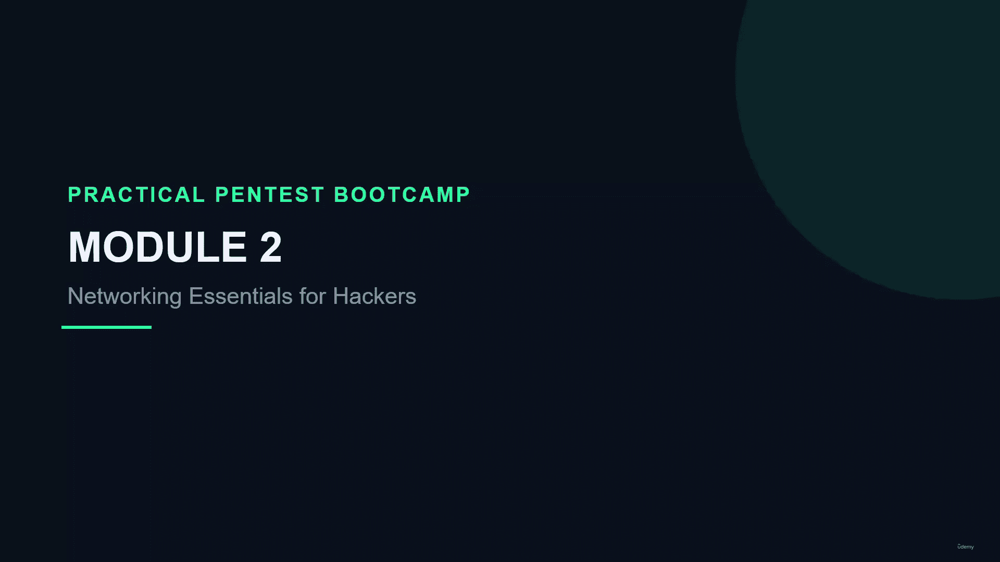
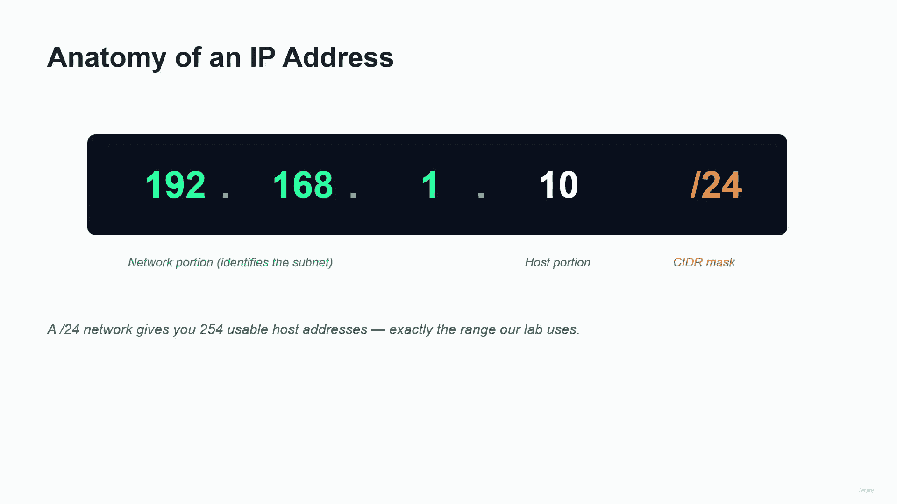
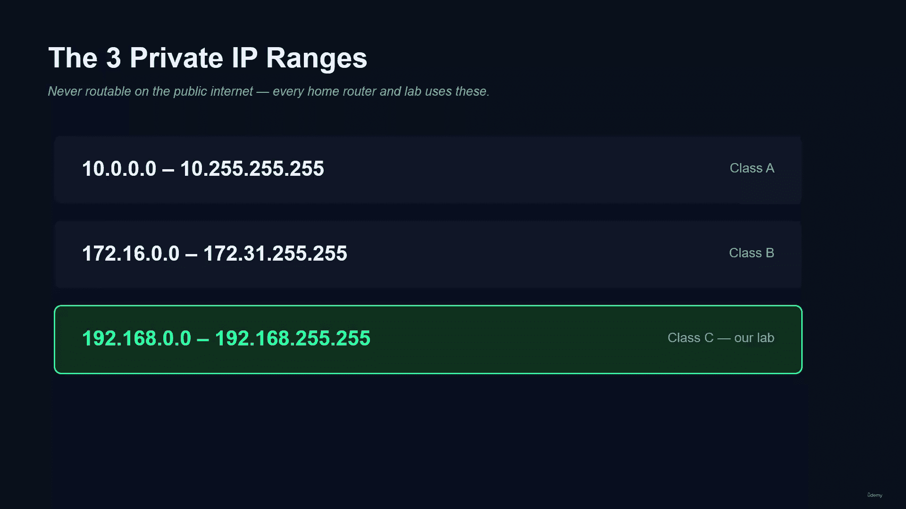

Ethical Hacking & Penetration Testing with Kali Linux：10：IP地址与子网划分基础 🌐

在本节课中，我们将学习网络基础中最重要的一部分，也就是IP地址是如何工作的，子网掩码是什么意思，CIDR简写方法怎么读，以及为什么实验室里总是用192.168开头的地址。这些知识看起来枯燥，但实际上是你后续使用任何黑客工具时必须掌握的基础，没有它们你很难理解扫描器或渗透测试工具在后台到底在做什么。

在我们开始之前，先做一个简单的自检，请用自己的话解释一下，IP地址到底是什么东西。

如果你暂时说不上来，完全不需要担心，这正好是本节课要解决的问题。

你必须搞清楚网络的基本原理，否则就不可能真正理解任何黑客工具在底层运行时的具体行为。

所以我们要从现在开始，把网络基础扎扎实实地建立起来。

接下来我们先来看IP地址本身。一个IPv4地址长这样，192.168.1.10。

它由四个数字组成，每个数字的取值范围在0到255之间，这四个数字之间用点号分隔。

以下是一个具体的IP地址示例：

`192.168.1.10`

每一个单独的数字，在计算机网络术语中被称为一个8位组，也就是8个二进制位。

除了IP地址本身，你几乎总会看到一个叫做子网掩码的东西。

子网掩码有两种不同的写法。有时你会看到它完整写出来，像255.255.255.0。

但更常见的情况是，特别是在本课程后面会用到的各种工具里，你会看到一种叫做CIDR表示法的写法。

以下是子网掩码的两种常见写法：

完整写法：`255.255.255.0`

CIDR写法：`/24`

CIDR写法由一个正斜杠后面跟一个数字组成，比如斜杠24。

我来详细解释一下斜杠24到底是什么意思，因为这个概念在后面会反复出现。

斜杠24告诉我们，IP地址的前24位用来标识网络本身。

剩下的8位用来标识单独的主机。

也就是说，剩下的8位标识同一个网络里的单独设备。

这也是为什么我们在第一模块搭建的实验室，使用的地址范围是192.168.56.x。

这是一个斜杠24网络，最多能给我们提供254个可用的主机地址。

对本课程里要搭建的每一台机器来说，这个地址空间绰绰有余。

现在，我们的实验室之所以使用192.168开头的地址，而不是一组完全随机的数字，这背后有一个非常具体的原因。

专门用于私有网络的地址范围一共有三个，这意味着这些地址范围在实际的公共互联网上是不可路由的。

以下是这三个私有IP地址范围：

`10.0.0.0` 到 `10.255.255.255`

`172.16.0.0` 到 `172.31.255.255`

`192.168.0.0` 到 `192.168.255.255`

这是一个值得知道的小知识点，实际上非常关键。你用过的每一台家用路由器，你以后可能会接触到的每一个企业内部网络，以及像我们一起搭建的这种实验室环境，使用的地址都来自于这三个范围中的某一个。

这样做在实际操作中很有帮助，因为当你看到一个IP地址以10开头，或者以172.16到172.31开头，或者以192.168开头时，你能立刻判断出这是一个私有内部网络地址，而不是面向公共互联网的地址。

单凭这一个识别能力，在后面学习网络拓扑图和扫描结果时会帮你大忙。

在继续之前，还有一个实际要点需要注意，像我们这样的斜杠24网络，提供254个可用地址。

这个数字的计算方式是2的8次方，也就是256，再减去2个保留地址。

其中一个保留地址给网络标识本身使用，另一个给广播地址使用。

可用地址数量计算公式如下：

`2^8 - 2 = 254`

对于本课程来说，你不需要把子网划分的数学细节死记硬背，因为子网划分本身就是一个值得单独开设课程的专业方向。

但理解CIDR数字和可用地址数量之间的基本关系，在几节课后我们开始扫描整个网络时，会大有帮助。

好了，关于IP地址的内容就先讲到这里。

下一节课我们将把视角放大，来看看更大的图景，也就是OSI模型，但会是专门为黑客准备的实用版本，而不是那种枯燥的七层模型死记硬背练习。

本节课中，我们一起学习了IPv4地址的组成形式，子网掩码的两种写法，CIDR斜杠表示法的含义，私有IP地址的三个标准范围，以及斜杠24网络下可用主机地址的计算方法。

