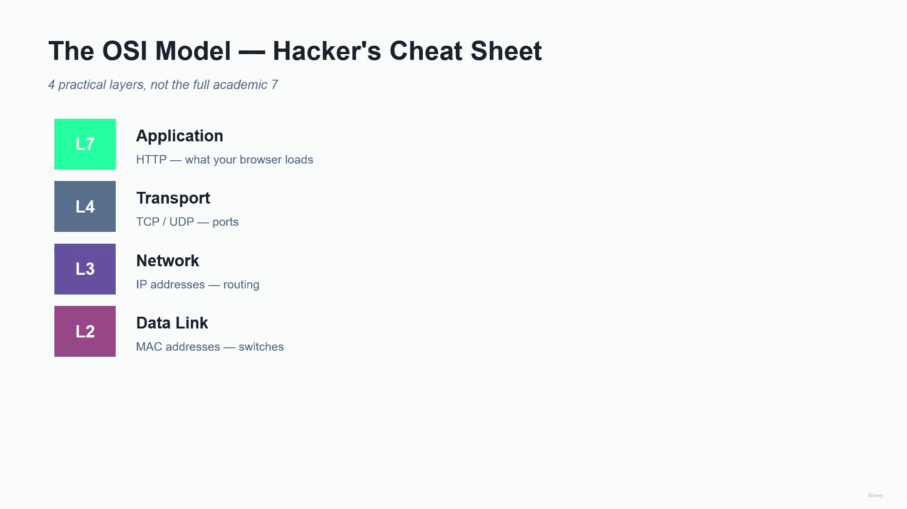
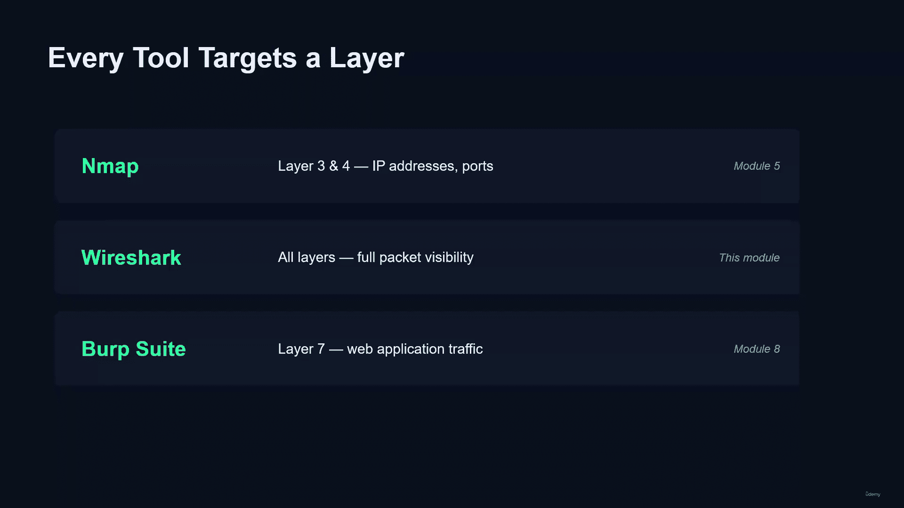

# Kali Linux 渗透测试与道德黑客：11：OSI 模型黑客速查表 🛡️

在本节课中，我们将一起学习 OSI 模型的核心内容。作者先声明，这里不会给你讲那种计算机教科书里完整的七层背诵训练，也不会像认证备考指南那样让你死记所有官方层名称。如果你正在准备 Security+ 或 CEH 之类的证书，那确实需要完整的七层拆解，我们的姊妹课程会在更偏理论的内容里深入讲解。但因为这是一门动手实操的渗透测试课程，作者希望你把 OSI 模型看成四个实用的部分，而不是七个要死记硬背的层级。


---

以下是黑客速查版本的 OSI 模型，共四个关键块：

- **块 1：第 2 层**。主要讲 MAC 地址和交换机，简单说就是同一个局域网里的设备如何互相找到对方。
- **块 2：第 3 层**。主要讲 IP 地址和路由，简单说就是数据流量如何在不同网络之间找路。
- **块 3：第 4 层**。主要讲端口以及 TCP 和 UDP 两种协议，简单说就是流量如何准确送到某台机器上的具体程序。
- **块 4：第 7 层**。主要讲实际的应用程序本身，比如 HTTP，也就是浏览器每次加载网页时用的协议。后面课程里用 Burp Suite 和 DVWA 做 Web 应用渗透时，我们基本都在这一层操作。


---

上一节我们已经讲过 IP 地址和子网划分，那部分内容本质上就属于第 3 层。本节我们把视野再放宽一点，看看整个 OSI 模型在黑客视角下该怎么理解。

先来看第 2 层。你用过的每一块网卡，在出厂时硬件层面就被烧入了一个全球唯一的 MAC 地址。交换机就是依靠这些地址，判断数据帧应该发给局域网里的哪一台设备。你可以把它想象成同一栋办公楼内部的房间号，只在内部生效，跨楼就不管用了。

核心关系可以用下面这行伪代码描述：

```text
设备 A 的 MAC 地址 匹配 交换机表项中的目标 MAC
    → 数据直接送达同一局域网内的设备 A
```


---

接下来进入第 3 层，也就是 IP 地址和路由层。如果说第 2 层只负责局域网内部，那么第 3 层就负责让数据跨越不同的网络。每个设备都有一个 IP 地址，路由器根据这个地址决定下一跳把数据包发往哪里，一直转发直到到达目标网络。

用大白话和简单公式表达就是：

```text
源 IP 地址 → 路由器逐跳转发 → 目标 IP 地址
```

这就是之前课程中讲 IP 和子网时所用的层级，属于典型的第 3 层工作内容。


---

然后是第 4 层，即传输层，主要涉及端口和 TCP、UDP 协议。一个 IP 地址对应的设备上可能同时运行很多程序，比如浏览器、聊天软件和游戏，端口就是用来把流量分发给正确程序的门牌号。TCP 和 UDP 决定了数据包如何实际送达。

核心关系可以简化为：

```text
IP 地址 + 端口号 = 目标应用程序
```

我们将在稍后的内容里详细讲解 TCP 和 UDP 的区别，现在你只需知道，这一层负责把数据从“机器”精确投递到“应用”。




---

最后一个块是第 7 层，也就是应用层。这一层最贴近实际使用，像 HTTP 这样的协议就在这里。每次你用浏览器打开网页，底层都在使用 HTTP 协议与 Web 服务器通信。后面课程里我们会用 Burp Suite 和 DVWA 进行 Web 应用渗透，基本上完全在第 7 层操作。

用代码形式表示，一个典型的第 7 层交互如下：

```http
GET /index.html HTTP/1.1
Host: example.com
```

这就是浏览器加载页面时发出的应用层请求，也是 Web 渗透测试最常打交道的层级。


---

你可能会问，为什么不直接教七层 OSI 模型的所有官方名称，而只要这四个块？原因很简单，这门课里我们会用到的每一个工具，基本都只作用于上面这四层中的某一层。把范围缩小，能让你更快建立实战直觉，不再觉得工具是神秘的黑箱。

以下是几个常见工具与 OSI 层级的对应关系：

- **Nmap**（模块 5 中重点讲解）：主要作用于第 3 层和第 4 层。它的本质是扫描 IP 地址、端口，以及运行在端口之上的协议。
- **Burp Suite**（模块 8 中介绍）：完全作用于第 7 层。它专门拦截和操纵应用级别的 Web 流量。
- **Wireshark**（本节课后面会用到）：可以同时抓取并显示所有层级的流量，是理解整个网络栈最强大的工具之一。


---

建议你从现在开始养成一个习惯。每次学完一个新工具，停下来问自己一个问题：

```text
这个工具到底作用在 OSI 模型的哪一层？
```

只要养成这个习惯，以后接触的每个工具都不会再像黑箱一样不可捉摸，而会变成一个大拼图里逻辑清晰、可预测的一块。


---

有了这个分层的思维模型之后，我们接下来要聊聊专门生活在第 4 层的两个协议，也就是 TCP 和 UDP。这两个协议在整个课程中会被反复提到，掌握它们是理解后续网络攻防内容的基础。


---



本节课中，我们一起学习了 OSI 模型的黑客速查版本。我们知道了第 2 层关注 MAC 地址和交换机，第 3 层关注 IP 地址和路由，第 4 层关注端口与 TCP/UDP，第 7 层关注 HTTP 等应用协议。我们还梳理了 Nmap、Burp Suite 和 Wireshark 分别对应哪些层级，并约定了在学习新工具时先判断其工作层的习惯。希望这些内容能帮你建立起清晰的网络分层概念，为后面的渗透测试实战打下基础。
