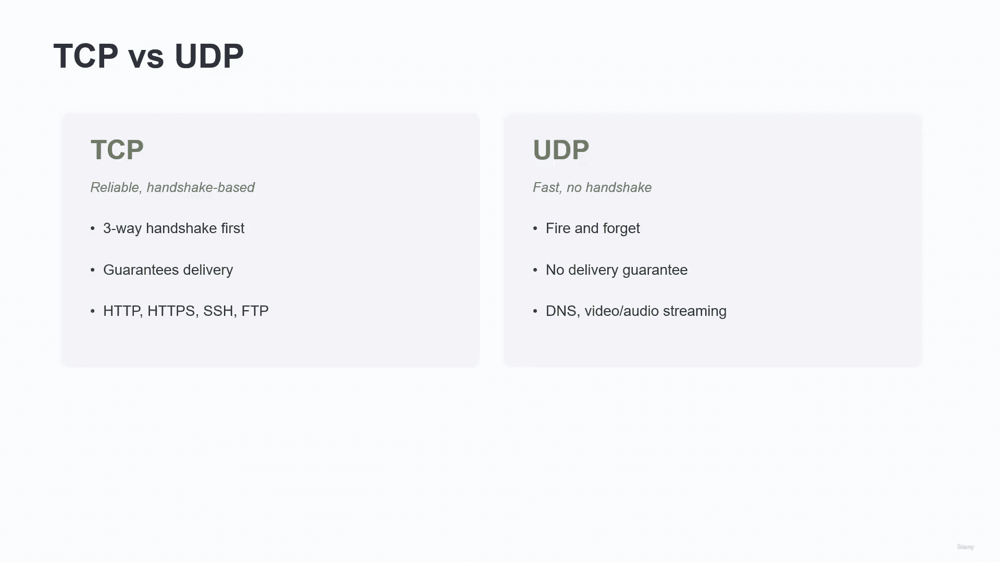
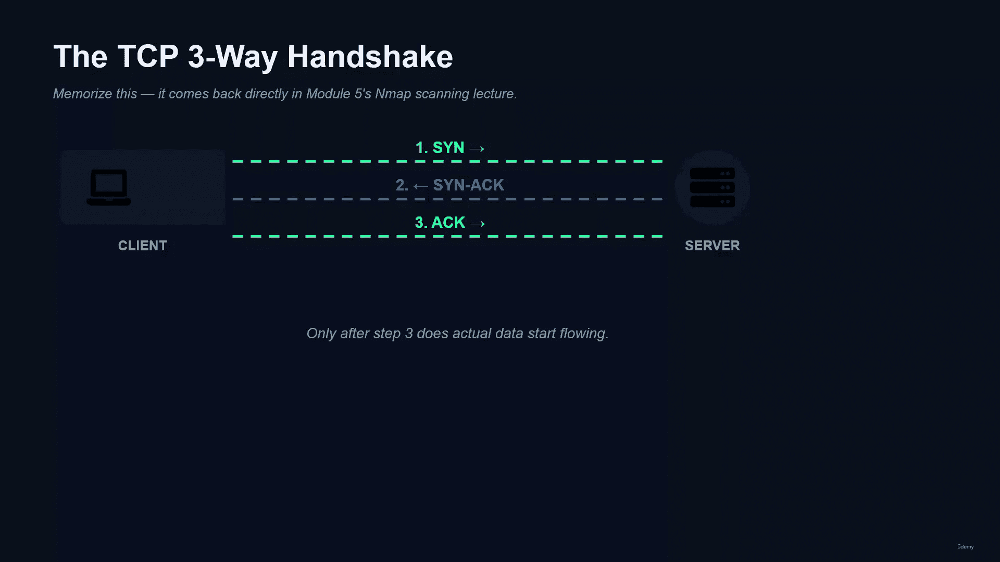
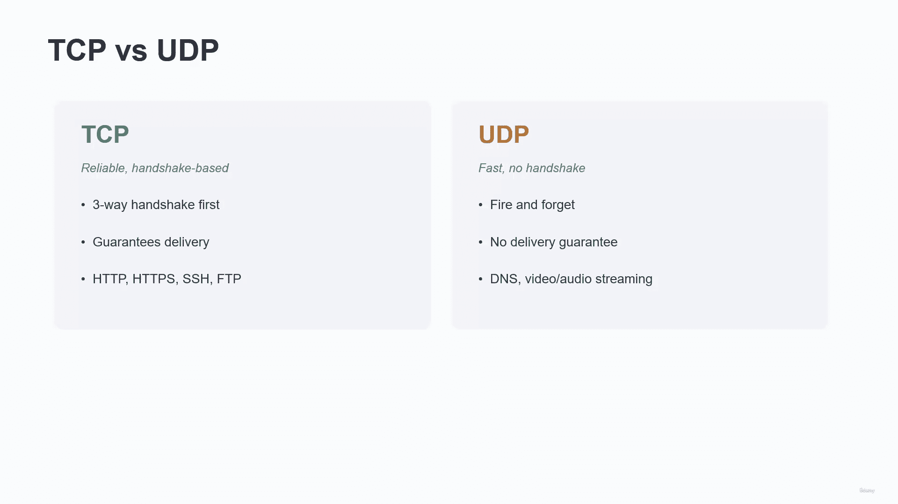

# Ethical Hacking & Penetration Testing with Kali Linux：12：TCP 与 UDP 以及三次握手 🌐

在本节课中，我们将学习网络传输中两种最常见协议的区别，也就是 TCP 和 UDP。除此之外，我们还会详细拆解 TCP 连接建立时的三次握手过程。理解这些内容，是后续学习端口扫描和渗透测试的基础，也是你之后使用各种安全工具时不能跳过的基础理论。


TCP 与 UDP 的基本区别 📊

这个区别在整个网络安全和渗透测试领域中会反复出现，所以我们现在就把它彻底弄清楚。TCP 的全称是传输控制协议，它是一种基于握手且可靠的传输方式。简单来说，在两台机器之间发送任何实际的应用数据之前，双方必须先完成连接建立，否则数据不会真正开始传输。


TCP 三次握手的具体步骤 🤝



了解完基本区别后，我们来看看 TCP 是如何具体建立连接的。TCP 连接建立时，双方会执行一个被称为三次握手的过程。为了让你能真正记住这个序列，我会一步步带你走一遍。这个序列后面在扫描课程中还会直接提到，就再过几节课，所以现在掌握它非常重要。

以下是三次握手的详细过程：

- 第一步，客户端发送一个称为 SYN 的数据包，SYN 是同步的缩写。这相当于客户端在说，嘿，我想和你建立一个连接。
- 第二步，服务器回复一个称为 SYN-ACK 的数据包，也就是同步确认。这相当于服务器在说，收到了，我接到了你的请求，我也希望从我这边进行同步。
- 第三步，客户端发回一个最终的 ACK 数据包，也就是确认数据包。握手到此完成，只有在第三步之后，真正的应用数据才会在两台机器之间开始传输。

为了让这个过程更直观，可以用下面的代码序列来表示：

```
客户端 --> 服务器：SYN
服务器 --> 客户端：SYN-ACK
客户端 --> 服务器：ACK
```

所以这个顺序是 SYN，然后是 SYN-ACK，最后是 ACK，共三步。我希望你能把这个序列牢牢记住，因为它会反复出现在后面的内容里。


为什么这个握手序列很重要 🔍

因为当我们进入第 5 模块并开始使用 Nmap 进行扫描时，你会看到一种扫描类型就叫做 SYN 扫描。理解这个确切的握手过程，就是让那个扫描类型真正说得通的关键。否则它对你来说只是一个神秘的命令，你只是盲目地复制粘贴，而不知道背后发生了什么。


基于 TCP 的可靠协议 🌐

因为 TCP 通过握手过程以及额外的确认机制来保证可靠性，所以所有需要可靠传输的协议都运行在 TCP 之上。这包括你的网页浏览器所使用的 HTTP 和 HTTPS，还有课程中会大量用于远程访问的协议，以及我们在第 7 模块会直接利用的老旧文件传输协议 FTP。这些协议之所以选 TCP，就是因为它们不能接受数据丢失或顺序错误。


UDP 的特点与应用场景 ⚡

UDP 另一方面代表用户数据报协议。它跳过了整个握手过程，速度快得多，因为它不保证每个单独的数据包都能送达目的地。如果你追求的是快速传输而非绝对准确，UDP 就是更合适的选择。



以下是典型使用 UDP 的场景：

- DNS 查询，用于将域名解析为 IP 地址。
- 视频或音频流传输。

在这些场景中，速度比完美可靠性更重要。比如如果某个 DNS 查询数据包在传输中丢失了，直接重新发送整个查询就很便宜也很快，而不需要每次都构建完整握手带来的额外开销。


TCP 与 UDP 的清晰对比 🧹

为了把这部分内容总结得干净利落，可以用下面这个简单的对比来理解：

```
TCP：较慢但可靠 | 使用三步握手 | 适用于需要保证每一份数据都到达的协议
UDP：较快但不可靠 | 完全跳过握手 | 适用于偶尔丢失数据可以接受以换取速度的协议
```


下一节课的过渡 🚪

下一节课，我们将结束网络理论模块，聊聊端口。因为理解端口，正是把这个抽象的握手概念变成你可以实际去利用的东西的关键，没有端口的概念，后面的扫描和利用都无法展开。


本节课总结 ✅



在本节课中，我们一起学习了 TCP 与 UDP 的区别，掌握了 TCP 三次握手的 SYN、SYN-ACK、ACK 三个步骤，了解了哪些可靠协议运行在 TCP 之上，以及哪些场景更适合使用 UDP。这些知识将为后面的端口扫描和漏洞利用打下坚实的基础。

