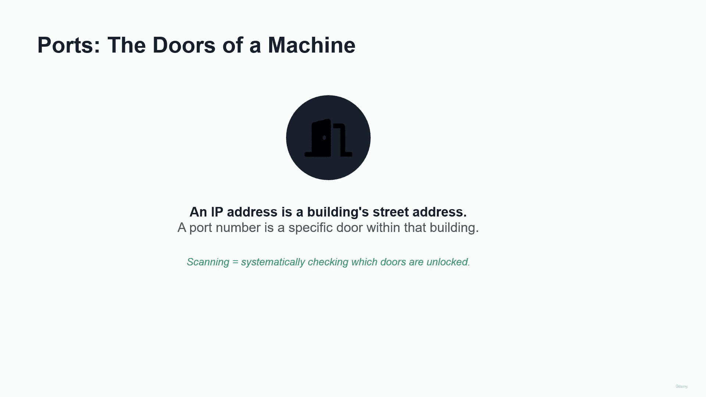

# 道德黑客与渗透测试：13：端口，机器的大门 🚪

## 课程概述

在本节课中，我们将学习网络基础理论的收尾部分，重点聊聊端口这个概念。我们会用大白话把它讲清楚，让你明白一台电脑为什么需要那么多个端口，以及作为渗透测试人员，哪些端口号是必须死记硬背的。这些知识是你后续使用 Nmap 扫描目标系统时的基础。

## 端口到底是什么

上一节我们介绍了 IP 地址、四层 OSI 模型的拆解，以及 TCP 和 UDP 之间关键的三次握手。本节中我们来看看端口，把网络通信的最后一块拼图补齐。

如果你把 IP 地址想象成一栋大楼的具体街道门牌号，那么端口号就相当于这栋大楼里某一扇具体的房门。说得更精确一点，它更像是大楼内某个特定公寓的门牌号。

这里有个关键点：一台只有一个 IP 地址的机器，完全可以同时运行很多种完全不同的服务。而每一个服务都会监听属于自己的那个特定端口号，这样进来的网络流量才能确切地知道，自己到底应该被交给哪个服务去处理。



从技术层面来说，任何一台机器上都有 65535 个可能的端口号可以使用。

```
可用端口范围：1 到 65535
```

不过在实际工作里，只有一小部分端口被广泛采用，成为了行业里的标准配置。我真的很希望你在完成本课程之前，能够把这个特定的列表背下来。

这是因为，在你之后的学习中，会一直用到这个列表。

## 必须记住的常用端口

以下是你需要重点记住的几个标准端口号及其对应的服务：

- 21：FTP，一种比较老旧的文件传输协议。
- 22：SSH，全称安全外壳协议，是安全访问远程机器命令行的标准方式。我们会在整个课程中不断使用它。
- 23：Telnet，一种古老且真正不安全的远程访问协议，它把包括密码在内的所有内容都以明文可读文本形式传输。
- 25：SMTP，用于发送电子邮件的协议。
- 53：DNS，负责把域名翻译成 IP 地址的协议。
- 80：明文、未加密的 HTTP。
- 443：加密的 HTTPS，也就是浏览器地址栏里那个小锁图标所对应的协议。
- 3389：Windows 远程桌面协议，在本课程后面的 Active Directory 模块中会特别重要。

## 这些端口为什么对我们这么重要

现在，我们来看看这个列表为什么对整个课程如此关键。

每一个端口，其实都代表着进入一台机器的潜在入口。等我们进入第 5 模块，开始用 Nmap 扫描目标的时候，我们实际做的事情就是，系统性地检查哪些门碰巧是开着的，然后弄清楚每扇开着的门后面到底跑着什么服务。

一个运行着旧版、过时或配置错误服务的开放端口，很往往就是真实攻击者，或者是在模拟攻击的专业渗透测试人员，拿到目标系统立足点的方式。

为了让这个知识点更牢固，我们再把这个列表过一遍：

```
21 FTP
22 SSH
23 Telnet
25 SMTP
53 DNS
80 HTTP
443 HTTPS
3389 RDP
```

请把这个列表牢牢记住。从这一点开始，本课程中几乎每一节实操课都会引用其中一个或多个端口号。

## 本节内容总结

好了，这个模块的内容就讲到这里。我们一起学习了 IP 地址、实用的四层 OSI 模型、TCP 与 UDP 以及关键的三次握手，最后又学习了端口。

下一节课，我们将把所有这些知识直接付诸实践，打开终端，动手去探索我们实验室网络的配置。


本节课中，我们一起学习了端口的概念、需要背熟的常用端口号列表，以及端口如何成为进入目标机器的潜在入口。

