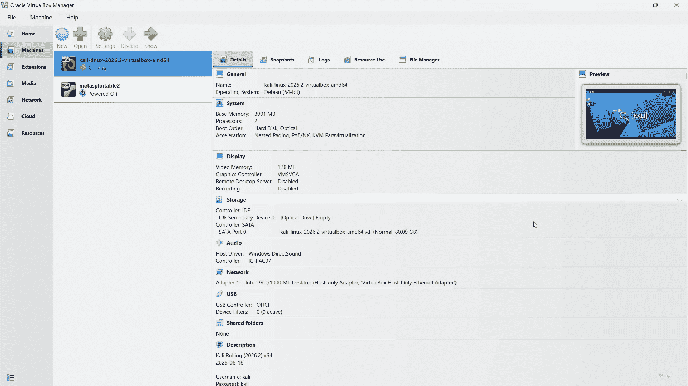
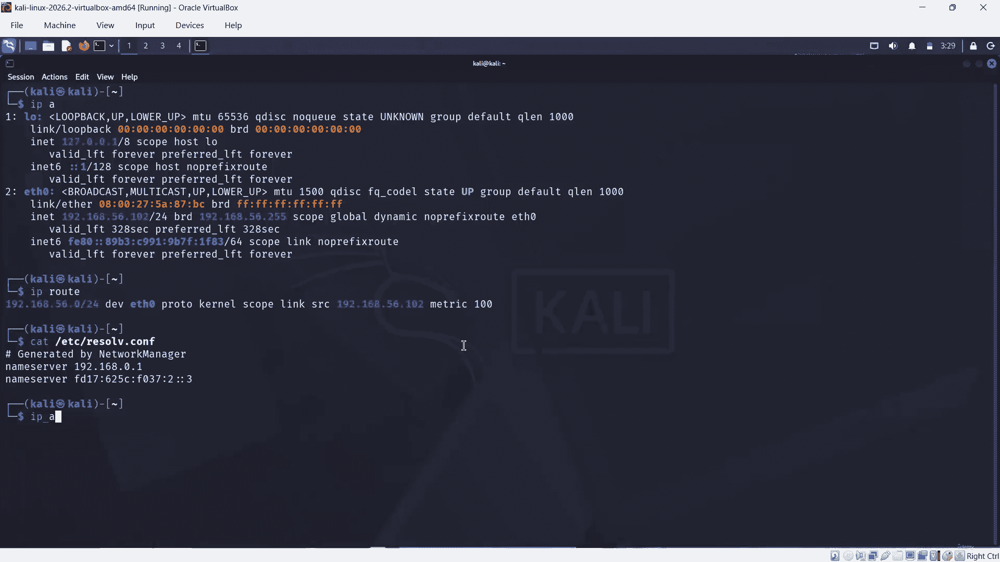

# Kali Linux 伦理黑客与渗透测试：14：探索你的网络配置 🌐



## 课程概述

在本节课中，我们将学习如何在 Kali Linux 虚拟机中查看和理解本机的网络配置。我们会依次运行几个常用命令，分别查看 IP 地址、路由表和 DNS 设置，并把这些实际操作与之前理论课程中讲解的知识点对应起来。通过本节课，你将掌握最基础的网络排查方法，为后续的渗透测试实验打下坚实基础。

## 准备工作

首先，我们需要切换到已经安装好的 Kali Linux 虚拟机，然后打开一个终端窗口。所有的操作都将在终端中完成，不需要使用图形界面。这是整个实验环境的起点，也是后续所有网络相关操作的基础。

以下是本节课需要用到的核心命令：

- `ip a`：查看网络接口和 IP 地址信息。
- `ip route`：查看系统的路由表和默认网关。
- `cat /etc/resolv.conf`：查看配置的 DNS 服务器地址。

## 查看 IP 地址和子网掩码

上一节我们介绍了网络理论基础，本节中我们来看看如何在实际系统中验证这些知识。

运行以下命令后，终端会列出系统中所有的网络接口：

```bash
ip a
```

输出内容比较多，我们需要逐个字段来理解。你会看到一系列不同的网络接口被列出来，其中有一个接口通常被标记为 `lo`。这个 `lo` 代表 loopback（回环接口），简单来说，就是机器在跟自己说话。在本课程中，你可以直接忽略这个接口，不需要关注它。

我们真正需要关注的是除了 `lo` 以外的其他接口。在输出中找到 `inet` 这一行，它显示的就是这台机器的真实 IP 地址。注意，地址是用 CIDR 表示法写的，例如：

```text
192.160.56.101/24
```

这里的 `/24` 表示子网掩码长度，这正是我们在理论课中讨论过的私有网络范围和子网大小。

## 查看默认网关和路由表

知道了本机 IP 地址之后，我们还需要了解流量是如何离开本地网络的。接下来的命令用于显示系统的路由表。

以下是路由表查看命令：

```bash
ip route
```

在输出结果中，请重点关注标记为 `default` 的那一行。这行内容标识了默认网关，用大白话来说，就是当流量需要离开当前子网、前往其他网络时，会经过的地址。

在我们现在的隔离实验环境里，机器处于仅主机网络模式，没有真正的互联网接入，因此默认网关的概念暂时用得不多。不过，当我们在后续课程中搭建更复杂的多网络实验环境，特别是在活动目录模块时，这个知识点将变得非常重要。

## 查看 DNS 服务器配置

除了 IP 地址和网关，域名解析也是网络通信的关键部分。我们需要查看系统当前配置的 DNS 服务器。

以下命令用于读取 DNS 配置文件：

```bash
cat /etc/resolv.conf
```

这个文件记录了系统使用的 DNS 服务器。DNS 协议的作用是将人类可读的域名（比如 `www.example.com`）转换成实际的 IP 地址。每当你在浏览器或命令行中输入域名而不是原始 IP 地址时，系统都会自动查阅这个文件，找到对应的解析服务器。

## 将三条命令串联起来

现在我们把刚才学到的三条命令，和之前理论课的内容对应起来，帮助你形成完整的认知。

- 从 `ip a` 中看到的 IP 地址和子网，代表这台机器在网络中的第 3 层身份。
- 从 `ip route` 中看到的默认网关，决定了流量离开本地子网时该去往哪里。
- 从 `/etc/resolv.conf` 中看到的 DNS 服务器，负责把域名转换成实际用于路由的 IP 地址。

此外，如果你运行 `ip a` 时发现有多个网络接口，每个接口都有独立的 IP 地址，这说明机器同时激活了多个网络连接，甚至可能连接在完全不同的网络上。这在后续搭建高级活动目录实验室时会非常有用，因为那里涉及多台互联机器，网络拓扑会比我们现在的简单两机环境复杂得多。不过现在，掌握这些基础知识就足够让你继续往下学习了。

## 下一节课预告

本节课中我们一起学习了如何在 Kali Linux 中查看 IP 地址、默认网关和 DNS 配置，并理解了它们在网络通信中的作用。



下一节课，我们将转而查看系统当前哪些网络连接是实际活跃并正在使用的，使用的工具叫做 `ss`，不再是本机配置，而是实时的网络连接状态。
