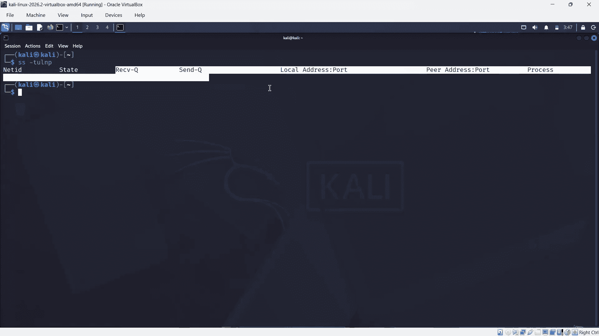
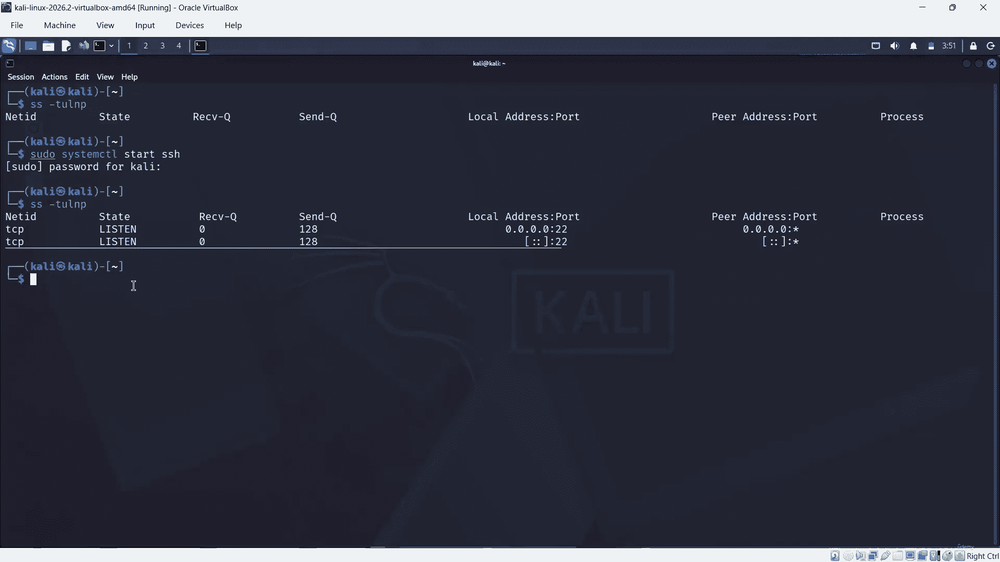

# 🛡️ 道德黑客与渗透测试 Kali Linux: 15: 使用 ss 查看活动网络连接

在本节课中，我们将要学习如何使用 ss 工具查看计算机上当前正在运行的所有网络连接。你会看到这条命令到底做了什么，以及为什么在渗透测试课程中，掌握它对后续学习非常重要。本节课的内容比较基础，但后面的模块会反复用到这些知识，所以建议你仔细阅读，不要跳过任何一部分。


我们先来认识一下这个工具。ss 是 socket statistics 的缩写，它能够实时显示机器上当前活跃的网络连接状态。这不仅有助于你了解自己的系统，以后也能帮你从内部判断一台被攻破或正在被攻击的机器长什么样。接下来，我们将逐步拆解这条命令，看看每个参数的具体含义，确保你不是盲目复制，而是真正明白自己在输入什么。


## 核心概念

**核心公式：**

```text
ss = socket statistics（套接字统计信息）
```

**核心命令：**


```bash
ss -H -t -u -l -n -p
```




以下是命令中每个标志的具体含义：

- `-H`：不显示表头，让输出更简洁。
- `-t`：只显示 TCP 连接。
- `-u`：同时显示 UDP 连接。
- `-l`：只显示处于监听状态的套接字，也就是正在等待外部连接的服务。
- `-n`：以数字形式显示端口号，而不是尝试解析成服务名称，这样更快也更清晰。
- `-p`：显示拥有每个监听套接字的具体进程，包括程序名和进程 ID。


现在我们来逐列查看命令输出的具体内容。下面是各个列的含义说明，帮助你理解屏幕上显示的每一行数据：

- 第一列 NetID：显示当前行是 TCP 还是 UDP，输出会显示为小写的 tcp 或 udp。
- 第二列 State：显示连接状态，对于等待连接的服务，通常显示为 listen。
- 接下来是接收队列和发送队列：这两列现在通常显示为 0，初学者可以暂时忽略。
- 本地地址和端口：这是对我们最重要的一列，它显示具体哪个服务正在本机的哪个端口上监听。
- 对端地址和端口：如果存在远程连接，这里会显示具体地址；对于监听套接字，通常显示星号，表示任意地址。
- 进程列：得益于 `-p` 标志，这里显示负责该监听端口的实际程序名和进程 ID。


我们来看看在全新安装的 Kali 系统上运行这条命令会得到什么结果。下面是可能出现的情况，你可以对照着自己机器上的输出来看：

- 表格可能为空，只显示表头，没有任何数据行。
- 这是完全正常的，也符合预期。
- Kali 默认不会运行任何网络服务，除非你显式地开启某个服务。
- 空结果不代表出错了，只是表示当前没有任何服务在监听端口。


为了让输出有内容可看，我们需要先启动一个网络服务。这里我们选择启动 SSH 服务，因为后续课程也会用到它。以下是具体操作步骤，请按顺序执行：

1. 输入 `sudo systemctl start ssh` 来启动 SSH 服务。
2. 系统会提示输入 kali 用户的密码，默认密码是 kali，全部小写。
3. 启动完成后，再次运行 `ss -H -t -u -l -n -p` 命令。


现在我们来分析启动 SSH 后得到的输出结果。假设你在输出中看到这样一行，下面是各个字段的含义：

- NetID 列显示 tcp，表示这是 TCP 连接。
- 本地地址列显示 `0.0.0.0:22`，端口号是 22。
- State 列显示 listen，表示服务正在监听。
- 这用大白话解释就是：SSH 进程正在监听 22 端口，并且在所有可用的网络接口上等待连入。
- 这与我们之前理论课中提到的 22 端口完全一致。


这个命令之所以对本课程后续内容非常重要，不仅仅是因为它是一个实用的诊断工具。当我们进入第 5 模块，使用 Nmap 扫描目标机器时，实际上是在做差不多同样的调查工作，只不过是从网络外部进行，而不是直接在机器内部查看。在 Kali 上本地运行 ss，是理解 Nmap 远程发现什么概念的绝佳热身。


下一节课，我们将深入一层。不再只是查看哪些端口是开放的，而是使用名为 tcpdump 的工具来捕获和检查原始网络流量。


## 总结



本节课中我们一起学习了使用 ss 命令查看活动网络连接的方法。我们拆解了命令中的每个标志，逐列理解了输出内容，在空结果和启动 SSH 服务后的结果之间做了对比，并解释了这项技能与后续 Nmap 扫描课程的关系。

