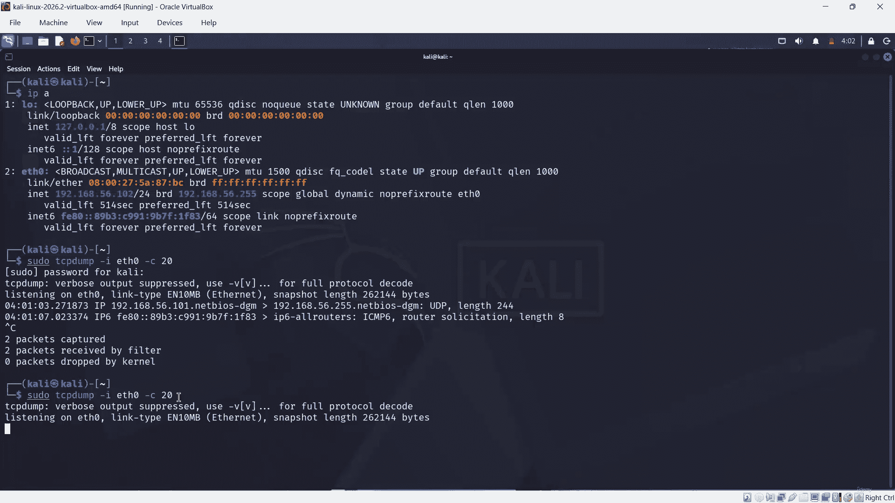
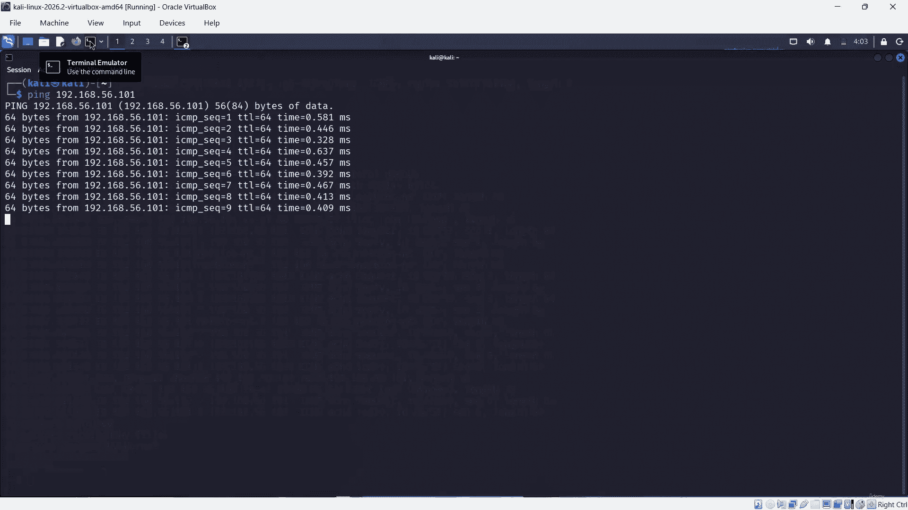
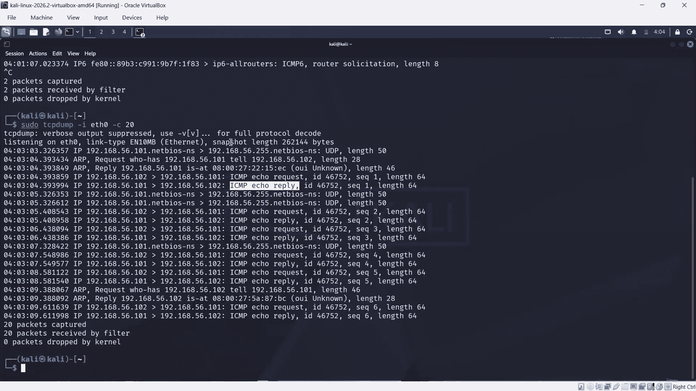
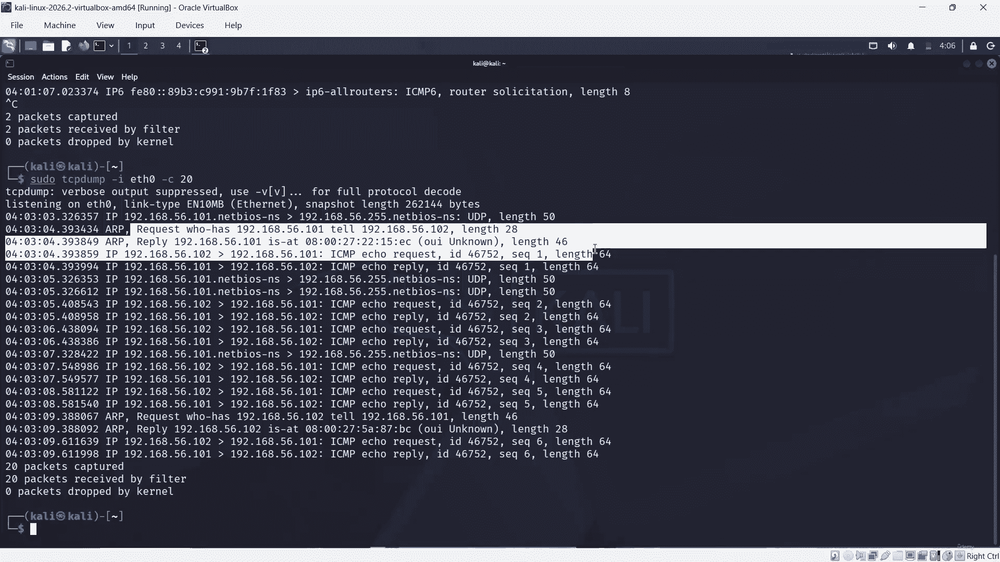

# 网络安全渗透测试：16：使用 tcpdump 抓取网络流量 📡

## 概述

在本节课中，我们将要学习如何在 Kali Linux 上使用 tcpdump 工具捕获真实的网络流量。在以前的课程里，我们只了解过如何查看目标主机上哪些端口是开放的，而现在我们要进一步抓取实际经过实验室网络的数据包，并且直接观察它们在网络中传输时的原始样子。

## 确认网络接口名称

在开始抓包之前，我们需要先确认自己电脑上的网络接口叫什么名字。这个名字会根据你的具体 VirtualBox 设置而有所不同，有的机器显示为 eth0，有的则显示为 eth1，因此不能盲目假设。

以下是查看接口的方法：

```bash
ip a
```

执行这条命令后，终端会列出系统中所有的网络接口。在示例环境中，主机专用网络接口显示为 eth0。请务必使用你自己屏幕上实际显示的名称，在后面的命令中替换掉 eth0，否则 tcpdump 将无法在正确的接口上监听。

## 运行 tcpdump 命令

tcpdump 已经预装在 Kali Linux 中，所以我们不需要额外安装，可以直接运行。接下来我们要执行的命令如下：

```bash
sudo tcpdump -i eth0 -c 20
```

在回车执行之前，我们先来拆解一下这个命令里的每一部分，这样你就知道自己到底在运行什么。

第一部分是 `sudo`。因为捕获原始网络流量需要更高的系统权限，所以必须使用 sudo 临时以 root 身份运行这一条命令。这和我们在模块 1 的 Linux 基础课程中学到的内容是一致的。

第二部分是 `-i eth0`。这里的 `-i` 代表 interface，也就是告诉 tcpdump 在哪一个具体的网络接口上进行监听。我们要监听的就是刚才用 `ip a` 确认好的那个主机专用实验室网络接口。

第三部分是 `-c 20`。这个标志告诉 tcpdump 捕获 exactly 20 个数据包后自动停止，而不是无限期运行下去并把终端刷屏。

请记住，如果你自己的接口名称不是 eth0，需要把命令里的 eth0 换成你实际看到的名称。



现在，我们可以回车开始捕获。此时 tcpdump 正处于等待状态，准备捕获数据包。但因为目前网络上没有流量经过，所以暂时看不到任何输出。

## 产生网络流量

为了让 tcpdump 有东西可抓，我们需要在网络上人为制造一些流量。



以下是操作步骤：

打开第二个终端窗口。
在第二个终端里，使用 ping 命令发送数据包给目标机器，目标 IP 地址是 192.168.56.101。
回车后，这会产生 tcpdump 正在等待捕获的那种流量。

在第二个终端中，输入命令如下：

```bash
ping 192.168.56.101
```

## 查看捕获结果

流量产生之后，我们切换回第一个终端，也就是运行 tcpdump 的那个窗口，看看抓到了什么。

此时你会看到捕获到的输出。请特别注意成对出现的两行，第一行是 ICMP Echo request，紧随其后的是 ICMP Echo reply。



这些行对应我们在另一个终端里运行的 ping 命令。每一个 Echo request 代表我们的机器发出一个 ping，而每一个对应的 Echo reply 代表目标机器响应回来。这正是我们在课程中一直在用的 ping 交换，只不过现在，我们第一次看到了让 ping 成为可能的原始底层网络流量，而不是 ping 命令本身通常显示的友好摘要。

## 输出内容的含义

在捕获结果中，每一行都清晰地标记了源 IP 地址和目的 IP 地址。

此外，还会显示每个数据包被捕获的准确时间戳。这种对网络流量的原始可见性，正是 tcpdump 和下一节课将要介绍的 Wireshark 之所以对进攻性和防御性安全工作都非常有价值的原因。

攻击者如果在网络上嗅探流量，可以看到完全相同的信息。而安全防御人员在调查安全事件时，也依赖于完全相同的捕获证据。

## tcpdump 的实用场景

在实际专业工作中，大多数人之所以选择 tcpdump，是因为他们需要一个快速、轻量且适合命令行的工具。比如，当你通过 SSH 连接到远程服务器，且没有图形界面可用时，tcpdump 就是非常合适的选择。

如果你想要更加直观、可视化的探索体验，那么下一节课我们将介绍 Wireshark。它基于完全相同的底层概念，但提供了更友好的颜色编码和可点击的界面。

## 总结



本节课中，我们一起学习了如何在 Kali Linux 上确认网络接口名称，如何使用 `sudo tcpdump -i 网络接口 -c 数量` 命令捕获网络流量，如何通过 ping 产生流量并观察 ICMP 请求与响应，以及如何解读 tcpdump 输出中的源 IP、目的 IP 和时间戳。我们还了解了 tcpdump 在实际安全工作中的应用场景，并预告了下一节将要学习的 Wireshark。

