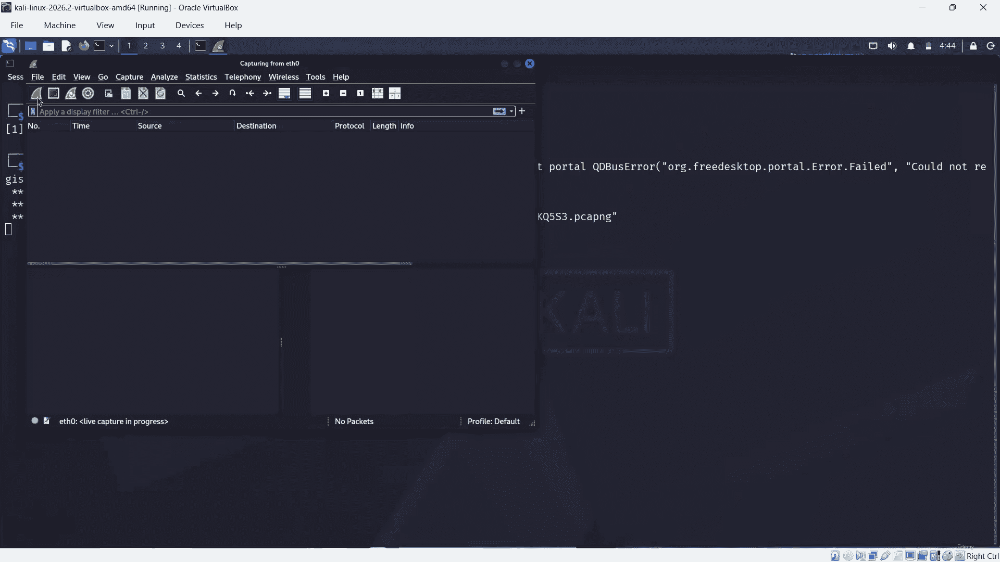
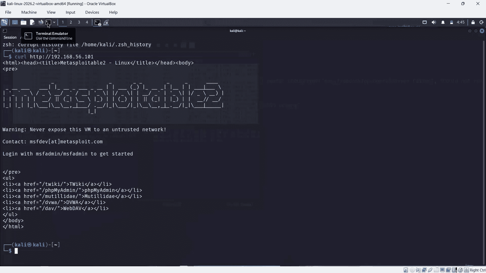
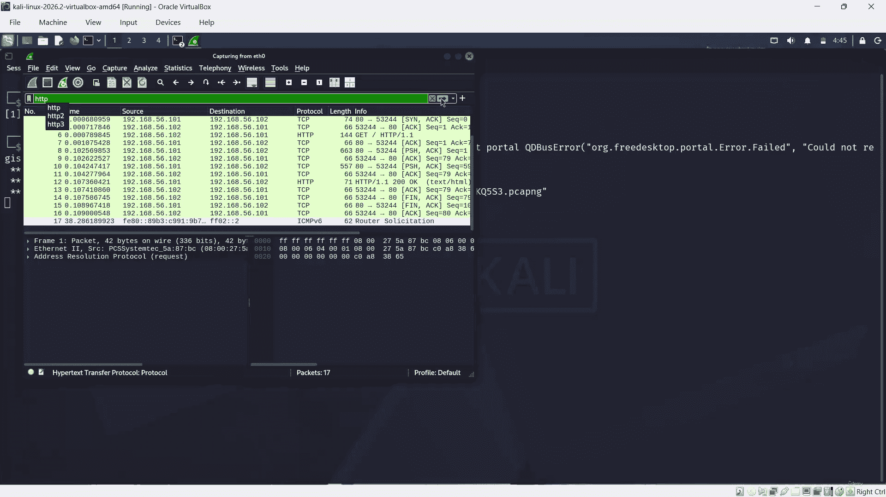
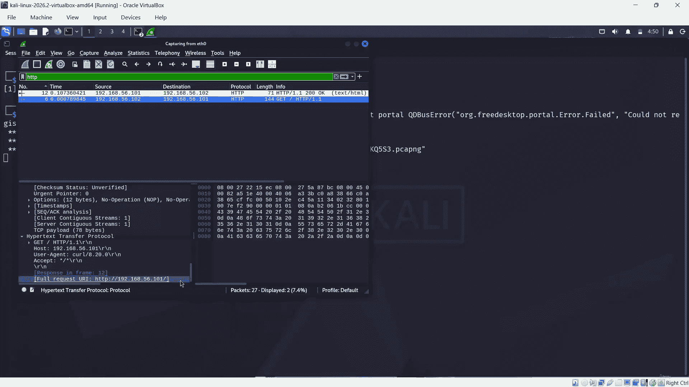

# Ethical Hacking & Penetration Testing with Kali Linux：17：使用 Wireshark 可视化网络流量 📊

## 本节概述

在本节课中我们将要学习如何使用 Wireshark 来可视化查看实验室网络中发生的一切。我们会从启动 Wireshark 开始，讲解为什么不需要使用管理员权限，也不会卡死终端。接着我们会把 Wireshark 和之前学过的 tcpdump 做个对比，然后选择正确的网卡开始抓包。之后我们会手动产生一些 HTTP 流量，在 Wireshark 里过滤出来，把数据包展开看个究竟。最后我们会聊聊为什么明文 HTTP 是个大安全隐患，以及 HTTPS 是怎么解决这个问题的。

## 启动 Wireshark

上一节我们介绍了 tcpdump 命令行抓包工具，本节中我们来看看具有图形界面的 Wireshark 是怎么工作的。

在 Kali 终端里直接输入下面这条命令，然后按回车：

```bash
wireshark &
```

你会注意到，这里面没有写 `sudo`。这是因为 Kali 预先配置好了权限，普通用户已经可以通过 Wireshark 的捕获助手直接抓取实时数据包，不需要 root 权限。

命令行末尾的 `&` 符号并不会把 Wireshark 窗口藏起来，它照常会在屏幕上打开，就像启动其他程序一样。`&` 真正起的作用是立即释放终端提示符，这样你可以在 Wireshark 运行的同时，继续在同一个终端窗口里输入别的命令。终端不会因为 Wireshark 还没关闭而变得没法用。

一定要记住，不要在前面加 `sudo`。以 root 身份运行 Wireshark 从安全角度来说都是不好的习惯，而且把 `sudo` 和末尾的 `&` 混在一起，还可能导致命令卡住，表现为按下回车后好像冻结了，实际上是在等你输入密码。

万一你真看到它卡住了，可以输入 `fg` 然后按回车，把它拉回前台，再把密码输入完。不过如果你完全按照刚才所示的命令启动，不用加 `sudo`，基本用不着这一步。

## Wireshark 与 tcpdump 的关系

刚才我们学会了如何启动 Wireshark，接下来我们来看看它和之前课程里用过的 tcpdump 工具有什么不同。

tcpdump 显示的是基于文本的原始数据包捕获，速度快、资源占用少，但乍一看不太容易读懂。Wireshark 展示的基本上是同一份底层数据，只不过通过更友好的、带颜色编码的图形界面来呈现，你可以点击单个数据包，把它们展开，一层层地深入查看。

以下是两者的简单对比：

- tcpdump：适合快速命令行检查，或者在没有图形界面的环境里写脚本自动运行。
- Wireshark：适合日常的详细流量分析，绝大多数安全从业者平时都直接用它来查看网络流量。

## 选择正确的网络接口

Wireshark 加载出来以后，我们要从可用接口列表里挑选要监听的网卡。



下面是需要关注的几点：

- 选 `eth0`，也就是主机专用网络接口，这个名字和我们前面用 `ip addr` 命令确认的一样。
- 列表里还会出现其他条目，比如回环接口、蓝牙监听、NF log 之类，它们都是虚拟捕获选项，不是真正的网卡，直接忽略就好。
- `eth0` 是连接到这台机器的唯一真实网络适配器，也就是我们想要的那个。

确认选中 `eth0` 之后，点击界面里的鲨鱼鳍图标，就可以开始捕获流量了。



## 产生流量并开始捕获

点击开始按钮以后，Wireshark 还没东西可显示，因为真正的抓包需要有实际的网络通信发生。



下面是产生测试流量的步骤：

1. 打开一个新的终端窗口。
2. 输入 `curl` 命令，访问目标机器上的 Web 服务器。
3. 命令如下：

```bash
curl http://192.168.56.101
```

这会向目标机器发送一个普通的 HTTP 请求。如果目标上确实有 Web 服务在运行，就会产生一笔可以被 Wireshark 抓到的通信。

然后切换回 Wireshark 界面，看看抓到了什么。

## 过滤和分析 HTTP 数据包

切换回 Wireshark 后，你可能会发现捕获到了很多不同的流量，不只是我们刚才发出的那个请求。这在真实网络上非常正常，因为网卡会把周围经过的各种数据都记录下来。

为了只看我们关心的内容，我们需要使用显示过滤器。

以下是具体操作：

1. 在 Wireshark 顶部的过滤器栏里，输入单词 `http`。
2. 按下回车键。
3. 原本成千上万个数据包会立刻缩小，只剩下少量几个 HTTP 流量数据包。

接下来，直接点击列表里的 `GET` 请求那一行，然后在下方面板把它展开，一直钻取到各个协议层，直到看到这个请求的完整原始内容。你可以清楚地看到源地址和目标地址。

## 明文 HTTP 的安全风险

这时候请仔细看看屏幕上显示的内容。

这是一个完全明文的 HTTP 请求，每一个头部字段，每一段数据，都毫无加密地摆在那里，任何人都能直接读懂。

这一点非常重要，也是整个网络模块最核心的实用收获之一：任何连在同一个本地网络里的人，不管是共享公共 WiFi 上的恶意用户，还是能接触到沿途交换机的人，都可以完全不加密地读取这次交换的每一个字节，和我们现在在自己屏幕上看到的一样清楚。

这个完全没有内置保护的漏洞，正是 HTTPS 协议存在的原因。HTTPS 把同样的底层 HTTP 对话包裹在一个加密隧道里，所以即使有人像刚才那样捕获了原始流量，他们看到的也只是乱码，根本看不出里面的内容，而不会像我们现在看到的这样是清晰的明文。

从今往后，只要你遇到运行在明文 HTTP 而不是 HTTPS 上的 Web 应用，就要立刻在脑子里把它当成红旗，视为一个值得在专业报告里专门点出来的真实安全弱点。我们后面在 Web 应用渗透测试模块里还会直接用到这个结论，因为课程里的那个故意存在漏洞的目标应用 DWA，就是专门跑在明文未加密的 HTTP 上的。

## 本节总结与下一节预告

好了，网络模块到此结束。我们在这八节课里一起学习了 IP 寻址和子网划分、四层 OSI 模型的实际拆解、TCP 与 UDP 以及关键的三次握手、常见端口，最后还动手用 `ip`、`ss`、`tcpdump` 和 Wireshark 检查了网络配置、活动连接和原始流量。



下一个模块我们将正式进入 Linux 基础，因为 Kali 本身就是 Linux 系统，而课程剩下部分里每一个工具都要在这个终端里运行。在开始主动攻击任何目标之前，你真的需要在这里打好扎实的基础，熟练掌握命令行操作。
