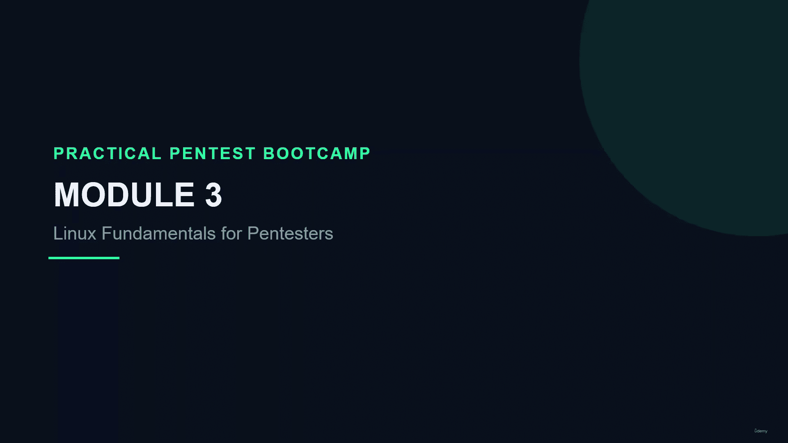
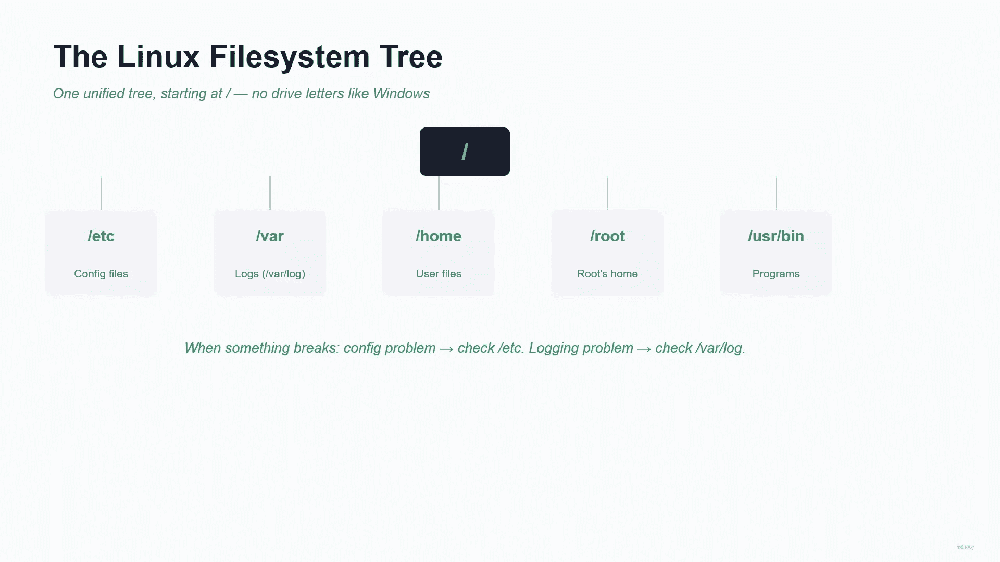
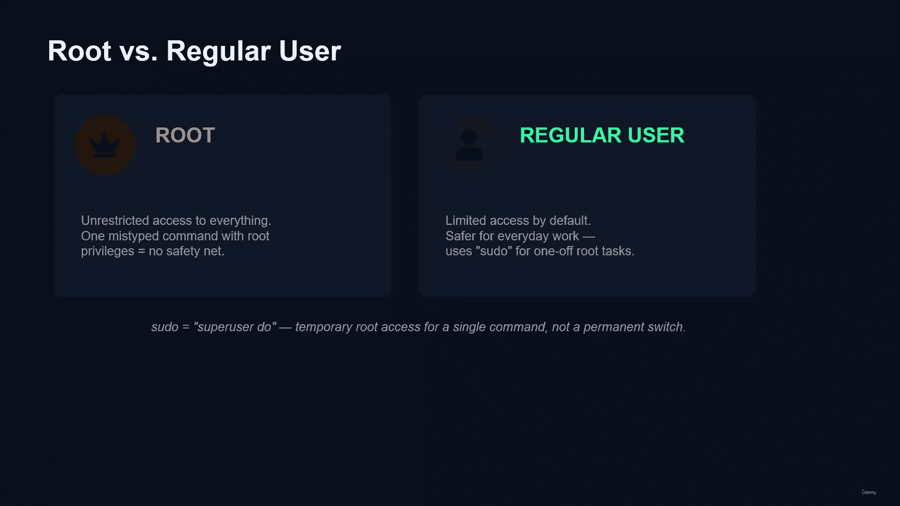
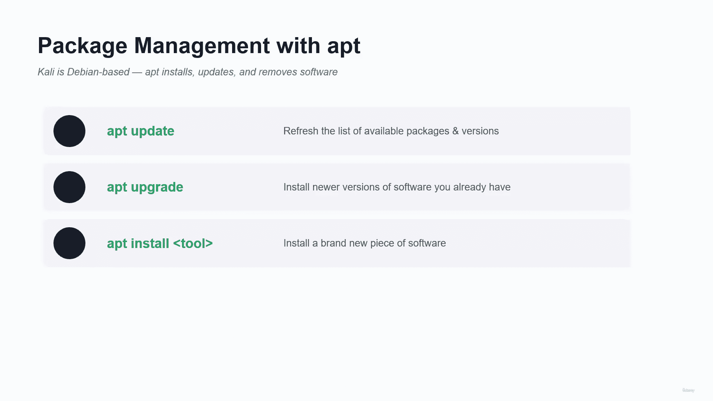
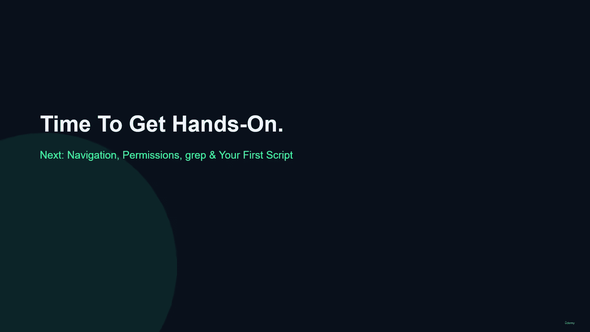

# 🛡️ 道德黑客与 Kali Linux 渗透测试：18：Linux 文件系统与 Root 与普通用户

在本节课中，我们将一起学习 Kali Linux 的文件系统布局，理解 root 用户与普通用户的区别，掌握 sudo 命令的作用，以及熟悉 APT 包管理器的基本使用。这些内容是后续所有渗透测试实操的基础，建议你花足够的时间把它们搞清楚，不要急于跳过。

Linux 是本课程中所有工具所在的环境，课程后续使用的每一个工具都存在于这个终端里面。如果你来自 Windows，并且这是你第一次真正接触 Linux 命令行，请不要跳过本节内容。本节非常值得反复观看。如果你后续在学习中感到困惑，大概率是因为对本节终端环境还不够熟悉。从这一点之后的所有课程，都默认你已经能够在这个终端环境中熟练地导航和操作。

## 1. Linux 文件系统布局



上一节我们简单介绍了 Kali Linux 的终端环境，本节中我们来看看 Linux 的文件系统是如何组织的。

与 Windows 不同，Windows 有独立的盘符，比如 C 盘和 D 盘。Linux 只有一个统一的文件系统，它从根目录开始。根目录写作一个正斜杠。

```
/
```

在根目录之下，有几个特定的目录对我们的课程非常重要。以下是这些目录的具体说明：

- /etc：存放系统范围的配置文件。课程中安装的几乎每个工具都会把它的设置存储在这个目录的某个位置。
- /var：存放可变数据，其中最重要的是日志文件。具体来说是 /var/log。后续课程讨论攻击如何被防守者检测到时，这里会变得非常重要。
- /home：普通用户账户存放个人文件的地方。这大致相当于 Windows 上你可能已经熟悉的用户文件夹。
- /root：专门属于 root 用户的主目录。我要说明的是，这个位置与任何普通用户在 /home 下的个人主文件夹是完全不同的两个位置。
- /usr/bin：这是安装的程序可执行文件实际所在的几个位置之一。

下面是一个简单的示例，帮助你记住这些常见路径：

```
配置文件 -> /etc
日志文件 -> /var/log
普通用户文件 -> /home/<用户名>
root 用户文件 -> /root
可执行程序 -> /usr/bin
```

这个结构在实际操作中很有意义，不仅仅是冷知识。当课程后面出现问题时，比如工具无法运行、配置文件似乎被忽略、日志没有显示你期望的内容，有经验的 Linux 用户做的第一件事就是根据这个结构进行思考。如果是配置问题，就检查 /etc；如果是日志问题，就检查 /var/log。现在建立这个心智地图，能为你节省后续大量的困惑时间。

## 2. Root 用户与普通用户

介绍完文件系统之后，我们需要讨论 root 用户与普通用户的区别，因为这个区别在后续学习中非常重要。



root 账户对系统中的一切都有真正不受限制的访问权限。每一个文件、每一个运行中的进程、每一个设置，都没有任何例外。

经常以 root 身份运行通常被认为是不良实践，即使是在我们这样的实验环境中也是如此。因为一条输入错误的命令，在拥有完整 root 权限的情况下执行，可能会造成严重、有时甚至无法挽回的损害，而且没有任何安全网能够捕捉这个错误。

我们在上一节模块中其实已经见过一个活生生的例子。当时以 root 身份启动 Wireshark，结果被证明是出于非常相似的原因而应该避免的操作。

这就是 Linux 给我们 sudo 命令的原因。sudo 的全称是 super user do。它允许一个有权限的普通用户，临时执行一条特定的命令，使用 root 级别的权限，而不需要一直以 root 身份运行。

你可以把 sudo 理解为下面这样一个公式：

```
sudo <命令> = 临时以 root 权限执行 <命令>
```

在本课程剩余部分中，你将看到大量命令前面都带有 sudo。现在你已经听完这个解释，就明白每次输入 sudo 时，背后到底发生了什么。

## 3. APT 包管理器



了解完用户权限之后，我们来看看 Kali 是如何安装和管理软件的。

Kali 是构建在 Debian 之上的，而基于 Debian 的系统使用一个名为 APT 的工具来安装、更新和删除软件。以下是三个最常用的命令：

```
apt update         # 刷新来自 Kali 官方仓库的可用软件包列表及其当前版本
apt upgrade        # 实际安装系统中已安装软件的更新版本
apt install <工具名>  # 安装你目前还没有的全新软件
```

本课程剩余部分将反复使用这三个命令。现在就要熟悉这个模式，因为它很快就会变得驾轻就熟。

## 4. 本节预告与下节课安排



在进入本模块的实操部分之前，再快速预览一下。今天涵盖的导航、权限、文本处理以及首次脚本测试，都是真正的基础内容。

这些内容并不花哨，目前还没有任何黑客攻击发生，但我向你保证，从第 4 模块开始的每一节课都假设你能毫不犹豫地在这个终端中移动。在这里投入真正的专注力，将在整个课程剩余部分中获得回报。

下一节课，我们将真正动手实践，使用真实命令在我们自己的 Kali 终端中直接导航这个文件系统。

## 总结



本节课中，我们一起学习了 Linux 的统一文件系统结构，了解了 /etc、/var/log、/home、/root 和 /usr/bin 等关键目录的作用，掌握了 root 用户与普通用户的权限区别，学会了使用 sudo 临时提升权限，以及熟悉了 APT 包管理器的三个基本命令。这些知识是后续所有渗透测试实操的基础，请务必掌握。

