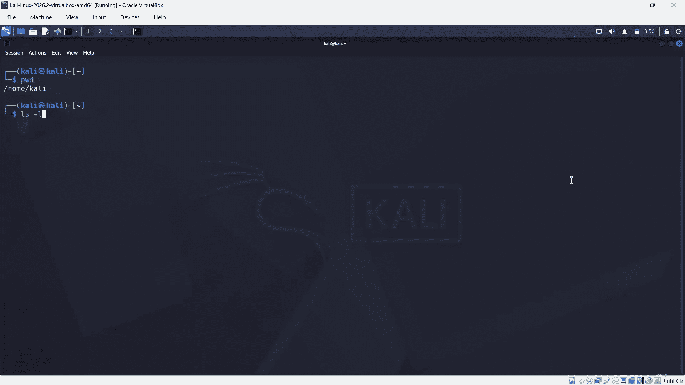
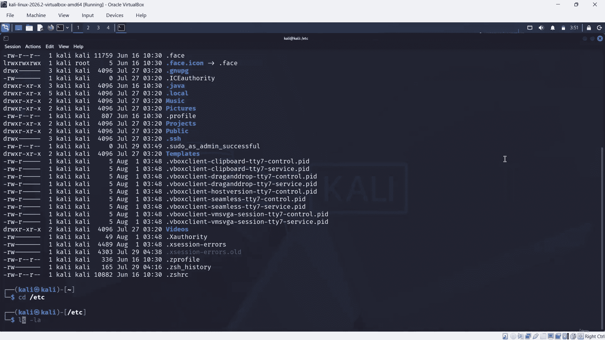
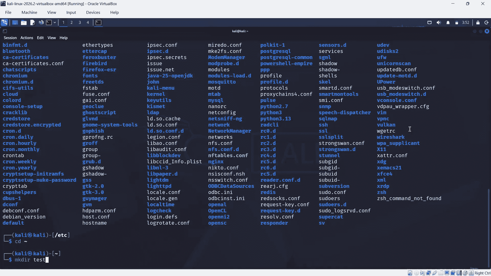
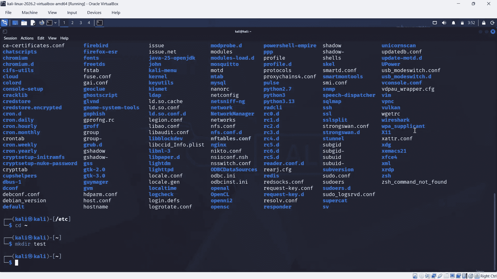
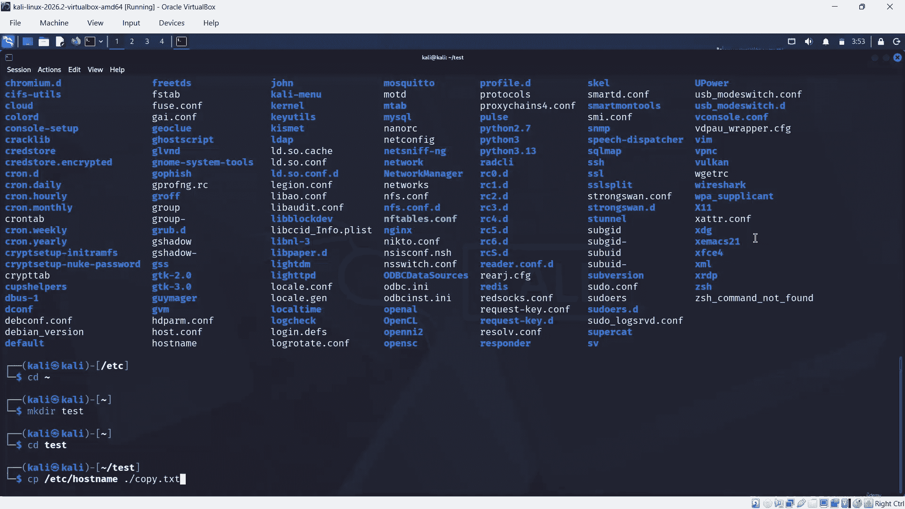
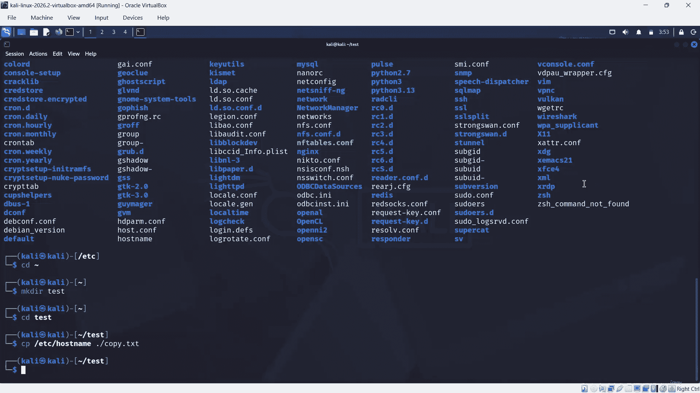
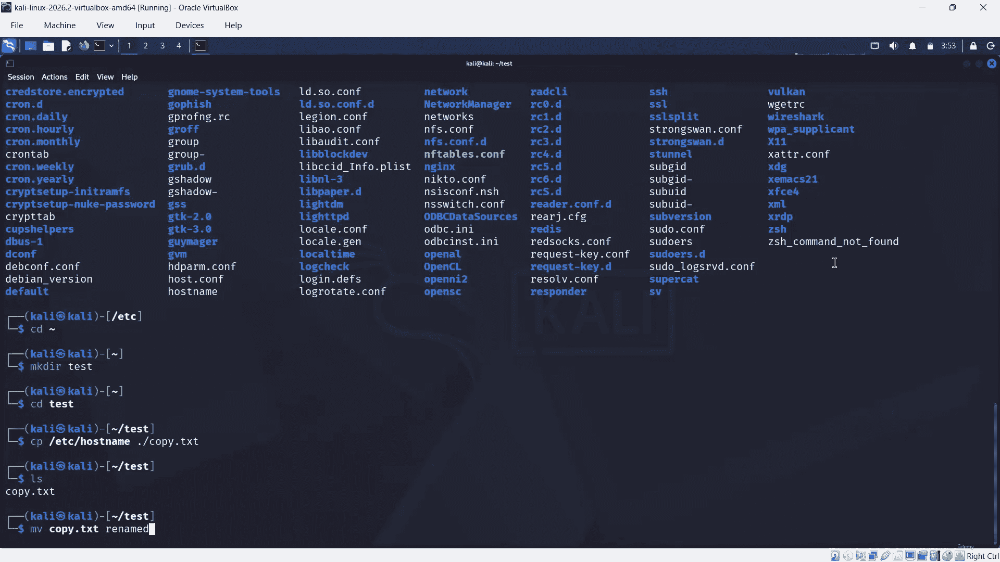
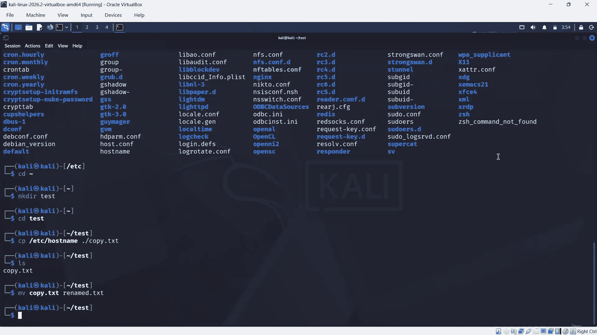
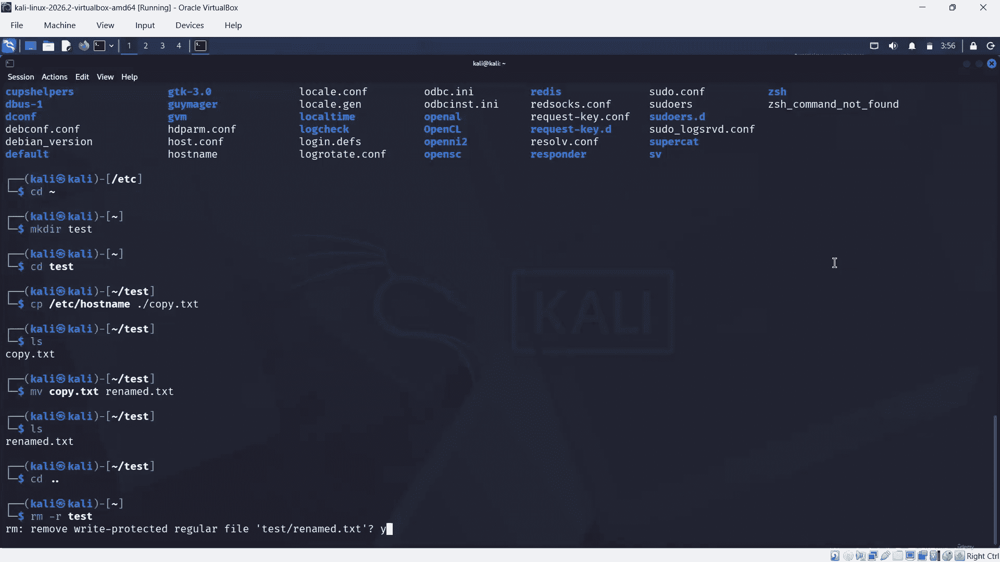

# 道德黑客与 Kali Linux 渗透测试：19：导航文件系统 📁

## 课程概述

在本节课中，我们将学习如何在 Kali Linux 的文件系统中进行实际操作。具体内容包括查看当前所在位置、列出目录里的文件、在不同文件夹之间切换、创建和复制文件、重命名文件，以及删除目录等基础技能。这些命令是后续课程中会反复使用的基础工具，掌握它们对后面的学习非常重要。

## 打开终端并查看当前位置

上一节课我们只是在理论层面讨论了 Linux 文件系统，本节课我们来实际动手操作一下。首先，我已经在屏幕上打开了一个终端窗口。



我们要输入的第一个命令是 PWD。

PWD 的全称是 Print Working Directory，中文意思是“打印当前工作目录”。我们直接在终端里输入 pwd，然后按下回车键。

这个命令非常简单直接，它会告诉我们当前正处于文件系统的哪个位置。此时此刻，我们位于用户主目录之中。

## 列出目录中的文件

接下来，我们要学习如何查看当前目录下都有哪些文件和文件夹。以下是常用的两个命令参数：

- `ls -l`：使用长格式显示详细信息，包括文件权限、所有者、文件大小和最后修改日期。
- `ls -a`：显示所有文件，其中包括隐藏文件。

在 Linux 系统中，任何文件名以点号（.）开头的文件或文件夹，默认都被视为隐藏文件。如果只输入普通的 ls 命令，这些隐藏文件不会显示出来。



结合使用，即 `ls -la`，可以一次性查看所有文件的完整详细信息。

## 在不同目录之间切换

现在我们来练习在不同目录之间移动。假设我们想要进入 /etc 目录，可以输入以下命令：

```bash
cd /etc
```

进入目录之后，我们可以用 ls 命令看看这个目录里面到底放了什么。你会发现 /etc 目录里存放了大量内容，这正是我们前一节理论课中提到的系统配置目录，现在你可以亲眼看到它的实际样子。

如果想要快速返回主目录，不需要输入完整路径，直接使用波浪号即可：

```bash
cd ~
```



这里的波浪号 `~` 是一个快捷方式，无论你当前身处文件系统的哪个位置，它始终代表你的主目录。

## 创建、复制和重命名文件



下面我们来练习创建和管理文件与文件夹。首先，在主目录下创建一个名为 test 的新文件夹：

```bash
mkdir test
```



然后，进入这个新创建的文件夹：

```bash
cd test
```

为了练习复制文件，我们把系统的主机名文件复制到当前目录，并重命名为 copy.txt：



```bash
cp /etc/hostname ~/copy.txt
```

执行完成后，使用 ls 命令确认文件是否已经到达当前目录：



```bash
ls
```

你应该能看到 copy.txt 已经出现在列表中。

接下来，我们把这个文件重命名为 renamed.txt.ext：

```bash
mv copy.txt renamed.txt.ext
```



mv 命令不仅可以把文件从一个位置移动到另一个位置，也可以直接在原地重命名文件。底层的操作原理是完全一样的，唯一的区别在于你指定的目标路径是不同的文件夹，还是仅仅是一个不同的文件名。

再次使用 ls 命令检查，确认重命名操作已经生效。

## 删除目录并清理

练习结束后，我们来清理一下刚才创建的内容。先使用两个点符号返回上一级目录：

```bash
cd ..
```

然后，彻底删除 test 目录及其内部的所有内容：

```bash
rm -r test
```

这里的 `-r` 参数是必须的，因为它告诉 rm 命令以递归方式工作，也就是说，不仅会删除文件夹本身，还会删除文件夹内部的所有文件和子目录。

使用这个命令时需要格外小心。与在 Windows 里删除文件不同，Linux 没有回收站机制，文件一旦被删除就无法找回，永久消失。

## 核心命令工具包

至此，我们已经掌握了文件系统导航的核心命令集合。你会在本课程的剩余部分中不断使用它们，所以建议在继续下一节之前，先在自己的机器上多练习几遍：

- `pwd`：显示当前所在目录
- `ls`：列出目录内容
- `cd`：切换目录
- `mkdir`：创建目录
- `cp`：复制文件
- `mv`：移动或重命名文件
- `rm`：删除文件或目录

如果你想在继续之前再亲自尝试几遍这些命令，可以暂停视频进行练习。

## 本节总结



本节课中，我们一起学习了如何在 Kali Linux 终端中导航文件系统，具体包括使用 pwd 查看位置、使用 ls 列出文件、使用 cd 切换目录、使用 mkdir 创建文件夹、使用 cp 复制文件、使用 mv 重命名文件，以及使用 rm 删除目录。下一节课，我们将进入文件权限的主题，这个知识点在你第一次尝试运行自己编写的脚本时就会直接用到。

