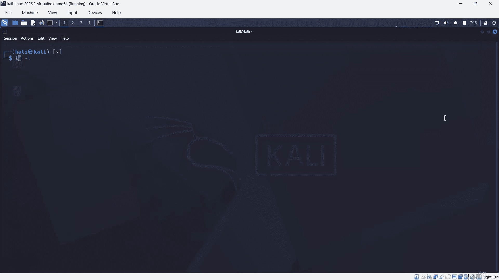
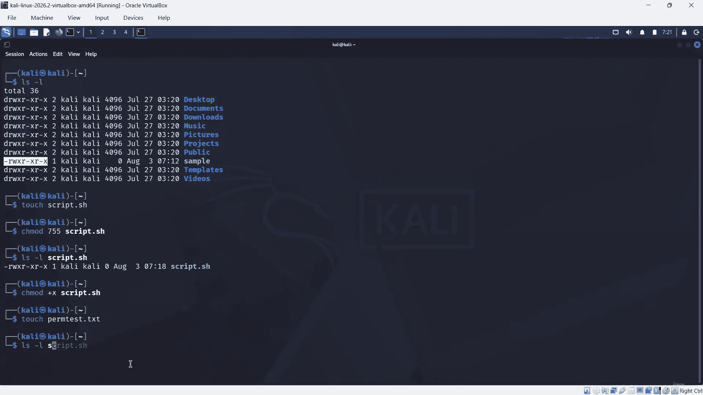
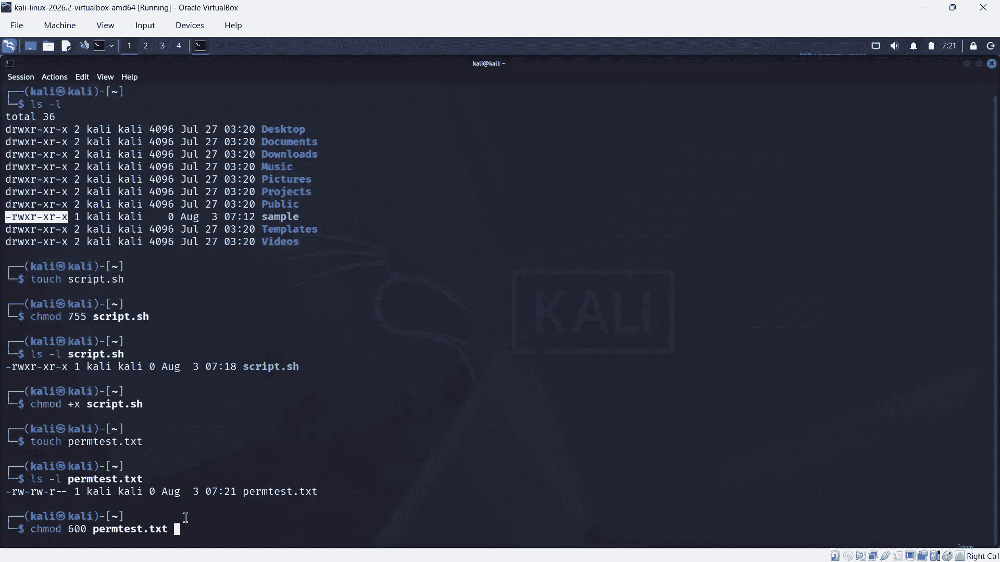
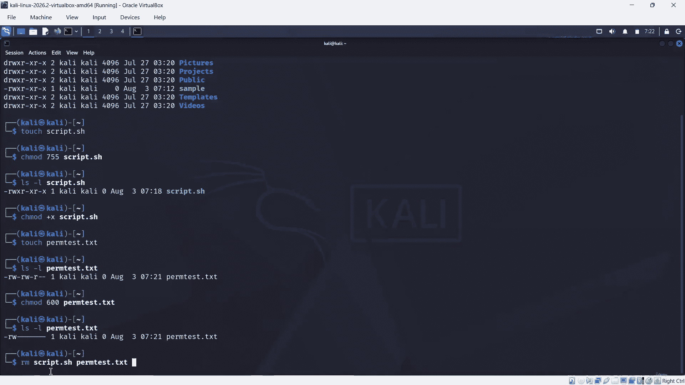
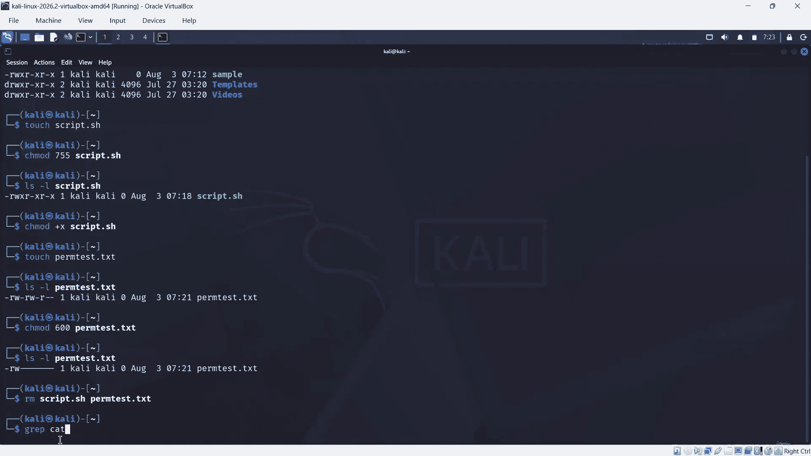

# 🔒 Udemy - Kali Linux 道德黑客与渗透测试：20：文件权限与 chmod


在本节课中，我们将一起学习 Linux 系统中文件权限的基础知识，重点掌握如何使用 chmod 命令修改权限，以及 ls -l 命令如何查看权限字符串。我们会从权限字符串的每一位含义说起，再讲解数字权限的计算方式，最后通过实际操作演示如何给文件赋予或限制权限，并简要介绍文件所有者变更命令 chown。无论你是完全没有 Linux 基础的初学者，还是刚开始接触渗透测试的学习者，都可以跟着本节课的步骤，一步步理解文件权限是如何工作的。


## 1. 查看文件权限字符串




在 Linux 操作系统中，每个文件都有自己的访问权限设置，这些设置决定了哪些用户可以读取文件，哪些用户可以修改文件，以及哪些用户可以运行文件。想要查看这些权限信息，最直接的方法就是使用带长格式参数的列表命令。


以下是查看权限的命令：
```
ls -l
```


当你在终端中运行这个命令时，每一行输出的最左侧都会显示一段权限字符串。我们需要放慢速度，专门观察这部分内容，因为它包含了文件最核心的访问控制信息，也是后续所有权限修改操作的基础。


## 2. 权限字符串的拆解


了解了如何查看权限字符串之后，接下来我们需要把这个字符串拆开来看，弄清楚每一部分分别代表什么，这样才能在修改权限时不出错。


一段典型的权限字符串看起来像这样：
`drwxr-xr-x`


为了让初学者更容易理解，我们把它拆解成四个不同的部分来看。


第一个字符表示文件类型。


以下是文件类型字符的含义：
- 短横线 `-` 表示普通文件。
- 字母 `d` 表示目录（directory）。


在首字符之后，接下来的内容分成三组，每组正好三个字符。这三组分别代表所有者权限、所在组权限和其他所有人权限，顺序固定不变。


在这三个字符的每一组当中：
- `r` 代表读取权限（read）。
- `w` 代表写入权限（write）。
- `x` 代表执行权限（execute）。
- 短横线 `-` 表示该特定权限不存在。


## 3. 创建测试文件


在掌握了权限字符串的含义以后，我们需要一个实际的文件来进行操作，否则所有的讲解都只停留在理论层面，很难让你产生直观的认识。


为了有具体的对象来操作，我们先创建一个测试文件。这里我们创建一个脚本文件，方便后面修改它的权限，也方便你亲眼看到权限变化的效果。


以下是创建命令：
```bash
touch script.sh
```


执行这条命令后，当前目录下就会出现一个名为 `script.sh` 的空文件。接下来我们就可以针对这个文件来修改权限了。


## 4. 使用数字修改权限：chmod 755


有了测试文件之后，下一步就是尝试修改它的权限，看看 chmod 命令到底是怎么工作的，以及数字 755 是如何得来的。


现在我们要为自己修改这个文件的权限。使用 chmod 命令，输入数字 755 和文件名。


以下是完整命令：
```bash
chmod 755 script.sh
```


这个 755 并不是一个需要死记硬背的魔法咒语，它背后有明确的计算逻辑。每个单独的权限都有对应的数值，计算公式如下：


```
权限数值 = r(4) + w(2) + x(1)
```


我们把这些数值加起来，针对三个类别分别计算，具体如下：
- 第一个数字 7 是给所有者的，计算方式是 4 加 2 加 1，表示拥有完整的读取、写入和执行权限。
- 第二个数字 5 是给所在组的，计算方式是 4 加 1，表示读取和执行权限，但没有写入权限。
- 第三个数字 5 也是给其他所有人的，使用完全相同的读取和执行组合。


## 5. 检查修改结果


修改完权限之后，自然需要检查一下修改是否生效，确保我们输入的数字确实产生了预期的结果，而不是盲目地相信命令执行成功了。


以下是检查命令：
```bash
ls -l script.sh
```


此时输出的权限字符串应该精确反映出我们刚才计算出来的 755 组合。通过这一步，你可以直观地看到数字权限和字符权限之间的对应关系，也能验证自己是否正确理解了权限计算方法。


## 6. 符号法快速调整权限


数字法虽然通用，但有时候我们只想快速加上或去掉某一项权限，这时候符号法就显得更加方便了，不需要每次都从头重新计算完整的数值。


除了数字法，还有一种更简单的符号替代方式，适合快速进行常见的权限调整。例如，你只想添加执行权限，而不需要从头重新计算完整的数值。


以下是示例命令：
```bash
chmod +x script.sh
```


这条命令的作用就是给文件添加执行权限，而不会改变其他已经存在的权限位。对于初学者来说，这种方式在日常调整中更加直观，也不容易出错。


## 7. 修改文件所有者：chown


掌握了权限修改之后，还有一个与之密切相关的操作，就是变更文件的所有者，因为有时候问题不在于权限位，而在于文件到底属于谁。


除了修改权限位，有时候我们还需要改变文件的实际所有者，而不仅仅是它的访问权限。这里简要提及一下相关命令，以便你在后续课程中有所印象。


以下是命令格式：
```bash
chown 用户:组 文件名
```


这个命令用于修改文件的所属用户和所属组。在本课程的后续内容中，特别是当我们开始讨论特权边界和特权提升时，我们会更深入地使用这个命令。




## 8. 实战演示：限制文件权限


光讲理论和简单例子还不够，我们需要一个更贴近实际场景的演示，才能真正理解权限设置的意义，尤其是在处理敏感文件时。


为了让这些概念更加扎实，我们来做一个最终的实际演示。首先创建一个新的测试文件。




以下是创建命令：
```bash
touch perm.txt
```


然后使用长格式列表命令查看它的默认权限：
```bash
ls -l perm.txt
```


接下来，我们故意把这个文件设置得非常严格，让只有所有者本人可以读取或写入，其他人一概不能访问。


以下是限制权限的命令：
```bash
chmod 600 perm.txt
```


再次检查结果时，你会发现权限字符串已经变成了反映这个更严格设置的样子。这个 600 权限在后续课程中还会专门提到，比如在处理 SSH 私钥文件时。SSH 作为一个内置的安全防护措施，如果私钥文件的权限过于宽松，会直接拒绝使用该私钥文件。


## 9. 清理测试文件


实验做完之后，测试文件就没有保留的必要了，建议把它们删掉，保持目录整洁，避免在后续练习中产生混淆。


以下是清理命令：
```bash
rm script.sh perm.txt
```




执行完这个命令后，测试文件就会被删除，环境恢复整洁，方便我们进入下一部分内容。


## 10. 本节总结


在本节课中，我们一起学习了 Linux 文件权限的基础知识，掌握了如何使用 `ls -l` 查看权限字符串，理解了 `rwx` 各字符的含义，学会了用数字法（如 755、600）和符号法（如 `+x`）通过 `chmod` 修改权限，还简要了解了 `chown` 修改文件所有者的方法。这些内容是后续学习渗透测试和系统安全的重要基础，建议你在课后多动手练习，加深印象。




下一节课，我们将进入一组在整个课程中会反复使用的文本处理工具，包括 grep、dd 以及管道操作符。


