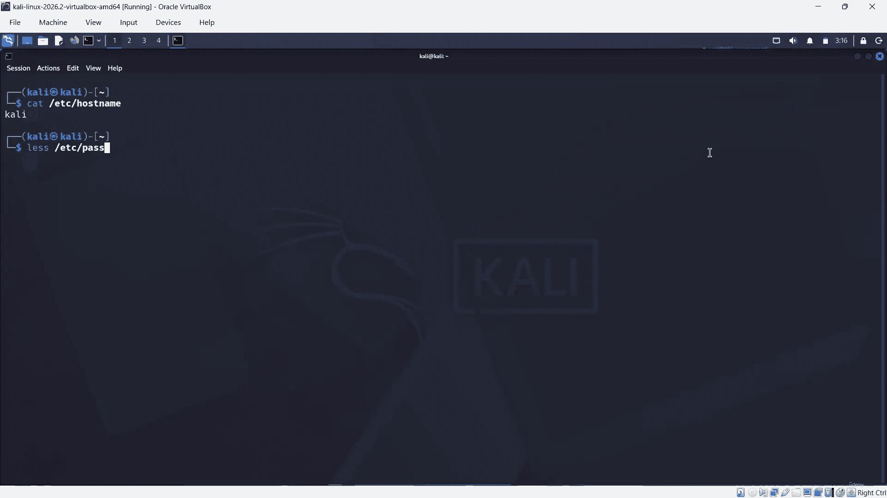
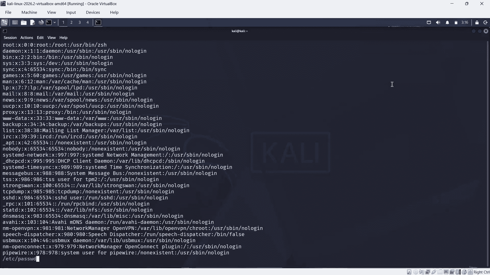
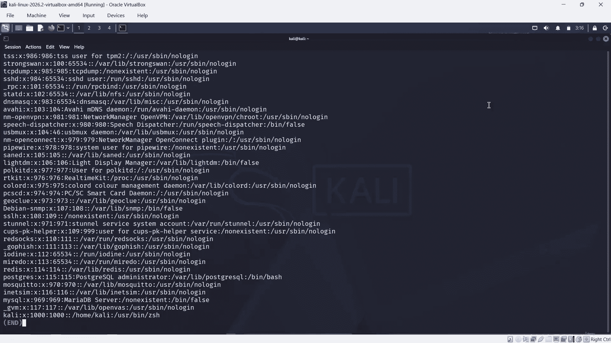
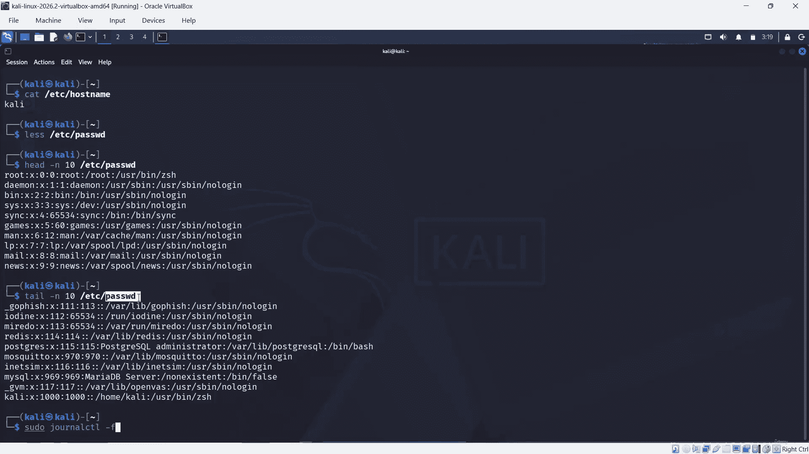
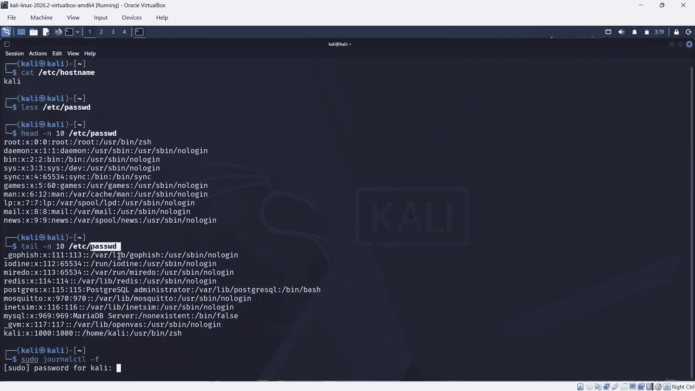
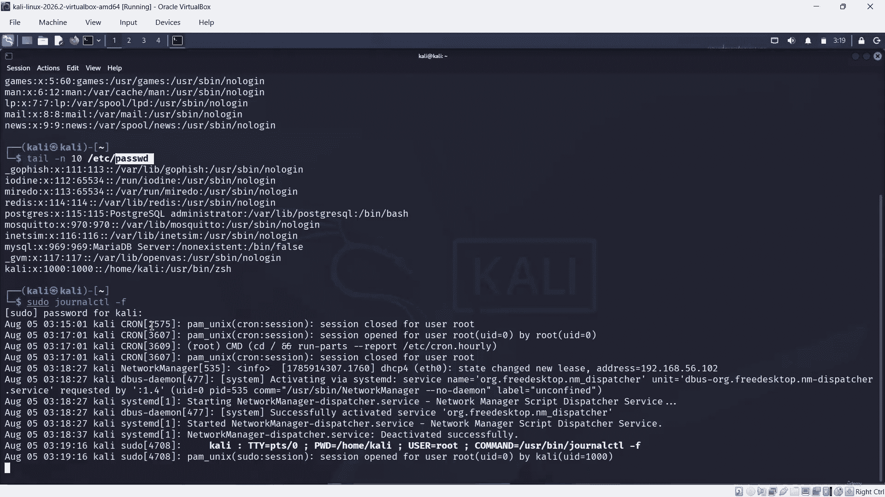
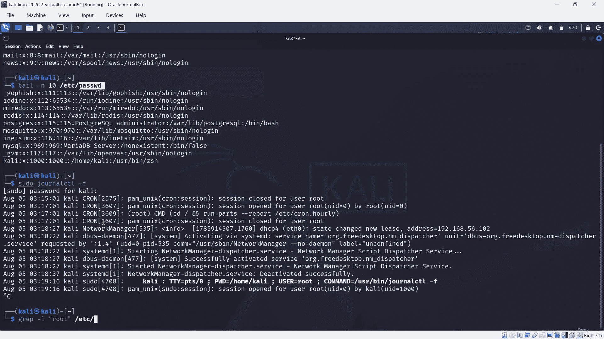
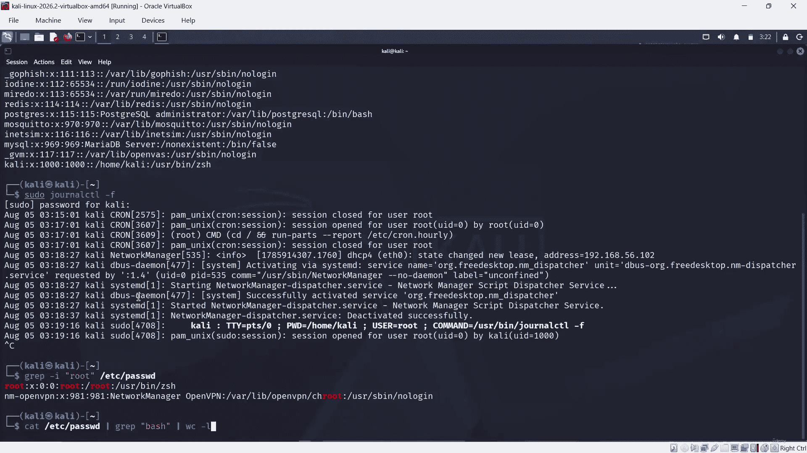
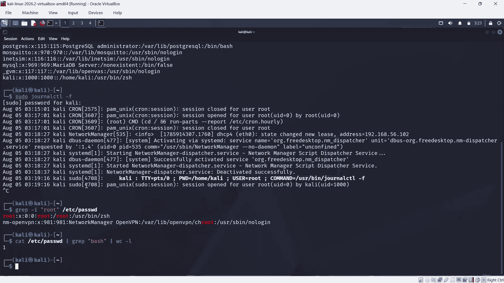

# Kali Linux 道德黑客与渗透测试：21：文本处理 cat、grep 与管道 📝

在本节课中，我们将要学习 Kali Linux 里最基础也最常用的一组文本处理工具。这组工具包括 cat、less、head、tail、grep 以及管道符号，在整个课程的后续部分里，你几乎在每一节课中都会反复使用它们。掌握这些命令之后，你就能快速查看系统文件、筛选日志信息，并把多个命令组合在一起完成更复杂的任务。

## cat 命令：直接输出整个文件内容 📄

cat 命令的作用非常直接，它的全称就是 concatenate，简单来说就是把文件里的全部内容原封不动地倒出来，显示在终端屏幕上。在渗透测试过程中，我们经常需要查看某个配置文件或者系统文件里写了什么，这时候 cat 就是最快速的方法。

以下是一个常见的使用示例：

```bash
cat /etc/hostname
```

这条命令会读取 /etc/hostname 这个系统文件，并把里面的主机名直接打印到屏幕上。如果文件本身比较短，cat 命令工作得很好，你看到的就是完整的文件内容，不会有任何问题。



但是，当文件比较长的时候，情况就不一样了。cat 会尝试一次性把所有内容全部刷到屏幕上，信息量太大，屏幕会被瞬间淹没，你根本看不清哪部分才是你需要的。这时候，我们需要换一个更合适的工具来浏览长文件。

## less 命令：分页浏览长文件 🔍





less 命令专门用来查看比较长的文本文件。它和 cat 的最大区别在于，less 不会把所有内容一次性全部扔到屏幕上，而是允许你一页一页地滚动阅读，这样就不会被海量信息淹没。

以下是使用 less 查看系统密码文件的示例：

```bash
less /etc/passwd
```

执行这条命令后，你会进入 less 的交互界面。你可以按空格键向下翻页，按 b 键向上翻页，也可以使用方向键逐行移动。当你想要退出这个界面，回到正常的命令行提示符时，直接按 q 键即可退出。

这种分页查看的方式，比直接把所有内容都 dump 到屏幕上要友好得多，尤其是在处理系统日志或者配置文件时非常实用。

## head 命令：查看文件开头几行 🔝

接下来我们来看 head 命令。head 命令的作用是只显示文件的前几行，也就是文件的头部部分。在实际操作中，我们通常会搭配 -n 参数来指定想要查看的行数。

以下是查看前 10 行的命令示例：

```bash
head -n 10 /etc/passwd
```

这条命令会从 /etc/passwd 文件的开头开始，显示前 10 行内容。head 的英文意思是头部，-n 后面跟的数字表示你希望显示多少行，这里我们设置为 10，所以结果就是文件的前 10 行。

如果你只想快速了解一个文件的格式或者看看它的前几条记录是什么，head 命令就是最合适的选择。

## tail 命令：查看文件结尾几行 🔚

tail 命令和 head 正好相反，它用来查看文件的最后几行，也就是文件的尾部部分。同样的，我们也可以使用 -n 参数来指定行数。

以下是查看最后 10 行的命令示例：

```bash
tail -n 10 /etc/passwd
```

这条命令会显示 /etc/passwd 文件的最后 10 行内容。tail 的英文意思是尾部，-n 10 表示我们要查看文件末尾的 10 行。在渗透测试中，查看文件结尾往往能帮你快速发现最近添加的用户账户或者最新的配置修改。

tail 还有一个特别强大的用法，就是搭配 -f 参数，用于实时跟踪文件的变化。



以下是使用 tail -f 监控日志文件的示例：



```bash
tail -f /var/log/syslog
```

不过在现代的 Kali Linux 系统中，情况稍微有一点变化。像大多数当前的 Debian 系统一样，现代 Kali 默认不再提供传统的 /var/log/syslog 文件了。系统日志现在由一个名为 systemd journal 的服务来处理。



因此，我们不再使用 tail 命令来查看日志，而是改用专门针对 systemd 日志设计的工具 journalctl。

以下是使用 journalctl 实时跟踪系统日志的命令：

```bash
sudo journalctl -f
```

这里的 -f 参数和 tail -f 的意思是一样的，表示跟踪或者实时跟踪。执行这条命令后，程序会一直运行在前台，每当系统产生新的日志条目，就会立即把新内容打印到屏幕上，你不需要反复执行命令就能看到最新的日志。



这就是实时观察系统活动的方法。比如，当正在进行一次攻击，或者某个服务正在启动时，你可以用它来查看实时的日志输出，了解系统到底在做什么。

需要注意的是，journalctl 命令不会自动停止，它会一直占据终端。如果你想退出，必须按下 Ctrl + C 组合键来中断当前运行的命令。

## grep 命令：在文件中搜索特定内容 🔍

现在我们来学习 grep 命令。grep 是整个课程中最有用的命令之一，它的核心功能是在文件里查找符合特定模式的文本内容。在渗透测试的后续章节里，你会不断地用它来从大量数据中筛选出你真正关心的信息。

以下是一个在密码文件中搜索 root 用户的示例：

```bash
grep -i root /etc/passwd
```

这条命令会在 /etc/passwd 文件中查找包含单词 root 的行。这里我们使用了 -i 参数，它的作用是让搜索不区分大小写。也就是说，不管文件里写的是 Root、ROOT 还是 root，都会被匹配到。之所以使用 -i，是因为这样可以一次性找到所有相关的变体，不会因为大小写不同而漏掉任何一条记录。

grep 的核心价值在于，它能帮你在海量的输出中迅速锁定你真正关心的那一部分内容。在接下来的课程中，你会不断用它来处理扫描结果、日志文件和各种系统输出。

## 管道符：将多个命令连接在一起 🔗

最后，我们来学习如何把多个命令组合在一起使用。这里的核心概念就是管道符，在 Linux 终端里用竖线符号 | 表示。管道符的作用是把前一个命令的输出，直接作为后一个命令的输入，这样你就可以把简单的小工具串联起来，完成比单一命令更强大的功能。

以下是一个组合命令的完整示例：

```bash
cat /etc/passwd | grep "bash" | wc -l
```

为了让你彻底理解，我们把这条命令从左到右拆开，一步步来看。

第一阶段，cat 命令把整个 /etc/passwd 文件的内容读取出来。

第二阶段，第一个管道符 | 把 cat 的输出直接传递给下一个命令 grep，而不是显示在终端屏幕上。grep 会对这些内容进行过滤，只保留包含单词 bash 的行。这里的 bash 指的是 Bash Shell，过滤出来的结果就是所有配置了 Bash Shell 的用户账户。



第三阶段，第二个管道符 | 把 grep 过滤后的结果传递给 wc -l 命令。wc -l 的作用是统计行数，最终会给出当前系统中启用 Bash Shell 的账户总数。

管道符的核心连接关系可以用下面这个简单的公式来描述：

```text
命令 A 的输出 ─────┤
                   ├─► 管道符 |
命令 B 的输入 ─────┘
```

## 管道符背后的核心思想 💡

你需要深刻理解管道符背后的概念，因为它是 Linux 设计哲学中最强大的思想之一。每个独立命令的输出，都会变成下一个命令的输入。这样你就可以把一个个简单、小巧的工具连接在一起，组合成比任何单一命令都强大得多的处理流程。

以后在课程中构建各种侦察脚本时，我们都会依赖这个思想。也就是说，不需要写一个巨大的复杂程序，而是把多个小命令通过管道符串联起来，就能实现复杂的数据处理。

在下一节课中，我们将学习用户、进程和服务，具体来说，就是如何查看 Linux 机器在任意时刻实际运行了哪些内容。

## 本节总结 📚



本节课中，我们一起学习了文本处理的基础命令。cat 用于直接输出整个文件内容，less 用于分页查看长文件，head 用于查看文件开头的若干行，tail 用于查看文件结尾的若干行以及实时跟踪日志，grep 用于在文件中搜索特定模式，而管道符 | 则让我们能够把多个命令串联起来，形成更强大的处理流程。掌握这些工具后，你将能够更高效地在 Kali Linux 系统中查找和分析信息。
