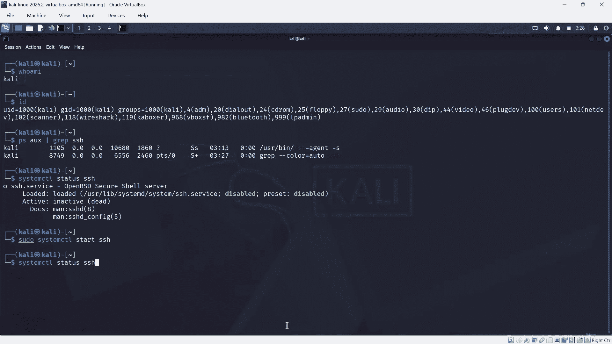
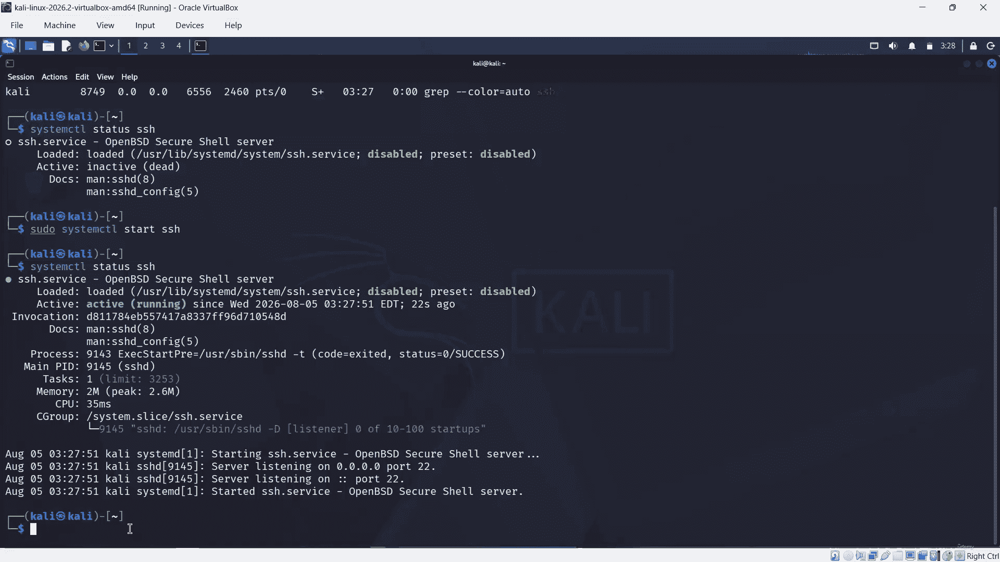

# 🖥️ Ethical Hacking & Penetration Testing with Kali Linux：22：用户、进程与服务

在本节课中，我们将一起学习如何在运行中的 Linux 机器上查看当前用户是谁、哪些进程正在运行，以及系统服务的运行状态。这些是渗透测试中最基础的技能，因为你需要知道自己以什么身份操作，才能判断能不能执行某些命令。我们会先从查看当前用户开始，然后逐步过渡到进程和服务的检查，最后把这些命令串起来形成一个简单的检查流程。

## 👤 查看当前用户身份

上一节我们介绍了 Wireshark 抓包的基础知识，本节中我们先来看看如何确认自己在 Linux 系统中的当前身份。这是所有操作的前提，因为不同的用户拥有不同的权限，如果你不知道自己是谁，可能会在尝试执行敏感命令时遇到权限不足的问题。

以下是查看当前用户的常用命令：

- `whoami`
- `id`

先运行 `whoami`，这个命令会直接显示你当前的用户名，非常简洁。如果你想了解更多细节，可以运行 `id`，它会显示你的用户 ID、主组 ID，以及你所属的所有附加组。相比于 `whoami`，`id` 命令提供的信息更加完整，能让你清楚知道自己的账号在系统中的具体身份和组成员身份。

## 🔗 用户组与权限的实际应用

在介绍完查看用户身份的命令后，我们来看看这些知识在实际渗透测试场景中如何派上用场。回想一下我们之前在 Wireshark 模块中讨论的内容，抓取网络数据包通常需要特定的权限，而普通用户默认是不能直接抓包的。

这时候 `id` 命令就非常有用了，你可以通过它确认自己的用户账号是否属于某个特定的组，例如 Wireshark 组。如果你的账号已经加入了这个组，就可以在不使用 `sudo` 的情况下捕获数据包，这大大简化了抓包操作。用户、组和权限之间的关系就像是一把钥匙，决定了你能打开哪些系统门。

## 📋 查看系统中运行的进程

确认了用户身份之后，接下来我们需要了解系统当前运行着哪些进程。进程就是正在执行的程序实例，查看进程可以帮助我们发现后台运行的服务、可疑程序或者可能被利用的入口点。

以下是查看进程的命令组合及其参数含义：

```bash
ps aux | grep ssh
```

- `ps aux` 中的 `a` 参数表示显示系统上所有用户的进程，而不仅仅是当前用户自己的进程。
- `u` 参数提供更易读的输出格式，让我们能一眼看出进程所属的用户、CPU 和内存占用情况。
- `x` 参数会额外包括那些没有连接控制终端的进程，比如后台运行的系统服务。
- `| grep ssh` 使用管道符将上一条命令的全部输出传递给 `grep`，只保留包含 "ssh" 字样的行，从而快速定位与 SSH 相关的进程。

这个管道技巧就是我们在上一节课刚刚学过的内容，这里再次应用来加深印象。

## 🛠️ 检查和管理系统服务

查看进程可以知道程序是否在运行，但有时候我们需要更直接地检查某个系统服务的状态，比如 SSH 服务。系统服务是在后台持续运行的程序，负责处理网络连接、日志记录等任务。

以下是检查 SSH 服务状态的命令：

```bash
systemctl status ssh
```

这条命令会告诉你 SSH 服务当前是否处于 active 状态，也就是是否正在运行。如果服务没有运行，你可以使用下面的命令启动它：

```bash
sudo systemctl start ssh
```

在本课程的后续内容中，我们需要保持 SSH 服务运行，既是为了合法的远程访问目的，也是为了后续进行直接攻击练习时的环境准备。因此请务必确认 SSH 服务目前处于运行状态，这样后面的实验才能顺利进行。

## 🧰 本节核心工具包回顾



经过上面的介绍，我们掌握了一组用于检查用户和进程的核心工具。以下是本节涉及的关键命令总结：

- `whoami`：查看当前用户名
- `id`：查看用户 ID 和所属组信息
- `ps aux | grep ssh`：查看所有用户进程并筛选 SSH 相关进程
- `systemctl status ssh`：检查 SSH 服务运行状态

这些命令构成了我们在 Linux 系统上进行基础侦察的工具包，下一节课我们将把本模块学到的所有内容整合在一起，编写第一个简单的 Bash 脚本来实现自动化。

## 📚 本节总结



本节课中我们一起学习了如何在 Kali Linux 上检查用户身份、运行中的进程以及系统服务状态。我们掌握了 `whoami`、`id`、`ps aux` 管道 `grep` 和 `systemctl` 等命令的使用方法，并理解了用户组权限在实际抓包和远程访问场景中的作用。这些基础知识为接下来的自动化脚本编写打下了坚实的基础。
