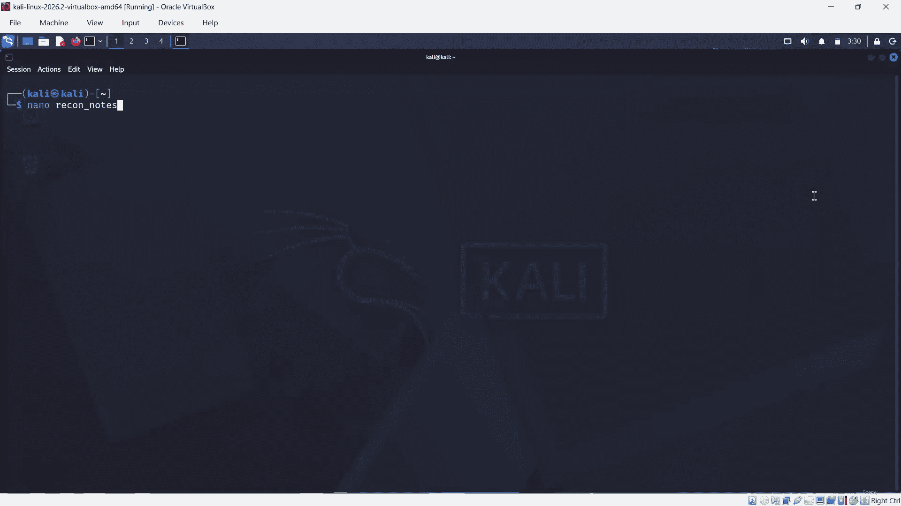
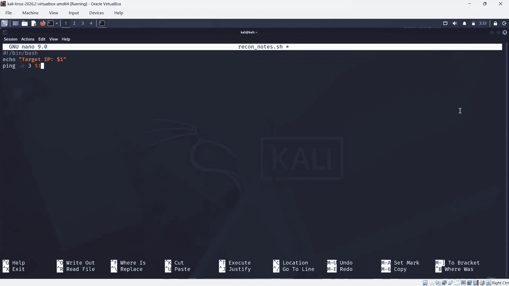
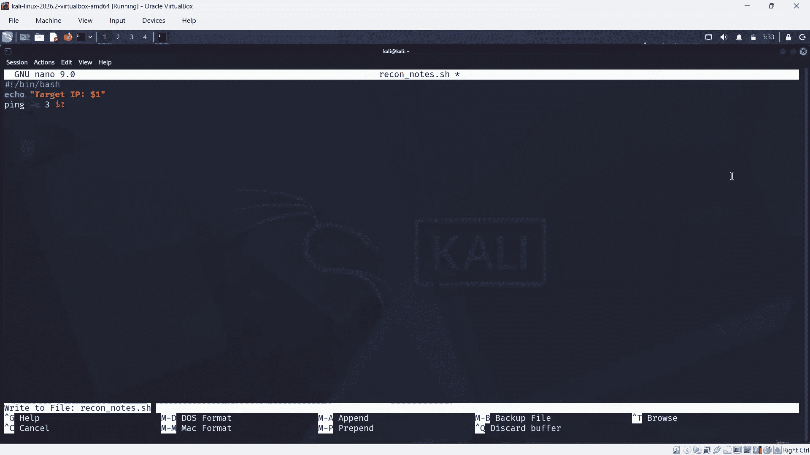
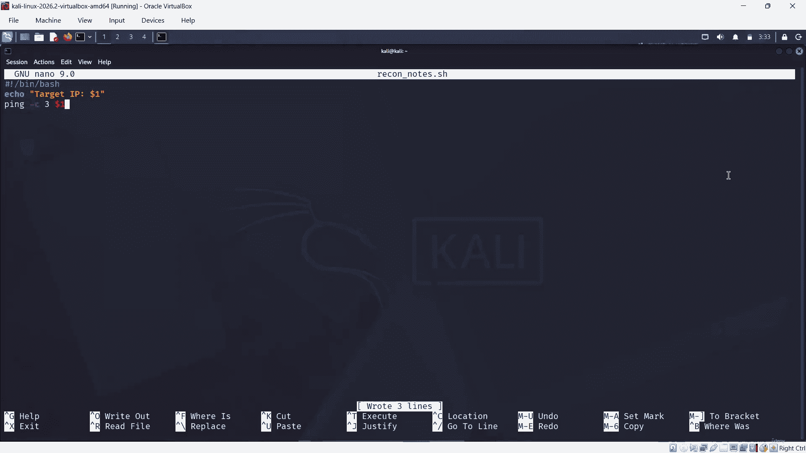
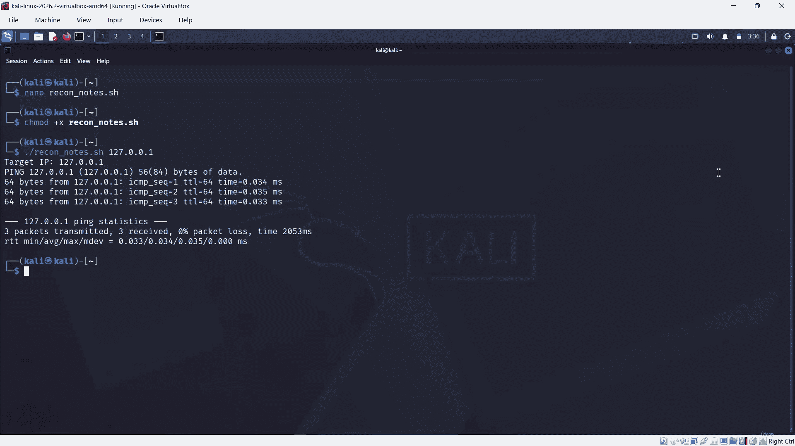

# Kali Linux 道德黑客与渗透测试：23：编写你的第一个 Bash 脚本 🖥️

在本节课中我们将要学习如何编写第一个真正可用的 Bash 自动化脚本。我们会把整个模块里学过的 Linux 基础知识全部串联起来，亲手创建一个简单的脚本文件，了解每一行代码的含义，最后运行它并查看输出结果。这不仅是脚本编程的入门，也是未来渗透测试自动化工作的基础。


## 创建脚本文件



在开始写代码之前，我们需要先准备一个地方来保存脚本，以下是具体的操作步骤。

我们将使用 nano 文本编辑器来创建一个全新的文件。nano 是一个在终端里直接运行的简单编辑器，不需要图形界面，非常适合快速编写脚本。在命令行中输入 nano 后跟上文件名，就可以打开或者新建一个文件。这里我们把文件命名为 recon_notes.sh，其中 .sh 是 shell 脚本的常见后缀名。

执行下面的命令即可打开编辑器：

```bash
nano recon_notes.sh
```

执行这条命令后，终端会切换到 nano 编辑器界面，此时就可以开始输入脚本内容了。


## 脚本内容逐行解释

上一节我们创建好了空文件，本节中我们来看看文件里到底要写些什么，以及每一行的作用。

在编辑器中输入以下内容：

```bash
#!/bin/bash
echo "Target: $1"
ping -c 3 $1
```

第一行 `#!/bin/bash` 被称为 shebang（井号加感叹号开头的行）。它的作用是告诉操作系统，运行这个文件时应该使用哪个解释器。在这里 `/bin/bash` 表示要用 bash shell 本身来执行脚本里的命令。

第二行 `echo "Target: $1"` 使用 echo 命令在屏幕上打印文本。其中 `$1` 是一个特殊符号，代表脚本运行时传入的第一个参数。也就是说，如果你在运行脚本时提供一个 IP 地址，那么这个 IP 地址就会被填入 `$1` 的位置，显示在屏幕上。

第三行 `ping -c 3 $1` 运行 ping 命令，并且使用 `-c 3` 参数。这个参数的意思是只发送 3 个数据包，而不是一直 ping 下去不停止。同样，$1 会被替换成你传入的目标 IP 地址，这样脚本就会对指定的目标发送三次探测。




## 保存并退出编辑器





脚本内容已经输入完毕，下面我们要把文件保存下来并退出 nano 编辑器。

保存文件的步骤如下：

- 按下 Control O，将编辑器里的内容写入硬盘。
- 按下 Enter 确认文件名。
- 按下 Control X 退出编辑器，回到终端命令行界面。

完成这些操作之后，你的脚本文件就已经安全地保存在磁盘上了。


## 赋予执行权限

文件已经保存，但此时它还不能直接运行，本节中我们来看看如何给脚本添加执行权限。

在 Linux 系统中，新建的文件默认通常没有执行权限。我们需要使用 chmod 命令来修改权限，具体做法是在 chmod 后面加上 `+x`，再跟上文件名。这表示给文件添加可执行属性。

运行下面的命令：

```bash
chmod +x recon_notes.sh
```

完成这一步之后，脚本就变成了一个可以直接运行的程序文件。


## 运行脚本并查看输出

权限设置好了，下面我们来实际运行这个脚本，看看它是否按预期工作。

因为后续模块里的 Metasploitable2 靶机还没有搭建好，这里我们先用自己 Kali 机器的回环地址来测试。回环地址永远是 127.0.0.1，代表本机本身。运行脚本时，需要在文件名前面加上 `./`，然后传入目标 IP 作为参数。

执行下面的命令：

```bash
./recon_notes.sh 127.0.0.1
```

运行之后，你会看到屏幕上首先打印出 echo 输出的目标 IP，这说明 `$1` 参数替换是正常的。紧接着会显示三条 ping 回复，数据来自于你自己的机器，也就是在和自己通信。


## 为什么这个简单的脚本很重要

看到输出结果之后，你可能会觉得这个脚本太简单了，但下面我们来聊聊它背后的意义。

尽管这个脚本看起来很基础，但它体现的模式——接收参数、针对参数运行命令、把有用的结果打印出来——实际上是每一名专业渗透测试人员职业生涯中编写的几乎所有自动化脚本的基础。后续课程中我们会在这个骨架的基础上继续扩展，特别是在 AI 辅助渗透测试模块里，我们会利用 AI 助手生成更复杂的版本。在最终的毕业项目中，我们也会基于同样的结构，构建一个真正有用且可复用的侦察工具。


## 总结



本节课中我们一起学习了如何创建第一个 Bash 脚本，包括使用 nano 编辑器新建文件、编写 shebang 声明与 echo 和 ping 命令、使用 chmod 赋予执行权限、以及通过回环地址运行脚本并验证输出。你现在已经能够熟练操作终端、在文件系统中导航、管理权限、处理文本、查看进程，甚至编写基本的自动化脚本来开展真实的侦察工作。下一模块我们将继续深入，敬请期待。

