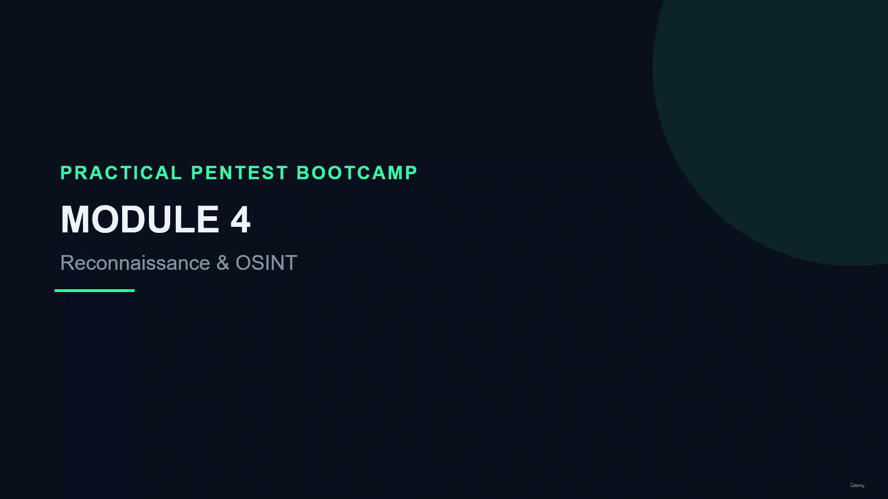
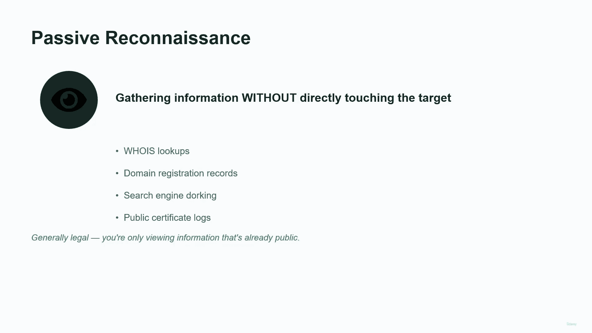
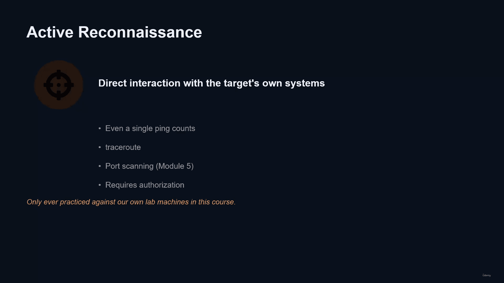
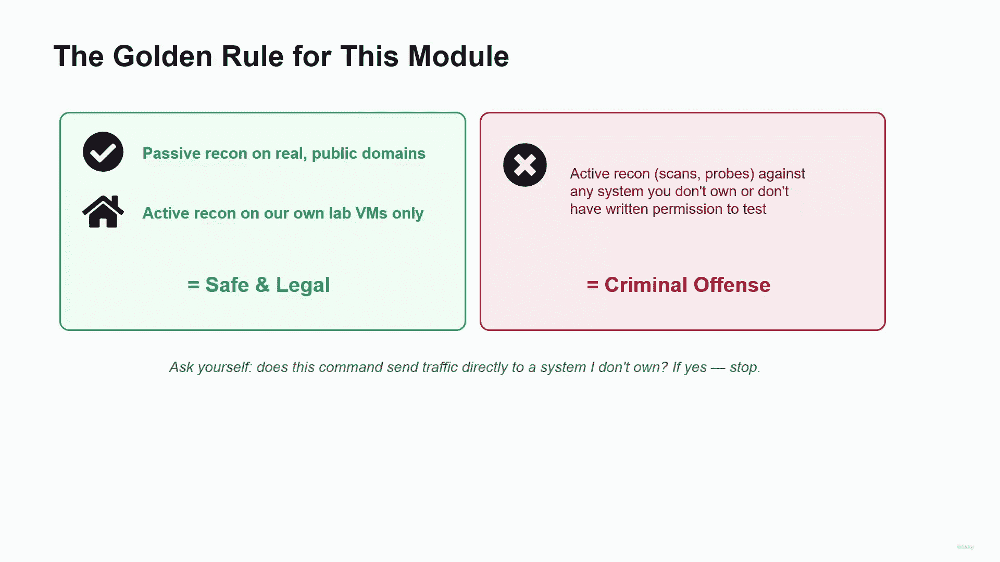
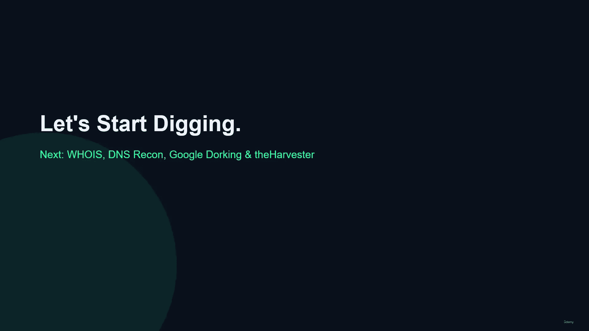

# 道德黑客与渗透测试：第24章：被动与主动侦察及法律红线 🛡️


在本节课中，我们将学习渗透测试过程中最关键的第一步，也就是侦察阶段。具体来说，我们会重点讨论被动侦察和主动侦察之间的区别，并明确在实际操作中哪些行为是合法的，哪些行为会越过法律红线。我们会用大白话把这些概念讲清楚，让初学者也能快速上手，不会因为概念模糊而误踩红线。


接下来，我们先来看看为什么侦察阶段如此关键。

侦察是每一次真实攻击的起点，在你接触目标机器上的任何端口之前，都需要完成这一步。你首先要收集关于该目标的所有公开可用信息。换句话说，在正式动手之前，你要尽可能多地了解目标的基本情况，而不是盲目尝试。



如果你跳过这个阶段，那么在后续的过程中，你实际上就是在瞎猜。这会导致两个严重后果。第一，你会浪费时间去攻击那些并不重要的目标。第二，你会漏掉那些真正重要、可以入手的信息。也就是说，没有侦察的攻击就像是闭着眼睛乱扔飞镖，既低效又容易失望。

以下是跳过侦察阶段会带来的主要后果：
- 浪费时间攻击无关紧要的系统
- 漏掉真正有价值的攻击面
- 整个渗透测试过程变得盲目且低效


刚才我们介绍了侦察的重要性，接下来我们要明确两种主要的侦察类别。

从技术和法律角度来看，侦察可以分为被动侦察和主动侦察两类。区分这两类非常重要，因为它们在操作方式和法律风险上有本质不同，搞混了很容易惹上不必要的麻烦。



被动侦察是指在不直接接触目标的前提下收集目标信息。也就是说，你并不向目标系统发送任何数据包，而是只利用已经公开在互联网上的资料。

以下是被动侦察常见的信息来源：
- 查询公开记录
- 浏览公司的官方网站
- 检查域名注册信息
- 使用特定技巧在搜索引擎中搜索

被动侦察的核心公式可以表示为：
`被动侦察 = 收集公开可用信息 + 不向目标系统发送任何数据包`



简单来说，你在做的事情，和任何一个普通上网用户查找公开信息没有区别。这些信息就摆在那儿，任何人都能找到，你只是把它们整理起来用于分析。

相比之下，主动侦察意味着与目标系统进行直接交互。即使是看似无害的一次 ping，也属于主动侦察。因为你直接向目标发送流量，并观察它如何响应。

主动侦察的核心公式可以表示为：
`主动侦察 = 直接向目标系统发送流量 + 观察系统响应`

我们将在下一个模块中正式学习主动技术，该模块将重点介绍扫描和枚举等内容。在那之前，你只需要记住，主动侦察比被动侦察更“显眼”，也更容易被目标发现，因此风险更高。


了解了被动和主动的区别后，最重要的问题是：在实际操作中，你到底可以碰什么，绝对不能碰什么。

这里有一条黄金法则，我希望你彻底记住。在进入本模块的任何实践操作之前，请务必明确：主动侦察只针对我们自己的实验室虚拟机，也就是你在第1模块中自己搭建的那些虚拟机。

被动侦察技术，当应用于真实存在的域名的公开可用信息时，通常是合法的。这是因为你只是查看已经公开的信息，并没有发起任何攻击，也没有给目标系统造成压力。

但是请不要越过这条线。不要针对你不拥有、也没有明确书面授权进行测试的真实公司、真实网站或真实基础设施运行主动扫描工具。还记得我们在 lecture 1.2 中讲过的基本规则吗？那些规则在这里依然适用，必须严格遵守。



在本模块中，当我们练习 whois 查询和 Google dorking 等被动技术时，我们只会查看知名公共域名的真实公开信息，纯粹用于演示目的。当我们学到本模块末尾的主动技术演示（如 ping 和 traceroute）时，我们会专门且仅将其指向我们自己的实验室 Metasploitable 机器，绝不针对任何其他目标。

以下是实践中必须遵守的硬性规定：
- 主动扫描只能针对自己搭建的实验室虚拟机
- 被动查询可以针对真实域名的公开信息
- 未经书面授权，禁止对真实公司或基础设施进行主动扫描
- 所有演示仅限教学目的，不得用于实际攻击


有了这些法律边界之后，你还需要一个简单的方法，在每次操作前快速判断自己是否越界。

我也想给你一个超越本模块、可用于日后实践的自我检查方法。在针对任何目标运行任何命令之前，请问自己一个问题：这个命令是否直接向我不拥有、也没有书面测试授权的系统发送流量？

你可以用下面的伪代码来理解这个检查过程：
```
如果 目标不是自己所有 且 没有书面授权:
    如果 命令会直接向目标发送流量:
        停止操作
    否则:
        属于被动合法范围，可以继续
```

如果答案是肯定的，也就是你要向未授权的系统发送流量，那么请立即停止。如果答案是否定的，说明你只是在查询公共数据库、搜索引擎或域名注册表，那么你几乎可以肯定仍处于被动合法的一侧，不会触碰法律红线。


最后，还需要提醒你一点关于工具使用的实际情况，以免在实践中产生误解。

工具及其具体行为会随时间发生变化。例如，某些搜索引擎对自动化查询的拦截变得更加严厉，这意味着某些命令的输出可能不如以前丰富。不过，发生这种情况时，不会改变我们刚才讨论的法律或伦理框架。法律界限不会因为工具变了而移动。

在后续的学习过程中，如果我们遇到工具输出变少、变慢的情况，我会予以标注。请务必牢记这条界限，当我们进入实际的动手实践时，始终保持谨慎，不要因为工具变化而随意越界。


在本节课中，我们一起学习了侦察阶段的重要性，明确了被动侦察和主动侦察的定义与区别，并掌握了判断操作是否越过法律红线的黄金法则。你现在知道，被动侦察只使用公开信息，不会向目标发送流量；而主动侦察会直接与目标系统交互，即使是一次 ping 也算主动行为。在实际练习中，主动扫描只能针对自己的实验室机器，绝对不能未经授权扫描真实公司或网站。



下一节课，我们将从最古老、最简单的侦察技术之一开始，即 whois 查询。
