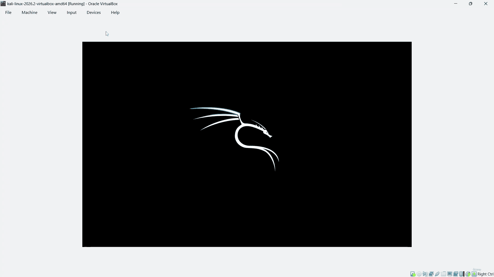
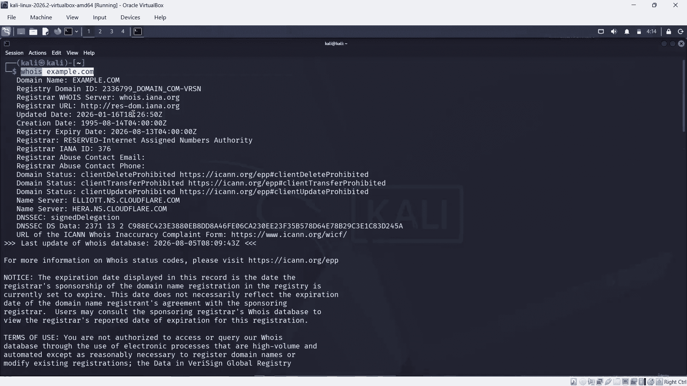

# 🌐 Udemy - Ethical Hacking & Penetration Testing with Kali Linux：25：WHOIS Lookups Explained & Demonstrated


在本节课中，我们将一起学习 WHOIS 查询的基础知识与实际操作演示。WHOIS 是道德黑客与渗透测试领域中非常经典的一款信息收集工具。虽然它已经存在很长时间，但直到今天依然非常有用。我们会先准备好虚拟机的网络环境，然后启动 Kali Linux，打开终端，输入命令查询一个域名的注册信息，最后讨论这些信息对攻击者和专业渗透测试人员意味着什么。


## 环境准备：连接虚拟机到互联网

上一节我们介绍了信息收集的理论基础，本节中我们来看看如何在实操环境中进行第一次主动侦察。在输入任何命令之前，我们需要先确保虚拟机已经连接到互联网。

以下是具体设置步骤：
- 选中虚拟机，打开设置菜单。
- 进入网络配置选项。
- 将网络模式改为桥接网络，确保虚拟机可以访问互联网。



如果不修改这些设置，继续使用仅主机适配器等模式，那么无法完成本次实践，因为 WHOIS 查询必须依赖互联网连接。


## 启动 Kali Linux 并打开终端

接下来我们启动虚拟机，进入 Kali Linux 系统。登录时使用的用户名是 galli，密码是 cu。登录成功之后，打开终端，并把字体调大，方便观察后续输出内容。


## 什么是 WHOIS 查询

好了，终端已经打开，我们来介绍 WHOIS 查询的具体含义。

WHOIS 是一种查询协议，用于查找域名的注册信息。具体来说，它可以告诉我们域名是由谁注册的，注册时间是什么时候，以及哪家公司充当域名注册商。

核心命令格式如下：
```bash
whois <域名>
```

本次演示出于法律边界考虑，我们使用 example.com 这个域名。example.com 是互联网标准组织专门保留用于示例和演示的域名，查询它是安全的，不会违反任何法律规定。


## 执行第一次 WHOIS 查询

现在我们输入命令并回车，一起查看输出结果。

```bash
whois example.com
```

在某些情况下，你可能会看到类似 "command not found" 的报错。这仅仅意味着你当前的 Kali 镜像中尚未安装 whois 软件包。

解决方法如下：
```bash
sudo apt install whois
```

安装完成后，再次运行 whois example.com 即可看到输出内容。


## 解读输出结果

如果你向上滚动终端输出，可以看到几个关键字段。首先是 registrar 字段，它告诉我们该域名是通过哪家注册公司注册的。其次是 creation date 字段，即域名的创建日期，告诉我们这个域名最初是在什么时候注册的。

此外，你还可能看到 registry expiry date（注册到期日期）、updated date（更新日期）以及 name servers（域名服务器）。域名服务器告诉我们哪些 DNS 服务器负责解析该域名的记录。这些信息在下一节关于 DNS 侦察的内容中将直接用到。


## 渗透测试视角下的价值

从攻击者或专业渗透测试人员的角度来看，进行授权后的侦察非常重要。注册信息有时可以揭示组织的实际内部联系方式、托管提供商详情，甚至组织结构，具体取决于域名注册启用了多少隐私保护。

今天许多组织使用一种叫做 WHOIS 隐私保护的服务。这项服务会将真实联系信息隐藏在代理服务背后，而不是直接显示出来。如果你亲自对几个不同的域名运行这个命令，就会发现有些域名显示详细信息，而另一些几乎什么都不显示，这完全取决于隐私保护是否开启。


## 实践建议与法律边界

现在你可以尝试针对自己的域名运行这个命令，如果你碰巧拥有一个域名的话。只需将 example.com 替换为你自己的域名，使用完全相同的命令结构即可。

```bash
whois 你的域名
```

这里我要明确提醒你，回顾我们之前的理论课，对任何公开域名进行 whois 查询完全合法，因为这些信息是设计上就公开可用的。这是一种真正安全的练习方式，你可以对任何自己好奇的域名进行练习。

但是，法律红线在哪里呢？当你从这种被动查询转向在未经授权的情况下，主动探测同一个域名的活跃基础设施时，就越过了法律边界。这就是为什么我们即将到来的主动技术，将专门针对我们自己的实验机器进行，而不是针对外部公开域名。


## 下一节预告

下一节，我们将进一步深入 DNS 侦察，使用两个更强大的工具：Dig 和 DNS Recon。




本节课中我们一起学习了 WHOIS 查询的含义、安装方法、实操命令、输出字段解读、渗透测试视角下的应用价值、隐私保护机制，以及合法练习的边界。希望你能在自己的实验环境中安全地练习这些内容。
