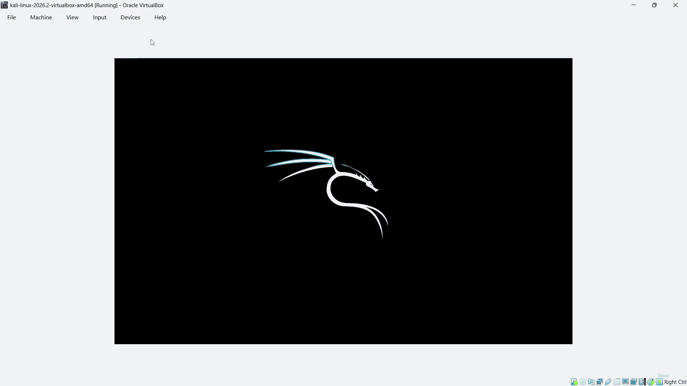
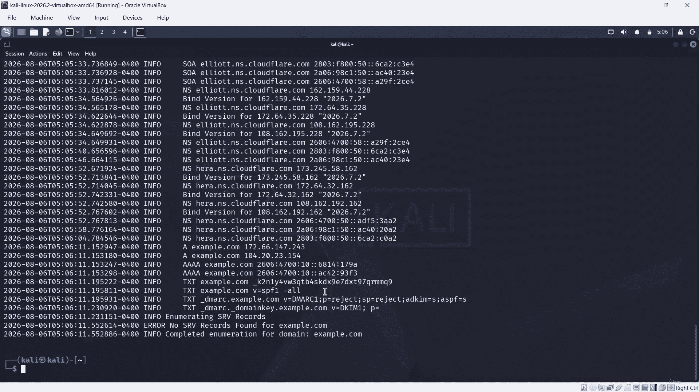

# Udemy - Ethical Hacking & Penetration Testing with Kali Linux：26：DNS Reconnaissance with dig & dnsrecon 🔍

在本节课中，我们将学习如何使用Kali Linux进行DNS侦察。课程的核心目标是让你掌握两个实用工具：dig和dnsrecon。在开始实际操作之前，我们需要先调整虚拟机的网络配置，确保Kali既能访问公共互联网，又能保持与Metasploitable靶机的连接。接着，我们会演示如何使用dig查询DNS记录，解决常见的超时问题，并学习如何查询特定的DNS记录类型。最后，我们会介绍dnsrecon这个更自动化的工具，看看它如何帮助我们发现子域名。通过本节课，你将掌握DNS侦察的基础操作，为后续的渗透测试打下基础。

---

## 一、调整Kali Linux的网络配置

上一节我们切换了网络适配器来修复上网问题，但这可能导致与Metasploitable2的连接中断。本节我们将把两个网络连接并行设置起来，这样既能上网，又能访问靶机。

如果你的Kali虚拟机当前处于运行状态，请先将其关闭。然后打开虚拟机的设置界面，找到网络选项卡。Adapter 1应该设置回宿主机仅主机适配器，也就是Host-Only Adapter，这和我们在第1模块中配置的方式完全一样，它用于保持Kali与Metasploitable之间的通信。接下来点击Adapter 2选项卡，勾选启用网络适配器，并将连接方式选择为NAT。完成这些设置后点击确定，然后启动虚拟机并等待其引导完成。

通过这样的配置，我们实际上让Kali虚拟机同时连接到真实互联网，同时也保持与Metasploitable工具的连接。

启动完成后，登录Kali，用户名是kali，密码也是kali。打开终端，我们需要验证两个网络连接是否都已经正常工作。在终端中输入以下命令：



```
ip a
```

执行后你应该能看到除了回环接口之外的两个独立网络接口。其中一个显示熟悉的192.168.56.x地址，这是宿主机仅主机网络；另一个通常显示10.0.3.x地址，这是我们新建的用于访问互联网的NAT连接。

如果你只看到了一个接口，请返回设置界面，确认两个网络适配器都已经启用。确认两个网络都正常之后，我们就可以进入今天的实际主题了。

---

## 二、使用dig进行DNS侦察

有了双网络连接之后，我们就可以开始深入学习DNS侦察了。我们将使用两个工具来获取比whois更详细的信息，第一个就是dig。

dig是一个命令行工具，用于查询域名系统的各种记录。我们先尝试最基本的用法，查询example.com的所有记录类型：

```
dig example.com any
```

运行之后，你可能会遇到通信错误，出现超时的情况。这是一个比较常见的问题，针对它我们有两种解决方法，一种是临时修复，另一种是永久修复。我们先尝试临时修复，直接指定使用Google的公共DNS服务器8.8.8.8来进行查询：

```
dig @8.8.8.8 example.com any
```

这次你应该能看到查询结果了。输出内容中包含多个DNS服务器的信息，并且分为不同的部分。其中问题部分（Question Section）会原样返回你刚才查询的内容，而答案部分（Answer Section）才是实际有用数据所在的地方。答案部分会列出当前域名关联的所有DNS记录类型，这些信息对于渗透测试的信息收集非常有价值。

如果你不想一次性查询所有记录，而只想查看某一种特定的记录类型，可以更精确地指定记录名。例如，如果你想查看该域名的邮件服务器记录，可以使用以下命令：

```
dig example.com MX
```

这样查询出来的结果只包含MX记录，能够帮助你快速定位负责处理该域名电子邮件的服务器。

---

## 三、永久修复DNS解析问题

临时指定DNS服务器可以解决超时问题，但每次查询都要输入@8.8.8.8比较麻烦。如果你希望系统始终使用可靠的DNS服务器，可以通过修改配置文件来实现永久修复。

我们需要编辑的文件是/etc/resolv.conf，使用nano编辑器并以管理员权限打开：

```
sudo nano /etc/resolv.conf
```

在文件中，你需要修改名称服务器的设置。将nameserver行改为以下内容：

```
nameserver 8.8.8.8
nameserver 1.1.1.1
```

修改完成后，在nano编辑器中使用Ctrl+X退出，系统会询问是否保存更改，按Y确认，然后按回车保存文件。如果你不想保存更改，可以使用Ctrl+O再按回车，不过通常我们是希望保存这些DNS设置的。

配置文件保存之后，建议重启网络管理器让设置立即生效：

```
sudo systemctl restart NetworkManager
```

重启完成后，我们再次运行dig命令来验证临时修复是否依然有效：

```
dig example.com any
```

你会看到输出中包含了问题部分和答案部分，和之前的讲解一致。答案部分里会包含大量细节，例如A记录、NS记录等，这些记录揭示了域名的基础网络信息。

---

## 四、查询特定DNS记录类型

在实际的渗透测试中，我们通常不会一次性查询所有记录，而是会根据目标有针对性地查询某一种记录类型。这种方式在你获得授权的真实目标上进行侦察时非常有用，比如你专门想要识别目标的邮件基础设施或名称服务器。

以下是几种常见的查询示例：

- 查询邮件服务器记录：`dig example.com MX`
- 查询名称服务器记录：`dig example.com NS`

其中NS记录代表名称服务器，它确认了该域名使用的服务器。你会发现这些信息和刚才用whois简要查看的内容基本一致，只不过在这里以更专注于DNS的格式呈现。

这种一次只查询一种记录类型的方法，在进行针对性的评估时非常实用，能够帮助你快速梳理目标的邮件系统和域名解析架构。

---

## 五、使用dnsrecon进行自动化DNS侦察

dig虽然功能强大，但每次只能查询一种记录，需要手动操作，效率较低。如果我们想要更自动化地收集DNS信息，并且希望发现一些单次dig查询可能遗漏的内容，可以使用专门为此设计的dnsrecon工具。

dnsrecon的基本使用命令如下：

```
dnsrecon -d example.com -n 8.8.8.8
```

这里的-d参数用于指定我们要调查的目标域名，-n参数则明确告诉dnsrecon将请求发送到哪个DNS服务器上。这里我们直接指向Google的公共DNS服务器8.8.8.8。之所以特意加上这个参数，是因为dnsrecon并不总是能自动正确识别系统配置的DNS设置。如果你在运行时遇到连接或解析错误，明确指定名称服务器通常是最常见的修复方法。如果你不加上-n参数，dnsrecon可能会立即报出解析错误，而加上这个标记几乎总是能解决问题。如果你的系统中找不到dnsrecon命令，可以使用以下命令进行安装：



```
sudo apt install dnsrecon
```

运行dnsrecon后，程序会自动尝试多种不同类型的DNS查询，并按照顺序依次执行。更重要的是，它还会执行一种叫做子域名枚举的操作。dnsrecon内置了一份常见子域名列表，例如www、mail、ftp、admin等，它会尝试这些名称，看看哪些子域名实际上存在并能解析。

在输出结果中，你会先看到程序处理标准记录类型的过程，这和我们之前用dig看到的内容相似。往下看，你会发现一个专门标记为子域名发现的部分，其中列出了自动猜测过程中成功找到的所有子域名。

---

## 六、子域名枚举的实际意义

子域名发现在专业的侦察工作中非常重要。很多组织的子域名并不会从主页面链接出来，但它们可能仍然托管着真实的内部系统，例如管理面板、尚未完全锁定的测试或暂存环境，或者是已经被遗忘多年的旧系统。

通过像我们刚才做的这种被动DNS枚举，可以合法地构建出一个组织基础设施的更完整图景，而不仅仅是他们的主页。建议你现在就尝试在两三个知名的公共域名上运行dnsrecon，熟悉它的输出格式，并且观察不同组织之间的子域名信息有多大差异，这取决于他们管理自身DNS配置的程度如何。

---

## 七、本节总结与下节预告

本节课中我们一起学习了如何调整Kali Linux虚拟机的网络配置，使其同时访问互联网和靶机，如何使用dig查询DNS记录并解决超时问题，如何通过修改/etc/resolv.conf永久修复DNS解析，以及如何使用dnsrecon进行自动化DNS侦察和子域名枚举。这些技能是渗透测试信息收集阶段的重要基础。

下一节课我们将完全脱离DNS专用工具，进入你可能已经在使用却未意识到其属于真正侦察技术的领域，即Google dorking。
