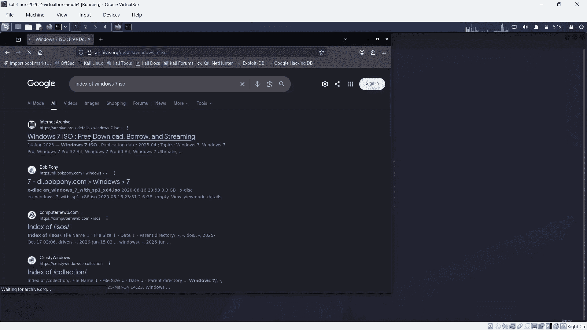
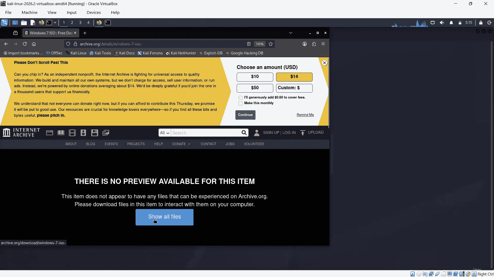
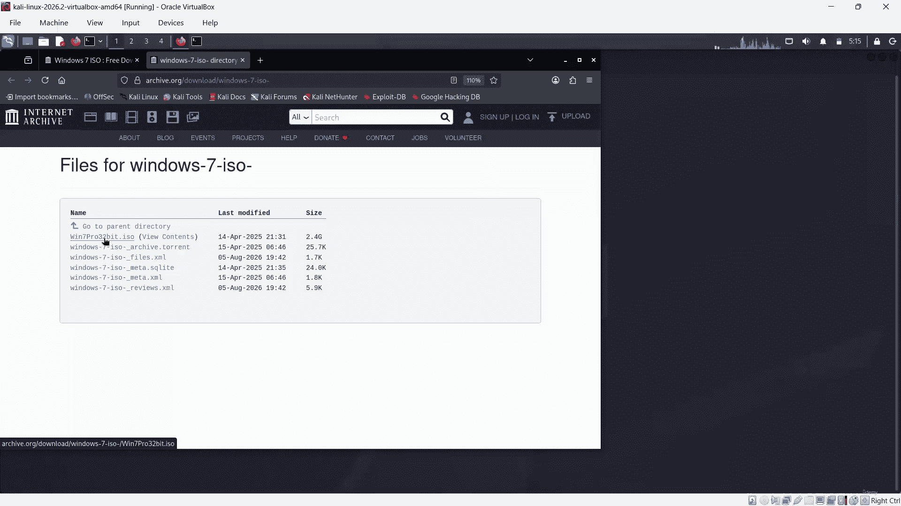
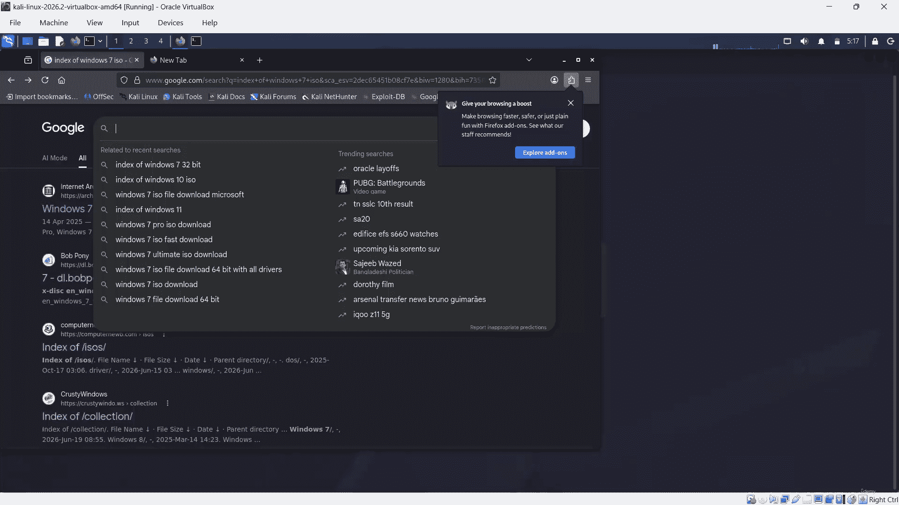

# Kali Linux 道德黑客与渗透测试：27：Google Dorking 与 OSINT 情报收集 🔍

## 概述

在本节课中，我们将一起学习如何使用 Google Dorking 进行 OSINT 情报收集。Google Dorking 是一种利用 Google 高级搜索操作符来挖掘隐藏信息的技术。我们将在 Kali Linux 的浏览器中实际操作，看看如何通过精确的搜索语法，找到普通搜索永远无法显示的内容。无论是限定特定网站、指定文件类型，还是搜索页面标题，这些方法都能帮助我们在不直接接触目标服务器的前提下，获取大量公开可用的情报信息。

## 什么是 Google Dorking 🔍

Google Dorking 就是使用特定的高级搜索操作符，去发现那些普通日常搜索绝对不会展示给你的信息。简单来说，就是让 Google 为我们干更精准的活，而不是随便输入几个关键词就等结果。这种方法在网络安全领域非常常见，因为很多敏感信息其实已经被 Google 索引了，只是普通用户不知道怎么找到而已。

接下来，我要切换到 Kali Linux 里的网页浏览器，演示具体怎么操作。你只需要打开浏览器，输入 Google.com，然后我会逐一展示几个搜索操作符，让你清楚地看到每个语法是怎么写的。

## site: 操作符：限制搜索范围 🌐

第一个操作符是 site。这个操作符的作用非常直白，就是把搜索结果限制在某一个特定的网站或域名内。

换句话说，当你使用 site:example.com 时，Google 只会显示它从 example.com 这个域名索引到的页面，而不是整个互联网上的其他页面。这样你就可以把注意力集中在单一目标上，而不会被成千上万个无关结果淹没。

以下是常见的使用方式：

site:example.com

通过这个语法，你可以快速查看某个网站中被 Google 收录的所有页面，这对初期的信息收集非常有帮助。

## filetype: 操作符：限制文件类型 📄

下一个操作符是 filetype。这个操作符可以把搜索结果限制为特定的文件扩展名，比如 PDF、Word 文档或 Excel 表格。

有时候我们不需要网页，只需要某类文件。这时候 filetype 就派上用场了，它能帮你过滤掉网页链接，只留下指定格式的文件。

以下是语法示例：

filetype:pdf

## 组合使用 site: 和 filetype: 🔗

现在让我们把上面两个操作符组合起来使用。首先输入 site:example.com，然后加上空格，再输入 filetype:pdf。组合后的完整语法如下：

site:example.com filetype:pdf

这个搜索专门用于查找托管在某个特定域名上的 PDF 文档。你可能会问，为什么要这么麻烦？从侦察的角度来看，这个组合其实非常强大。

很多组织会不小心把内部文档公开发布到网上，而自己却浑然不觉。比如旧的内部演示文稿、泄露的指南或被遗忘的政策文档，有时就能通过这种针对性的搜索找到。原因很简单，这些文档在某个时间点被 Google 索引了，即使该组织从未打算让普通大众找到它们。

不过在 example.com 上我们并没有 PDF 文件，所以页面会显示未匹配到任何文档。这没关系，我们换一个目标继续尝试。

## intitle: 操作符：搜索页面标题 📑

这次我们来看 intitle 操作符，也就是在页面标题中搜索。这个操作符专门在网页标题里查找关键词，而不是搜索整个页面内容。

比如，我们可以使用 intitle:"index of" 来搜索。这里的双引号是必须的，用来限定精确匹配。

以下是语法示例：

intitle:"index of"

这个 dork 非常著名，经常能暴露出一些配置不当的网络服务器。这些服务器没有正确隐藏原始文件列表，导致文件夹里的内容直接暴露在公众视野中。

## index of 搜索技巧 📂

好了，现在你可以搜索任何东西了。举个例子，你可以搜索 index of，后面加上你想要的任何内容，不管是电影名称、游戏名称，还是其他任何东西。搜索之后，你往往能直接跳到下载链接。

举个具体的例子，搜索 index of Windows 7 ISO，你可能会直接进入一个供下载的页面，点击链接就能开始下载。

index of 是一个在日常生活中非常重要的搜索操作符。不过这里有个前提，就是你不能做任何违规的事情。比如，你可以对 example.com 使用 index of，但不能对任何游戏、ISO 文件或其他受版权保护的内容使用 index of。

## 法律与伦理边界 ⚖️

好了，现在我要在这里非常明确地说明法律和伦理框架。这直接回到了我们本模块的第一堂课，我们刚才做的一切都是完全标准的、公开可用的 Google 搜索。

我们根本没有直接触碰任何目标服务器，只是比通常的日常搜索查询更精确地使用了 Google 自己的索引和搜索功能。这确实是明确无误的被动侦察。

因为 Google 在我们搜索之前，早已抓取并索引了这些信息。在真实的专业项目中，渗透测试人员通常会花专门的时间，针对一个经过授权的特定域名运行一整套这些 dork 查询，纯粹是为了查看关于该组织在网上可能已经存在哪些公开索引的信息，完全不需要直接触碰他们正在运行的基础设施。

所以，不要随意在任何地方使用 index of，一定要在获得授权的范围内进行测试。

## 下一节课预告 🚀

下一节课，我们将把今天学到的几种技术结合起来，使用一个专门搜索电子邮件地址和其他有用细节的自动化工具，即 theharvester。这个工具可以帮助我们更高效地完成信息收集工作，敬请期待。

## 总结 📝

在本节课中，我们一起学习了 Google Dorking 与 OSINT 情报收集的基础内容。我们介绍了 site 操作符，用于限制特定网站或域名的搜索范围；介绍了 filetype 操作符，用于限定特定的文件扩展名；还介绍了 intitle 操作符，用于在页面标题中搜索关键词。通过 index of 技巧，我们看到了如何发现配置不当的服务器文件列表。最后，我们明确了法律与伦理边界，强调所有操作必须基于公开可用的 Google 搜索，不能直接攻击目标服务器，也不能随意搜索受版权保护的内容。

