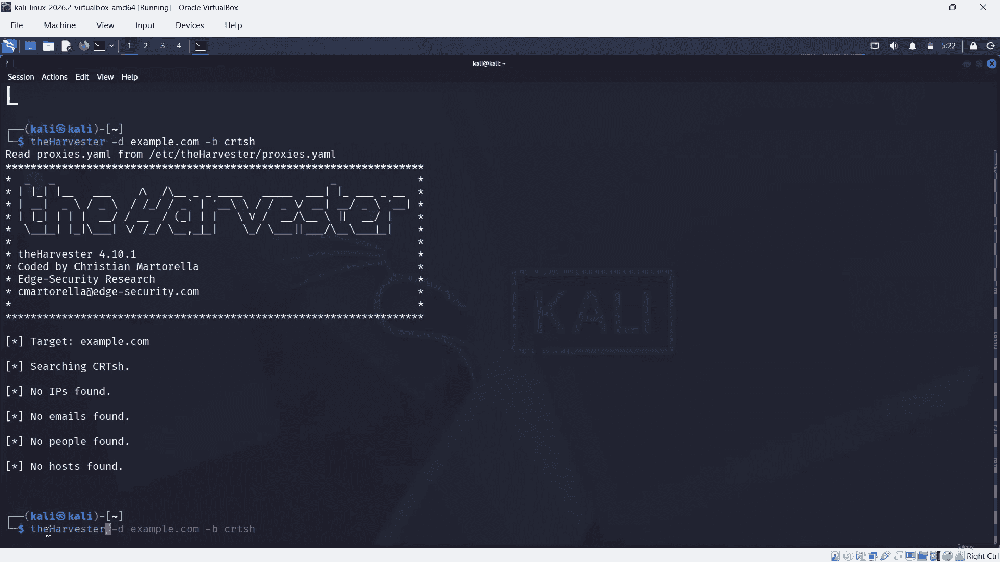
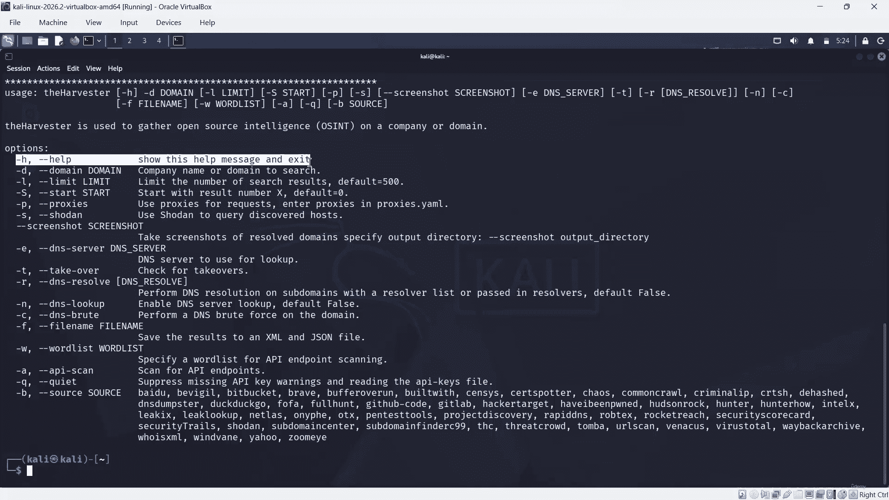

# 道德黑客与 Kali Linux 渗透测试：第28节：使用 theHarvester 进行电子邮件与员工情报收集 🔍

在本节课中，我们将一起学习如何使用 theHarvester 工具来收集目标组织的电子邮件地址、员工信息以及子域名资产。我们会先了解这个工具是什么，接着看看它到底从哪些数据源获取信息，然后通过一条具体的命令来演示如何操作。最后，我们会讨论为什么被动发现子域名对后续渗透测试非常有帮助，并为接下来进入主动侦查阶段做好铺垫。

## 什么是 theHarvester 以及它的数据来源

以下是关于 theHarvester 工具的基本介绍。

theHarvester 是一款自动化工具，它把多种被动侦查技术整合到了一条方便的命令里面。运行它之前，你需要知道一件重要的事情：theHarvester 会从很多不同的数据源中抓取信息。这些数据源可能包括搜索引擎、证书日志、公开记录等等。因为它自动把几种常见的侦查手段串联在一起，所以新手可以用它快速初步了解目标的网络面，而不需要逐个去查每个来源。

## 为什么不使用 Google，而使用 CRT SH

接下来我们来看为什么这里不选择 Google，而是转而使用 CRT SH。

简单来说，Google 最近对 theHarvester 这类自动化查询变得非常不稳定，因为 Google 会主动阻止这类自动化请求。如果你强行用 Google 作为数据源，很可能得不到可靠的结果，甚至直接被拒绝连接。为了避免这个问题，本节课我们使用一个名为 CRT SH 的数据源。CRT SH 是 Certificate Transparency 的缩写，它的工作原理是读取公开的证书日志，而不是去抓取搜索引擎的页面。使用 CRT SH 的一个很大好处是，你不需要申请任何 API 密钥就可以直接开始查询。

## 实操演练：运行 theHarvester 命令

现在我们进入实际的终端演练部分。

请在你的 Kali Linux 终端中输入下面这条命令，注意每一个部分都要准确无误。

```bash
theHarvester -d example.com -b crt.sh
```

这条命令的意思是，让 theHarvester 针对 example.com 这个目标域名进行查询，并且只使用 crt.sh 作为数据后端。回车执行之后，程序会去公开证书日志中查找与这个域名相关的信息。

## 参数详解：-d 与 -b

为了让你彻底明白这条命令，下面是各个参数的具体含义。

- `-d` 参数：用来指定我们要测试的目标域名，作用和之前 DNS 枚举课程里的用法完全一样。
- `-b` 参数：用来指定 theHarvester 应该去查询的具体数据源或后端。在这里我们选用 `crt.sh`，因为它速度快、结果可靠，而且不需要 API 密钥。这也是我们在本节课中把它作为主要示例的原因。

你可以把 `-d` 理解为“告诉工具目标是谁”，把 `-b` 理解为“告诉工具去哪里查信息”。

## 查看帮助信息与可能的提示



接下来我们看看运行这条命令之后会发生什么。

如果你按下回车后看到类似“没有发现电子邮件”“没有发现人员”“没有发现主机”的提示，这说明针对 example.com 这个特定目标，公开证书日志里暂时没有暴露出可用的邮箱或子域名记录，这属于正常情况。如果终端提示你需要使用某个输出选项，你可以先忽略它，或者继续往下看帮助信息。

如果你想查看 theHarvester 支持的所有参数，可以运行下面这条命令。

```bash
theHarvester -h
```

帮助输出会在屏幕前面列出每个选项的作用，建议你在实际操作时对照着阅读。

## 子域名发现的实际意义

到这里你可能会问，被动发现子域名到底有什么实际意义呢？

在一次获得授权的真实渗透测试中，如果渗透测试人员能够通过证书透明度数据完整地绘制出组织的子域名足迹，那么这些信息就成为后续测试阶段非常宝贵的基础工作。掌握子域名可以帮助你更完整地了解目标组织的结构和规模，而且这一切都在任何主动扫描开始之前就完成了。我真诚地建议你现在就尝试针对两三个不同的知名上市公司域名运行这条命令，纯粹是为了对比不同组织之间信息量的差异。有些公司索引的内容非常少，而有些公司则会有出乎意料的丰富证书历史记录，而且所有这些信息都是公开可用的，完全不需要进行任何黑客行为。

## 被动侦查小结与进入主动侦查

最后，我们来回顾一下本节课的内容，并看看接下来会学什么。

本节课我们介绍的被动侦查技术包括 Whois 查询、DNS 枚举、Google 搜索技巧以及 theHarvester 工具的使用。接下来，我们将完全转换方向，进入主动侦查阶段，但请注意，主动侦查只会针对我们自己的实验室环境进行，这和我们在本模块第一节课中讨论过的原则完全一致。

## 本节课总结



在本节课中，我们一起学习了 theHarvester 是什么、它如何从不同数据源收集信息、为什么选择 CRT SH 而不是 Google、如何使用 `-d` 和 `-b` 参数运行查询命令、如何查看帮助信息，以及子域名发现对授权渗透测试的实际价值。希望这些内容能帮助你建立起对被动侦查的初步认识。
