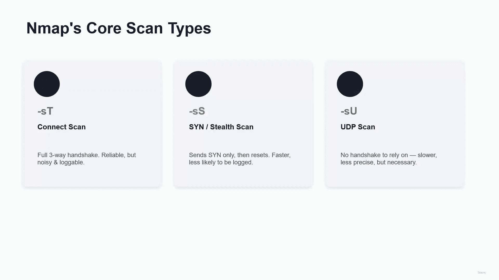
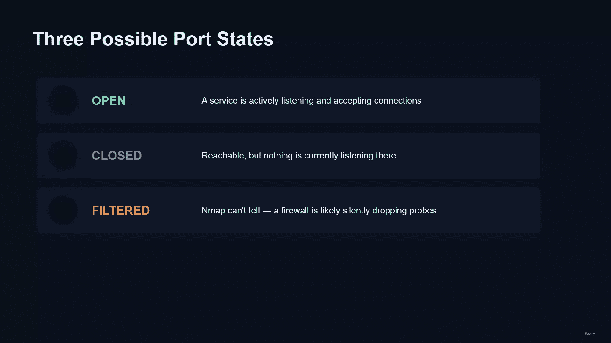
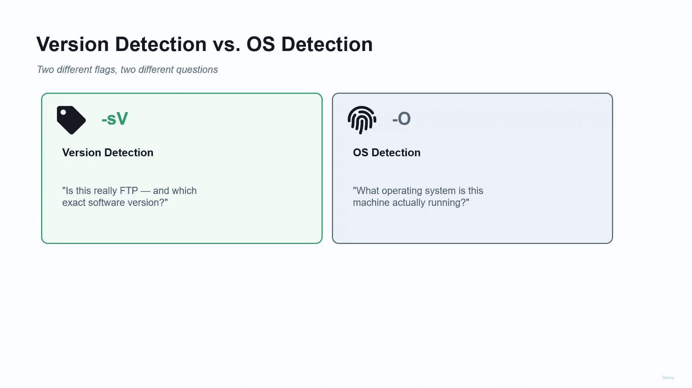

# Udemy - Ethical Hacking & Penetration Testing with Kali Linux：30：Nmap 基础：扫描类型与端口状态 🎯

## 本节课概述 📋

在本节课中，我们将学习 Nmap 的基础扫描类型，理解端口状态的三种可能含义，并区分服务版本检测与操作系统检测之间的不同。这节课是整个课程中非常重要的一部分，因为从这里开始，Nmap 这种工具会在后续几乎每一个模块中以某种形式反复出现。我们不再只是被动地收集信息，而是要直接、有系统地探测我们的实验室目标，把目标系统上到底运行着什么服务彻底摸清楚。


## 从侦察到行动：为什么这节课很重要 🔍

上一节课我们主要进行的是被动侦察，或者最多只是发送一个简单的探测包。而今天的课程标志着侦察阶段真正转化为实战行动。我们将直接针对实验室目标进行系统性探测，绘制出目标系统上到底运行着什么服务。这不仅是理论讲解，更是后续渗透测试工作的实际起点，掌握好这一节对后面的学习至关重要。

## Nmap 扫描类型详解 🔬

好了，现在我们进入正题，开始讲解 Nmap 的扫描类型。这里需要特别注意的是，扫描标志的选择非常关键，不仅仅是输入基础命令那么简单，不同的标志会决定扫描的行为和结果。

以下是 TCP Connect 扫描的详细说明。这种扫描通过标志 -sT 触发，它会完成我们在第 2 模块中讲过的完整三次握手过程。具体来说，就是针对被检测的每一个端口，依次发送 SYN，收到 SYN-ACK 后再发送 ACK。它是最基础、也最可靠的扫描类型。但同时它也是最容易被发现的一种，因为一旦连接建立完成，目标系统很容易在日志中记录下这次完整的连接行为。

```text
SYN → SYN-ACK → ACK
```

接下来我们来看 SYN 扫描，有时也被称为半开扫描，使用标志 -sS 触发。它的做法是只发送最初的 SYN 数据包。如果收到 SYN-ACK 响应，它会立即发送 RST 数据包来重置连接，而不是完成整个握手过程。这意味着，一次完整的 TCP 连接其实从来没有被真正建立起来。因此，这种扫描速度更快，也大大降低了被目标应用程序记录的可能性。当然，配置得当的防火墙或入侵检测系统仍然往往能够发现它。

```text
SYN → SYN-ACK → RST
```

然后是 UDP 扫描，使用标志 -sU 触发。它的工作原理与 TCP 扫描完全不同，因为 UDP 协议本身根本没有握手机制。正如你在第 2 模块中记得的那样，Nmap 必须发送一个 UDP 数据包，然后根据是否收到响应，或者更具体地说，收到什么样的错误信息，来推断该端口是否开放。这使得 UDP 扫描的速度比 TCP 扫描慢得多，精度也更低。但它仍然是必须掌握的技能，因为现实中确实有很多真实服务运行在 UDP 端口上。



## 端口状态：Open、Closed 与 Filtered 🚪

扫描类型讲完之后，我们需要理解 Nmap 输出中会报告的端口状态。对于 Nmap 检查的每一个端口，它都会给出三种可能性之一。

以下是三种端口状态的具体含义。
- **Open**：表示该端口上有一个服务正在主动监听，并且正在接受连接。
- **Closed**：表示该端口是可达的，但当前没有任何服务在上面监听。
- **Filtered**：表示 Nmap 无法确定该端口的状态，通常是因为防火墙在静默丢弃数据包，根本不做任何响应。

开放端口和关闭端口的区别在实际渗透测试中非常重要。特别是 Closed 与 Filtered 的区别，意义重大。如果一个端口显示为 Filtered，通常意味着有一个防火墙正在积极保护那个特定的入口点，而这本身就是非常有价值的情报信息，能帮助我们判断目标的防御部署情况。



## 服务与版本检测 vs 操作系统检测 🖥️

在动手实操之前，还有最后一部分理论需要讲解，即服务与版本检测，和操作系统检测。这是两个完全不同的事情，分别由两个不同的标志来控制，理解它们的区别对后续分析扫描结果非常有帮助。

以下是两者的区别和具体用法。
- 服务与版本检测，使用标志 -sV，它试图识别开放端口背后到底运行的是什么软件，以及具体的版本号。比如，这真的是一个 FTP 服务器吗？如果是，具体是哪个版本？
- 操作系统检测，使用标志 -O，它试图指纹识别底层的操作系统本身，依据是机器的网络协议栈对专门构造的数据包做出的细微差异响应。

这两项检测都非常有用，我们今天都会用到，但它们回答的问题完全不同。我希望你在本节课结束时，能够自信地区分这两者，不要把它们混淆。

## 实操前置准备 🛠️



在进入动手实操之前，有一个实际的注意事项需要提醒你。Nmap 已经预装在 Kali Linux 中，所以这里不需要任何额外的安装或配置工作。而且，因为我们将直接通过仅主机网络来扫描 Metasploitable 目标，这完全不依赖于上一节课设置的网络连通性。

今天的所有操作都将完全发生在我们隔离的实验室环境之内，不涉及外网，所以你可以放心地进行扫描练习，不需要担心网络连接问题。

好了，这就是本节课的扫描词汇表。包括 Connect 扫描、SYN 扫描、UDP 扫描、端口状态，以及版本检测与操作系统检测之间的区别。下一节课，我们将运行第一个真实的 Nmap 扫描，并把刚才学的所有概念在实际中演示一遍。

## 本节课总结 ✅


本节课中，我们一起学习了 Nmap 的基础扫描类型，包括 TCP Connect 扫描、SYN 半开扫描和 UDP 扫描，理解了 Open、Closed 和 Filtered 三种端口状态，还区分了服务版本检测与操作系统检测的不同用途，并确认了在 Kali Linux 中进行实操的前置条件。
