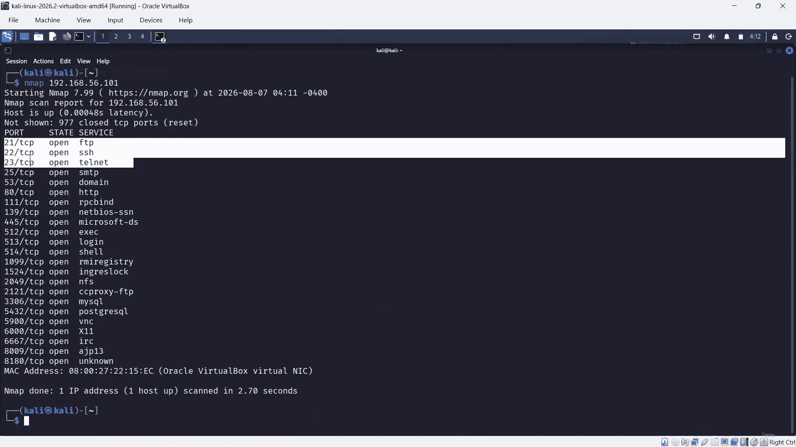
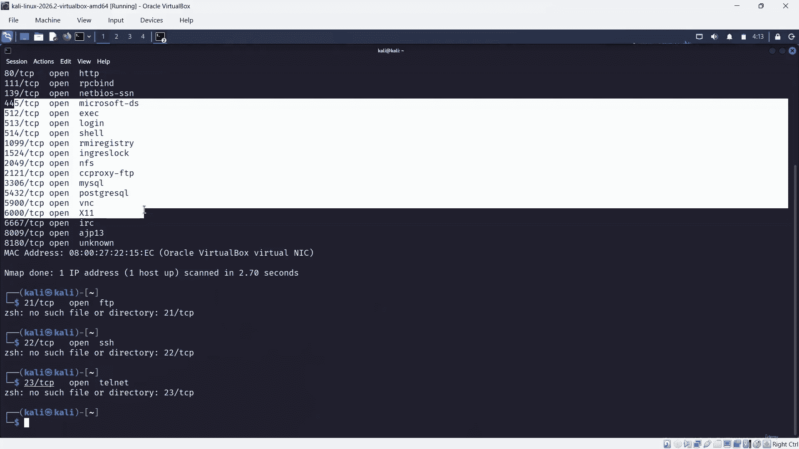
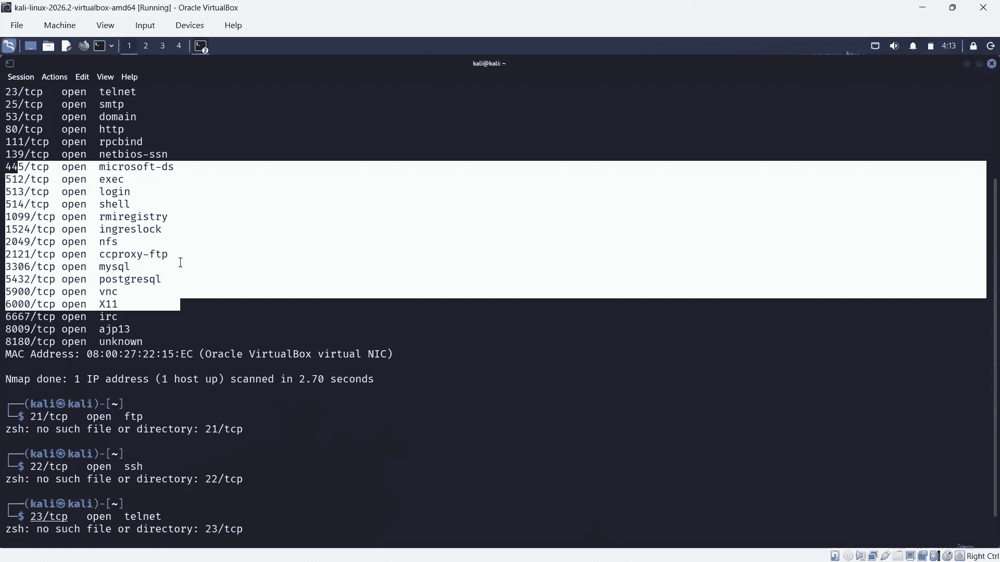
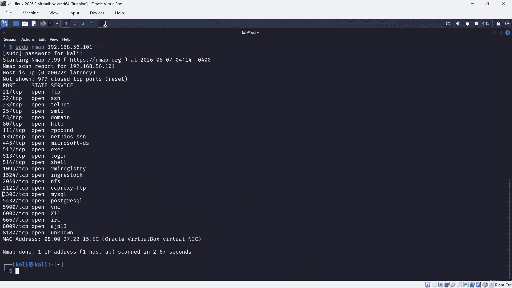

# 道德黑客与 Kali Linux 渗透测试：第 31 课：你的第一次 Nmap 扫描 🕵️‍♂️


在本节课中，我们将一起学习如何在 Kali Linux 中使用 Nmap 进行第一次网络端口扫描。你将了解如何确认目标虚拟机已经启动，如何在终端中输入最基础的 Nmap 命令，如何逐行阅读扫描输出结果，以及普通用户扫描与管理员权限扫描之间的差异。通过本节课的学习，你能够建立对网络扫描的直观认识，为后续深入学习服务版本探测和漏洞分析打下坚实基础。无论你是完全没有扫描经验的初学者，还是刚刚接触 Kali 工具的爱好者，这节课的内容都会用最直白的方式讲解清楚，让你轻松上手。


在开始实际操作之前，请先确保你的 Kali 虚拟机和 Metasploitable 目标虚拟机都已经启动并且正在运行。在演示环境中，这两台虚拟机都处于开启状态。只有两台虚拟机都正常运行，后续的扫描操作才能顺利进行，否则你可能会在终端中看到连接超时或者主机不可达的提示信息。请花一点时间检查虚拟机的网络连接和电源状态，确保没有出现暂停或关闭的情况，这样可以避免在扫描过程中出现不必要的错误。


现在我们来到 Kali 终端界面，先运行最简单的 Nmap 扫描，这样你可以在开始添加各种参数之前，先看到扫描的基准结果。请在终端中输入 nmap，然后加一个空格，接着输入目标虚拟机的 IP 地址，也就是 192.168.56.101，最后按下回车键并让扫描运行起来。你不需要在这个阶段添加任何额外的参数，保持命令尽可能简单，就能得到最原始的扫描数据。


以下是本节课使用的基础扫描命令：

```bash
nmap 192.168.56.101
```

注意，上面显示的 IP 地址仅作示例，实际操作时请替换为你自己 Metasploitable 虚拟机的真实 IP 地址，确保目标地址正确无误。


默认情况下，当你不添加任何参数时，Nmap 会针对它预定义的 1000 个最常见端口执行扫描。如果你当前使用的是具有管理员权限的账户，Nmap 会使用 SYN 扫描方式；如果你没有管理员权限，它会回退到使用 Connect 扫描方式。这两种扫描方式的底层原理不同，管理员权限扫描通常会更快一些，因为它不需要在每个端口上完成完整的 TCP 握手过程。


扫描开始后，你会在输出的最上方看到一行确认信息，告诉你扫描已经启动，并附带当前的时间戳。紧接着，你会看到一个包含两列的表格，我们最关注的是“端口”列和“状态”列。除此之外，表格中还有一个“服务”列，Nmap 会根据我们在模块 2 中背诵过的标准端口与服务对应关系，猜测某个端口号通常运行着什么服务。


以下是输出表格中三列的含义：

- 端口：目标主机上被检测到的网络端口号。
- 状态：端口当前的开放情况，常见的有开放、关闭、被过滤等。
- 服务：Nmap 基于端口号做出的最佳猜测，并不是经过验证的最终结论。


请注意，服务列中的内容只是 Nmap 的一种假设，是基于常见惯例做出的推测，并没有真正去探测该端口上运行的具体软件版本。因此，你不能仅凭这一列就断定目标上到底跑着什么程序，这只是一个初步的参考线索。




接下来，请浏览输出列表，找出所有被标记为“开放”的端口。以 Metasploitable2 为例，这台虚拟机是故意构建成充满暴露服务的环境，因此你应该能看到一份相当长的开放端口列表。通常会出现 FTP、SSH 等多种服务，它们都处于完全暴露的状态，方便我们进行后续的渗透测试练习。




以下是 Metasploitable2 上常见的开放服务示例：



- FTP：文件传输协议服务。
- SSH：安全远程登录服务。
- 其他常见服务：例如 Telnet、SMB 等，具体取决于目标镜像版本。


在输出结果的最底部，Nmap 会报告它总共检查了多少个端口，以及整个扫描过程花费了多长时间。通过这一行信息，你可以对扫描效率有一个初步印象，也能大致了解扫描覆盖的范围。


**核心概念：开放端口的含义**

开放端口可以理解为目标主机上未被防火墙阻断、并且正在监听连接的网络端口。我们可以用一个简单的公式来描述：

```text
开放端口 = 未被防火墙阻断 且 正在监听的端口
```

换句话说，开放端口就像是一扇没有锁上的门，任何人都可以尝试敲门，看看里面有没有人在应答。


这次基础扫描实际上告诉我们什么，同样重要的是，它还没有告诉我们什么。现在我们知道了哪些门是打开的，但我们还不知道每扇门后面具体是什么，也不知道运行的是什么具体软件版本，更不知道存在哪些已知漏洞。弄清楚这些内容，正是后面几节课要一层层构建的目标，所以不要急于下结论，先把基础扫描的结果看懂即可。


为了直观感受差别，我们可以尝试再次运行完全相同的扫描，但这次在命令前面加上 sudo，以管理员权限执行。命令如下：

```bash
sudo nmap 192.168.56.101
```

系统会提示你输入密码，输入后等待扫描完成。你可以对比两次扫描所花费的时间。取决于你的系统环境，使用管理员权限的真实 SYN 扫描通常会比没有权限时回退的 Connect 扫描快得多，因为 Connect 扫描需要在检查的每个端口上完成完整的握手过程。以上就是本次扫描的基准表现，你可以把它作为后续参数优化的参照点。


下一节课中，我们将运行更精确的扫描，将 SYN 扫描与服务版本探测结合起来，这样我们就能开始识别每个开放端口背后到底运行着什么程序了。到时候，你将能够看到具体的软件名称和版本号，进一步缩小攻击面的范围。




在本节课中，我们一起学习了如何准备 Kali 和 Metasploitable 虚拟机，如何在终端中运行第一次基础 Nmap 扫描，如何阅读包含端口、状态和服务的输出表格，理解服务猜测的局限性，以及普通用户与管理员权限扫描的区别。你现在已经掌握了 Nmap 扫描的最基本用法，可以作为进一步学习端口探测和漏洞分析的起点，建议多在实验环境中练习，加深印象。

