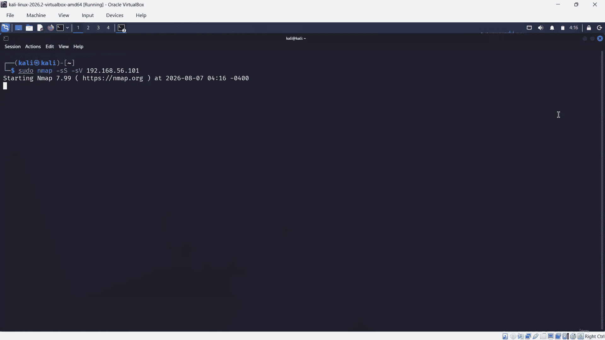
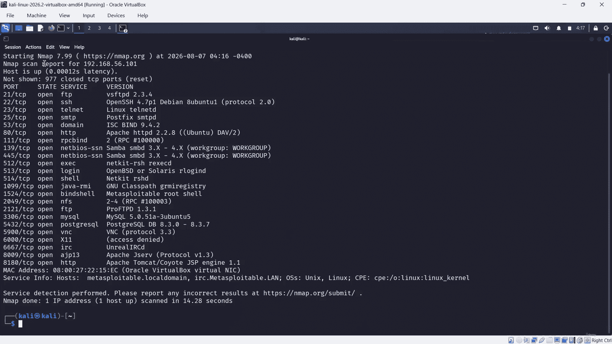
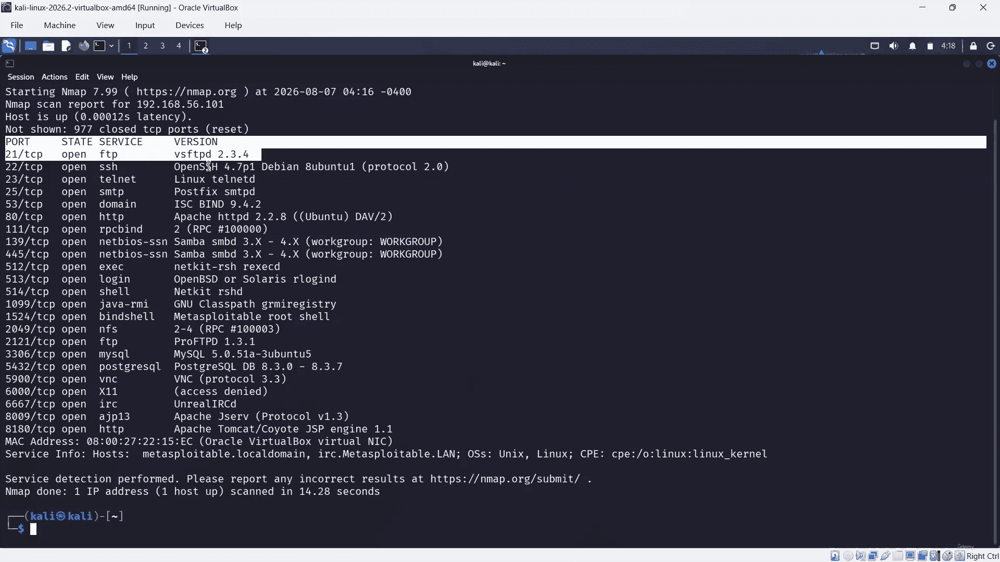
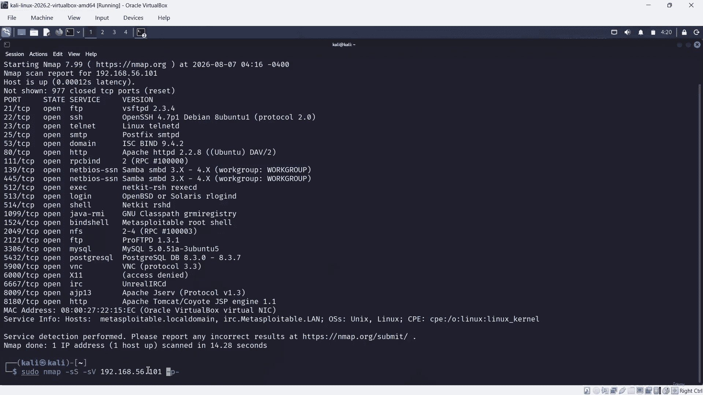

# 道德黑客与渗透测试：Kali Linux实战：第32节：SYN隐秘扫描与版本探测 🔍


在本节课中，我们将学习如何让端口扫描的结果比上一节课的基础扫描更加精确。具体来说，我们会把两种扫描方式结合在一起使用，一种是SYN隐秘扫描，另一种是服务版本探测。通过这种组合，我们不仅能知道目标系统哪些端口是开放的，还能搞清楚每个开放端口后面到底运行着什么软件，以及软件的具体版本号是多少。我们还会解释为什么在这个场景下必须使用管理员权限，以及这些版本信息在后续寻找已知漏洞时为什么至关重要。下面我们就从核心目标开始，逐步拆解整个扫描过程。


## 一、为什么这次扫描更精确 🎯

上一节课我们介绍了基础端口扫描的基本概念，本节中我们来看看如何让扫描结果更具体、更可靠。

以下是本节课要实现的核心目标：

- 把SYN隐秘扫描与服务版本探测结合起来使用；
- 在输出中识别出每个开放端口背后运行的精确软件名称；
- 获取服务的具体版本号，为后续漏洞查找打下基础。

扫描策略可以用下面的公式来概括：



扫描类型 = SYN 隐秘扫描 + 服务版本探测


## 二、执行命令的详细拆解 💻

上一节我们介绍了什么是基础扫描，本节中我们来看看具体应该如何输入命令来完成这次进阶扫描。

以下是命令的逐部分拆解：

首先输入 `sudo`，这是因为SYN隐秘扫描需要在底层构造原始数据包，而在Linux系统中这类操作需要 root 权限。

接着输入扫描工具 `nmap`。



然后添加扫描类型标志 `-sS`，这里的小写 `s` 和大写 `S` 共同表示启用 SYN 隐秘扫描模式。

再添加版本探测标志 `-sV`，这里的小写 `s` 后面跟大写 `V`，表示要探测目标端口上的服务版本。

最后输入目标系统的 IP 地址，本例中使用的是 `192.168.56.101`。



把这些部分拼在一起，完整命令如下所示：

```bash
sudo nmap -sS -sV 192.168.56.101
```

这里有一个重要的提醒：如果不加 `sudo`，Nmap 会在没有 root 权限的情况下悄悄回退到普通的连接扫描。也就是说，即使你明确写了 `-sS`，实际执行的也可能不是真正的 SYN 隐秘扫描，而是效果较弱的替代方案。所以管理员前缀在这里不能省略。


## 三、解读扫描输出 📋

上一节我们介绍了命令的输入方法，本节中我们来看看运行命令后得到的输出应该怎么读。

以下是需要重点关注的输出列：

- 端口号：告诉你目标系统上哪些端口处于开放状态；
- 服务列：上一节的基础扫描通常只根据端口号做简单猜测，比如看到端口 21 开放就猜测是 FTP 服务；
- 版本列：本次扫描新增的列，显示通过实际横幅抓取得到的软件名称和具体版本号。

以 FTP 服务为例，基础扫描可能只告诉你端口 21 是开放的，于是猜测是 FTP。但本次扫描的输出会更进一步，直接显示 `vsFtpd 2.3.4`，这意味着它已经抓取到了该端口背后实际运行的软件名和版本号。

再看 Web 服务，如果端口 80 处于开放状态，输出会将其标识为 Web 服务器，并附带版本号。在本例中，显示的版本号是 `2.2.8`。这个数字在我们后面学习 Web 应用黑客模块时会直接用到，所以需要留意。


## 四、版本信息为什么如此重要 🔐

上一节我们介绍了如何从输出中读取服务列和版本列，本节中我们来看看这些信息在实际渗透测试工作中的真正意义。

以下几点说明了版本探测的核心价值：

- 仅根据端口号猜测服务是非常不可靠的，因为任何人都可以在自己选择的任何端口上运行任何服务；
- 实际的横幅抓取能够确认我们面对的确切软件和具体版本，而不只是猜测；
- 一旦知道了具体版本，我们就可以去查找该版本已知的安全漏洞，这正是我们将在第 6 模块中直接开展的工作；
- 例如 `vsFtpd 2.3.4` 是这个领域非常著名的、故意留有漏洞的服务版本，我们将在第 7 模块中直接通过它的名称来实施利用。

总之，端口号只能告诉你“门可能开着”，而版本信息才能告诉你“门后面站着谁，穿的是什么”，这才是制定后续攻击计划所需的关键情报。


## 五、下一节预告：全端口扫描 🚪

本节我们介绍了 SYN 隐秘扫描与版本探测的组合用法，下一节中我们来看看如何进一步扩大扫描范围。

以下是下一节课的主要内容：

- 不再只扫描最常见的前 1000 个端口；
- 扫描所有可能的 65535 个端口；
- 发现那些故意隐藏在非默认、不常用端口上的服务。

通过全端口扫描，我们可以得到目标系统更完整的暴露面图景，避免遗漏隐藏在冷门端口上的重要服务。


## 总结 📚



本节课中我们一起学习了如何使用 Nmap 将 SYN 隐秘扫描与服务版本探测结合，掌握了必须使用管理员权限的原因，学会了解读输出中的服务列与版本列，理解了版本信息在查找已知漏洞中的关键作用，并初步了解了下一节全端口扫描的内容。希望这些知识能帮助你更深入地理解端口扫描在渗透测试中的实际应用。


