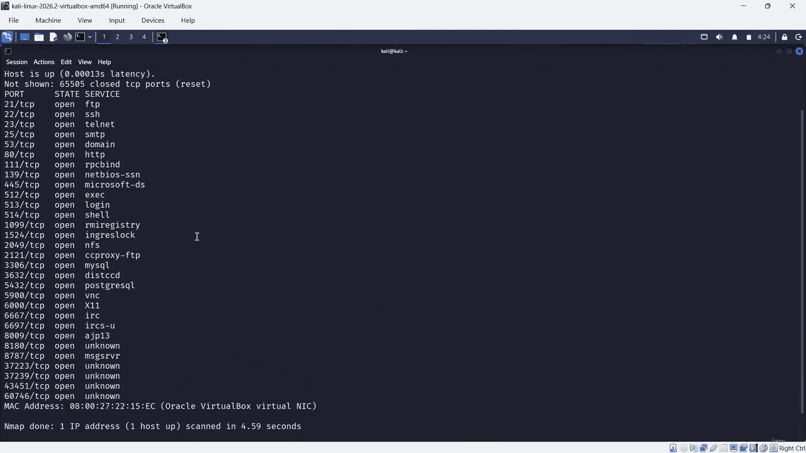
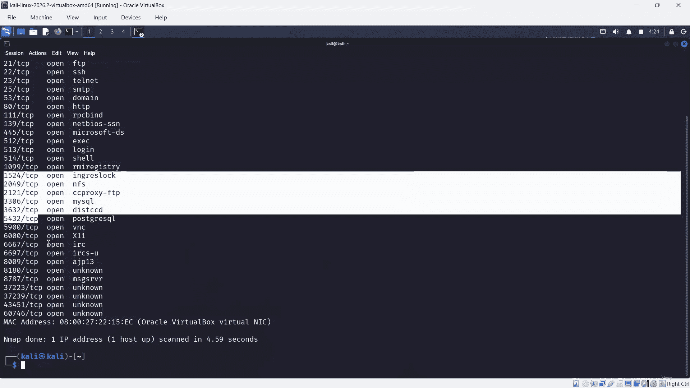
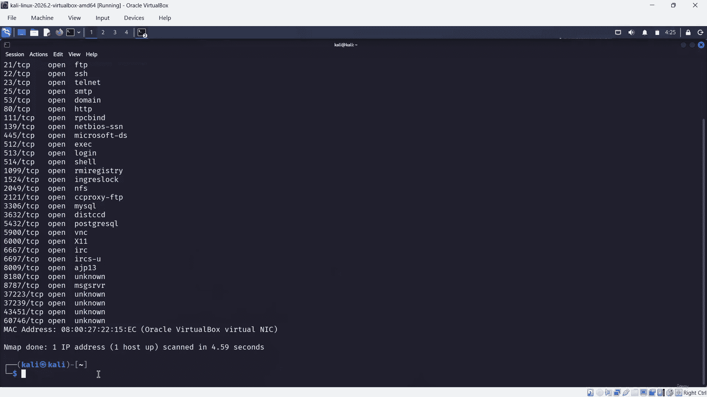

🛡️ Ethical Hacking & Penetration Testing with Kali Linux：33：全端口扫描（Full Port Scan）


在本节课中，我们将学习如何使用 Nmap 工具进行全端口扫描。在之前的课程里，我们运行过的每一次扫描都只检查了前 1000 个最常见的端口，这个范围对于大多数目标来说已经足够发现大部分服务。但是，一次真正专业的安全评估不能就此停止。有些系统管理员会故意将服务配置在不寻常的端口上，目的就是为了躲避像我们之前运行的那种普通扫描。因此，我们需要掌握全端口扫描的方法，了解它的运行原理，并知道在什么情况下应该使用它。这节课的内容会用大白话来讲解，即使你是完全的初学者，也能听懂其中的逻辑和具体操作步骤。


让我们先看看为什么只扫描前 1000 个端口是不够的。以下是默认扫描的主要局限性：
- 默认扫描只覆盖前 1000 个最常见端口
- 这足以发现大多数常见服务
- 但是无法发现配置在非标准端口上的服务
- 专业评估需要更完整的端口覆盖范围


扫描端口的数量直接决定了我们能发现多少服务。如果一个服务运行在第 5000 号端口，而我们只扫描了前 1000 个，那么这个服务就会被完全忽略。在真实的渗透测试工作中，遗漏一个隐藏服务可能意味着错过进入目标网络的唯一入口点。这就是为什么我们需要学习全端口扫描，而不是满足于默认设置。


接下来，我们来看看如何执行一次全端口扫描。以下是具体操作命令：

```bash
nmap -p- 192.168.5.101
```

这里的 `-p-` 标志告诉 Nmap 检查所有可用的 65535 个端口，而不仅仅是默认的前 1000 个。目标系统的 IP 地址是 192.168.5.101，也就是我们自己的靶机环境。输入完命令后按下回车键，扫描就会开始运行。

我要提前跟你说清楚，这次扫描需要花一点时间。在我们自己的靶机上，可能大概需要 5 秒钟左右。在真实世界的目标系统上，扫描时间会比平时更长一些，这是完全正常的情况。不要因为等待而心烦意乱，花时间去理解为什么会这样，比盲目等待更有价值。


全端口扫描之所以耗时，是因为它要检查的端口数量多了很多。你可以把端口范围看作下面这个公式：

Ports = {1, 2, 3, ..., 65535}

当我们只扫描前 1000 个端口时，实际上只检查了这个集合的一小部分。想象一下这样的场景：一名管理员想显得很聪明，把 SSH 服务从标准的 22 号端口移到不寻常的 2222 号端口，希望这样能减少自动化攻击。默认的前 1000 个端口扫描可能还能碰巧捕获 2222 号端口，因为它出现频率足够高，被包含在常见列表里。但是，很多真正冷门的端口，任何不全面的扫描都会完全遗漏。




在一次真实的专业项目中，漏掉一个隐藏服务，可能就意味着完全错过了进入目标网络的实际攻击入口点。所以，了解全端口扫描的必要性，不仅是技术问题，更是职业素养的体现。




扫描运行结束后，我们就可以查看结果了。以下是我们需要关注的对比内容：
- 本次全端口扫描发现的端口列表
- 之前几节课做的前 1000 个端口扫描结果
- 两者之间的差异和新增发现的端口


你会发现，全端口扫描结果里包含了一些之前扫描完全遗漏的更重要端口。这些端口可能承载着关键服务，也可能是攻击者真正感兴趣的入口。在真实的专业工作中，扫描的彻底程度和所需时间之间，始终存在着权衡。有些项目的时间窗口非常紧，只允许进行快速的前 1000 个端口扫描；而另一些项目会专门预留时间做全端口扫描，因为漏掉隐藏服务被认为是无法接受的风险。

知道哪种方法适用于什么场景，是区分初级扫描操作者和经验丰富的渗透测试人员的关键所在。作为初学者，你不需要一次性记住所有细节，但要清楚这两种方法的优劣，并在实践中慢慢积累判断力。


好了，本节课的内容基本讲完了。下节课，我们将把迄今为止学到的所有内容整合成一次综合扫描，加入操作系统探测和 Nmap 内置的脚本引擎，让扫描能力更上一层楼。敬请期待。




本节课中，我们一起学习了全端口扫描的概念、执行命令、扫描耗时的原因，以及在专业渗透测试中如何权衡时间和完整性。希望这些内容能帮你建立起对端口扫描的完整认识。

