道德黑客与渗透测试：Kali Linux：34：攻击性扫描、操作系统检测与 NSE 脚本 🛡️


在本节课中，我们将学习如何使用 Nmap 的攻击性扫描模式一次性完成多种扫描任务。你将了解攻击性扫描的命令格式，理解它在后台自动开启的多项功能，并学会阅读扫描输出中的操作系统检测结果、路由追踪信息以及 NSE 脚本扫描结果。此外，我们还会讨论在真实渗透测试项目中使用这种扫描方式时需要注意的问题，并为下一节保存扫描结果的内容做好铺垫。


什么是攻击性扫描


在前面的章节中，我们分别介绍了端口扫描、服务版本探测、操作系统识别和脚本扫描等基础内容。本节中，我们来看看如何把这些功能整合到一条命令里。攻击性扫描就是 Nmap 提供的一种综合扫描模式，它的核心命令如下：

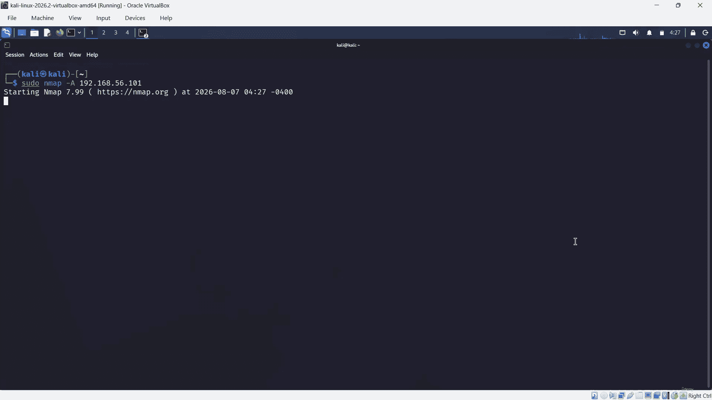

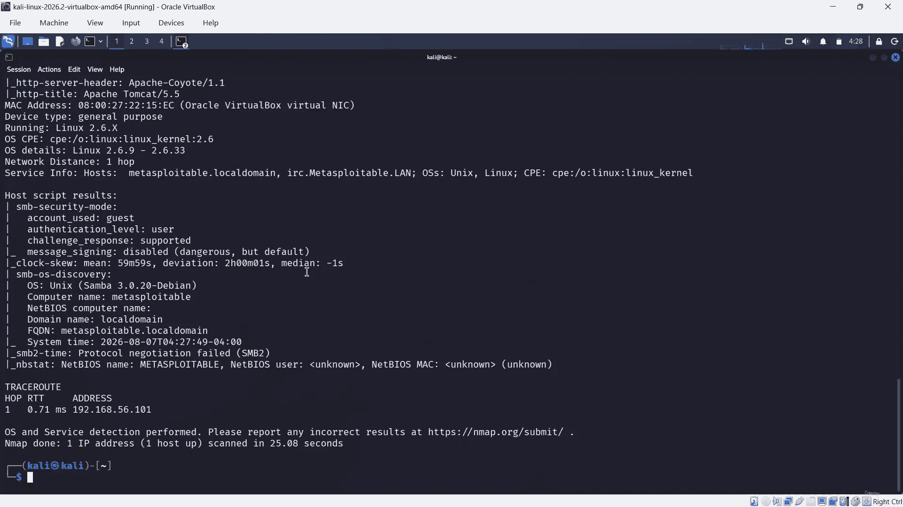

```bash
nmap -A <目标 IP 地址>
```

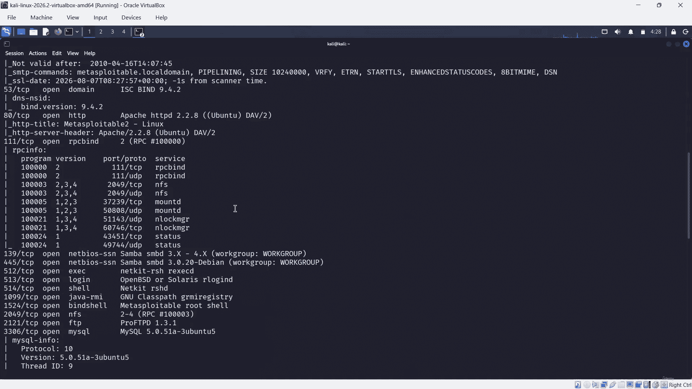

这里的 `-A` 参数是一个缩写，它实际上在后台一次性开启了多项扫描功能。你可以把它理解为扫描界的“大杂烩”，一次运行就能获得目标主机的多方面信息。虽然扫描速度会比单一功能扫描慢一些，但换取的是更全面的结果，适合用来快速掌握目标的整体状况。攻击性扫描的核心组成可以用下面的公式表示：

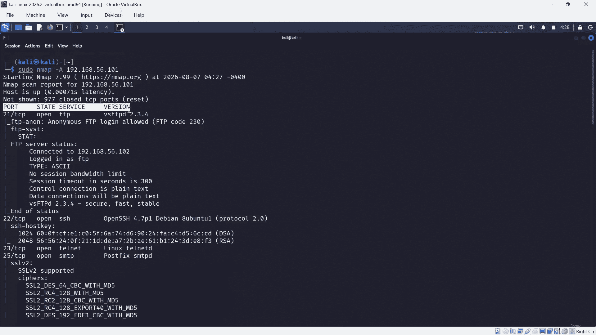

```
攻击性扫描 = 端口扫描 + 服务版本检测 + 操作系统检测 + NSE 脚本扫描 + 路由追踪
```


攻击性扫描包含的具体功能


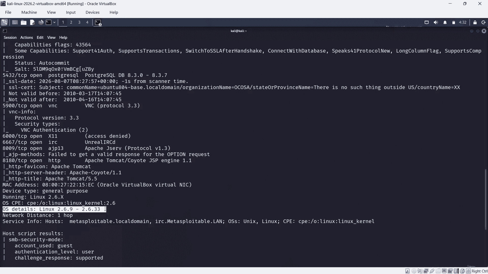

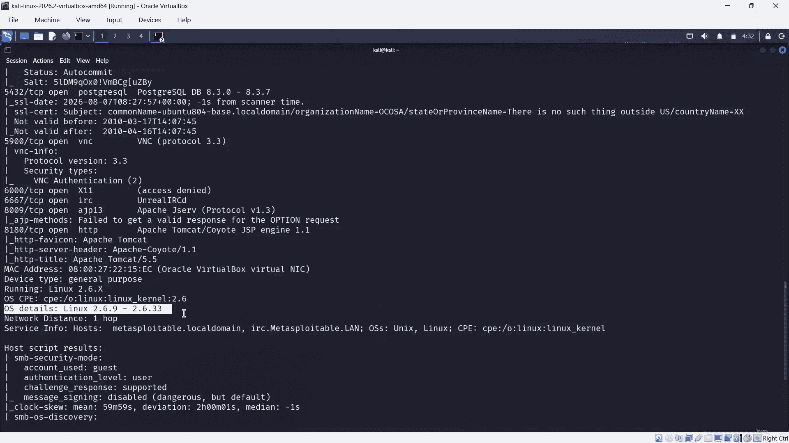

我们刚才已经运行了攻击性扫描，并且得到了扫描输出。以下是该命令自动开启的四项核心功能：

- 操作系统检测：Nmap 会根据目标主机网络协议栈的细微差别，猜测其底层操作系统，并给出一个置信度提示。
- 版本检测：Nmap 会探测开放端口上运行的服务及其具体版本号。
- 脚本扫描：Nmap 会使用 Nmap 脚本引擎自动运行社区编写的脚本，检查常见的配置错误或已知漏洞。
- 路由追踪：Nmap 会显示数据包从你的机器到达目标主机所经过的网络节点。


如何解读扫描输出


扫描完成后，屏幕上会显示大量信息，初学者可能会觉得眼花缭乱。以下是输出中你需要重点关注的几个部分：

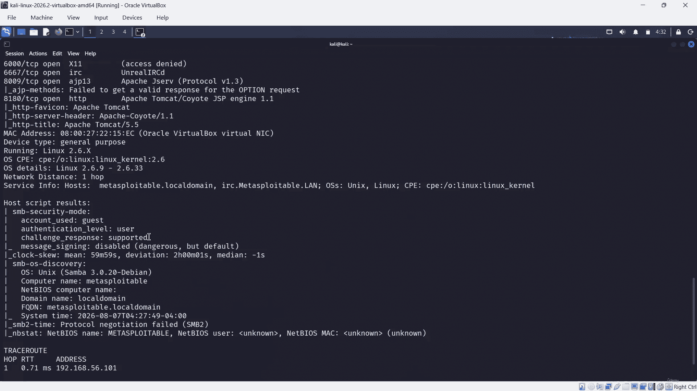

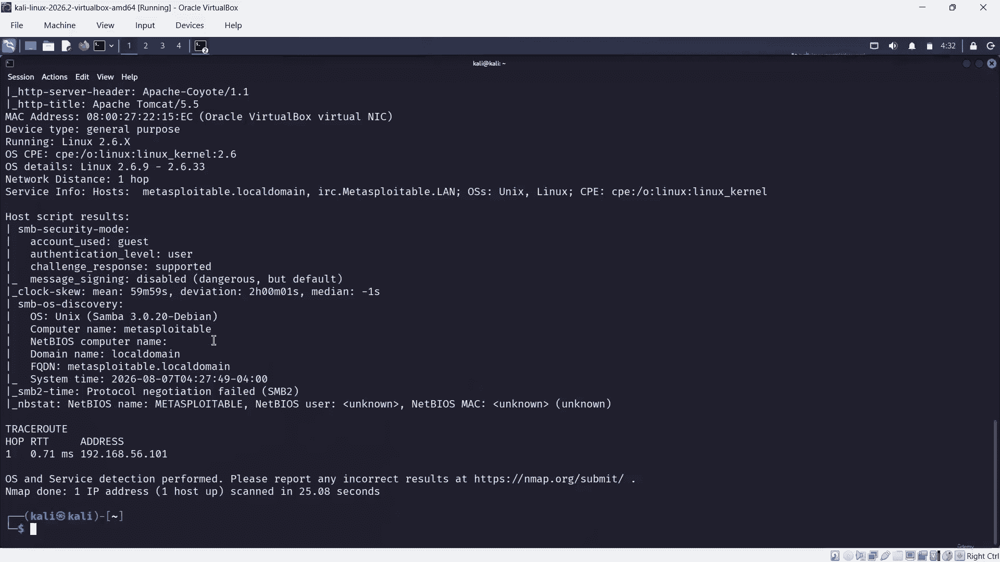

- 端口、状态、服务和版本列：这些是我们最熟悉的基础信息，显示哪些端口是开放的，运行着什么服务。
- 操作系统检测部分：Nmap 会给出它对目标操作系统的最佳猜测，通常会附带一个置信度指示，帮助你判断这个猜测有多可靠。
- 路由追踪结果：这一部分展示了数据包经过的路径，和我们之前在侦察模块中学习的路由追踪概念一致，只不过现在它直接内置在综合扫描命令里了，不需要再单独运行命令。
- NSE 脚本结果：Nmap 脚本引擎会针对发现的服务自动运行大量脚本，检查特定的配置问题，收集额外细节，有些情况下甚至会直接指出已知漏洞。


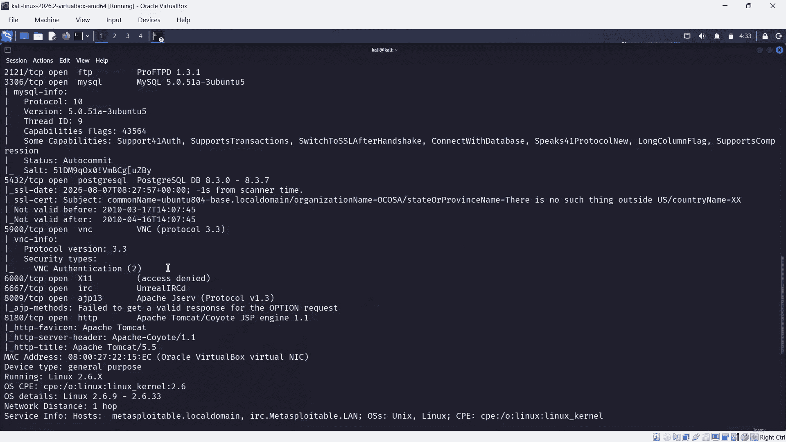

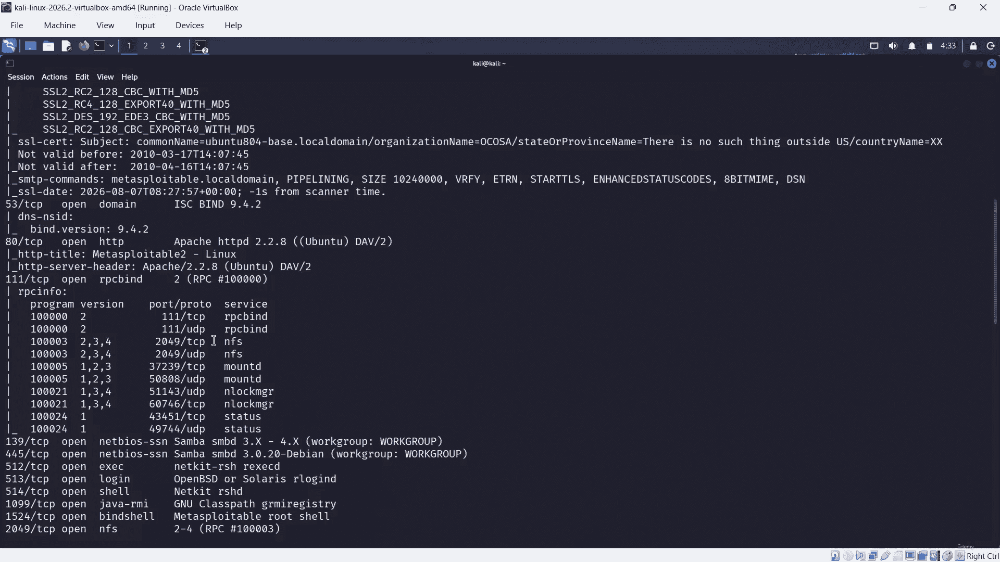

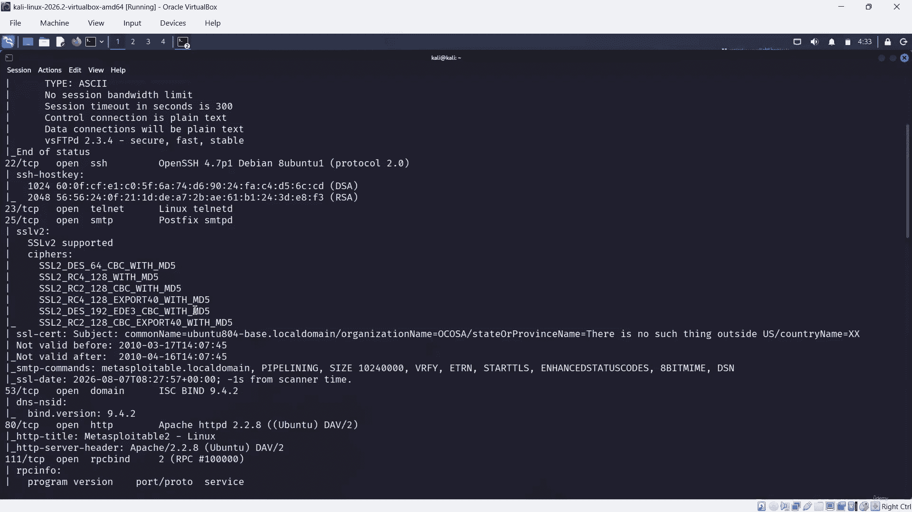

使用 NSE 脚本发现漏洞


在扫描结果中，你可能会发现一些特别值得注意的条目。以下是需要留意的几种情况：

- 如果 Nmap 的脚本引擎确认某个服务存在漏洞，输出中可能会出现包含“VULNERABLE”字样的条目。
- 这种直接标记已知严重问题的能力，是 Nmap 脚本引擎带来的一大优势，能让你在漏洞评估阶段获得很大的先机。
- 这些信息将为我们在下一个模块中开展的漏洞评估工作提供重要参考。


现实环境中的注意事项


虽然攻击性扫描功能强大，但在真实渗透测试项目中，使用时仍需谨慎。以下是几个真实世界中真正重要的注意事项：

- 攻击性扫描比单独的安静扫描更加嘈杂，更容易被目标系统发现，因为它在主动运行脚本并进行更深入的探测。
- 在我们的隔离实验室环境中，这种噪音问题不需要考虑，但在真实授权的项目中，如果客户对隐蔽性有严格要求，就不能默认总是使用最全面的扫描选项。
- 渗透测试人员应根据客户的规则约定书来选择扫描类型，而不是习惯性地总是使用最彻底的方案。


保存扫描结果


我们已经完成了攻击性扫描，并且了解了输出中各部分的含义。下一节中，我们将学习如何把扫描结果保存到文件中。因为在专业工作中，你无法向客户展示一次根本没有发生过的扫描，保存结果是展示工作成果的必要步骤。


本节课总结


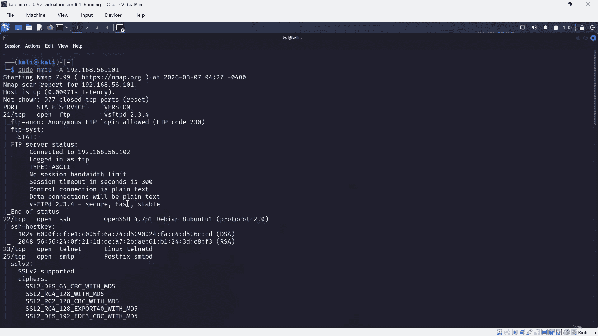

在本节课中，我们一起学习了攻击性扫描的概念和用法，理解了 `-A` 参数自动开启的操作系统检测、版本检测、脚本扫描和路由追踪功能，并学会了如何从输出中定位操作系统猜测、路由追踪结果以及 NSE 脚本发现的漏洞。我们还讨论了在真实项目中使用攻击性扫描时需要注意的噪音和隐蔽性问题，并为下一节保存扫描结果的内容打好了基础。

