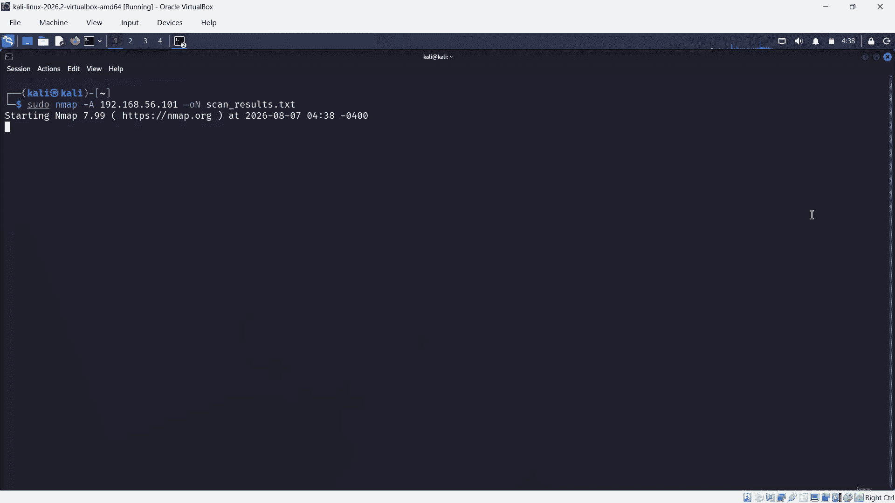
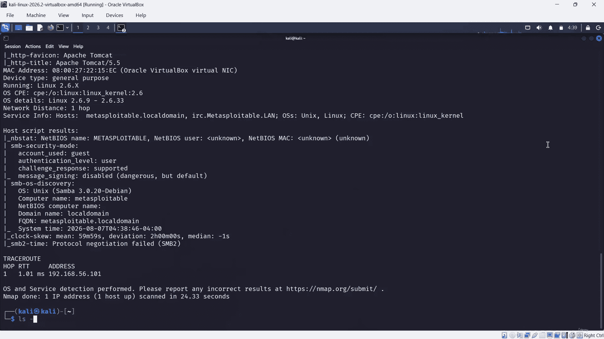
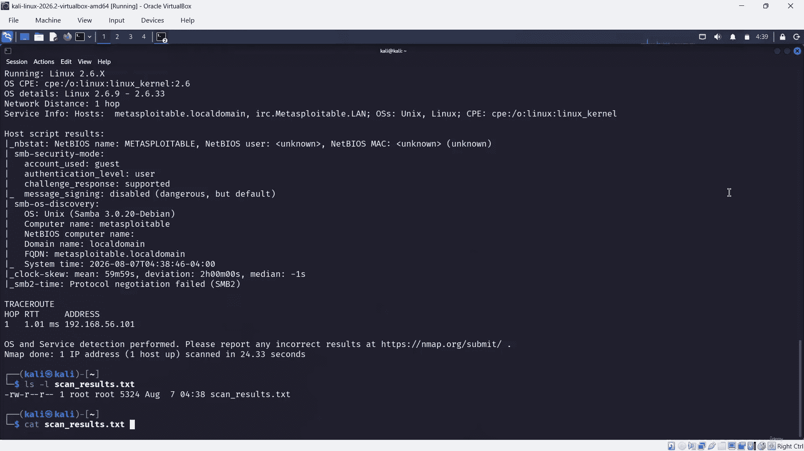
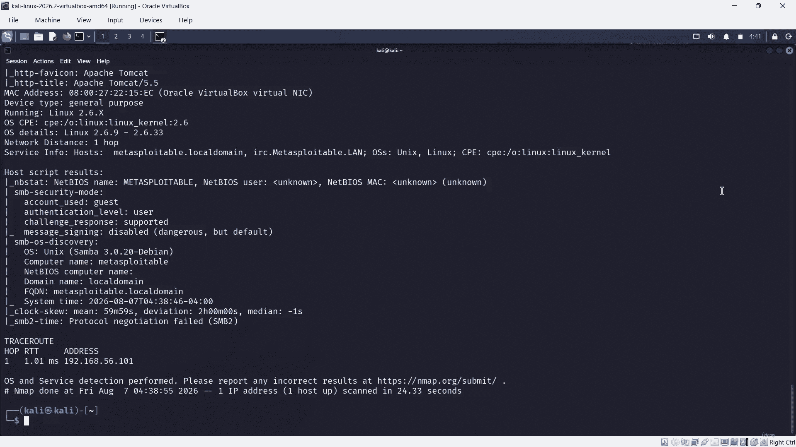

Ethical Hacking & Penetration Testing with Kali Linux：35：保存与记录扫描结果 📁

在本节课中我们将要学习如何把 Nmap 扫描的结果保存到文件中，而不是只让它显示在黑色的终端屏幕上。这听起来好像是一件非常简单的事情，甚至简单到好像不需要单独开一节课来讲，但实际上它非常重要，是每个渗透测试人员都必须养成的基本习惯。如果不保存扫描结果，你做完所有的工作之后可能什么也记不住，这在真实的安全项目里是不可接受的。

在之前的课程里，我们运行过的每一次扫描，结果都直接打印到了终端屏幕上。问题是，只要你滚动一下屏幕，或者不小心关掉了终端窗口，这些扫描结果就永远消失了，再也找不回来。如果你只是在家里练习，这可能不是什么大问题，但当你做真实的客户项目时，情况就完全不同了。专业的渗透测试工作需要留下书面痕迹，也就是所谓的证据链，而这条痕迹的起点就是把扫描输出保存成带有时间信息的文件。所以我们现在要重新运行上一节课讲过的那个激进扫描，不过这一次，我们要把扫描结果保存下来，以便以后查阅和使用。

接下来我们来看看具体该怎么操作。

以下是保存扫描结果的具体命令：
```bash
sudo nmap -sT -p- -sV -O -A <目标IP地址> -oN scan_results.txt
```
这里的 `-oN` 参数告诉 Nmap 把扫描输出以普通文本格式保存到文件里，文件名就是紧跟在后面的 `scan_results.txt`。这种保存方式下，文件里的内容和你在终端屏幕上看到的完全一样，不会有任何格式变化或信息丢失。扫描运行完成之后，结果就会被干净地写进这个永久文件中，供你以后随时打开查看，不用担心因为关闭了终端而丢失数据。



扫描结束后，我们需要确认文件到底有没有生成，并且看看里面的内容对不对。



以下是用来检查文件和读取内容的命令：
```bash
ls -l scan_results.txt
cat scan_results.txt
```
第一条命令 `ls -l` 用来列出文件的详细信息，让你确认 `scan_results.txt` 确实存在于当前目录里。第二条命令 `cat` 会把文件里的所有内容原样打印到屏幕上，你可以对比一下，发现它和刚才在终端里看到的扫描输出完全一致，没有任何内容被篡改或遗漏，只是被整齐地保存到了一个永久文件里，方便你以后反复查看和引用。



保存文件看起来是个小动作，但在实际工作中意义重大，我们来详细说说为什么。

以下是这个小习惯在真实渗透测试项目中的几个重要作用：
- 它会成为你后续撰写专业报告时的证据链的一部分。
- 当你在报告里声称某个端口是开放的，并且运行着某个特定的易受攻击服务版本时，这个保存的文件就是你的证明。
- 文件里记录的是原始、未经过编辑的扫描输出，能够有力地支持你的每一个发现结论。
- 没有客户，也没有雇主，愿意仅仅因为你说了句"我相信"就接受你的报告，他们都想看到实实在在的证据。

除了保存结果之外，给文件起一个好名字同样重要，下面我们聊聊命名规则。

以下是给扫描结果文件命名的实用建议：
- 文件名最好包含扫描目标和日期，这样一眼就能知道是针对哪个系统、哪一天扫描的。
- 避免总是覆盖同一个通用文件，比如永远只用 `scan_results.txt` 这个名字。
- 在真实项目中，你可能需要扫描多个目标，持续好几天，一套有条理、带日期的命名文件，是写报告时轻松自如和感到非常沮丧之间的真正区别。

好了，扫描和枚举模块的所有内容已经讲完了，我们来快速回顾一下。

以下是我们在本模块中一起学习的核心知识点：
- Nmap 的核心扫描类型和各种端口状态。
- 基础扫描，以及 SYN 扫描结合服务版本探测和全端口覆盖。
- 带操作系统检测和 NSE 脚本的全面激进扫描。
- 最后，如何正确保存扫描结果以便后续使用。

下一节模块中，我们将使用刚才保存的扫描输出，借助名为 OpenVAS 的专业漏洞扫描器，去寻找这些开放端口背后真正存在的漏洞。



本节课中我们一起学习了如何使用 Nmap 的 `-oN` 参数把扫描结果保存到文件，如何使用 `ls` 和 `cat` 命令确认并查看文件内容，以及为什么保存扫描输出是撰写专业渗透测试报告的重要基础。我们还回顾了本模块的全部扫描知识点，并简单展望了下一节漏洞扫描的内容。希望大家能养成保存扫描结果和合理命名文件的好习惯。
