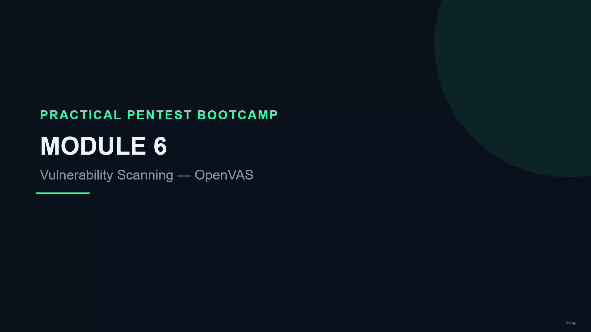
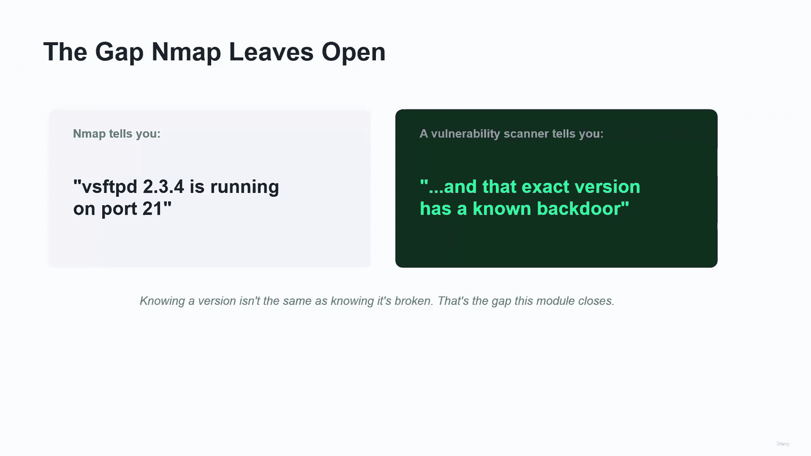
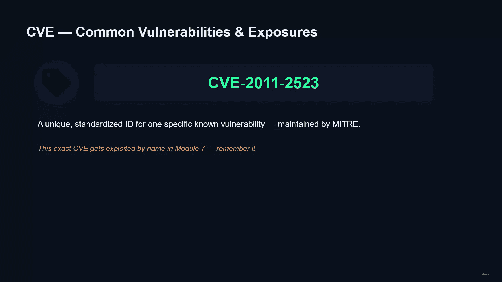
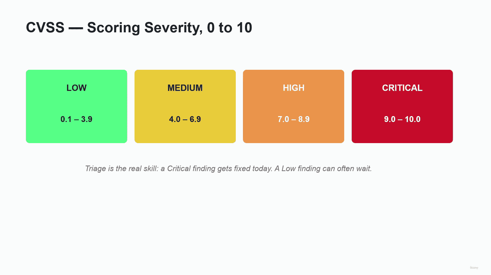
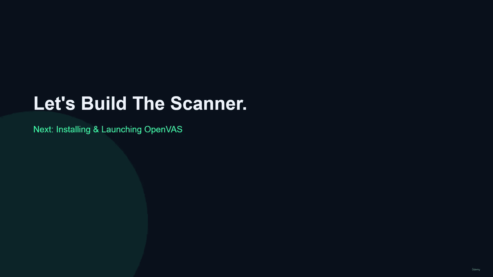

# 🔍 Ethical Hacking & Penetration Testing with Kali Linux：36：漏洞扫描器 CVE 与 CVSS 详解

## 概述



在本节课中，我们将要学习漏洞扫描器的基本概念，重点搞清楚 CVE 和 CVSS 这两个你在渗透测试职业生涯中会反复遇到的术语。我们会用最直白的大白话来解释，让你明白扫描器到底能帮我们自动完成什么，又不能帮我们做什么，避免把自动化结果当成最终结论。

## 漏洞扫描器是什么

上一节我们已经用 Nmap 探测出目标上哪些端口是开放的，现在需要搞清楚，这些开放的门后面到底哪些地方是真正坏掉的。这个问题和我们之前回答的问题完全不同。

漏洞扫描器是一种自动化工具。它会把我们用 Nmap 版本探测功能发现的具体服务版本，拿去和一个庞大、不断更新、记录在案的已知安全缺陷数据库进行比对。

以下是漏洞扫描器的具体工作方式：

- 手动研究：一个人逐个查看每个服务版本，如果目标上有几十个开放端口，这会花费非常长的时间。
- 自动扫描：漏洞扫描器自动批量完成查找工作，然后返回一个带有优先级的漏洞列表。

用一段简单的伪代码来描述它的核心逻辑：



```text
漏洞扫描器 = 自动化工具 × (已发现的服务版本 × 已知漏洞数据库) → 优先级漏洞列表
```

这种自动化确实能节省大量时间，但在学习这个模块时，我希望你同时记住两个想法。第一，相比于人工一个个去研究，这能节省大量时间；第二，同样重要的是，自动扫描的结果不等于已经确认可以利用的漏洞。

扫描器标记的是可能性，而专业渗透测试员的工作是核实这些可能性中，哪些在当前目标上是真实可利用的。我们会在整个模块中清楚地划定这条界限。

## CVE 是什么

刚才介绍完了漏洞扫描器的基本原理，接下来我们聊聊 CVE，因为在你从事这个领域的职业生涯中，会一直看到这个术语。

CVE 代表通用漏洞和披露（Common Vulnerabilities and Exposures），它是一个标准化的识别系统。你可以把它想象成公开已知安全缺陷的通用序列号。

每个 CVE 条目都有一个唯一标识符，格式如下：



```
CVE-年份-唯一编号
```

例如 `CVE-2011-2523`。从标识符本身就能立刻知道，这个特定缺陷是在 2011 年被编目的。

这个系统存在的目的，就是为了让不同的安全工具、不同的研究人员和不同的厂商，都能使用同一个通用名称来指代完全相同的底层缺陷，而不是每个人都为可能是同一个问题编造不一致的描述。

以下是 CVE 标识符的各个组成部分：

- `CVE`：固定前缀，表示通用漏洞和披露。
- `年份`：该漏洞被分配编号的年份。
- `唯一编号`：该年份下的唯一序列号。

## 漏洞严重性与 CVSS 评分

了解 CVE 之后，我们再谈谈漏洞的严重性。并不是每个漏洞都同样危险，把它们都当成同一级别来处理，在实际的专业工作中是一个真正的错误。

这时就要用到 CVSS 了，CVSS 代表通用漏洞评分系统（Common Vulnerability Scoring System）。它是一个标准化框架，根据诸如利用难度、是否首先需要身份验证、成功利用后的实际影响有多严重等因素，将每个漏洞评定为 0 到 10 之间的数值分数。

CVSS 分数的计算可以简化为下面这样：



```text
CVSS 分数 = f(利用难度, 是否需要认证, 实际影响程度) ∈ [0, 10]
```

你会在本课程的剩余部分，甚至在整个职业生涯中，看到几乎每个发现都附带这些标签。以下是通用的严重性分级：

- 低危：分数从 0.1 到 3.9，值得记录，但通常不紧急。
- 中危：分数从 4.0 到 6.9，值得在合理时间内修复，但通常不是紧急情况。
- 高危：分数从 7.0 到 8.9，确实需要尽快处理。
- 严重：分数从 9.0 到 10.0，这类发现在真实的专业项目中，往往足以让你立即给客户打电话，而不是仅仅等最终书面报告几天后发到客户邮箱。

你可能会问，这个评分系统在实际中为什么那么重要，而不仅仅是附在发现后面的一个数字？

假设一次真实的评估在客户网络中发现了 30 个独立问题，如果没有统一的评分系统，你或者收到报告的客户，都不知道在这 30 件事中应该先修哪一个。CVSS 为所有人提供了一种共享的、客观的语言，用于进行优先级讨论。

这就是为什么这个框架是整个领域中最实用的工具之一，也是为什么专业报告几乎总是先列出严重性，而不是简单地按发现顺序列出所有内容。

## OpenVAS 与实战过渡

讲完了 CVE 和 CVSS 的理论，我们来看看今天要用的工具。

OpenVAS 会自动将我们发现的目标服务与成千上万个已知 CVE 条目进行比对，并为每个发现自动分配 CVSS 分数。这相当于在几分钟内完成了原本需要几天才能完成的大量手动研究工作。

但是，请记住刚才说过的话：扫描器标记的是可能性。在第 7 模块，当我们进入实际利用阶段时，我们会取今天扫描中优先级最高的发现，亲自手动确认它们是否真实存在。这正是区分真正专业人士和仅仅转发自动化报告而不理解其含义的人的关键验证步骤。

## 本节总结



本节课中，我们一起学习了漏洞扫描器的定义和工作原理，理解了 CVE 如何用通用名称识别漏洞，也掌握了 CVSS 如何将漏洞严重性评为 0 到 10 分并划分为四个等级。下一节课，我们将安装将这两个系统自动应用到实验目标上的工具。

