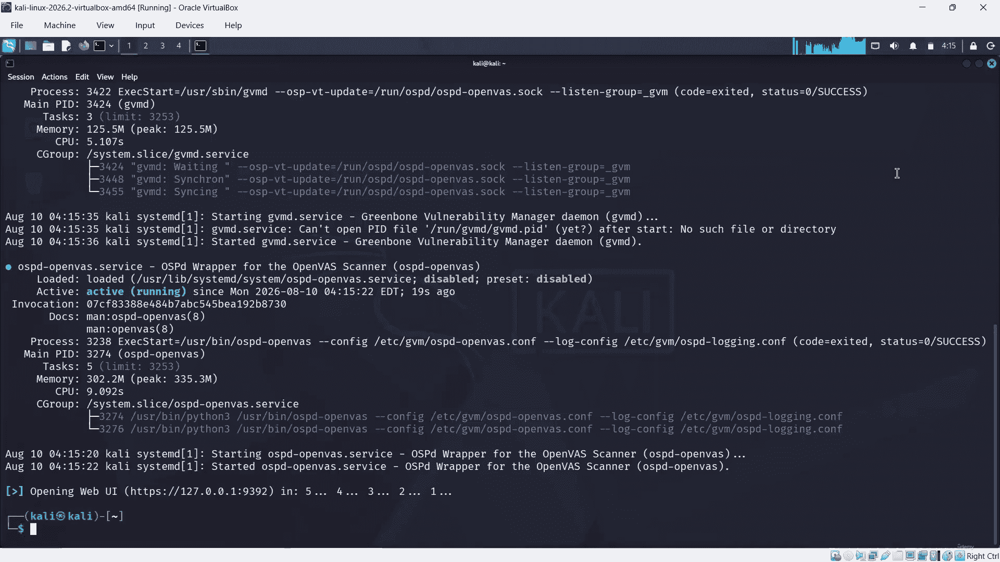
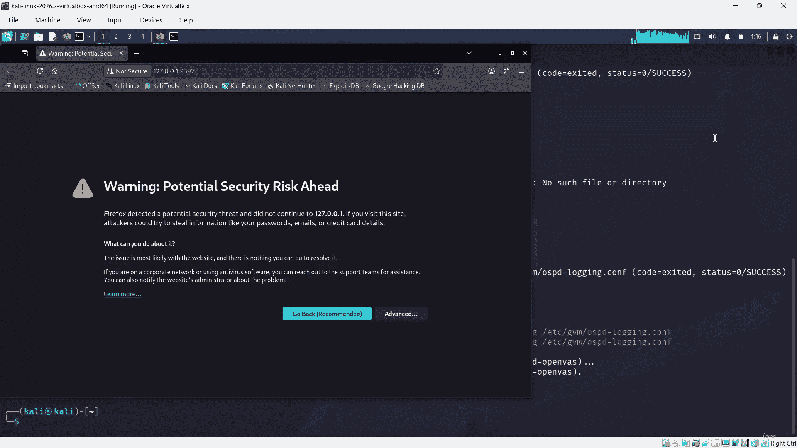

Ethical Hacking & Penetration Testing with Kali Linux：37：🛡️ 安装与启动 OpenVAS

在本节课中，我们将学习如何在 Kali Linux 系统上安装并启动 OpenVAS 漏洞扫描工具。OpenVAS 是一款常用于渗透测试的安全扫描器，能够帮助我们发现目标系统中的已知漏洞。整个安装过程比较漫长，主要是因为程序需要在后台下载并构建一个庞大的漏洞数据库，常常需要十五分钟甚至更久。我们不会让你干等着，而是会利用这段时间边等边讲解背后的原理，让你明白在等待的时候电脑里到底发生了什么。

首先，我们要准备系统环境，确保能下载到最新的软件包。

在安装任何工具之前，先运行更新命令是个好习惯。这样可以确保从 Kali 的软件仓库中拉取到最新的包信息，而不是意外安装到旧版本。

以下是需要执行的命令：
```bash
sudo apt update
```
回车后系统会要求输入密码，输入完成后等待更新过程结束。这一步本身不算太慢，但我们必须等它完成，才能继续安装真正的工具。

软件源更新完成后，接下来就是安装 OpenVAS 本体了。

在当前的 Kali 发行版中，这个工具通常被打包为 openvas。不过，根据你使用的具体版本，也可能显示为 GVM，全称是 Greenbone Vulnerability Management，也就是大多数人平时口语中所说的 OpenVAS 背后的正式项目名称。

以下是安装命令：
```bash
sudo apt install openvas -y
```
如果系统找不到 openvas 这个包名，可以尝试另一个名称：
```bash
sudo apt install gvm -y
```
这两个命令安装的是同一个底层工具，只是不同 Kali 版本之间的命名差异。执行命令后，系统会开始下载并安装相关组件，这时你可以先稍作等待。

在程序下载安装的同时，有必要先搞清楚 OpenVAS 到底是什么，而不是盲目地看着进度条。

OpenVAS 不是一个单一的程序，而是一套由多个组件协同工作的小型生态系统。我们可以用下面的公式来简单概划它的构成：

```
OpenVAS = 扫描引擎 + 管理组件 + Web 界面 + 漏洞馈送
```

各部分的作用如下：
- 扫描引擎：负责在网络层面执行实际的漏洞测试。
- 管理组件：负责协调扫描任务并保存扫描结果。
- Web 界面：是你直接操作和交互的控制面板。
- 漏洞馈送：一个巨大的、持续更新的漏洞测试数据库，有时也被称为 NVT（Network Vulnerability Tests），数量多达几万条。

下载和索引这个漏洞馈送，是整个安装过程中最耗时的部分，也就是你需要等待的主要原因。

等软件包本身安装完成之后，还需要运行一个初始化命令来把所有组件启动起来。

初始化命令如下：
```bash
sudo gvm-setup
```
这是今天课程中耗时最长的一步。根据你的网络速度和机器性能，这个过程可能需要五分钟，也可能长达十五分钟。我在这里如实告诉你这个时间，而不是假装它很快完成。

之所以需要这么久，是因为 gvm-setup 需要连接 Greenbone 的服务器，下载完整的漏洞馈送数据。如果没有真正的互联网连接，比如你之前在第四模块中配置的第二个 NAT 网络适配器没有正常工作，这一步会直接失败。

在等待初始化完成的这段时间，我们可以聊聊漏洞数据库是如何建立和维护的，理解这一点对初学者很有帮助。

全球的安全研究人员、厂商和机构会不断发现软件中的新漏洞。当一个漏洞被负责任地披露时，意味着发现者先向受影响的厂商报告，给厂商留出修复的时间，随后细节才会公开。这时候，该漏洞通常会被分配一个 CVE 编号，就像我们在上一节课中讨论过的那样，最后伴随技术细节一起发布。

OpenVAS 之类的工具会把这些公开的技术细节，转化成一条自动化测试。这条测试本质上是一个网络探测，旨在安全地检查目标是否运行了易受攻击的版本，而不会进行具有破坏性的实际利用。

把这个过程乘以成千上万个漏洞，再乘以几十年积累的安全研究，你就能理解为什么初始馈送下载需要花这么长时间。

初始化设置完成后，屏幕末尾会出现一条非常重要的信息，你不能错过。

当 gvm-setup 运行完毕，输出的末尾会显示一个自动生成的管理员密码。这一点非常关键，请立刻把这个密码复制下来并妥善保存。因为 OpenVAS 在此之后不会再次显示这个密码，而你稍后登录 Web 界面时一定会用到它。

有了密码之后，最后一步就是启动 OpenVAS 服务了。

启动服务的命令如下：
```bash
sudo gvm-start
```
输入密码确认后，等待服务启动。这一步比刚才的初始化设置要快得多，因为它只是启动已经配置好的服务，而不是从零开始构建任何东西。

当你看到服务成功启动的提示，就意味着整个安装过程全部完成了。我知道这一节内容偏长，其中包含大量等待时间，但正是这些基础工作，才让接下来的几节课成为可能。我们现在拥有一个运行正常的漏洞扫描器，并且拥有最新、全面的漏洞数据库支持。





本节课中，我们一起学习了如何在 Kali Linux 上更新软件源、安装 OpenVAS 或 GVM、运行初始化设置、理解漏洞馈送的构成、保存管理员密码，以及启动服务。下一节课，我们将首次打开 Web 界面，并进行登录。
