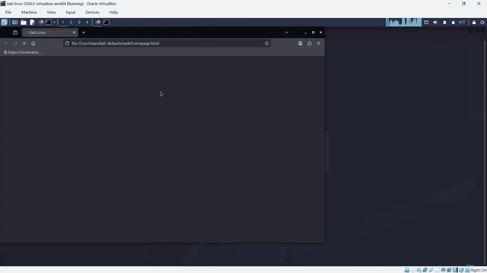
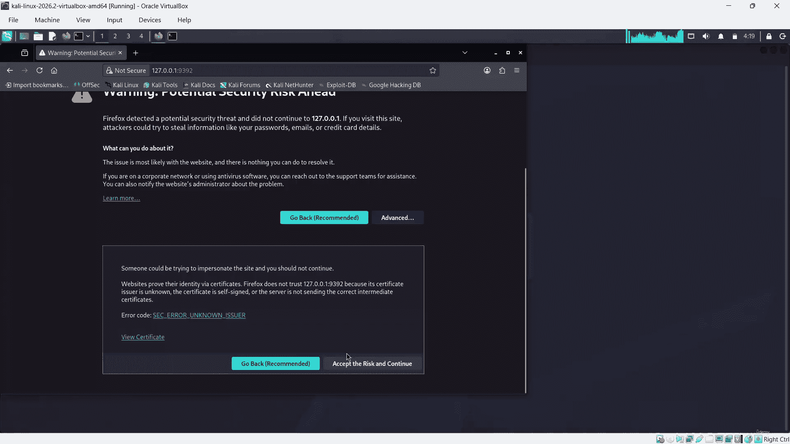
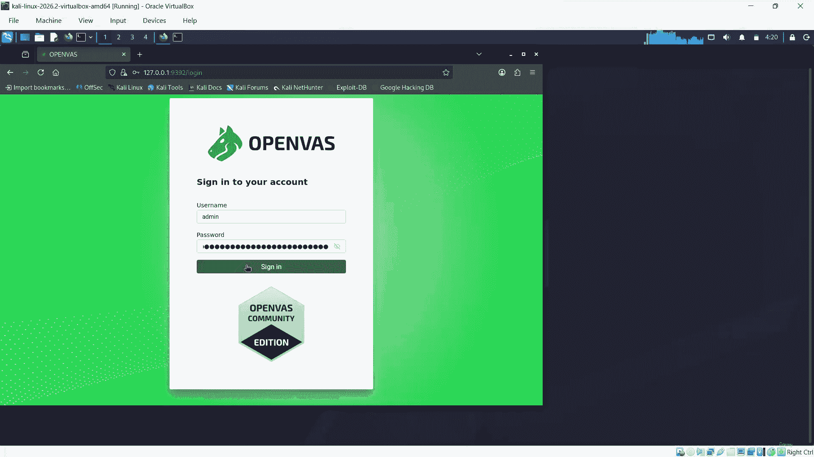
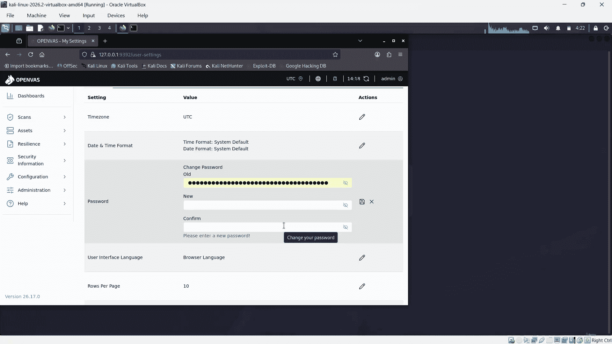

# 道德黑客与 Kali Linux 渗透测试：第 38 课：首次访问 OpenVAS Web 界面 🌐

## 本节课程概述

在本节课中，我们将一起学习如何第一次打开 OpenVAS 的 Web 管理界面，并完成登录操作。我们会讲解浏览器地址栏该输入什么，回顾本地回环地址的含义，解释为什么浏览器会弹出安全警告，然后使用管理员账号登录系统。登录之后，我们会简要浏览界面里的主要模块，并养成修改默认密码的好习惯。最后，我们会为下一节运行第一次漏洞扫描做好准备。

接下来，我们进入第一个具体步骤：打开浏览器并访问 OpenVAS 界面。



## 打开浏览器并访问 OpenVAS 界面

OpenVAS 默认以本地 Web 应用程序的形式运行，这意味着它只能从当前这台机器本身访问，外部目标无法直接连接。这样的安全策略正是我们希望强大安全工具在实验室环境中具备的特性。

我们要在地址栏输入的地址如下：

```text
https://127.0.0.1:9392
```

以下是这个地址每一部分的具体含义。

- `https`：使用安全传输协议访问 Web 界面。
- `127.0.0.1`：本地回环地址，代表这台当前机器本身，而不是任何外部目标。
- `9392`：OpenVAS Web 界面默认监听的端口号。

在模块 3 中我们简要接触过本地回环地址，它的作用就是让你访问本机上运行的服务。在这里，OpenVAS 就在本机监听 9392 端口，因此输入这个地址就能打开管理页面。

当你在地址栏输入完地址并按下回车后，接下来会遇到浏览器的安全提示。

## 处理浏览器安全证书警告

当你打开上面的地址后，浏览器很可能会显示一个警告页面，提示连接不是私密连接，或者证书不被信任。



这种情况完全正常，也完全可以预期。OpenVAS 在安装过程中会生成自签名证书，而不是使用公共证书颁发机构签发的证书。浏览器默认会把所有自签名证书标记为需要谨慎对待。

因为我们知道这个服务到底是什么，而且也是我们亲手安装的，所以可以安全地继续操作。具体做法是点击“高级”，然后接受风险并继续访问。

在处理完证书警告并继续访问之后，你就会来到登录页面。

## 使用管理员账号登录



在忽略证书警告并进入页面之后，你会看到 OpenVAS 的登录界面。

登录所需的信息如下：

- 用户名：`admin`
- 密码：在上一节课结束时仔细抄下的自动生成密码

输入用户名和密码后，点击登录按钮。密码通常比较长，请务必准确输入。登录成功之后，你就会进入 OpenVAS 的主控界面。

登录成功进入系统之后，我们需要花点时间认识眼前的界面。

## 熟悉 OpenVAS 主界面

这个 Web 界面的正式名称是 Greenbone Security Assistant，也就是 Greenbone 安全助手。虽然业内几乎所有人都把整个工具统称为 OpenVAS，但 Web 界面本身确实叫这个正式名称。

接下来我们要花几节课在这个界面里操作，所以先花点时间熟悉一下布局。界面顶部或侧边栏，取决于你使用的具体版本，会显示几个主要模块。

以下是各个主要模块的功能说明。

- `Dashboard`：控制面板，提供系统的高级概览。因为我们还没有运行任何扫描，现在页面几乎是空的。
- `Scans`：扫描模块，是我们接下来大部分时间会待的地方。在这里可以创建、配置和查看漏洞扫描任务。
- `Configuration`：配置模块，用于管理扫描目标、扫描配置和凭据等设置。

界面目前还比较简洁，主要就是这几个入口，你不需要一下子全部记住，跟着后面的课程逐步使用即可。

在熟悉完界面布局之后，还有一件非常重要的事情不能忘记。

## 修改默认管理员密码

在第一次使用 OpenVAS 时，有一个非常重要的实际操作习惯需要立刻建立起来。

不要一直依赖安装时自动生成的那串随机密码，而应该把它改成你自己容易记住的密码。否则以后很容易忘记当初把生成的密码记在了哪里。

修改密码的入口通常位于用户或管理菜单里，一般可以通过点击右上角的用户名进入。进入设置之后，你会看到“旧密码”、“新密码”和“确认新密码”三个字段。建议在记忆还新鲜的时候立即完成修改，不要拖到以后。

完成这一步之后，OpenVAS Web 界面就已经完全可以正常使用了。

到这里，OpenVAS 的 Web 界面已经全部搭建好并可以使用。下面我们来回顾一下本节课的主要内容。

## 本节课程总结



在本节课中，我们一起学习了如何通过浏览器访问 OpenVAS Web 界面，使用了 `https://127.0.0.1:9392` 地址，理解了本地回环地址和默认端口的含义，处理了自签名证书带来的浏览器警告，并使用管理员账号登录系统。我们还简要介绍了控制面板、扫描和配置三个主要模块，并强调了尽快修改默认管理员密码的重要性。下一节课，我们将把这套环境用起来，针对 Metasploitable2 运行第一次真正的漏洞扫描。

