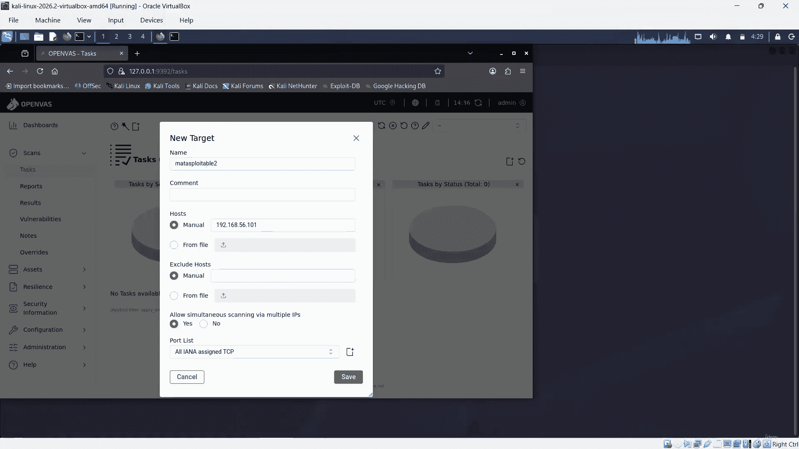
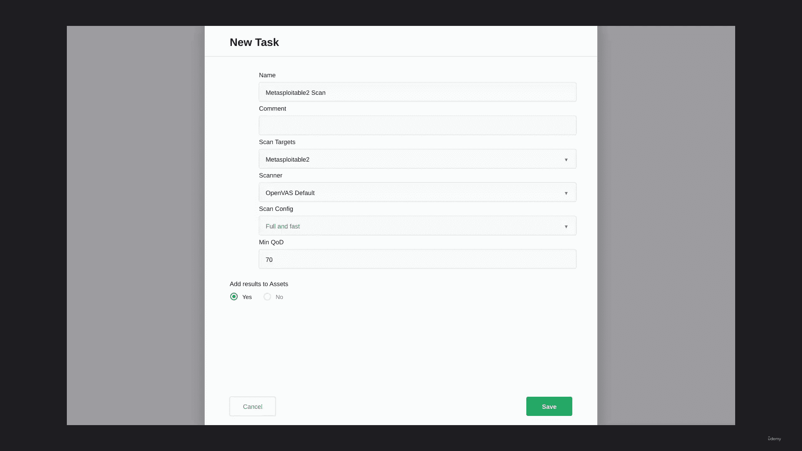
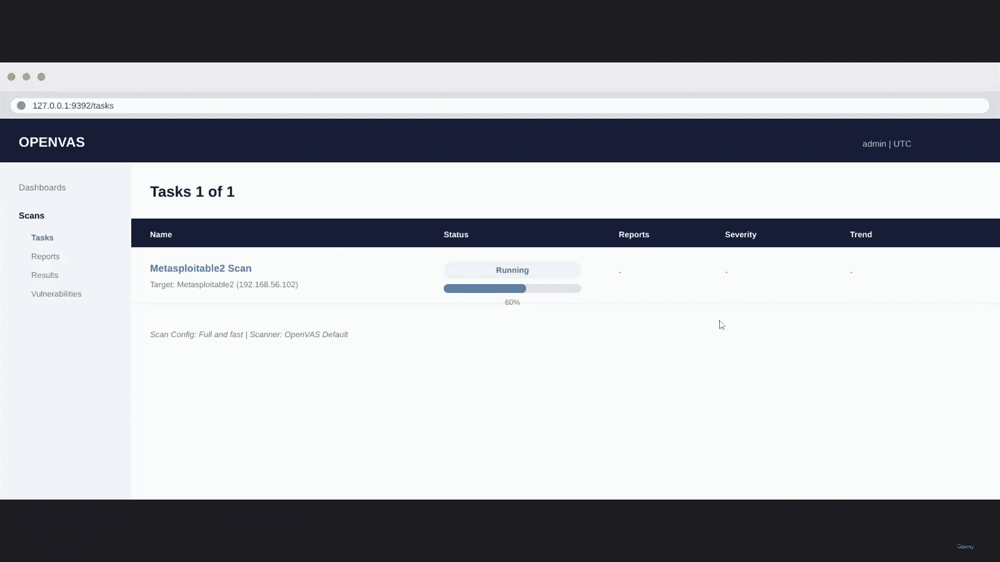

# Ethical Hacking & Penetration Testing with Kali Linux：39：Running Vulnerability Scan 🔍

在本节课中，我们将学习如何在 Kali Linux 的 Web 界面里运行第一个漏洞扫描任务。前面的章节已经把环境搭建好了，现在正是让之前的准备工作派上用场的时候。我们会一起创建扫描任务、添加目标机器，并启动扫描。除了具体操作步骤，我也会用大白话解释 OpenVAS 在后台到底在做什么，为什么扫描需要花那么久，以及以后怎么给扫描任务起名字才不会把自己搞糊涂。

## 39.1 创建新的扫描任务

上一节我们完成了环境准备，本节中我们来看看如何在 Web 界面里新建一个扫描任务。

现在，一切设置都已经就绪，这节课就是让之前的准备工作真正发挥作用的时候。打开 Web 界面后，首先要做的就是进入“任务”页面，然后点击“创建新任务”按钮。这听起来很简单，但第一次填写表单时，每一个字段都值得仔细对待，因为配置得当的任务才是产生有用、可读扫描结果的前提。

以下是创建任务时需要填写的关键字段：

- 任务名称：使用清晰的描述性名称，例如 `Meta_supply_table_Scan`，而不是留作默认的“未命名”或“新任务”。
- 扫描目标：稍后单独创建并关联，不要直接在任务里随便填一个 IP 地址。

为什么要这么强调命名规范？因为等过一个月你再回到这个界面，可能会看到一大堆保存的扫描任务摆在那里。如果它们全都叫“未命名”或者“新任务 1”“新任务 2”，你很快就会分不清哪个是哪个。从你的第一次扫描开始就养成清晰命名的习惯，能省掉后来不少真正的困惑。

从命名角度看，一个合格的任务名称可以用这个公式来理解：
`任务名称 = 项目或目标标识 + 扫描类型 + 日期或版本`

## 39.2 添加扫描目标机器

任务名称确定之后，本节中我们来看看如何为这个任务指定要扫描的目标机器。

接下来，你需要告诉扫描器到底要扫哪一台机器。在 OpenVAS 里，目标是一个单独保存的对象，而不是直接把 IP 地址敲进任务表单里就完事。也就是说，你要先点击“创建新目标”，把目标对象建好，再把它关联到扫描任务中。这样做的好处是目标可以被重复使用，不需要每次新建任务都重新输入 IP。



以下是创建目标时的操作要点：

- 目标名称：保持和任务名称风格一致，比如 `meta_target_2`。
- 主机字段：直接输入目标机器的 IP 地址，在这里是 `192.168.56.101`。

保存目标后，你会看到一个完成的表单。不同操作系统或工具版本弹出的对话框可能长得不一样，但核心内容是一样的：目标名称和目标 IP 地址。填好之后，点击保存，然后就可以启动这个扫描任务了。

在 OpenVAS 中，目标对象的基本结构可以简化表示为：
```
目标对象 {
    名称: 字符串
    主机: IP地址或主机名
}
```

## 39.3 启动扫描并预估所需时间

目标对象准备好了以后，本节中我们来看看启动扫描后需要等待多久，以及为什么等待时间会这么长。

保存任务和目标之后，现在可以点击开始按钮，让扫描真正跑起来。不过在此之前，我得先跟你打个预防针。针对单台目标机器的完整 OpenVAS 扫描，可能真正需要 20 分钟，甚至超过一小时才能完成。具体时长取决于目标上开了多少服务，以及每个单独测试需要多么彻底。

这个时长跟我们在第 5 模块里用 Nmap 做的扫描完全不可同日而语，这也是完全预期的正常差异。Nmap 本质上是做发现，快速扫出有哪些端口开放；而 OpenVAS 本质上是做深度，它要对每一个发现的服务，去跑成千上万个针对特定漏洞的检查，一项一项来。

扫描耗时可以用下面这个简单公式来粗略估算：
`扫描耗时 ≈ 开放服务数量 × 每个服务的漏洞检查数量 × 单次检查平均耗时`



启动任务后，你会在界面上看到一个蓝色的进度条，比如可能会停留在 60% 的位置稳步攀升。这正是扫描正在进行中的样子，你在自己的屏幕上也会看到类似的进度显示。

## 39.4 OpenVAS 在后台实际做了什么

扫描开始运行以后，本节中我们来看看 OpenVAS 在进度条背后到底在做些什么。

趁扫描还在跑，我利用这段时间给你讲讲 OpenVAS 工作原理中真正有用的部分。对于 Nmap 找到的目标上的每一个开放端口，OpenVAS 都会在自己的庞大漏洞测试库里，系统地逐一过一遍。它会检查每个测试是否专门适用于那台机器上实际运行的服务和版本。

其中很多单独的测试，涉及 OpenVAS 发送一个精心设计的、通常是安全的探测数据包，然后观察返回的具体响应。这个响应可能是某个特定的错误消息、一个特定的响应头，或者是极其细微的时序差异。根据这些反馈，OpenVAS 就能判断底层漏洞是否真的存在，而不需要真的去利用漏洞做破坏性操作，只为了确认漏洞是否存在。

OpenVAS 检测漏洞的基本逻辑可以表示为：
```
对于每个开放端口:
    对于每个漏洞测试用例:
        发送安全探测
        接收响应
        如果响应匹配已知漏洞特征:
            标记为潜在漏洞
```

## 39.5 下一课预告与本节小结

扫描原理讲清楚了以后，本节中我们来看看接下来的内容，并简单总结一下今天学到的知识。

下一节课，我们会打开扫描完成后的实际结果，学习怎么读懂 OpenVAS 找到的所有漏洞，以及怎么按照优先级来处理这些发现。



在本节课中，我们一起学习了如何在 Kali Linux 的 Web 界面中新建漏洞扫描任务，如何创建并保存扫描目标，如何启动扫描并预估完成时间，以及 OpenVAS 在后台如何逐个检测服务漏洞。希望这些内容能帮你顺利跑完第一次漏洞扫描，并在后续的学习中少走弯路。
