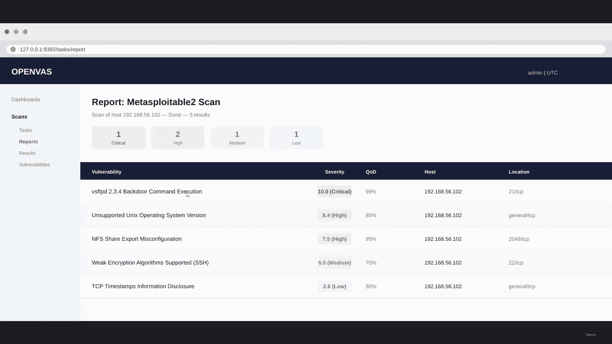
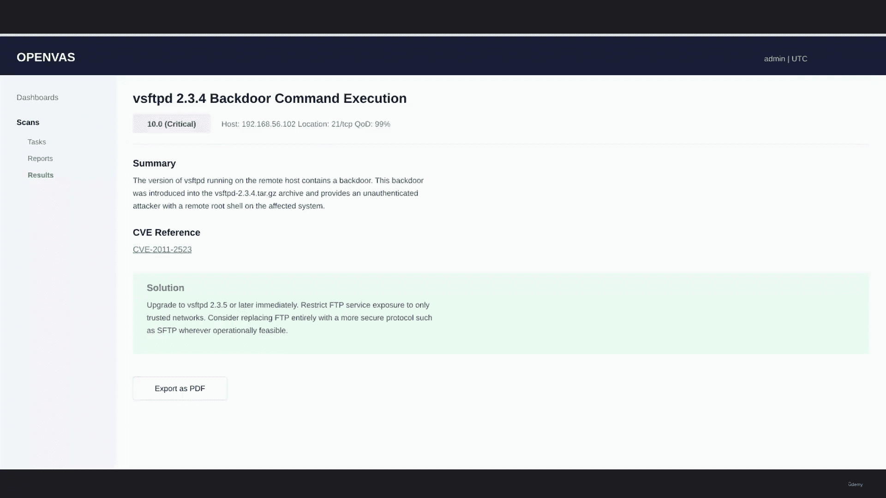

# 🛡️ 道德黑客与 Kali Linux 渗透测试：40：读取扫描结果


在本节课中我们将要学习扫描完成之后如何打开和阅读扫描报告。我们会先查看任务列表，理解报告中包含的大量发现项，并学习如何按严重程度排序。随后我们会重点分析严重和高危漏洞，查看单个发现项的详细结构，包括 CVSS 评分、CVE 编号和修复建议。最后我们会讨论误报问题，并了解为什么在专业渗透测试中必须人工确认扫描结果。


上一节我们介绍了如何启动漏洞扫描，本节中我们来看看扫描结束后报告长什么样。

打开报告的方法很简单。你需要进入任务列表，然后直接点击一个已完成的扫描任务。点击之后系统会直接带你进入该扫描任务的完整报告页面。这就是进入报告页面后的样子。

报告里包含大量信息。即使是像 Metasploitable 2 这样故意制造漏洞的靶机，也会产生成百上千条单独的发现项。系统会把这些发现项浓缩成一个清晰的摘要，方便你快速浏览。

以下是打开报告后需要进行的操作步骤：
- 进入任务列表页面
- 找到状态为已完成的扫描任务
- 直接点击该任务名称
- 等待系统加载完整报告页面


接下来我们要看如何整理这些扫描结果。报告中默认可能没有按照危险程度排序，你需要手动点击表头中的“严重程度”列来完成排序。点击这一列之后，系统会立即对所有发现项进行重新排列。

实际上，你现在看到的列表已经按严重程度从高到低排好了。每条发现项旁边都会显示我们在理论课中讲过的 CVSS 评分，方便你一眼看出漏洞的危险等级。

每条发现项旁边还会带有颜色编码的严重程度标签，这些标签对应我们之前讲过的危险等级带，分别是：严重、高危、中危、低危。

核心概念可以用下面的公式表示：



```
严重程度排序：最严重 → 高危 → 中危 → 低危
CVSS 评分显示位置：每条发现项右侧
```


让我们具体来看看标记为严重或高危的发现项。这些发现项正是在真实专业渗透测试任务中需要优先处理的问题，因为它们最可能构成紧急安全威胁。

在像 Metasploitable 2 这样故意充满已知漏洞的靶机上，你通常会看到一个非常长的发现列表。列表顶部通常会出现我们在模块 5 的版本扫描中已经提到过的 VSFTPD 后门。除此之外，你还会看到配置错误的 NFS 共享，以及各种过时未修补的服务版本，这些通常都被标记为严重。

以下是你在严重和高危区域中常见的发现项类型：
- VSFTPD 后门
- 配置错误的 NFS 共享
- 过时且未打补丁的服务版本


现在我们点击其中某一条具体的发现项，来看看 OpenVAS 实际上提供了哪些细节。

在单个发现项的详情页面顶部附近，你会看到发现项的名称和其 CVSS 评分，并且以醒目方式显示。名称下方是摘要部分，用通俗的语言解释这个漏洞到底是什么。页面往下还会直接引用该漏洞对应的 CVE 编号，这正是我们在本模块第一节课中讲过的命名系统。

点击 CVE 编号通常会直接跳转到官方公共 CVE 数据库的条目页面，提供更多技术细节。在页面底部附近，你会找到修复方案部分，给出如何实际修复这个问题的具体指导。修复方案下方有一个导出按钮，用于保存报告。

以下是单个发现项页面的典型结构：
- 发现项名称 + CVSS 评分（页面顶部显著位置）
- 漏洞摘要部分（用通俗语言说明漏洞内容）
- CVE 编号及官方数据库链接
- 修复方案部分（给出具体修复指导）
- 导出报告按钮（位于修复方案下方）

核心概念可以用下面的代码块表示：

```
发现项详情结构：
  名称: VSFTPD 后门
  CVSS 评分: 10.0
  CVE 编号: CVE-XXXX-XXXX
  修复方案: 升级服务或应用补丁
```


我想真诚地感谢这个修复方案部分，因为它是整个报告中最具实践价值的部分之一。

原因如下。修复方案文本几乎就是你未来专业报告中已经写好的内容。当我们走到课程末尾的 capstone 课程，一起构建真实报告时，绝大部分实际写作工作都将是改写类似这个发现项所提供的文本。你不需要为每一条发现项完全从零开始搜索和撰写修复建议，而是可以直接在扫描工具提供的基础上进行调整和润色。

这意味着扫描报告不仅是发现问题的工具，更是报告撰写的素材库。


让我们简要谈谈一个对专业信誉非常重要的问题：误报。扫描器报告的每一条发现项，并不一定在每个具体场景下都准确无误。自动化工具偶尔会误识别服务版本，或者根据一个具有误导性的横幅信息将某个东西标记为易受攻击。

这就是为什么在真实的专业实践中，渗透测试人员会手动审查，并在可能的情况下确认重大发现项，而不是直接把一份原始的自动化报告完整转发给客户，而不加任何人工判断。

我们将在模块 7 中亲手实践这种人工确认过程。届时我们会挑选其中几条最高严重程度的发现项，亲自去利用它们，确凿地证明它们是真实存在的，而不只是理论上的漏洞。


下一节模块我们将停止扫描，开始进行利用。我们会拿出今天扫描中优先级最高的发现项，从那个我们已经被标记过两次的 VSFTPD 后门开始——一次是由 Nmap 版本探测标记的，另一次是由 OpenVAS 直接标记的。然后我们会使用 Metasploit 框架，将这些发现项转化为实际确认的访问权限。下一节课见。




本节课中我们一起学习了扫描完成后如何打开报告，如何按严重程度排序发现项，以及如何查看单个发现项的详细结构，包括 CVSS 评分、CVE 编号和修复方案。我们还讨论了误报问题，并理解了人工确认在专业渗透测试中的重要性。下一节课我们将进入利用阶段，使用 Metasploit 对高危漏洞进行实际验证。
